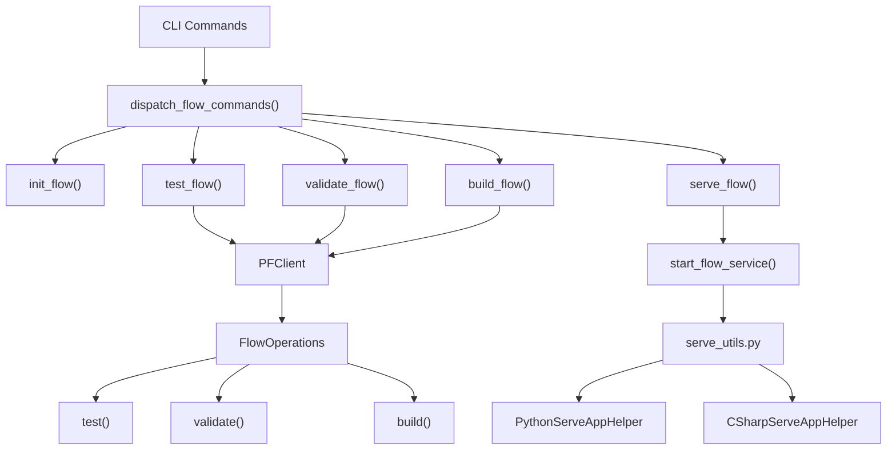
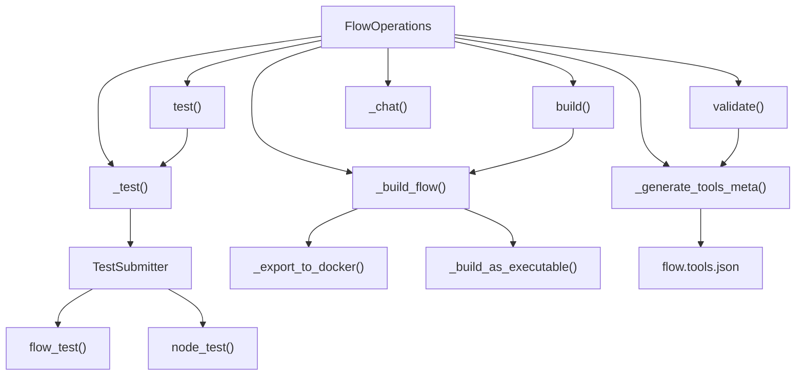
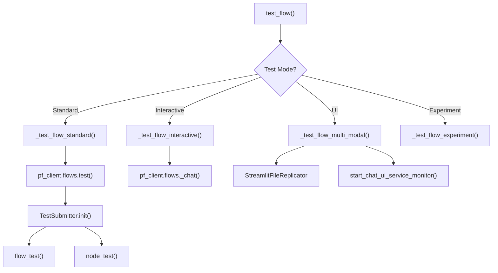
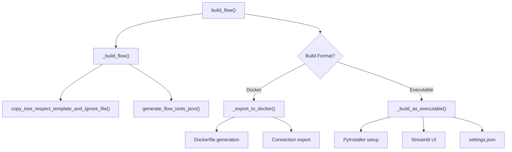
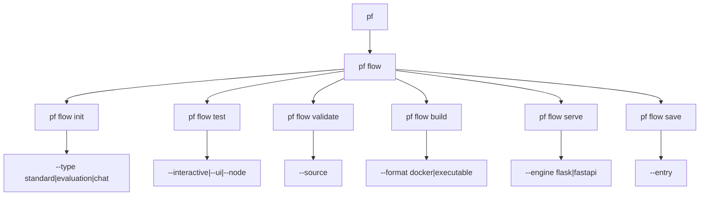
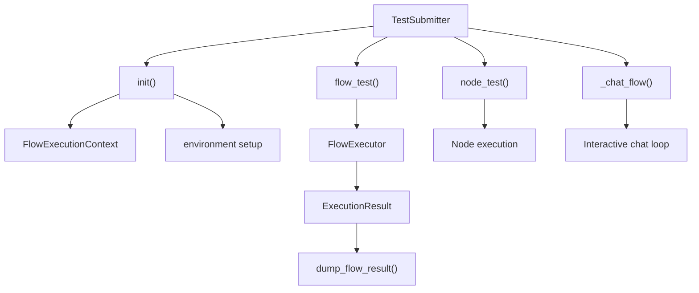
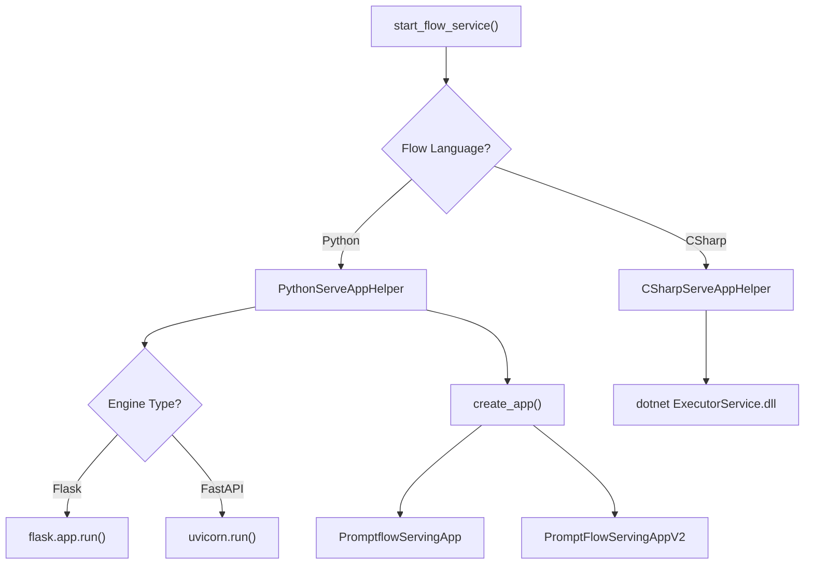

<!-- source: DeepWiki mcp.deepwiki.com · repo microsoft/promptflow · page 3.1 Flow Operations · fetched 2026-10-26 -->

# Flow Operations

Relevant source files

The following files were used as context for generating this wiki page:

- [docs/cloud/azureai/create-run-with-compute-session.md](docs/cloud/azureai/create-run-with-compute-session.md)
- [docs/cloud/azureai/manage-flows.md](docs/cloud/azureai/manage-flows.md)
- [docs/cloud/azureai/run-promptflow-in-azure-ai.md](docs/cloud/azureai/run-promptflow-in-azure-ai.md)
- [docs/cloud/azureai/runtime-change-log.md](docs/cloud/azureai/runtime-change-log.md)
- [docs/cloud/azureai/use-flow-in-azure-ml-pipeline.md](docs/cloud/azureai/use-flow-in-azure-ml-pipeline.md)
- [docs/cloud/index.md](docs/cloud/index.md)
- [docs/media/cloud/azureml/llmops_cloud_value.png](docs/media/cloud/azureml/llmops_cloud_value.png)
- [docs/media/cloud/manage-flows/flow_create_2.png](docs/media/cloud/manage-flows/flow_create_2.png)
- [docs/media/cloud/runtime-change-log/runtime-version.png](docs/media/cloud/runtime-change-log/runtime-version.png)
- [docs/media/trace/trace-ui-portal-demo.gif](docs/media/trace/trace-ui-portal-demo.gif)
- [docs/reference/pf-command-reference.md](docs/reference/pf-command-reference.md)
- [docs/reference/pfazure-command-reference.md](docs/reference/pfazure-command-reference.md)
- [examples/configuration.ipynb](examples/configuration.ipynb)
- [scripts/json_schema/FlexFlow.schema.json](scripts/json_schema/FlexFlow.schema.json)
- [src/promptflow-core/promptflow/_core/entry_meta_generator.py](src/promptflow-core/promptflow/_core/entry_meta_generator.py)
- [src/promptflow-core/promptflow/_core/tool_meta_generator.py](src/promptflow-core/promptflow/_core/tool_meta_generator.py)
- [src/promptflow-core/promptflow/core/_serving/app.py](src/promptflow-core/promptflow/core/_serving/app.py)
- [src/promptflow-devkit/promptflow/_cli/_pf/_flow.py](src/promptflow-devkit/promptflow/_cli/_pf/_flow.py)
- [src/promptflow-devkit/promptflow/_sdk/_orchestrator/__init__.py](src/promptflow-devkit/promptflow/_sdk/_orchestrator/__init__.py)
- [src/promptflow-devkit/promptflow/_sdk/_utilities/chat_utils.py](src/promptflow-devkit/promptflow/_sdk/_utilities/chat_utils.py)
- [src/promptflow-devkit/promptflow/_sdk/_utilities/serve_utils.py](src/promptflow-devkit/promptflow/_sdk/_utilities/serve_utils.py)
- [src/promptflow-devkit/promptflow/_sdk/data/executable/main.py](src/promptflow-devkit/promptflow/_sdk/data/executable/main.py)
- [src/promptflow-devkit/promptflow/_sdk/operations/_flow_operations.py](src/promptflow-devkit/promptflow/_sdk/operations/_flow_operations.py)
- [src/promptflow-devkit/promptflow/_sdk/schemas/_flow.py](src/promptflow-devkit/promptflow/_sdk/schemas/_flow.py)
- [src/promptflow-devkit/tests/sdk_cli_test/e2etests/test_executable.py](src/promptflow-devkit/tests/sdk_cli_test/e2etests/test_executable.py)
- [src/promptflow-devkit/tests/sdk_cli_test/unittests/test_flow_serve.py](src/promptflow-devkit/tests/sdk_cli_test/unittests/test_flow_serve.py)
- [src/promptflow-devkit/tests/sdk_cli_test/unittests/test_flow_serve_cli.py](src/promptflow-devkit/tests/sdk_cli_test/unittests/test_flow_serve_cli.py)
- [src/promptflow/tests/test_configs/flows/web_classification_invalid/convert_to_dict.py](src/promptflow/tests/test_configs/flows/web_classification_invalid/convert_to_dict.py)
- [src/promptflow/tests/test_configs/flows/web_classification_invalid/flow.dag.yaml](src/promptflow/tests/test_configs/flows/web_classification_invalid/flow.dag.yaml)
- [src/promptflow/tests/test_configs/functions/class_init_complicated_ports/hello.py](src/promptflow/tests/test_configs/functions/class_init_complicated_ports/hello.py)
- [src/promptflow/tests/test_configs/prompty/single_prompty/prompty_example.prompty](src/promptflow/tests/test_configs/prompty/single_prompty/prompty_example.prompty)

Flow Operations encompasses the core functionality for managing, testing, validating, building, and serving prompt flows through both command-line interface (CLI) and software development kit (SDK) interfaces. This page covers the operational aspects of working with flows after they have been created.

For information about flow types and their definitions, see [Flow Types](#4). For run management operations, see [Run Management](#3.2). For connection management, see [Connection Management](#3.3).

## Overview

The Flow Operations system provides five primary operations that can be performed on flows:

| Operation | Purpose | CLI Command | SDK Method |
|-----------|---------|-------------|------------|
| **Test** | Execute a flow or individual nodes with test inputs | `pf flow test` | `FlowOperations.test()` |
| **Validate** | Check flow syntax and generate metadata | `pf flow validate` | `FlowOperations.validate()` |
| **Build** | Package flow for deployment (Docker/executable) | `pf flow build` | `FlowOperations.build()` |
| **Serve** | Host flow as HTTP endpoint | `pf flow serve` | `start_flow_service()` |
| **Init** | Create new flow from templates | `pf flow init` | N/A |

Sources: [src/promptflow-devkit/promptflow/_sdk/operations/_flow_operations.py:71-851](), [docs/reference/pf-command-reference.md:16-351]()

## Architecture

### CLI to SDK Flow

**CLI Command Dispatch Flow**

Sources: [src/promptflow-devkit/promptflow/_cli/_pf/_flow.py:72-85](), [src/promptflow-devkit/promptflow/_cli/_pf/_flow.py:453-667]()

### Flow Operations Class Structure

**FlowOperations Method Dependencies**

Sources: [src/promptflow-devkit/promptflow/_sdk/operations/_flow_operations.py:71-851](), [src/promptflow-devkit/promptflow/_sdk/_orchestrator/__init__.py:1-12]()

## Core Operations

### Flow Testing

The `test` operation executes a flow or individual nodes with specified inputs. It supports multiple test modes including interactive chat, UI mode, and standard execution.

**Key Components:**
- `FlowOperations.test()` - Main SDK interface
- `TestSubmitter` - Orchestrates flow execution
- Support for variants, environment variables, and initialization parameters

**Test Modes:**
- **Standard**: Execute flow with inputs and return outputs
- **Interactive**: Chat mode for conversational flows  
- **UI**: Browser-based chat interface
- **Node**: Test individual flow nodes
- **Experiment**: Internal feature for testing flow variants

**Flow Test Mode Selection**

Sources: [src/promptflow-devkit/promptflow/_cli/_pf/_flow.py:453-593](), [src/promptflow-devkit/promptflow/_sdk/operations/_flow_operations.py:78-167]()

### Flow Validation

The `validate` operation checks flow syntax, validates tool definitions, and generates the `flow.tools.json` metadata file required for Azure ML pipeline integration.

**Validation Process:**
1. Load and parse flow definition
2. Generate tools metadata for DAG flows
3. Validate tool schemas and connections
4. Create `flow.tools.json` in `.promptflow` directory

**Key Methods:**
- `FlowOperations.validate()` - Main validation entry point
- `FlowOperations._generate_tools_meta()` - Creates tool metadata
- `ValidationResult` - Contains validation errors and warnings

Sources: [src/promptflow-devkit/promptflow/_sdk/operations/_flow_operations.py:803-850](), [src/promptflow-devkit/promptflow/_sdk/operations/_flow_operations.py:852-907]()

### Flow Building

The `build` operation packages flows for deployment in two formats: Docker containers and standalone executables.

**Build Formats:**
- **Docker**: Creates containerized flow with Dockerfile, connections, and dependencies
- **Executable**: Generates standalone executable using PyInstaller with embedded UI

**Build Process:**
1. Copy flow files to output directory
2. Resolve additional includes and variants
3. Export connection configurations
4. Generate format-specific deployment assets

**Flow Build Process**

Sources: [src/promptflow-devkit/promptflow/_sdk/operations/_flow_operations.py:702-782](), [src/promptflow-devkit/promptflow/_sdk/operations/_flow_operations.py:519-546]()

### Flow Serving

The `serve` operation hosts flows as HTTP endpoints with support for both Flask and FastAPI engines. It includes automatic browser launching and real-time chat interfaces.

**Serving Components:**
- `start_flow_service()` - Main serving entry point
- `PythonServeAppHelper` - Python flow serving
- `CSharpServeAppHelper` - C# flow serving
- Support for static files, environment variables, and initialization parameters

**Engines Supported:**
- **Flask**: Default serving engine with CORS support
- **FastAPI**: Alternative engine requiring uvicorn

Sources: [src/promptflow-devkit/promptflow/_sdk/_utilities/serve_utils.py:243-352](), [src/promptflow-devkit/promptflow/_cli/_pf/_flow.py:595-610]()

### Flow Initialization

The `init` operation creates new flows from built-in templates or existing code. It supports standard, evaluation, and chat flow types.

**Initialization Modes:**
- **Template-based**: Create from built-in flow templates
- **Code-based**: Convert existing Python functions to flows
- **Interactive**: Prompt user for flow configuration

**Flow Templates:**
- **Standard**: Basic processing flow
- **Evaluation**: Flow for evaluating other flows  
- **Chat**: Conversational flow with chat history

Sources: [src/promptflow-devkit/promptflow/_cli/_pf/_flow.py:337-451](), [src/promptflow-devkit/promptflow/_cli/_pf/_flow.py:87-132]()

## CLI Command Structure

### Command Hierarchy

**CLI Command Structure**

Sources: [docs/reference/pf-command-reference.md:16-351](), [src/promptflow-devkit/promptflow/_cli/_pf/_flow.py:55-85]()

### Parameter Patterns

Flow operations follow consistent parameter patterns across CLI commands:

| Parameter Type | Examples | Usage |
|----------------|----------|-------|
| **Source** | `--flow`, `--source` | Specify flow directory or file |
| **Input** | `--inputs`, `--input` | Provide test input data |
| **Configuration** | `--environment-variables`, `--init` | Runtime configuration |
| **Output** | `--output`, `--detail` | Control output behavior |
| **Execution** | `--variant`, `--node` | Control execution scope |

Sources: [src/promptflow-devkit/promptflow/_cli/_params.py](), [docs/reference/pf-command-reference.md:88-351]()

## Integration Points

### TestSubmitter Integration

The `TestSubmitter` class orchestrates flow execution across all test modes:

**TestSubmitter Flow Execution**

Sources: [src/promptflow-devkit/promptflow/_sdk/operations/_flow_operations.py:285-317](), [src/promptflow-devkit/promptflow/_sdk/_orchestrator/__init__.py:1-12]()

### Serving Architecture

The serving system supports multiple languages and engines through a pluggable helper architecture:

**Flow Serving Architecture**

Sources: [src/promptflow-devkit/promptflow/_sdk/_utilities/serve_utils.py:69-352](), [src/promptflow-core/promptflow/core/_serving/app.py:8-51]()

---

