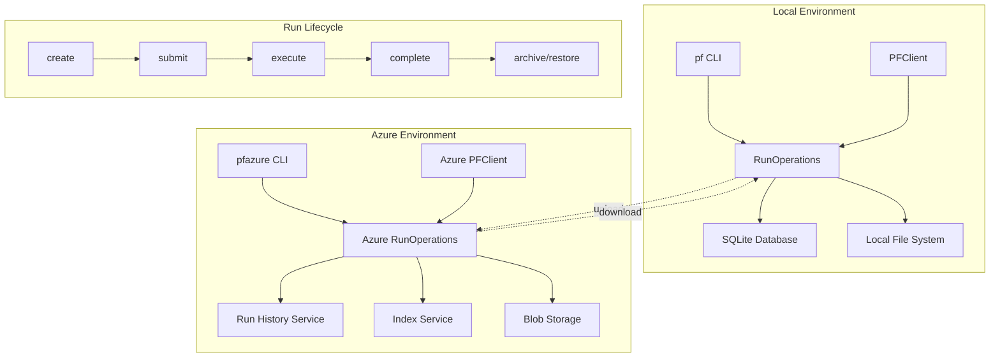
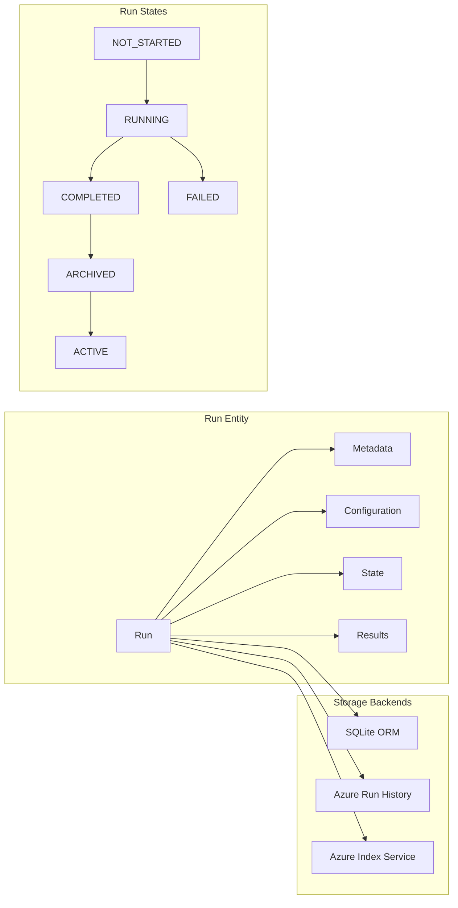
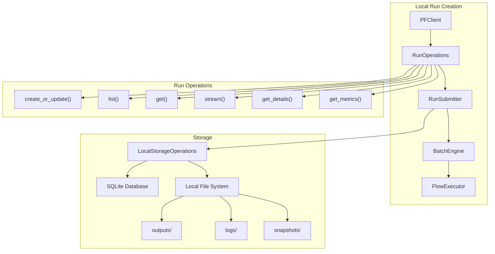
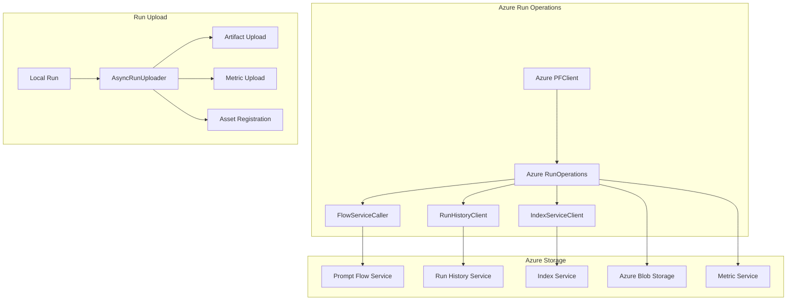
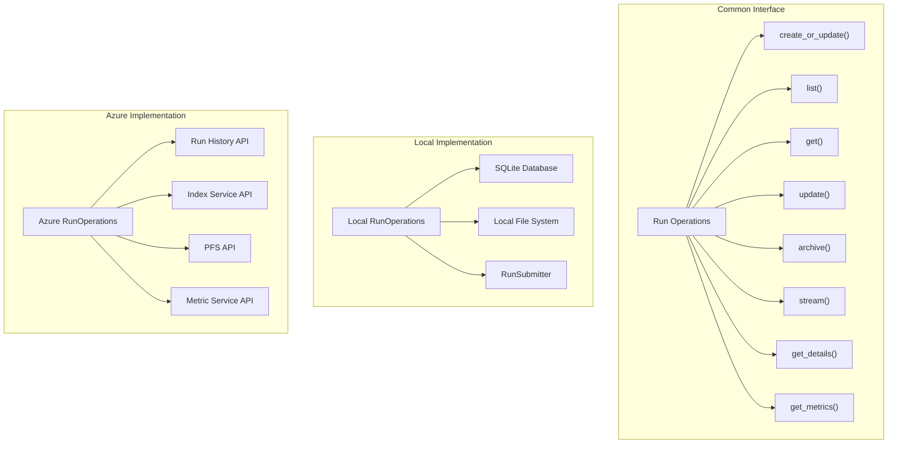
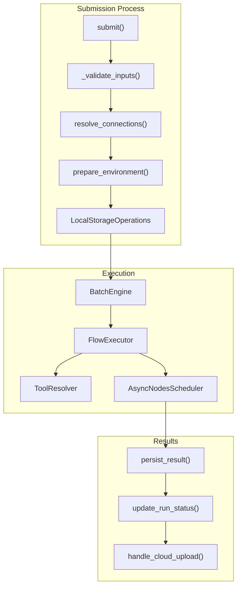
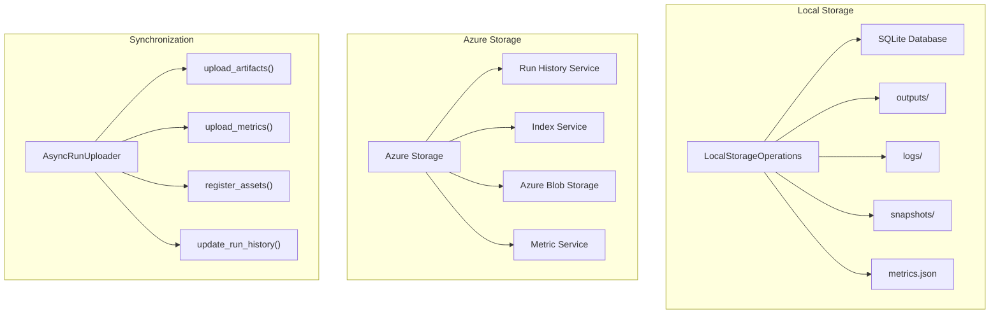

<!-- source: DeepWiki mcp.deepwiki.com · repo microsoft/promptflow · page 3.2 Run Management · fetched 2026-10-26 -->

# Run Management

<details>
<summary>Relevant source files</summary>

The following files were used as context for generating this wiki page:

- [docs/cloud/azureai/create-run-with-compute-session.md](docs/cloud/azureai/create-run-with-compute-session.md)
- [docs/cloud/azureai/manage-flows.md](docs/cloud/azureai/manage-flows.md)
- [docs/cloud/azureai/run-promptflow-in-azure-ai.md](docs/cloud/azureai/run-promptflow-in-azure-ai.md)
- [docs/cloud/azureai/runtime-change-log.md](docs/cloud/azureai/runtime-change-log.md)
- [docs/cloud/azureai/use-flow-in-azure-ml-pipeline.md](docs/cloud/azureai/use-flow-in-azure-ml-pipeline.md)
- [docs/cloud/index.md](docs/cloud/index.md)
- [docs/media/cloud/azureml/llmops_cloud_value.png](docs/media/cloud/azureml/llmops_cloud_value.png)
- [docs/media/cloud/manage-flows/flow_create_2.png](docs/media/cloud/manage-flows/flow_create_2.png)
- [docs/media/cloud/runtime-change-log/runtime-version.png](docs/media/cloud/runtime-change-log/runtime-version.png)
- [docs/media/trace/trace-ui-portal-demo.gif](docs/media/trace/trace-ui-portal-demo.gif)
- [docs/reference/pf-command-reference.md](docs/reference/pf-command-reference.md)
- [docs/reference/pfazure-command-reference.md](docs/reference/pfazure-command-reference.md)
- [examples/configuration.ipynb](examples/configuration.ipynb)
- [src/promptflow-azure/promptflow/azure/_cli/_run.py](src/promptflow-azure/promptflow/azure/_cli/_run.py)
- [src/promptflow-azure/promptflow/azure/_pf_client.py](src/promptflow-azure/promptflow/azure/_pf_client.py)
- [src/promptflow-azure/promptflow/azure/operations/_async_run_uploader.py](src/promptflow-azure/promptflow/azure/operations/_async_run_uploader.py)
- [src/promptflow-azure/promptflow/azure/operations/_run_operations.py](src/promptflow-azure/promptflow/azure/operations/_run_operations.py)
- [src/promptflow-azure/tests/sdk_cli_azure_test/e2etests/test_run_upload.py](src/promptflow-azure/tests/sdk_cli_azure_test/e2etests/test_run_upload.py)
- [src/promptflow-azure/tests/sdk_cli_azure_test/e2etests/test_telemetry.py](src/promptflow-azure/tests/sdk_cli_azure_test/e2etests/test_telemetry.py)
- [src/promptflow-azure/tests/sdk_cli_azure_test/unittests/test_run_operations.py](src/promptflow-azure/tests/sdk_cli_azure_test/unittests/test_run_operations.py)
- [src/promptflow-devkit/promptflow/_cli/_params.py](src/promptflow-devkit/promptflow/_cli/_params.py)
- [src/promptflow-devkit/promptflow/_cli/_pf/_config.py](src/promptflow-devkit/promptflow/_cli/_pf/_config.py)
- [src/promptflow-devkit/promptflow/_cli/_pf/_run.py](src/promptflow-devkit/promptflow/_cli/_pf/_run.py)
- [src/promptflow-devkit/promptflow/_sdk/_errors.py](src/promptflow-devkit/promptflow/_sdk/_errors.py)
- [src/promptflow-devkit/promptflow/_sdk/_orchestrator/run_submitter.py](src/promptflow-devkit/promptflow/_sdk/_orchestrator/run_submitter.py)
- [src/promptflow-devkit/promptflow/_sdk/_pf_client.py](src/promptflow-devkit/promptflow/_sdk/_pf_client.py)
- [src/promptflow-devkit/promptflow/_sdk/entities/_run.py](src/promptflow-devkit/promptflow/_sdk/entities/_run.py)
- [src/promptflow-devkit/promptflow/_sdk/schemas/_run.py](src/promptflow-devkit/promptflow/_sdk/schemas/_run.py)
- [src/promptflow/tests/test_configs/datas/webClassification.json](src/promptflow/tests/test_configs/datas/webClassification.json)
- [src/promptflow/tests/test_configs/eager_flows/basic_callable_class/init.json](src/promptflow/tests/test_configs/eager_flows/basic_callable_class/init.json)
- [src/promptflow/tests/test_configs/eager_flows/basic_callable_class/run_init_file.yaml](src/promptflow/tests/test_configs/eager_flows/basic_callable_class/run_init_file.yaml)
- [src/promptflow/tests/test_configs/prompty/prompty_with_env.prompty](src/promptflow/tests/test_configs/prompty/prompty_with_env.prompty)

</details>


Run management in Prompt Flow provides comprehensive capabilities for creating, executing, monitoring, and managing flow runs across both local development environments and Azure cloud infrastructure. This system handles the complete lifecycle of flow executions, from initial submission through completion, including storage, retrieval, and synchronization between local and cloud environments.

For information about flow execution internals, see [Flow Execution Model](#2.2). For details about Azure integration, see [Azure Integration](#7).

## Overview

The run management system operates across two primary environments: local development through the `pf` CLI and SDK, and cloud execution via the `pfazure` CLI and Azure SDK. The system provides unified interfaces for run operations while handling the complexities of different execution environments, storage backends, and synchronization requirements.



**Run Management Architecture Overview**

Sources: [docs/reference/pf-command-reference.md:1-1105](), [docs/reference/pfazure-command-reference.md:1-599](), [src/promptflow-devkit/promptflow/_sdk/_pf_client.py:1-438](), [src/promptflow-azure/promptflow/azure/_pf_client.py:1-283]()

## Run Entity and Lifecycle

The `Run` entity serves as the core data model representing flow executions. It encapsulates all execution metadata, configuration, and state information required for run management across different environments.



**Run Entity Architecture and State Machine**

The `Run` class supports multiple instantiation patterns based on the source environment:

| Source | Method | Storage Backend |
|--------|--------|-----------------|
| Local Creation | `Run.__init__()` | SQLite via ORM |
| Existing Local Run | `Run._from_orm_object()` | SQLite Database |
| Azure Index Service | `Run._from_index_service_entity()` | Azure Index Service |
| Azure Run History | `Run._from_run_history_entity()` | Azure Run History Service |

Sources: [src/promptflow-devkit/promptflow/_sdk/entities/_run.py:82-661](), [src/promptflow-devkit/promptflow/_sdk/_constants.py:42-45]()

## Local Run Management

Local run management handles flow execution in development environments, providing immediate feedback and debugging capabilities. The system uses SQLite for persistence and local file system storage for run artifacts.



**Local Run Management Architecture**

### Key Components

- **RunSubmitter**: Orchestrates run execution and manages the submission process
- **LocalStorageOperations**: Handles local persistence of run data and artifacts
- **RunOperations**: Provides the primary interface for run management operations

Sources: [src/promptflow-devkit/promptflow/_sdk/_orchestrator/run_submitter.py:33-305](), [src/promptflow-devkit/promptflow/_sdk/operations/_run_operations.py:1-50]()

## Cloud Run Management

Cloud run management extends local capabilities to Azure infrastructure, providing scalable execution, enterprise security, and collaborative features. The system integrates with multiple Azure services for comprehensive run lifecycle management.



**Azure Run Management Architecture**

### Azure-Specific Operations

| Operation | Service | Purpose |
|-----------|---------|---------|
| `create_or_update()` | Prompt Flow Service | Submit runs for execution |
| `list()` | Index Service | Query and filter runs |
| `get()` | Run History Service | Retrieve detailed run information |
| `get_metrics()` | Metric Service | Access evaluation metrics |
| `get_details()` | Prompt Flow Service | Retrieve run inputs/outputs |

Sources: [src/promptflow-azure/promptflow/azure/operations/_run_operations.py:79-1152](), [src/promptflow-azure/promptflow/azure/operations/_async_run_uploader.py:36-666]()

## Run Operations Interface

The run operations interface provides consistent methods across local and cloud environments, abstracting the underlying complexity while preserving environment-specific capabilities.



**Run Operations Interface Architecture**

### Method Signatures

```python
# Common interface across both local and Azure implementations
def create_or_update(run: Run, **kwargs) -> Run
def list(max_results: int, list_view_type: ListViewType) -> List[Run]  
def get(run: Union[str, Run]) -> Run
def update(name: str, **kwargs) -> Run
def stream(run: Union[str, Run]) -> Run
def get_details(run: Union[str, Run], max_results: int) -> DataFrame
def get_metrics(run: Union[str, Run]) -> Dict[str, Any]
```

Sources: [src/promptflow-devkit/promptflow/_sdk/operations/_run_operations.py:1-50](), [src/promptflow-azure/promptflow/azure/operations/_run_operations.py:162-1152]()

## Run Submission and Execution

Run submission handles the transition from run creation to actual execution, managing dependencies, validation, and execution orchestration across different flow types and environments.



**Run Submission and Execution Flow**

### Execution Modes

The system supports different execution modes based on run configuration:

- **Single Line Execution**: For testing individual inputs
- **Batch Execution**: For processing multiple data entries  
- **Resume Execution**: For continuing failed or interrupted runs
- **Evaluation Runs**: For running evaluation flows against existing run outputs

Sources: [src/promptflow-devkit/promptflow/_sdk/_orchestrator/run_submitter.py:87-252](), [src/promptflow-devkit/promptflow/_sdk/_orchestrator/run_submitter.py:65-69]()

## Run Storage and Persistence

The run storage system manages persistence across multiple storage backends, ensuring data consistency and enabling efficient retrieval and synchronization operations.



**Run Storage and Persistence Architecture**

### Storage Structure

Local runs follow a standardized directory structure:

```
~/.promptflow/runs/<run-name>/
├── flow_artifacts/          # Flow execution artifacts
├── flow_logs/              # Detailed execution logs  
├── node_artifacts/         # Node-level artifacts
├── outputs.jsonl           # Run outputs
├── inputs.jsonl           # Run inputs
├── metrics.json           # Evaluation metrics
├── snapshot/              # Flow source snapshot
└── logs.txt              # Overall execution logs
```

Sources: [src/promptflow-devkit/promptflow/_sdk/operations/_local_storage_operations.py:1-50](), [src/promptflow-azure/promptflow/azure/operations/_async_run_uploader.py:192-666]()

## CLI and SDK Interfaces

The command-line and SDK interfaces provide comprehensive access to run management functionality, supporting both interactive development and automated workflows.

### Local CLI Commands (`pf run`)

| Command | Purpose | Key Parameters |
|---------|---------|----------------|
| `pf run create` | Create and execute runs | `--flow`, `--data`, `--column-mapping` |
| `pf run list` | List existing runs | `--max-results`, `--archived-only` |
| `pf run show` | Display run details | `--name` |
| `pf run show-details` | Show input/output details | `--name`, `--max-results` |
| `pf run show-metrics` | Display evaluation metrics | `--name` |
| `pf run stream` | Stream execution logs | `--name` |
| `pf run update` | Update run metadata | `--name`, `--set` |
| `pf run archive` | Archive completed runs | `--name` |

### Azure CLI Commands (`pfazure run`)

| Command | Purpose | Key Parameters |
|---------|---------|----------------|
| `pfazure run create` | Submit runs to Azure | `--flow`, `--data`, `--subscription` |
| `pfazure run list` | List cloud runs | `--max-results`, `--workspace-name` |
| `pfazure run show` | Show cloud run details | `--name`, `--resource-group` |
| `pfazure run download` | Download run to local | `--name`, `--output` |
| `pfazure run upload` | Upload local run to cloud | `--name` |

### SDK Interface

```python
# Local SDK usage
from promptflow import PFClient

pf = PFClient()
run = pf.run(flow="./my-flow", data="./data.jsonl") 
runs = pf.runs.list(max_results=10)
details = pf.runs.get_details(run="run-name")

# Azure SDK usage  
from promptflow.azure import PFClient

pf = PFClient(subscription_id="...", resource_group_name="...", workspace_name="...")
run = pf.run(flow="./my-flow", data="./data.jsonl")
runs = pf.runs.list(max_results=10)
pf.runs.download(run="run-name", output="./downloads")
```

Sources: [docs/reference/pf-command-reference.md:475-759](), [docs/reference/pfazure-command-reference.md:163-599](), [src/promptflow-devkit/promptflow/_sdk/_pf_client.py:228-367](), [src/promptflow-azure/promptflow/azure/_pf_client.py:144-283]()

---

