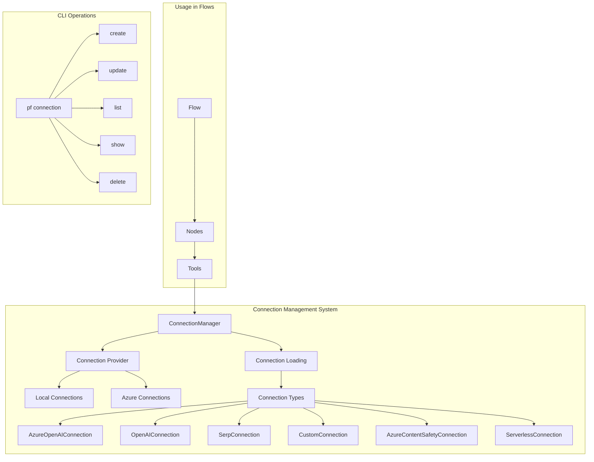
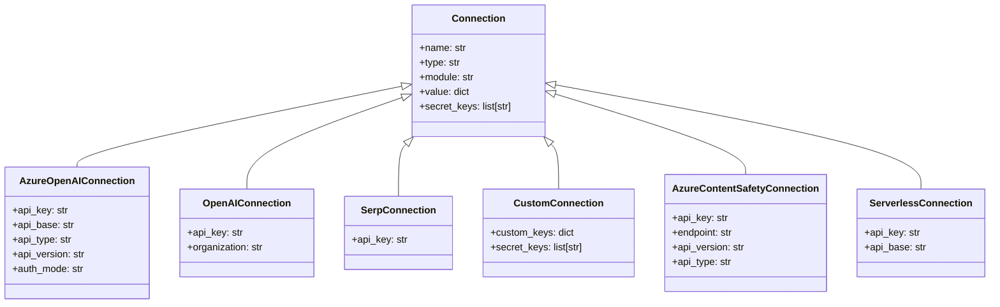
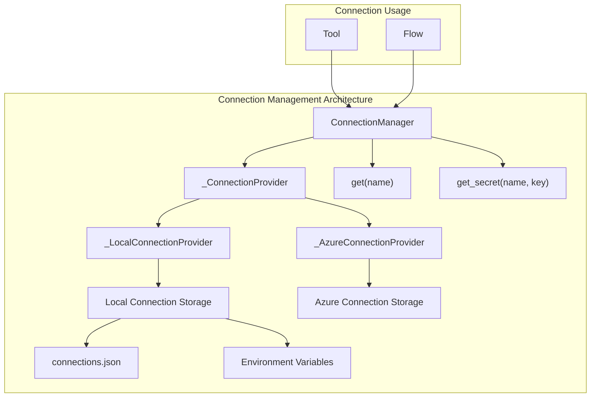
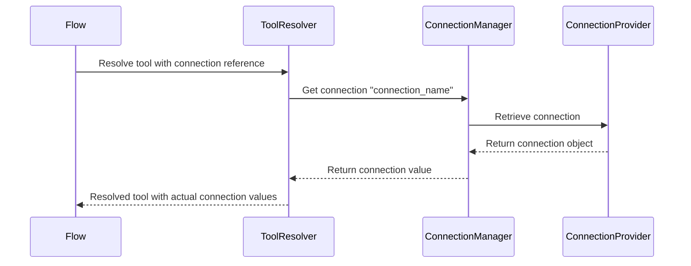
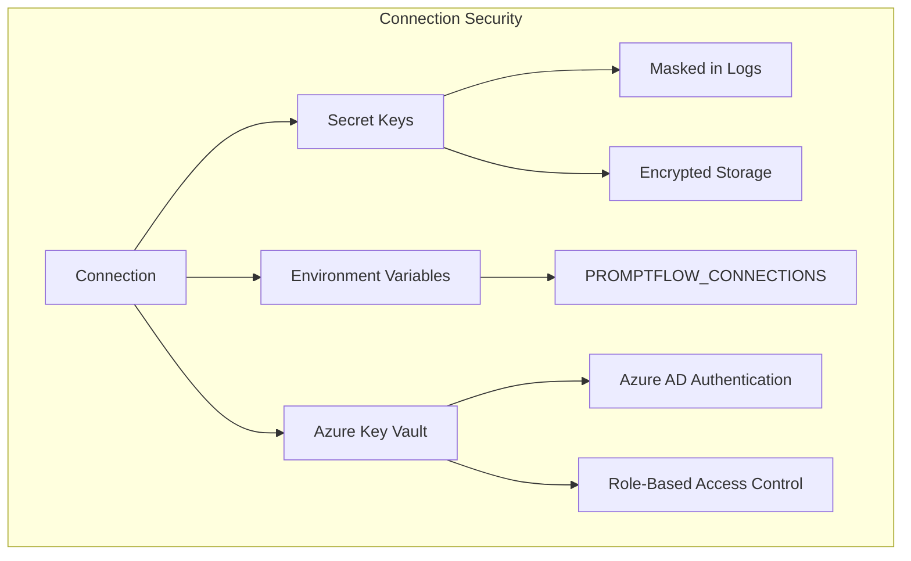
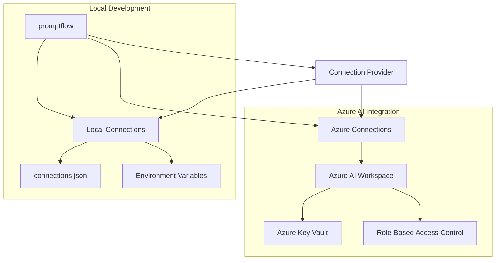
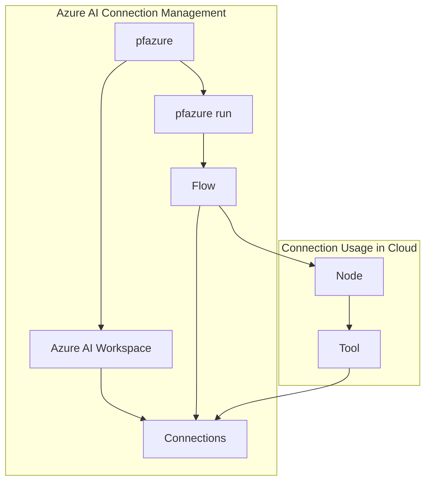

<!-- source: DeepWiki mcp.deepwiki.com · repo microsoft/promptflow · page 3.3 Connection Management · fetched 2026-10-26 -->

# Connection Management

<details>
<summary>Relevant source files</summary>

The following files were used as context for generating this wiki page:

- [.cspell.json](.cspell.json)
- [docs/cloud/azureai/create-run-with-compute-session.md](docs/cloud/azureai/create-run-with-compute-session.md)
- [docs/cloud/azureai/manage-flows.md](docs/cloud/azureai/manage-flows.md)
- [docs/cloud/azureai/run-promptflow-in-azure-ai.md](docs/cloud/azureai/run-promptflow-in-azure-ai.md)
- [docs/cloud/azureai/runtime-change-log.md](docs/cloud/azureai/runtime-change-log.md)
- [docs/cloud/azureai/use-flow-in-azure-ml-pipeline.md](docs/cloud/azureai/use-flow-in-azure-ml-pipeline.md)
- [docs/cloud/index.md](docs/cloud/index.md)
- [docs/media/cloud/azureml/llmops_cloud_value.png](docs/media/cloud/azureml/llmops_cloud_value.png)
- [docs/media/cloud/manage-flows/flow_create_2.png](docs/media/cloud/manage-flows/flow_create_2.png)
- [docs/media/cloud/runtime-change-log/runtime-version.png](docs/media/cloud/runtime-change-log/runtime-version.png)
- [docs/media/trace/trace-ui-portal-demo.gif](docs/media/trace/trace-ui-portal-demo.gif)
- [docs/reference/pf-command-reference.md](docs/reference/pf-command-reference.md)
- [docs/reference/pfazure-command-reference.md](docs/reference/pfazure-command-reference.md)
- [examples/configuration.ipynb](examples/configuration.ipynb)
- [src/promptflow-tools/connections.json.example](src/promptflow-tools/connections.json.example)
- [src/promptflow-tools/tests/conftest.py](src/promptflow-tools/tests/conftest.py)
- [src/promptflow-tools/tests/test_acs.py](src/promptflow-tools/tests/test_acs.py)

</details>


This document explains how connections are managed in Prompt Flow, including how to create, update, list, and delete connections. Connections are used to securely store and manage credentials for external services like Azure OpenAI, OpenAI, and other custom services that your flows interact with.

For information about using connections in flows, see [Tool System](#2.3). For information about consuming connections from Azure AI, see [Consume Connections from Azure AI](#7.3).

## Overview of Connection Management

Connections in Prompt Flow provide a secure way to store and access credentials for external services. They abstract away the authentication details from your flows, allowing you to:

1. Securely store API keys, endpoints, and other credentials
2. Reference these connections in your flows without hardcoding sensitive information
3. Share connections across multiple flows
4. Easily update credentials in one place when they change



Sources:
- [src/promptflow-tools/tests/conftest.py:10-50]()
- [docs/reference/pf-command-reference.md:352-474]()
- [src/promptflow-tools/connections.json.example:1-97]()

## Connection Types

Prompt Flow supports several built-in connection types to interact with different services:

| Connection Type | Purpose | Key Properties |
|-----------------|---------|----------------|
| AzureOpenAIConnection | Connect to Azure OpenAI services | api_key, api_base, api_version |
| OpenAIConnection | Connect to OpenAI services | api_key, organization |
| SerpConnection | Connect to search engine services | api_key |
| CustomConnection | Connect to custom services | User-defined key-value pairs |
| AzureContentSafetyConnection | Connect to Azure Content Safety | api_key, endpoint, api_version |
| ServerlessConnection | Connect to serverless endpoints | api_key, api_base |

Each connection type has specific properties required for authentication with its respective service.



Sources:
- [src/promptflow-tools/connections.json.example:1-97]()
- [src/promptflow-tools/tests/conftest.py:25-116]()

## Connection Management Architecture

The connection management system in Prompt Flow is built around the `ConnectionManager` class, which provides a centralized way to access and manage connections.



The `ConnectionManager` uses different connection providers to retrieve connections from various sources:

1. **Local Connection Provider**: Manages connections stored locally in a JSON file or environment variables
2. **Azure Connection Provider**: Retrieves connections from Azure AI workspace when running in the cloud

Sources:
- [src/promptflow-tools/tests/conftest.py:10-13]()
- [examples/configuration.ipynb:100-165]()

## Managing Connections with CLI

Prompt Flow provides a comprehensive CLI for managing connections. Here are the main commands:

### Creating Connections

You can create connections using the `pf connection create` command:

```bash
pf connection create -f <yaml-filename>
```

The YAML file should contain the connection specification, including type, name, and credentials.

Example YAML for an Azure OpenAI connection:

```yaml
$schema: https://azuremlschemas.azureedge.net/promptflow/latest/AzureOpenAIConnection.schema.json
name: my_azure_openai_connection
type: azure_open_ai
api_key: <your-api-key>
api_base: <your-endpoint>
api_version: 2023-07-01-preview
```

You can also override values during creation:

```bash
pf connection create -f <yaml-filename> --set api_key="<api-key>"
```

### Updating Connections

To update an existing connection:

```bash
pf connection update -n <name> --set api_key="<api-key>"
```

### Listing Connections

To list all available connections:

```bash
pf connection list
```

### Showing Connection Details

To view details of a specific connection:

```bash
pf connection show -n <name>
```

### Deleting Connections

To delete a connection:

```bash
pf connection delete -n <name>
```

Sources:
- [docs/reference/pf-command-reference.md:352-474]()

## Using Connections in Flows

Connections can be referenced in flows using the following syntax:

```
${connection_name.property_name}
```

For example, to reference an API key from a connection named "azure_openai_connection":

```
${azure_openai_connection.api_key}
```

When a flow is executed, the connection references are resolved to their actual values by the `ConnectionManager`.



Sources:
- [src/promptflow-tools/tests/conftest.py:25-50]()
- [docs/reference/pf-command-reference.md:334-335]()

## Connection Security

Connections handle sensitive information like API keys and credentials. Prompt Flow implements several security measures:

1. **Secret Keys**: Connections can designate certain properties as "secret_keys", which are handled with extra security
2. **Environment Variables**: Connections can be stored in environment variables using the `PROMPTFLOW_CONNECTIONS` environment variable
3. **Azure Key Vault Integration**: When running in Azure, connections can leverage Azure Key Vault for secure storage



Sources:
- [src/promptflow-tools/connections.json.example:36-50]()
- [src/promptflow-tools/tests/conftest.py:26-28]()

## Cloud Integration with Azure AI

When working with Azure AI, connections can be managed through the Azure AI workspace. This provides additional benefits:

1. **Centralized Management**: Connections are managed centrally in the workspace
2. **Team Sharing**: Connections can be shared across team members
3. **Role-Based Access Control**: Access to connections can be controlled through Azure RBAC
4. **Integration with Azure Key Vault**: Sensitive connection information can be stored in Azure Key Vault

To use Azure connections with the CLI, you can configure the connection provider:

```bash
pf config set connection.provider="azureml://subscriptions/<subscription-id>/resourceGroups/<resource-group-name>/providers/Microsoft.MachineLearningServices/workspaces/<workspace-or-project-name>"
```



Sources:
- [docs/reference/pf-command-reference.md:903-909]()
- [docs/cloud/index.md:5-14]()
- [docs/cloud/azureai/consume-connections-from-azure-ai.md]()

## Connection Management in Azure AI with pfazure

When working with Azure AI, you can use the `pfazure` CLI to manage connections in your Azure AI workspace. The connections created or updated in Azure AI can be used in your flows when running in the cloud.



When submitting a run to Azure AI, you can override connections using the `--connections` parameter:

```bash
pfazure run create --flow <flow-path> --connections node1.connection=test_llm_connection node1.deployment_name=gpt-35-turbo
```

Sources:
- [docs/reference/pfazure-command-reference.md:589-590]()
- [docs/cloud/azureai/use-flow-in-azure-ml-pipeline.md:346-349]()

## Best Practices for Connection Management

Here are some best practices for managing connections in Prompt Flow:

1. **Use Connection References**: Always use connection references (`${connection_name.property}`) instead of hardcoding credentials
2. **Separate Development and Production Connections**: Use different connections for development and production environments
3. **Regularly Rotate Credentials**: Update connection credentials regularly for security
4. **Use Azure AI for Team Collaboration**: When working in teams, use Azure AI workspace connections for better sharing and management
5. **Designate Secret Keys**: For custom connections, always designate sensitive properties as secret_keys
6. **Use Environment Variables for Local Development**: For local development, consider using environment variables for connection management

Sources:
- [docs/reference/pf-command-reference.md:334-335]()
- [src/promptflow-tools/connections.json.example:36-50]()
- [docs/cloud/index.md:5-14]()

## Troubleshooting Connection Issues

Common connection issues and their solutions:

| Issue | Possible Cause | Solution |
|-------|---------------|----------|
| Connection not found | Connection name mismatch | Verify the connection name in your flow matches the created connection |
| Authentication failure | Expired or invalid credentials | Update the connection with valid credentials |
| Permission denied | Insufficient permissions in Azure | Check RBAC permissions in Azure AI workspace |
| Connection reference not resolved | Syntax error in reference | Ensure reference follows `${connection_name.property}` format |
| Connection works locally but not in cloud | Different connections in local vs. cloud | Configure the same connection in Azure AI workspace |

Sources:
- [src/promptflow-tools/tests/conftest.py:100-116]()
- [docs/cloud/azureai/faq.md]()

## Summary

Connection management in Prompt Flow provides a secure and flexible way to handle credentials for external services. By using connections, you can:

1. Securely store and manage credentials
2. Reference connections in flows without exposing sensitive information
3. Easily update credentials when they change
4. Share connections across team members when using Azure AI

Understanding how to create, manage, and use connections is essential for building secure and maintainable flows in Prompt Flow.

---

