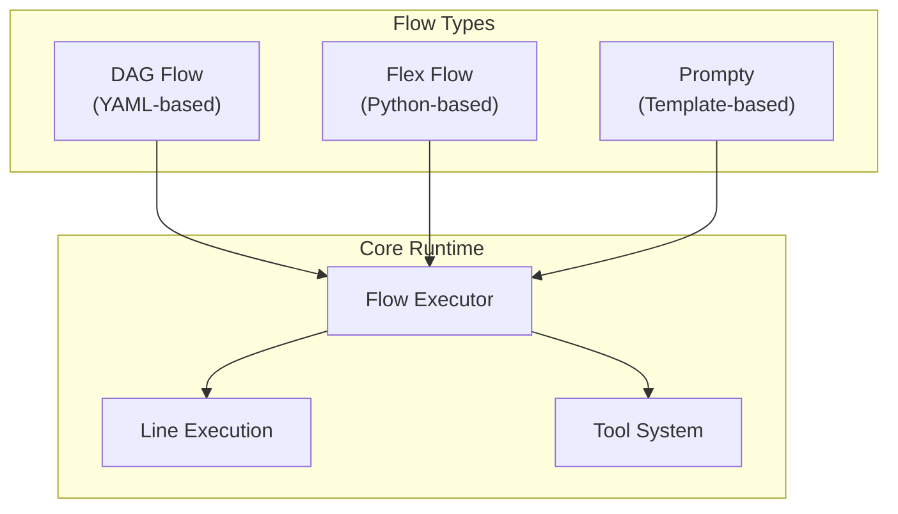
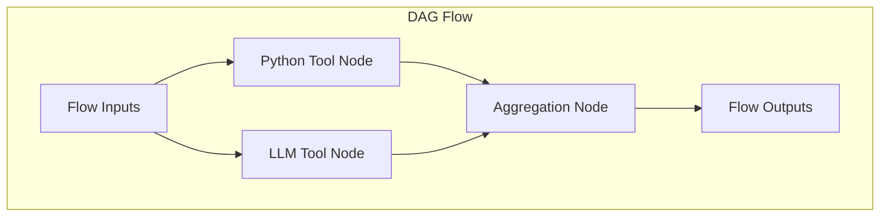
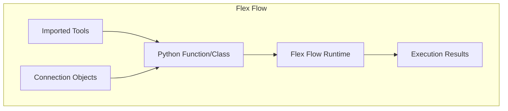
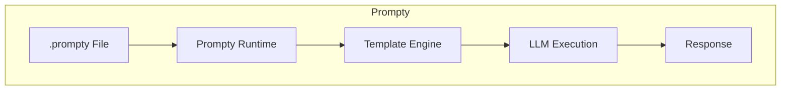
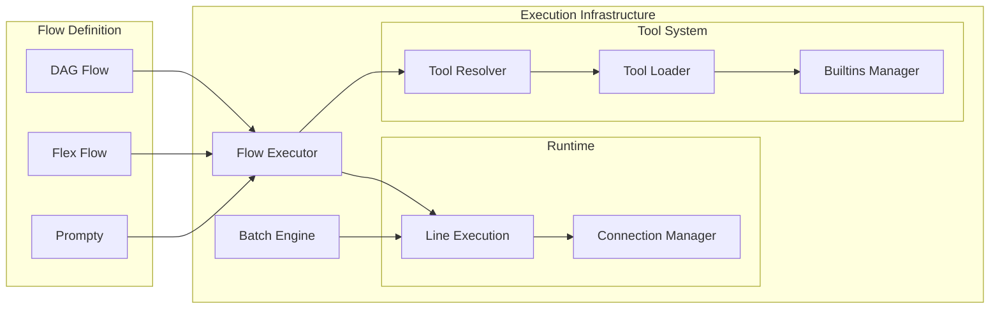

<!-- source: DeepWiki mcp.deepwiki.com · repo microsoft/promptflow · page 4 Flow Types · fetched 2026-10-26 -->

# Flow Types

<details>
<summary>Relevant source files</summary>

The following files were used as context for generating this wiki page:

- [src/promptflow/tests/executor/unittests/contracts/test_flow.py](src/promptflow/tests/executor/unittests/contracts/test_flow.py)
- [src/promptflow/tests/executor/unittests/executor/test_exceptions.py](src/promptflow/tests/executor/unittests/executor/test_exceptions.py)
- [src/promptflow/tests/test_configs/flows/flow_with_dict_input_with_variant/flow.dag.yaml](src/promptflow/tests/test_configs/flows/flow_with_dict_input_with_variant/flow.dag.yaml)
- [src/promptflow/tests/test_configs/flows/flow_with_dict_input_with_variant/print_val.py](src/promptflow/tests/test_configs/flows/flow_with_dict_input_with_variant/print_val.py)
- [src/promptflow/tests/test_configs/flows/flow_with_environment_variables/flow.dag.yaml](src/promptflow/tests/test_configs/flows/flow_with_environment_variables/flow.dag.yaml)
- [src/promptflow/tests/test_configs/flows/flow_with_environment_variables/inputs.jsonl](src/promptflow/tests/test_configs/flows/flow_with_environment_variables/inputs.jsonl)
- [src/promptflow/tests/test_configs/flows/flow_with_environment_variables/print_env.py](src/promptflow/tests/test_configs/flows/flow_with_environment_variables/print_env.py)
- [src/promptflow/tests/test_configs/flows/web_classification_invalid/convert_to_dict.py](src/promptflow/tests/test_configs/flows/web_classification_invalid/convert_to_dict.py)
- [src/promptflow/tests/test_configs/flows/web_classification_invalid/flow.dag.yaml](src/promptflow/tests/test_configs/flows/web_classification_invalid/flow.dag.yaml)

</details>


This page provides an overview of the different flow types supported by PromptFlow. It covers the three main flow paradigms available for developing AI applications: DAG Flows, Flex Flows, and Prompty. For information about flow operations such as testing, validation, or serving, see [Flow Operations](#3.1).

## Flow Types Overview

PromptFlow supports three distinct flow types, each designed for different use cases and development preferences:



Sources: 
- System architecture diagrams (Core Components, Execution Architecture)
- CHANGELOG.md entries for flow type announcements

## DAG Flows

Directed Acyclic Graph (DAG) flows are the traditional workflow representation in PromptFlow. They define a graph of connected nodes where data flows in one direction without cycles.

### DAG Flow Structure

A DAG flow consists of:
- **Inputs**: Data that enters the flow
- **Nodes**: Processing steps (tools) that transform data
- **Outputs**: Results produced by the flow
- **References**: Connections between nodes using a `${node.output}` syntax



Sources:
- Example flow.dag.yaml in test config
- System architecture diagrams

### DAG Flow Configuration

DAG flows are defined in a `flow.dag.yaml` file with the following structure:

```yaml
inputs:
  input_name:
    type: string
    default: default_value
outputs:
  output_name:
    reference: ${node_name.output}
nodes:
- name: node_name
  type: python/llm/etc
  source:
    type: code
    path: script_file.py
  inputs:
    param_name: ${inputs.input_name}
```

### Node Variants

DAG flows support variants for experimentation through the `node_variants` section:

```yaml
node_variants:
  node_name:
    default_variant_id: variant_1
    variants:
      variant_0:
        node:
          # node configuration
      variant_1:
        node:
          # alternative configuration
```

Sources:
- [src/promptflow/tests/test_configs/flows/web_classification_invalid/flow.dag.yaml]()

## Flex Flows

Introduced in v1.11.0 (May 2024), Flex Flows allow designing LLM applications using native Python functions or classes instead of YAML configuration.

### Flex Flow Structure



Sources:
- CHANGELOG.md v1.11.0 announcement
- System architecture diagrams

### Flex Flow Benefits

| Benefit | Description |
|---------|-------------|
| **Native Python** | Write flows as Python functions or classes |
| **Control Flow** | Use Python's control structures (if/else, loops, etc.) |
| **Easier Debugging** | Standard Python debugging tools work |
| **IDE Integration** | Seamless testing and running in VS Code |
| **Type Safety** | Leverage Python type hints |

### Flex Flow Structure

Flex flows are defined as Python functions or classes with appropriate imports and decorations:

```python
# Example structure - not actual implementation
from promptflow.tools import tool
from promptflow import Connection

def my_flex_flow(input_text: str, connection: Connection):
    # Process input with Python logic
    # Call other tools or LLMs
    return processed_result
```

Sources:
- CHANGELOG.md v1.11.0 announcement

## Prompty

Prompty is an experimental feature introduced in v1.11.0 (May 2024) that streamlines the creation of prompt templates with a dedicated file format.

### Prompty Structure



Sources:
- CHANGELOG.md v1.11.0 announcement
- System architecture diagrams

### Prompty Benefits

| Benefit | Description |
|---------|-------------|
| **Template Focus** | Dedicated format for prompt engineering |
| **Readability** | Clear separation of prompt design from code |
| **Reusability** | Create reusable prompt templates |
| **Testing** | Test prompts without changing code |
| **Iteration** | Rapidly iterate on prompt design |

Sources:
- CHANGELOG.md v1.11.0 announcement

## Flow Types Comparison

| Feature | DAG Flow | Flex Flow | Prompty |
|---------|----------|-----------|---------|
| **Definition Format** | YAML | Python | .prompty |
| **Structure** | Graph-based | Function/Class | Template |
| **Flexibility** | Moderate | High | Specialized |
| **Primary Use Case** | Complex workflows | Python-native apps | Prompt engineering |
| **Introduced In** | Initial release | v1.11.0 | v1.11.0 |
| **Integration With** | CLI, SDK, VS Code | Python, VS Code | VS Code, Python |

## Flow Execution Model

All flow types use the same underlying execution infrastructure:



Sources:
- System architecture diagrams (Execution Architecture)

## Relationships Between Flow Types

In PromptFlow's architecture, all flow types:

1. Are implemented within the `promptflow-core` package
2. Use the shared execution model
3. Can leverage the same tool system
4. Support local and cloud execution
5. Can be evaluated using the evaluation framework

For detailed information about specific flow types, see:
- [DAG Flows](#4.1)
- [Flex Flows](#4.2)
- [Prompty](#4.3)

Sources:
- System architecture diagrams
- pyproject.toml dependencies
- CHANGELOG.md entries

---

