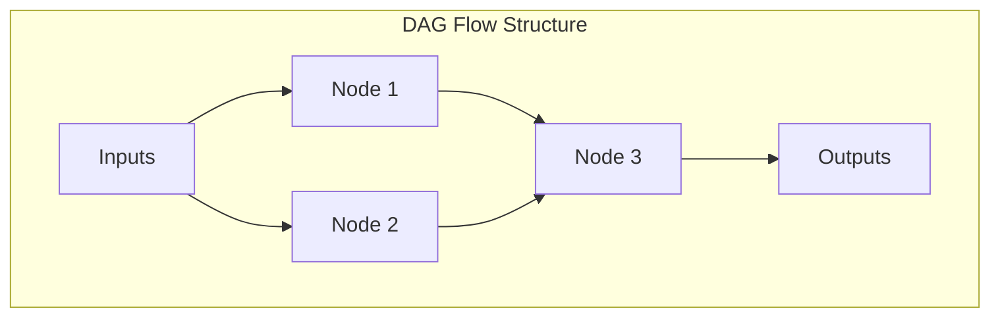
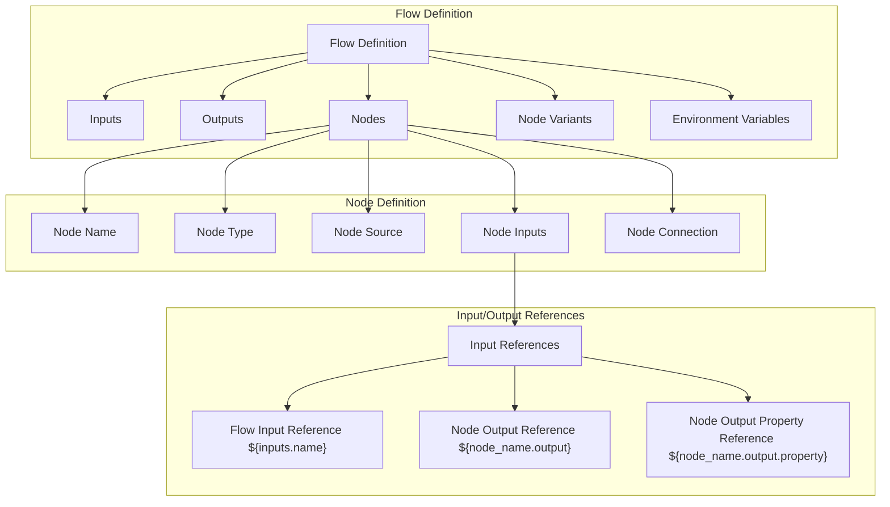
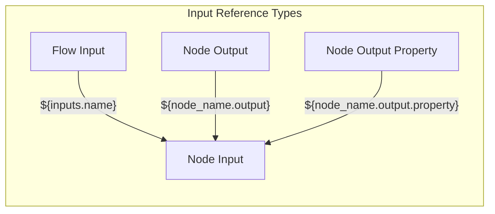
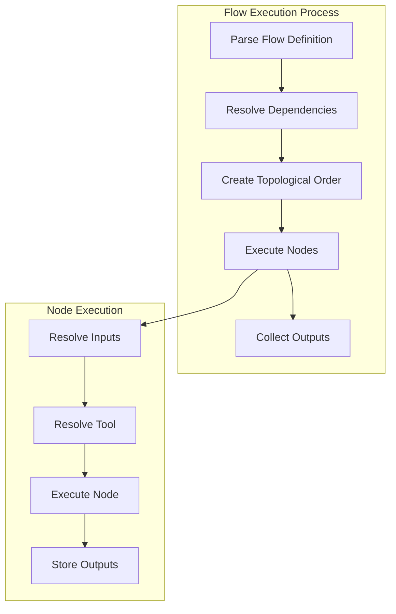
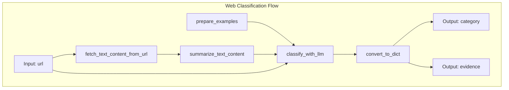
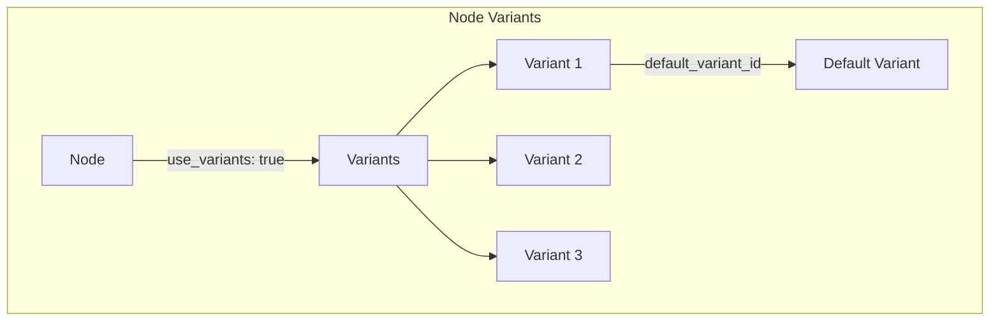

<!-- source: DeepWiki mcp.deepwiki.com · repo microsoft/promptflow · page 4.1 DAG Flows · fetched 2026-10-26 -->

# DAG Flows

<details>
<summary>Relevant source files</summary>

The following files were used as context for generating this wiki page:

- [src/promptflow/tests/executor/unittests/contracts/test_flow.py](src/promptflow/tests/executor/unittests/contracts/test_flow.py)
- [src/promptflow/tests/executor/unittests/executor/test_exceptions.py](src/promptflow/tests/executor/unittests/executor/test_exceptions.py)
- [src/promptflow/tests/test_configs/flows/flow_with_dict_input_with_variant/flow.dag.yaml](src/promptflow/tests/test_configs/flows/flow_with_dict_input_with_variant/flow.dag.yaml)
- [src/promptflow/tests/test_configs/flows/flow_with_dict_input_with_variant/print_val.py](src/promptflow/tests/test_configs/flows/flow_with_dict_input_with_variant/print_val.py)
- [src/promptflow/tests/test_configs/flows/flow_with_environment_variables/flow.dag.yaml](src/promptflow/tests/test_configs/flows/flow_with_environment_variables/flow.dag.yaml)
- [src/promptflow/tests/test_configs/flows/flow_with_environment_variables/inputs.jsonl](src/promptflow/tests/test_configs/flows/flow_with_environment_variables/inputs.jsonl)
- [src/promptflow/tests/test_configs/flows/flow_with_environment_variables/print_env.py](src/promptflow/tests/test_configs/flows/flow_with_environment_variables/print_env.py)
- [src/promptflow/tests/test_configs/flows/web_classification_invalid/convert_to_dict.py](src/promptflow/tests/test_configs/flows/web_classification_invalid/convert_to_dict.py)
- [src/promptflow/tests/test_configs/flows/web_classification_invalid/flow.dag.yaml](src/promptflow/tests/test_configs/flows/web_classification_invalid/flow.dag.yaml)

</details>


This page documents Directed Acyclic Graph (DAG) flows in Prompt Flow, which are the traditional YAML-defined flows with nodes and connections. DAG flows represent a sequence of operations where each node performs a specific task, and the outputs of nodes can be used as inputs to other nodes.

For information about other flow types, see [Flex Flows](#4.2) and [Prompty](#4.3).

## Overview

DAG flows in Prompt Flow are defined using YAML files with a `.dag.yaml` extension. These files describe the flow's inputs, outputs, nodes (operations), and the connections between them. The DAG structure ensures that there are no circular dependencies between nodes, allowing for deterministic execution.



Sources: [src/promptflow/tests/test_configs/flows/web_classification_invalid/flow.dag.yaml:1-139]()

## Flow Definition Components

A DAG flow is defined by the following key components:

| Component | Description |
|-----------|-------------|
| `inputs` | Defines the input parameters for the flow |
| `outputs` | Defines the output parameters and their references |
| `nodes` | Defines the operations to be performed in the flow |
| `node_variants` | Defines alternative implementations for nodes |
| `environment_variables` | Defines environment variables for the flow |
| `additional_includes` | Specifies additional files to include |

### Inputs

Inputs define the parameters that can be passed to the flow. Each input has a type and optional properties like default values.

```yaml
inputs:
  url:
    type: string
    default: https://www.microsoft.com
```

Sources: [src/promptflow/tests/test_configs/flows/web_classification_invalid/flow.dag.yaml:1-4]()

### Outputs

Outputs define what the flow returns. Each output has a type and a reference to a node's output.

```yaml
outputs:
  category:
    reference: ${convert_to_dict.output.category}
  evidence:
    type: string
    reference: ${convert_to_dict.output.evidence}
```

Sources: [src/promptflow/tests/test_configs/flows/web_classification_invalid/flow.dag.yaml:4-9]()

### Nodes

Nodes are the building blocks of a flow. Each node represents an operation and has inputs that can come from flow inputs or other nodes' outputs.

```yaml
nodes:
- name: fetch_text_content_from_url
  type: python
  source:
    type: code
    path: fetch_text_content_from_url.py
  inputs:
    url: ${inputs.url}
```

Sources: [src/promptflow/tests/test_configs/flows/web_classification_invalid/flow.dag.yaml:10-17]()

## Flow Structure Diagram



Sources: [src/promptflow/tests/executor/unittests/contracts/test_flow.py:7-20](), [src/promptflow/tests/test_configs/flows/web_classification_invalid/flow.dag.yaml:1-139]()

## Flow Contract Classes

The DAG flow structure is represented by several contract classes in the codebase:

| Class | Description |
|-------|-------------|
| `Flow` | Represents the entire flow definition |
| `Node` | Represents a single operation in the flow |
| `FlowInputDefinition` | Defines an input parameter for the flow |
| `FlowOutputDefinition` | Defines an output parameter for the flow |
| `InputAssignment` | Represents a value assignment to a node input |
| `NodeVariant` | Represents an alternative implementation for a node |

Sources: [src/promptflow/tests/executor/unittests/contracts/test_flow.py:7-20]()

## Input References

Inputs to nodes can reference:

1. Flow inputs using the syntax `${inputs.input_name}`
2. Outputs from other nodes using the syntax `${node_name.output}`
3. Properties of node outputs using the syntax `${node_name.output.property_name}`



Sources: [src/promptflow/tests/executor/unittests/contracts/test_flow.py:525-610]()

## Node Types

DAG flows support several types of nodes:

| Node Type | Description |
|-----------|-------------|
| `python` | Executes Python code |
| `llm` | Calls a language model |
| `custom_llm` | Calls a custom language model implementation |
| `aggregation` | Aggregates results from multiple iterations |

Sources: [src/promptflow/tests/test_configs/flows/web_classification_invalid/flow.dag.yaml:10-81]()

## Node Variants

Node variants allow defining alternative implementations for a node. This is useful for experimentation and A/B testing.

```yaml
node_variants:
  summarize_text_content:
    default_variant_id: variant_1
    variants:
      variant_0:
        node:
          # Node definition
      variant_1:
        node:
          # Alternative node definition
```

Sources: [src/promptflow/tests/test_configs/flows/web_classification_invalid/flow.dag.yaml:87-138](), [src/promptflow/tests/test_configs/flows/flow_with_dict_input_with_variant/flow.dag.yaml:15-27]()

## Environment Variables

Flows can define environment variables that are available during execution:

```yaml
environment_variables:
  env1: 2
  env2: spawn
  env3:
  - 1
  - 2
  - 3
  env4:
    a: 1
    b: "2"
```

Sources: [src/promptflow/tests/test_configs/flows/flow_with_environment_variables/flow.dag.yaml:1-12]()

## Flow Execution Model

When a DAG flow is executed, the system:

1. Parses the flow definition
2. Resolves node dependencies
3. Executes nodes in topological order
4. Passes outputs from completed nodes to dependent nodes
5. Collects the final outputs



Sources: [src/promptflow/tests/executor/unittests/contracts/test_flow.py:27-193]()

## Flow Contract Methods

The `Flow` class provides several methods for working with flows:

| Method | Description |
|--------|-------------|
| `from_yaml` | Creates a Flow object from a YAML file |
| `get_connection_names` | Gets all connection names used in the flow |
| `get_connection_input_names_for_node` | Gets connection input names for a specific node |
| `get_environment_variables_with_overrides` | Gets environment variables with optional overrides |
| `is_chat_flow` | Checks if the flow is a chat flow |
| `get_chat_input_name` | Gets the name of the chat input |
| `get_chat_output_name` | Gets the name of the chat output |

Sources: [src/promptflow/tests/executor/unittests/contracts/test_flow.py:27-193](), [src/promptflow/tests/executor/unittests/contracts/test_flow.py:474-493]()

## Node Operations

The `Flow` class provides methods for working with nodes:

| Method | Description |
|--------|-------------|
| `get_node` | Gets a node by name |
| `is_reduce_node` | Checks if a node is a reduce/aggregation node |
| `is_normal_node` | Checks if a node is a normal (non-aggregation) node |
| `is_llm_node` | Checks if a node is an LLM node |
| `is_referenced_by_flow_output` | Checks if a node is referenced by a flow output |
| `is_node_referenced_by` | Checks if a node is referenced by another node |
| `is_referenced_by_other_node` | Checks if a node is referenced by any other node |

Sources: [src/promptflow/tests/executor/unittests/contracts/test_flow.py:405-473]()

## Example DAG Flow

Here's an example of a complete DAG flow for web classification:



Sources: [src/promptflow/tests/test_configs/flows/web_classification_invalid/flow.dag.yaml:1-139]()

## Node Variants Implementation

When a node has variants, the flow can select which variant to use. The default variant is specified by `default_variant_id`.



Sources: [src/promptflow/tests/executor/unittests/contracts/test_flow.py:300-325](), [src/promptflow/tests/test_configs/flows/flow_with_dict_input_with_variant/flow.dag.yaml:9-27]()

## Flow Serialization and Deserialization

The `Flow` class provides methods for serializing and deserializing flows:

| Method | Description |
|--------|-------------|
| `serialize` | Converts a Flow object to a dictionary |
| `deserialize` | Creates a Flow object from a dictionary |

Sources: [src/promptflow/tests/executor/unittests/contracts/test_flow.py:236-280]()

## Connection Management

Flows can use connections to external services, such as Azure OpenAI:

```yaml
- name: summarize_text_content
  type: llm
  source:
    type: code
    path: summarize_text_content.jinja2
  inputs:
    deployment_name: gpt-35-turbo
    # other inputs
  provider: AzureOpenAI
  connection: azure_open_ai_connection
```

Sources: [src/promptflow/tests/test_configs/flows/web_classification_invalid/flow.dag.yaml:18-40]()

## Summary

DAG flows provide a structured way to define complex operations involving multiple tools, including LLMs. The YAML-based definition makes it easy to understand the flow structure and dependencies between nodes. The flow execution system resolves dependencies and ensures that nodes are executed in the correct order.

For more information on how flows are executed, see [Flow Execution Model](#2.2).

---

