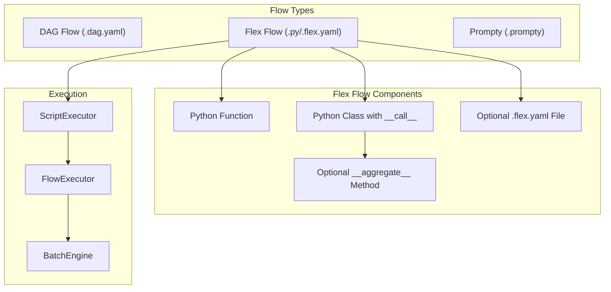
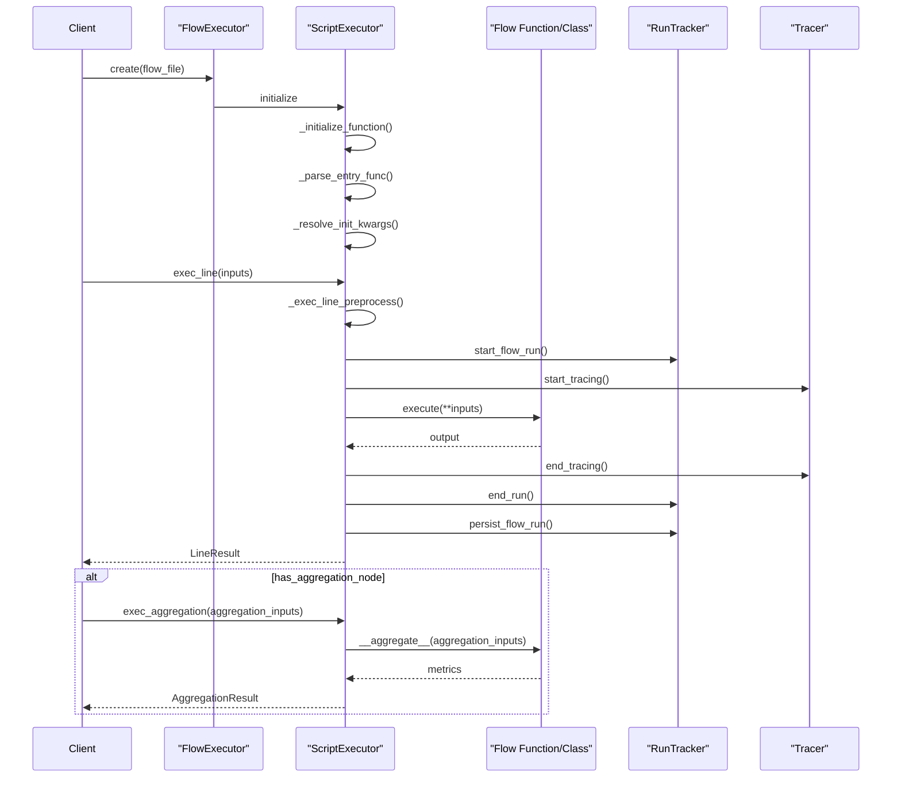
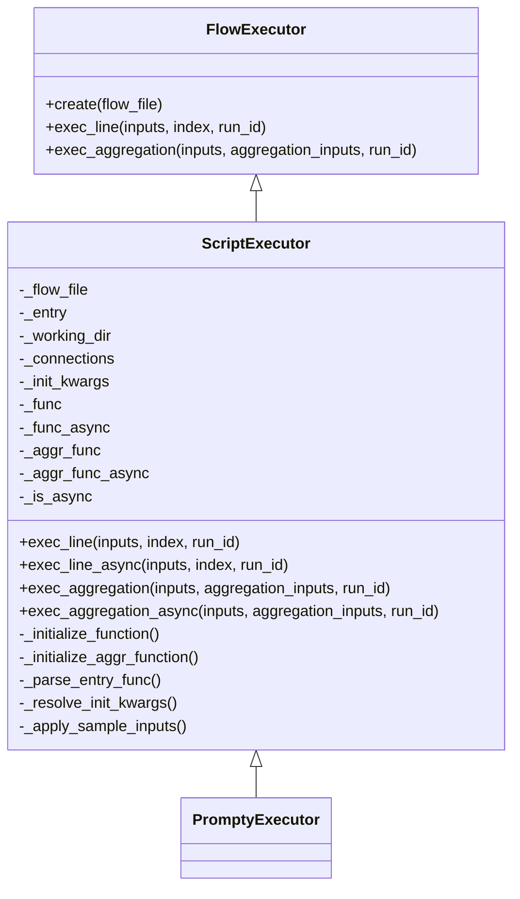
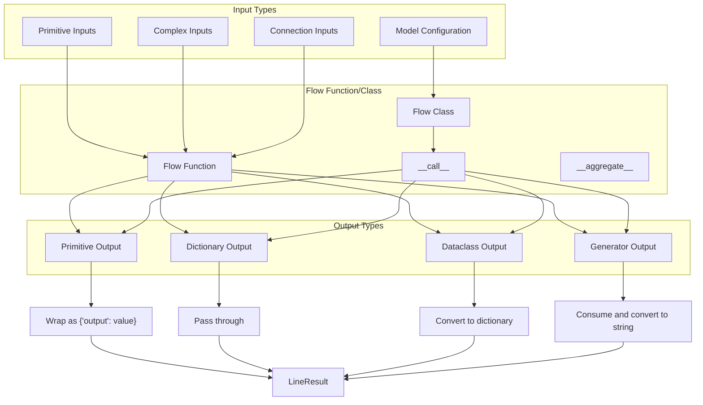
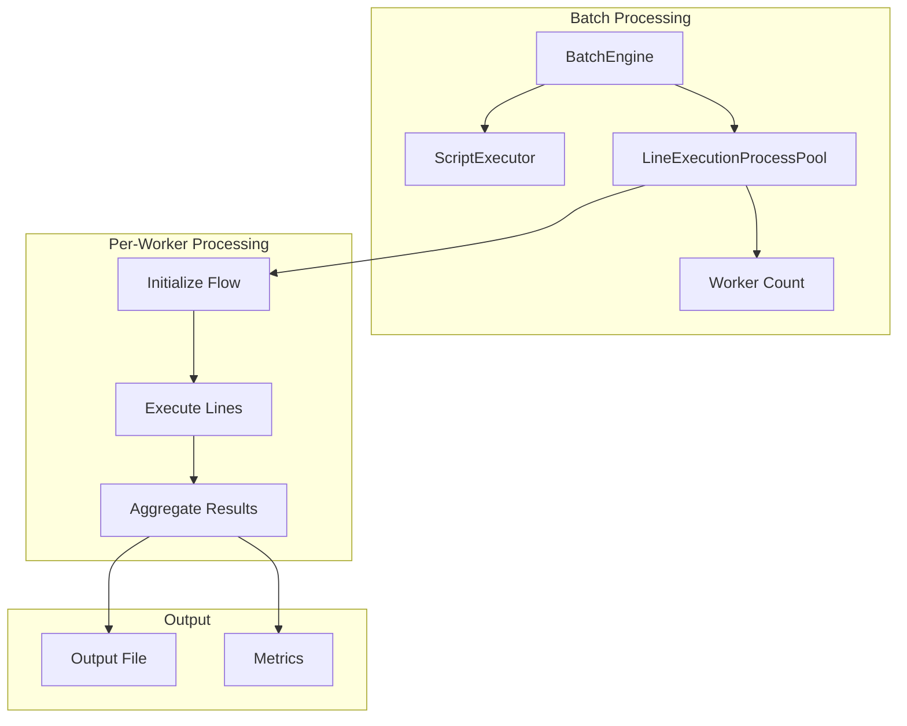

<!-- source: DeepWiki mcp.deepwiki.com · repo microsoft/promptflow · page 4.2 Flex Flows · fetched 2026-10-26 -->

# Flex Flows

<details>
<summary>Relevant source files</summary>

The following files were used as context for generating this wiki page:

- [src/promptflow-core/promptflow/_utils/dataclass_serializer.py](src/promptflow-core/promptflow/_utils/dataclass_serializer.py)
- [src/promptflow-core/promptflow/contracts/types.py](src/promptflow-core/promptflow/contracts/types.py)
- [src/promptflow-core/promptflow/core/_model_configuration.py](src/promptflow-core/promptflow/core/_model_configuration.py)
- [src/promptflow-core/promptflow/executor/_errors.py](src/promptflow-core/promptflow/executor/_errors.py)
- [src/promptflow-core/promptflow/executor/_prompty_executor.py](src/promptflow-core/promptflow/executor/_prompty_executor.py)
- [src/promptflow-core/promptflow/executor/_script_executor.py](src/promptflow-core/promptflow/executor/_script_executor.py)
- [src/promptflow-core/tests/core/e2etests/test_eager_flow.py](src/promptflow-core/tests/core/e2etests/test_eager_flow.py)
- [src/promptflow-devkit/tests/sdk_cli_test/e2etests/test_flow_test.py](src/promptflow-devkit/tests/sdk_cli_test/e2etests/test_flow_test.py)
- [src/promptflow-devkit/tests/sdk_cli_test/unittests/test_prompty.py](src/promptflow-devkit/tests/sdk_cli_test/unittests/test_prompty.py)
- [src/promptflow-tracing/promptflow/tracing/_operation_context.py](src/promptflow-tracing/promptflow/tracing/_operation_context.py)
- [src/promptflow-tracing/tests/unittests/test_operation_context.py](src/promptflow-tracing/tests/unittests/test_operation_context.py)
- [src/promptflow/tests/executor/e2etests/test_eager_flow.py](src/promptflow/tests/executor/e2etests/test_eager_flow.py)
- [src/promptflow/tests/executor/unittests/contracts/test_flow.py](src/promptflow/tests/executor/unittests/contracts/test_flow.py)
- [src/promptflow/tests/executor/unittests/executor/test_exceptions.py](src/promptflow/tests/executor/unittests/executor/test_exceptions.py)
- [src/promptflow/tests/test_configs/datas/chat_history_with_tools.json](src/promptflow/tests/test_configs/datas/chat_history_with_tools.json)
- [src/promptflow/tests/test_configs/datas/prompty_with_multi_tools.json](src/promptflow/tests/test_configs/datas/prompty_with_multi_tools.json)
- [src/promptflow/tests/test_configs/eager_flows/basic_callable_class/simple_callable_class.py](src/promptflow/tests/test_configs/eager_flows/basic_callable_class/simple_callable_class.py)
- [src/promptflow/tests/test_configs/eager_flows/basic_callable_class_async/simple_callable_class.py](src/promptflow/tests/test_configs/eager_flows/basic_callable_class_async/simple_callable_class.py)
- [src/promptflow/tests/test_configs/eager_flows/basic_callable_class_with_sample_file/simple_callable_class.py](src/promptflow/tests/test_configs/eager_flows/basic_callable_class_with_sample_file/simple_callable_class.py)
- [src/promptflow/tests/test_configs/eager_flows/callable_class_with_primitive/callable_class_with_primitive.py](src/promptflow/tests/test_configs/eager_flows/callable_class_with_primitive/callable_class_with_primitive.py)
- [src/promptflow/tests/test_configs/eager_flows/dummy_flow_with_invalid_entry/flow.dag.yaml](src/promptflow/tests/test_configs/eager_flows/dummy_flow_with_invalid_entry/flow.dag.yaml)
- [src/promptflow/tests/test_configs/flows/flow_with_dict_input_with_variant/flow.dag.yaml](src/promptflow/tests/test_configs/flows/flow_with_dict_input_with_variant/flow.dag.yaml)
- [src/promptflow/tests/test_configs/flows/flow_with_dict_input_with_variant/print_val.py](src/promptflow/tests/test_configs/flows/flow_with_dict_input_with_variant/print_val.py)
- [src/promptflow/tests/test_configs/flows/flow_with_environment_variables/flow.dag.yaml](src/promptflow/tests/test_configs/flows/flow_with_environment_variables/flow.dag.yaml)
- [src/promptflow/tests/test_configs/flows/flow_with_environment_variables/inputs.jsonl](src/promptflow/tests/test_configs/flows/flow_with_environment_variables/inputs.jsonl)
- [src/promptflow/tests/test_configs/flows/flow_with_environment_variables/print_env.py](src/promptflow/tests/test_configs/flows/flow_with_environment_variables/print_env.py)
- [src/promptflow/tests/test_configs/prompty/prompty_tool_with_chat_history.prompty](src/promptflow/tests/test_configs/prompty/prompty_tool_with_chat_history.prompty)
- [src/promptflow/tests/test_configs/prompty/prompty_with_escape_role.prompty](src/promptflow/tests/test_configs/prompty/prompty_with_escape_role.prompty)

</details>


Flex Flows are a Python-based flow definition format in Prompt Flow that allows developers to define flows using Python functions or classes instead of YAML-based DAG definitions. This approach provides more flexibility and enables native Python programming patterns while still leveraging the Prompt Flow execution engine.

For information about traditional YAML-defined DAG flows, see [DAG Flows](#4.1). For information about Prompty files, see [Prompty](#4.3).

## Overview

Flex Flows enable developers to define flows as Python functions or classes with a `__call__` method. This approach offers several advantages:

- Native Python syntax for flow definition
- Support for complex logic within a single flow
- Ability to use Python's type system for inputs and outputs
- Support for dataclass outputs
- Aggregation capabilities through a special `__aggregate__` method



Sources: [src/promptflow-core/promptflow/executor/_script_executor.py:48-588]()

## Flex Flow Definition

Flex Flows can be defined in two ways:

1. **Function-based**: A Python function that takes inputs and returns outputs
2. **Class-based**: A Python class with a `__call__` method that takes inputs and returns outputs

### Function-based Flex Flow

A simple function-based Flex Flow:

```python
def my_flow(input_val: str) -> str:
    return f"Hello world! {input_val}"
```

### Class-based Flex Flow

A class-based Flex Flow with initialization parameters:

```python
class MyFlow:
    def __init__(self, obj_input: str):
        self.obj_input = obj_input
        
    def __call__(self, func_input: str) -> dict:
        return {
            "obj_input": self.obj_input,
            "func_input": func_input,
            "obj_id": id(self)
        }
        
    def __aggregate__(self, results: list) -> dict:
        return {"length": len(results)}
```

Sources: [src/promptflow/tests/test_configs/eager_flows/basic_callable_class/simple_callable_class.py:1-38](), [src/promptflow/tests/test_configs/eager_flows/basic_callable_class_async/simple_callable_class.py:1-39]()

## Flex Flow YAML Configuration

While Flex Flows can be defined purely in Python, you can also provide a YAML configuration file (`.flex.yaml`) to specify additional metadata:

```yaml
entry: module_name:function_name
inputs:
  input_name:
    type: string
    default: default_value
init:
  param_name: param_value
sample:
  inputs:
    input_name: sample_value
  init:
    param_name: sample_value
```

Key components:
- `entry`: Module and function/class to use as the flow entry point
- `inputs`: Input definitions with types and default values
- `init`: Initialization parameters for class-based flows
- `sample`: Sample values for testing

Sources: [src/promptflow-core/promptflow/executor/_script_executor.py:74-83](), [src/promptflow-core/promptflow/executor/_script_executor.py:542-569]()

## Execution Model



Sources: [src/promptflow-core/promptflow/executor/_script_executor.py:116-207](), [src/promptflow-core/promptflow/executor/_script_executor.py:220-256]()

### ScriptExecutor

The `ScriptExecutor` class is responsible for executing Flex Flows. It handles:

1. Loading the flow function or class
2. Resolving initialization parameters for class-based flows
3. Executing the flow with provided inputs
4. Handling aggregation if defined
5. Managing tracing and run tracking



Sources: [src/promptflow-core/promptflow/executor/_script_executor.py:49-587]()

### Initialization Process

When a Flex Flow is initialized:

1. The executor determines if the entry is a function, class, or path to a module
2. For class-based flows, it initializes the class with provided parameters
3. It resolves any connection references to actual connection objects
4. It applies tracing to the function or method
5. It determines if the function is async or sync

Sources: [src/promptflow-core/promptflow/executor/_script_executor.py:492-522](), [src/promptflow-core/promptflow/executor/_script_executor.py:374-441]()

### Execution Process

When a Flex Flow is executed:

1. The executor prepares the inputs and run context
2. It starts tracing for the execution
3. It calls the flow function or class's `__call__` method
4. It processes the output (including handling generators)
5. It records metrics and traces
6. It returns a `LineResult` with the output and run information

Sources: [src/promptflow-core/promptflow/executor/_script_executor.py:166-207](), [src/promptflow-core/promptflow/executor/_script_executor.py:307-340]()

### Aggregation

Flex Flows can define an optional `__aggregate__` method that processes the outputs of multiple flow executions:

1. The method takes a list of flow outputs as input
2. It returns a dictionary of metrics
3. These metrics are recorded and can be used for evaluation

Sources: [src/promptflow-core/promptflow/executor/_script_executor.py:220-291]()

## Input and Output Handling

### Input Types

Flex Flows support various input types:

- Primitive types (string, int, float, bool)
- Complex types (dict, list)
- Connection objects
- Model configurations

Inputs can be provided:
- Directly when calling the flow
- From a sample in the YAML configuration
- From a default value in the function signature

Sources: [src/promptflow-core/promptflow/executor/_script_executor.py:571-587](), [src/promptflow-core/promptflow/executor/_script_executor.py:163-164]()

### Output Types

Flex Flows support various output types:

- Primitive values (automatically wrapped in a dictionary with key "output")
- Dictionaries (used as-is)
- Dataclasses (converted to dictionaries)
- Generators (consumed and converted to strings)



Sources: [src/promptflow-core/promptflow/executor/_script_executor.py:209-214](), [src/promptflow-core/promptflow/_utils/dataclass_serializer.py:74-94](), [src/promptflow-core/promptflow/executor/_script_executor.py:353-365]()

## Model Configuration

Flex Flows support model configurations for LLM integrations:

```python
class MyFlow:
    def __init__(self, 
                 azure_open_ai_model_config: AzureOpenAIModelConfiguration,
                 open_ai_model_config: OpenAIModelConfiguration):
        self.azure_config = azure_open_ai_model_config
        self.openai_config = open_ai_model_config
        
    def __call__(self, func_input: str) -> dict:
        # Use model configurations
        return {
            "azure_open_ai_model_config_azure_endpoint": self.azure_config.azure_endpoint,
            "open_ai_model_config_model": self.openai_config.model
        }
```

Model configurations can be created:
- Directly with parameters
- From connection objects

Sources: [src/promptflow-core/promptflow/core/_model_configuration.py:1-122](), [src/promptflow-core/promptflow/executor/_script_executor.py:374-441]()

## Async Support

Flex Flows support both synchronous and asynchronous execution:

```python
async def async_flow(input_val: str) -> str:
    # Async processing
    return result

class AsyncFlow:
    async def __call__(self, input_val: str) -> str:
        # Async processing
        return result
        
    async def __aggregate__(self, results: list) -> dict:
        # Async aggregation
        return metrics
```

The executor automatically detects if a function is async and handles it appropriately.

Sources: [src/promptflow-core/promptflow/executor/_script_executor.py:293-340](), [src/promptflow-core/promptflow/executor/_script_executor.py:513-521]()

## Streaming Output

Flex Flows support streaming outputs through generators:

```python
async def streaming_flow(input_val: str):
    for i in range(10):
        yield str(i)
```

The executor can:
- Consume generators and return the concatenated result
- Pass through generators for streaming responses

Sources: [src/promptflow-core/promptflow/executor/_script_executor.py:342-365](), [src/promptflow-devkit/tests/sdk_cli_test/e2etests/test_flow_test.py:424-452]()

## Error Handling

Flex Flows provide detailed error information when execution fails:

1. User code exceptions are wrapped in `ScriptExecutionError`
2. Initialization errors are wrapped in `FlowEntryInitializationError`
3. Invalid entry errors are wrapped in `InvalidFlexFlowEntry`
4. Input validation errors are wrapped in `InputNotFound` or `InputTypeError`

Sources: [src/promptflow-core/promptflow/executor/_errors.py:104-129](), [src/promptflow-core/promptflow/executor/_script_executor.py:191-207]()

## Batch Processing

Flex Flows can be executed in batch mode using the `BatchEngine`:



Key aspects of batch processing:
- Multiple worker processes can be used
- Each worker initializes its own instance of the flow
- Results are aggregated across all workers
- Metrics are collected from all executions

Sources: [src/promptflow/tests/executor/e2etests/test_eager_flow.py:24-181]()

## Integration with Prompt Flow SDK

Flex Flows integrate with the Prompt Flow SDK for testing and execution:

```python
from promptflow import PFClient

# Test a Flex Flow
pf = PFClient()
result = pf.test(
    flow="path/to/flow",
    inputs={"input_val": "test"},
    init={"obj_input": "init_val"}
)

# Run a Flex Flow in batch
run = pf.run(
    flow="path/to/flow",
    data="path/to/data.jsonl",
    column_mapping={"input_val": "${data.column}"},
    init={"obj_input": "init_val"}
)
```

Sources: [src/promptflow-devkit/tests/sdk_cli_test/e2etests/test_flow_test.py:462-532]()

## Tracing and Telemetry

Flex Flows include built-in tracing and telemetry:

1. Flow executions are traced with OpenTelemetry
2. LLM calls are automatically tracked
3. Execution metrics are collected
4. Operation context is maintained throughout execution

Sources: [src/promptflow-core/promptflow/executor/_script_executor.py:181-184](), [src/promptflow-tracing/promptflow/tracing/_operation_context.py:1-200]()

## Comparison with Other Flow Types

| Feature | Flex Flows | DAG Flows | Prompty |
|---------|-----------|-----------|---------|
| Definition | Python functions/classes | YAML with nodes | YAML with Jinja templates |
| Complexity | Complex logic in Python | Node-based graph | Template-based |
| Execution | Direct function calls | Node-by-node | Template rendering + LLM |
| Aggregation | `__aggregate__` method | Aggregation node | Not supported |
| Streaming | Generator functions | LLM streaming | LLM streaming |
| Async | Supported | Supported | Not supported |
| Connections | Injected as parameters | Referenced in nodes | Referenced in config |

Sources: [src/promptflow-core/promptflow/executor/_script_executor.py:1-588](), [src/promptflow-core/promptflow/executor/_prompty_executor.py:1-72]()

## Best Practices

1. **Type Annotations**: Use Python type annotations for inputs and outputs
2. **Dataclasses**: Use dataclasses for structured outputs
3. **Async**: Use async functions for non-blocking operations
4. **Error Handling**: Handle exceptions gracefully within the flow
5. **Aggregation**: Implement `__aggregate__` for batch metrics
6. **Connections**: Use connection objects for external services
7. **Model Configurations**: Use model configuration classes for LLMs

Sources: [src/promptflow/tests/test_configs/eager_flows/basic_callable_class/simple_callable_class.py:1-38](), [src/promptflow-devkit/tests/sdk_cli_test/e2etests/test_flow_test.py:462-532]()

---

