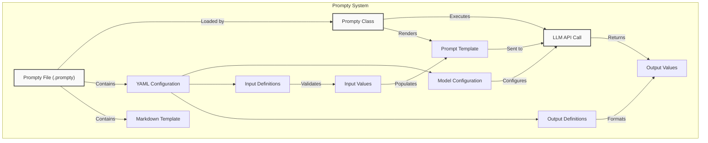
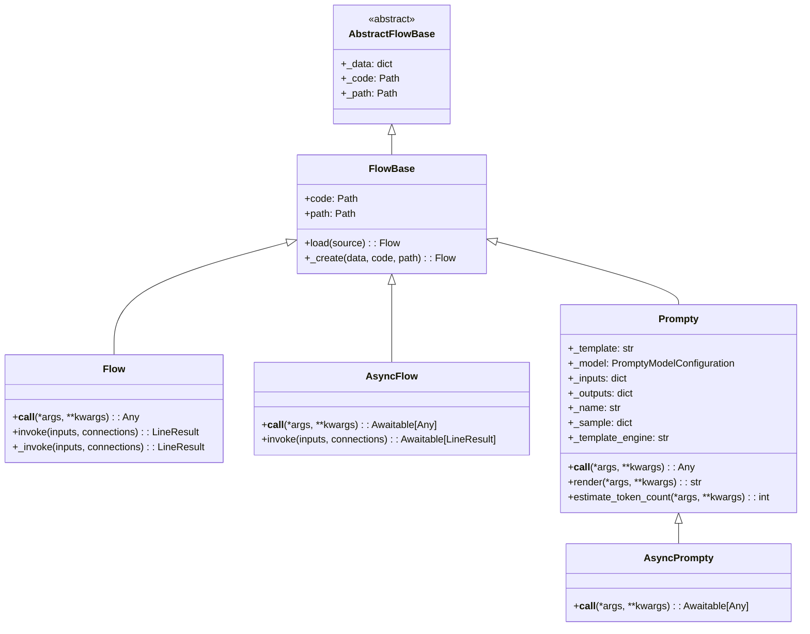
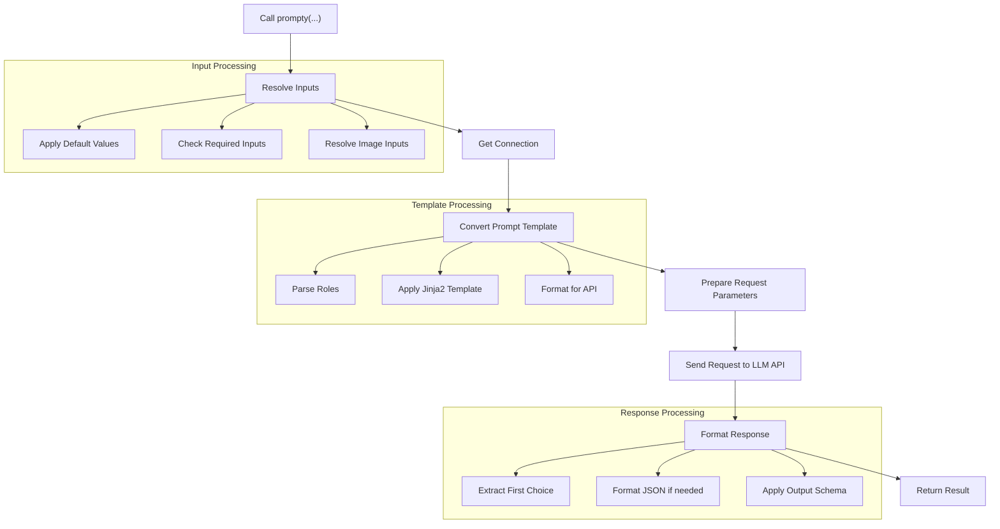
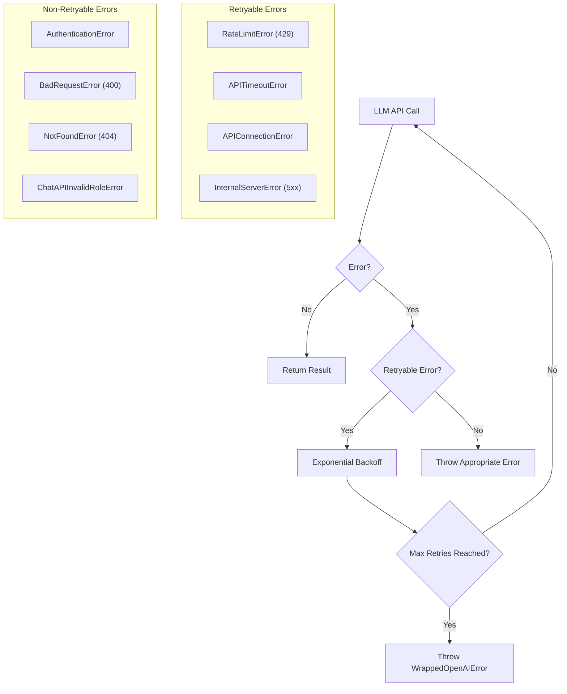
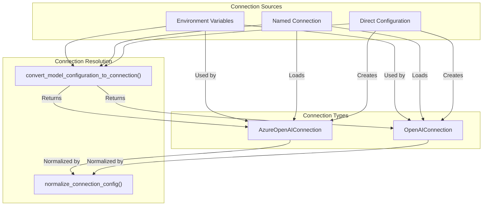
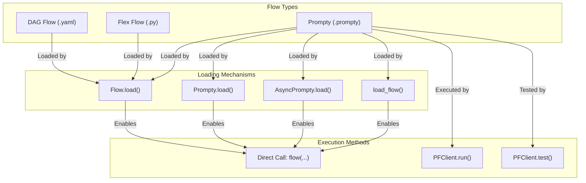

<!-- source: DeepWiki mcp.deepwiki.com · repo microsoft/promptflow · page 4.3 Prompty · fetched 2026-10-26 -->

# Prompty

<details>
<summary>Relevant source files</summary>

The following files were used as context for generating this wiki page:

- [src/promptflow-core/promptflow/core/_errors.py](src/promptflow-core/promptflow/core/_errors.py)
- [src/promptflow-core/promptflow/core/_flow.py](src/promptflow-core/promptflow/core/_flow.py)
- [src/promptflow-core/promptflow/core/_prompty_utils.py](src/promptflow-core/promptflow/core/_prompty_utils.py)
- [src/promptflow-devkit/promptflow/_sdk/_orm/retry.py](src/promptflow-devkit/promptflow/_sdk/_orm/retry.py)
- [src/promptflow-devkit/tests/sdk_cli_test/e2etests/test_chat_group.py](src/promptflow-devkit/tests/sdk_cli_test/e2etests/test_chat_group.py)
- [src/promptflow-devkit/tests/sdk_cli_test/e2etests/test_cli.py](src/promptflow-devkit/tests/sdk_cli_test/e2etests/test_cli.py)
- [src/promptflow-devkit/tests/sdk_cli_test/e2etests/test_flow_serve.py](src/promptflow-devkit/tests/sdk_cli_test/e2etests/test_flow_serve.py)
- [src/promptflow-devkit/tests/sdk_cli_test/e2etests/test_flow_serve_fastapi.py](src/promptflow-devkit/tests/sdk_cli_test/e2etests/test_flow_serve_fastapi.py)
- [src/promptflow-devkit/tests/sdk_cli_test/e2etests/test_prompty.py](src/promptflow-devkit/tests/sdk_cli_test/e2etests/test_prompty.py)
- [src/promptflow-devkit/tests/sdk_cli_test/e2etests/test_prompty_error_handler.py](src/promptflow-devkit/tests/sdk_cli_test/e2etests/test_prompty_error_handler.py)
- [src/promptflow-recording/promptflow/recording/local/record_storage.py](src/promptflow-recording/promptflow/recording/local/record_storage.py)
- [src/promptflow-recording/recordings/local/node_cache.shelve.bak](src/promptflow-recording/recordings/local/node_cache.shelve.bak)
- [src/promptflow-recording/recordings/local/node_cache.shelve.dat](src/promptflow-recording/recordings/local/node_cache.shelve.dat)
- [src/promptflow-recording/recordings/local/node_cache.shelve.dir](src/promptflow-recording/recordings/local/node_cache.shelve.dir)
- [src/promptflow/tests/test_configs/prompty/prompty_with_image.prompty](src/promptflow/tests/test_configs/prompty/prompty_with_image.prompty)

</details>


Prompty is a streamlined way to create and use prompt templates in the Prompt Flow framework. It provides a simplified interface for defining, configuring, and executing prompts with Large Language Models (LLMs), particularly focusing on Azure OpenAI and OpenAI services. Prompty files use a markdown-based format with YAML front matter to define model configurations, inputs, and outputs, making them easier to create and maintain than traditional flow definitions.

For information about other flow types like DAG Flows and Flex Flows, see [DAG Flows](#4.1) and [Flex Flows](#4.2).

## Overview

Prompty files (`.prompty`) combine configuration metadata with prompt templates in a single file. They can be loaded and executed directly like functions, with automatic handling of connections, model configurations, and input/output formatting.



Sources:
- [src/promptflow-core/promptflow/core/_flow.py:222-307]()
- [src/promptflow-devkit/tests/sdk_cli_test/e2etests/test_prompty.py:39-78]()

## Prompty File Format

A Prompty file consists of two main parts:
1. **YAML Front Matter**: Configuration metadata enclosed between `---` delimiters
2. **Markdown Template**: The prompt template with role-based formatting

### YAML Front Matter

The front matter contains configuration for:
- **name**: Name of the prompt
- **description**: Description of the prompt
- **model**: Model configuration including API type, connection details, and parameters
- **inputs**: Input definitions with types and optional default values
- **outputs** (optional): Output definitions for structured responses
- **sample** (optional): Sample inputs for testing

### Markdown Template

The template section follows the front matter and contains the actual prompt template with role-based formatting for chat models:

```
system:
Your system instructions here

user:
{{variable_name}} and other content

assistant:
Optional assistant response template
```

Variables from the inputs are referenced using Jinja2 syntax: `{{variable_name}}`.

### Example Prompty File

```
---
name: Basic Prompt
description: A basic prompt that uses the GPT-3 chat API to answer questions
model:
  api: chat
  configuration:
    connection: azure_open_ai_connection
    azure_deployment: gpt-35-turbo
    type: azure_openai
  parameters:
    max_tokens: 128
    temperature: 0.2
inputs:
  firstName:
    type: string
    default: John
  lastName:
    type: string
    default: Doh
  question:
    type: string
---
system:
You are an AI assistant who helps people find information.
As the assistant, you answer questions briefly, succinctly,
and in a personable manner using markdown and even add some personal flair with appropriate emojis.

# Safety
- You **should always** reference factual statements to search results based on [relevant documents]
- Search results based on [relevant documents] may be incomplete or irrelevant. You do not make assumptions
# Customer
You are helping {{firstName}} {{lastName}} to find answers to their questions.
Use their name to address them in your responses.

user:
{{question}}
```

Sources:
- [src/promptflow-devkit/tests/sdk_cli_test/e2etests/test_prompty.py:39-78]()
- [src/promptflow/tests/test_configs/prompty/prompty_with_image.prompty:1-24]()

## Architecture

Prompty is implemented as a specialized flow type in the Prompt Flow framework. It extends the `FlowBase` class and provides functionality for loading, parsing, and executing prompts.



Sources:
- [src/promptflow-core/promptflow/core/_flow.py:42-571]()

## Using Prompty

### Loading a Prompty File

Prompty files can be loaded using the `Prompty.load()` method or through the general `Flow.load()` method:

```python
from promptflow.core import Prompty, Flow

# Direct loading
prompty = Prompty.load(source="path/to/file.prompty")

# Loading through Flow (automatically detects Prompty files)
prompty = Flow.load(source="path/to/file.prompty")

# For async usage
async_prompty = AsyncPrompty.load(source="path/to/file.prompty")
```

Sources:
- [src/promptflow-devkit/tests/sdk_cli_test/e2etests/test_prompty.py:73-84]()

### Executing Prompty

Once loaded, a Prompty can be called like a function with keyword arguments:

```python
# Call with required inputs
result = prompty(question="what is the result of 1+1?")

# Call with async version
result = await async_prompty(question="what is the result of 1+1?")
```

Sources:
- [src/promptflow-devkit/tests/sdk_cli_test/e2etests/test_prompty.py:125-132]()
- [src/promptflow-devkit/tests/sdk_cli_test/e2etests/test_prompty.py:200-206]()

### Overriding Model Configuration

You can override the model configuration when loading a Prompty:

```python
# Override with dictionary
model_config = {
    "configuration": {
        "connection": "mock_connection_name",
        "azure_deployment": "gpt-35-turbo",
    },
    "parameters": {
        "max_tokens": 64,
        "temperature": 0.5
    }
}
prompty = Prompty.load(source="path/to/file.prompty", model=model_config)

# Override with ModelConfiguration object
from promptflow.core._model_configuration import AzureOpenAIModelConfiguration
config = AzureOpenAIModelConfiguration(
    connection="azure_open_ai_connection",
    azure_deployment="gpt-35-turbo"
)
prompty = Prompty.load(
    source="path/to/file.prompty", 
    model={"configuration": config}
)
```

Sources:
- [src/promptflow-devkit/tests/sdk_cli_test/e2etests/test_prompty.py:105-123]()
- [src/promptflow-devkit/tests/sdk_cli_test/e2etests/test_prompty.py:150-166]()

### Rendering Templates

You can render the prompt template without executing it:

```python
# Render the prompt template
rendered_prompt = prompty.render(question="what is the result of 1+1?")
```

Sources:
- [src/promptflow-devkit/tests/sdk_cli_test/e2etests/test_prompty.py:439-455]()

### Estimating Token Count

You can estimate the token count for a prompt:

```python
# Estimate token count
token_count = prompty.estimate_token_count(question="what is the result of 1+1?")
```

Sources:
- [src/promptflow-devkit/tests/sdk_cli_test/e2etests/test_prompty.py:465-497]()

## Advanced Features

### Structured Output Formatting

Prompty supports structured output formatting using the `response_format` parameter and `outputs` configuration:

```python
# JSON format output
prompty = Prompty.load(
    source="path/to/json_format.prompty",
    outputs={"answer": {"type": "number"}}
)
result = prompty(question="what is the result of 1+1?")
# result will be a dictionary with the specified output fields
```

Sources:
- [src/promptflow-devkit/tests/sdk_cli_test/e2etests/test_prompty.py:257-282]()

### Streaming Responses

Prompty supports streaming responses from LLMs:

```python
# Enable streaming
prompty = Prompty.load(
    source="path/to/file.prompty", 
    model={"parameters": {"stream": True}}
)
result = prompty(question="what is the result of 1+1?")
# result will be an iterator
for chunk in result:
    print(chunk, end="")
```

Sources:
- [src/promptflow-devkit/tests/sdk_cli_test/e2etests/test_prompty.py:290-329]()

### Environment Variable References

Prompty supports referencing environment variables in the configuration:

```
model:
  configuration:
    azure_deployment: "${env:AZURE_OPENAI_DEPLOYMENT}"
    api_key: "${env:AZURE_OPENAI_API_KEY}"
    api_version: "${env:AZURE_OPENAI_API_VERSION}"
    azure_endpoint: "${env:AZURE_OPENAI_ENDPOINT}"
```

Sources:
- [src/promptflow-devkit/tests/sdk_cli_test/e2etests/test_prompty.py:538-565]()

### File References

Prompty supports referencing external files for configuration values:

```python
# Reference a file for sample data
prompty = Flow.load(
    source="path/to/file.prompty", 
    sample="${file:../data/sample.json}"
)
```

Sources:
- [src/promptflow-devkit/tests/sdk_cli_test/e2etests/test_prompty.py:499-536]()

### Image Inputs

Prompty supports image inputs for vision models:

```
---
name: Basic Prompt with Image
model:
  api: chat
  configuration:
    type: azure_openai
    azure_deployment: gpt-4-vision-preview
    connection: azure_open_ai_connection
  parameters:
    temperature: 0.2
inputs:
  image:
    type: image
  question:
    type: string
---
system:
As an AI assistant, your task involves interpreting images and responding to questions about the image.

user:
{{question}}

```

Sources:
- [src/promptflow/tests/test_configs/prompty/prompty_with_image.prompty:1-24]()
- [src/promptflow-devkit/tests/sdk_cli_test/e2etests/test_prompty.py:593-618]()

### Function/Tool Calling

Prompty supports OpenAI's function and tool calling features:

```python
# Prompty with tools
prompty = Flow.load(source="path/to/prompty_with_tools.prompty")
result = prompty(question="What's the weather like in Boston today?")
# result will contain tool_calls
```

Sources:
- [src/promptflow-devkit/tests/sdk_cli_test/e2etests/test_prompty.py:408-437]()

## Implementation Details

### Execution Flow

When a Prompty is called, the following steps occur:



Sources:
- [src/promptflow-core/promptflow/core/_flow.py:426-470]()
- [src/promptflow-core/promptflow/core/_prompty_utils.py:135-146]()
- [src/promptflow-core/promptflow/core/_prompty_utils.py:206-288]()

### Error Handling

Prompty includes robust error handling for LLM API calls, with automatic retries for transient errors:



Sources:
- [src/promptflow-core/promptflow/core/_errors.py:10-73]()
- [src/promptflow-devkit/tests/sdk_cli_test/e2etests/test_prompty_error_handler.py:140-186]()

### Connection Management

Prompty supports different connection types and configurations:



Sources:
- [src/promptflow-core/promptflow/core/_prompty_utils.py:93-132]()
- [src/promptflow-core/promptflow/core/_prompty_utils.py:497-536]()

## Integration with Prompt Flow

Prompty integrates with the broader Prompt Flow ecosystem:



Sources:
- [src/promptflow-core/promptflow/core/_flow.py:68-102]()
- [src/promptflow-devkit/tests/sdk_cli_test/e2etests/test_prompty.py:213-249]()
- [src/promptflow-devkit/tests/sdk_cli_test/e2etests/test_prompty.py:251-256]()

### Batch Execution

Prompty supports batch execution through the PFClient:

```python
from promptflow._sdk._pf_client import PFClient

pf = PFClient()
run = pf.run(
    flow="path/to/file.prompty",
    data="path/to/inputs.jsonl"
)
```

Sources:
- [src/promptflow-devkit/tests/sdk_cli_test/e2etests/test_prompty.py:213-249]()

### Serving

Prompty can be served as an API endpoint using the Prompt Flow serving capabilities:

```bash
pf flow serve --source path/to/file.prompty
```

The API will expose endpoints for executing the prompty and providing feedback.

Sources:
- [src/promptflow-devkit/tests/sdk_cli_test/e2etests/test_flow_serve.py:17-206]()
- [src/promptflow-devkit/tests/sdk_cli_test/e2etests/test_flow_serve_fastapi.py:17-173]()

## Best Practices

### Structuring Prompty Files

1. **Clear Organization**: Separate configuration (YAML front matter) from the prompt template
2. **Descriptive Names**: Use clear names for the prompty and its inputs
3. **Default Values**: Provide default values for non-required inputs
4. **Sample Data**: Include sample data for testing
5. **Role-Based Format**: Use clear role delimiters (system, user, assistant) for chat models

### Error Handling

1. **Connection Errors**: Handle connection errors by checking environment variables or connection configurations
2. **Input Validation**: Validate inputs before sending to the LLM
3. **Rate Limiting**: Be aware of rate limits and implement appropriate retry strategies
4. **Token Limits**: Use `estimate_token_count()` to avoid exceeding model token limits

### Performance Optimization

1. **Streaming**: Use streaming for long responses to improve user experience
2. **Caching**: Implement caching for frequently used prompts
3. **Batch Processing**: Use batch processing for large datasets
4. **Async Processing**: Use AsyncPrompty for concurrent execution

## Conclusion

Prompty provides a streamlined way to create and use prompt templates in the Prompt Flow framework. It simplifies the process of defining, configuring, and executing prompts with LLMs, making it easier to create and maintain prompt-based applications. With support for various model configurations, input types, and output formats, Prompty is a versatile tool for working with LLMs in the Prompt Flow ecosystem.

---

