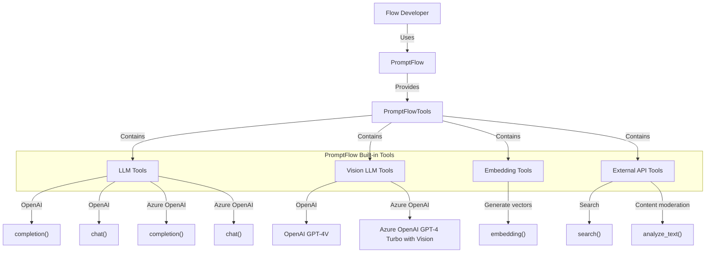
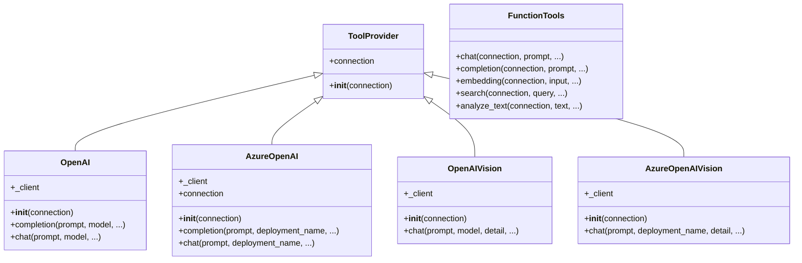
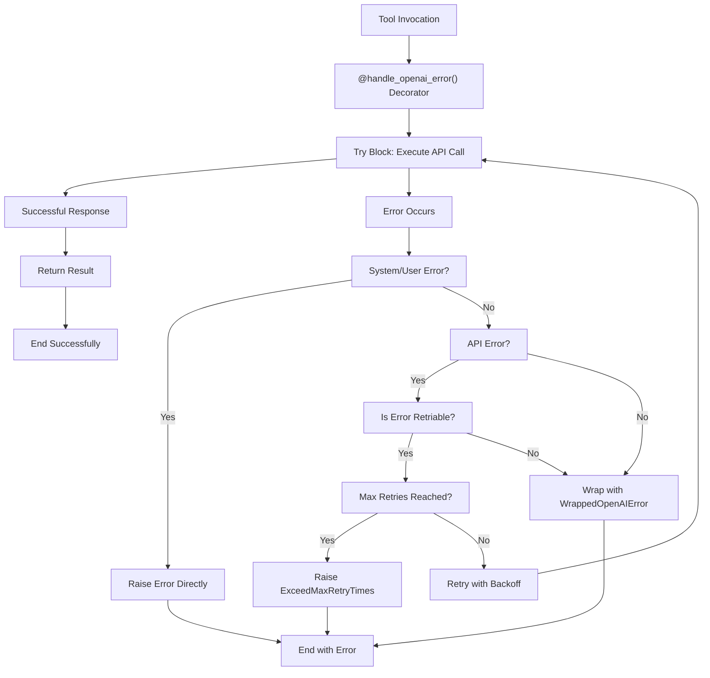
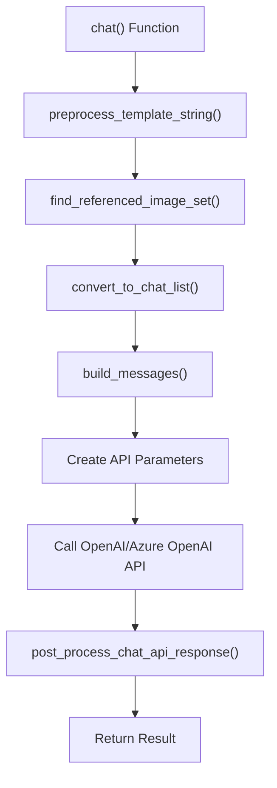
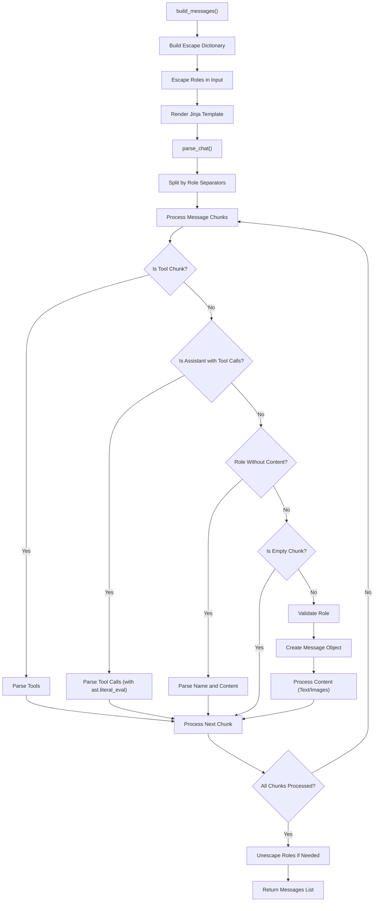
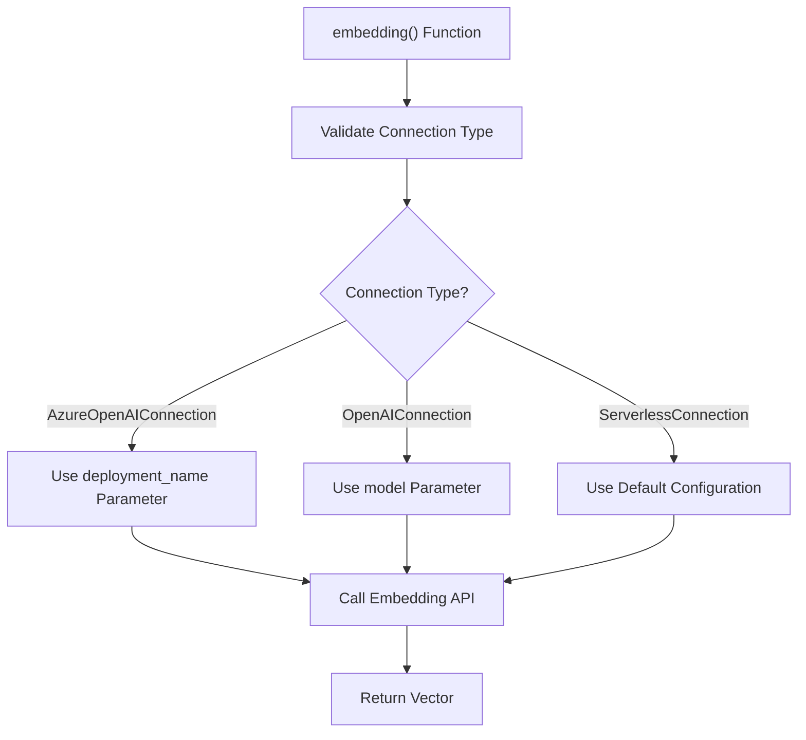
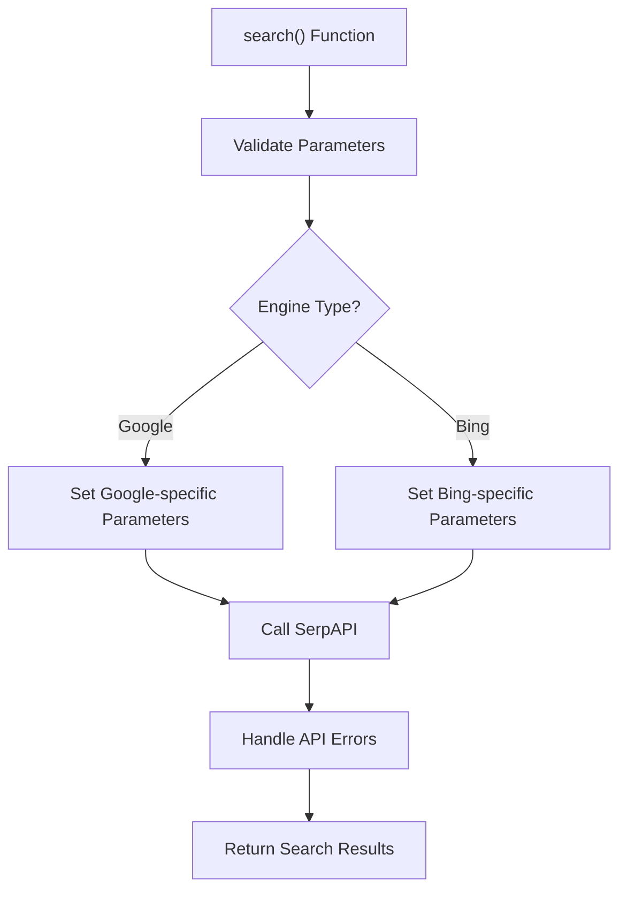
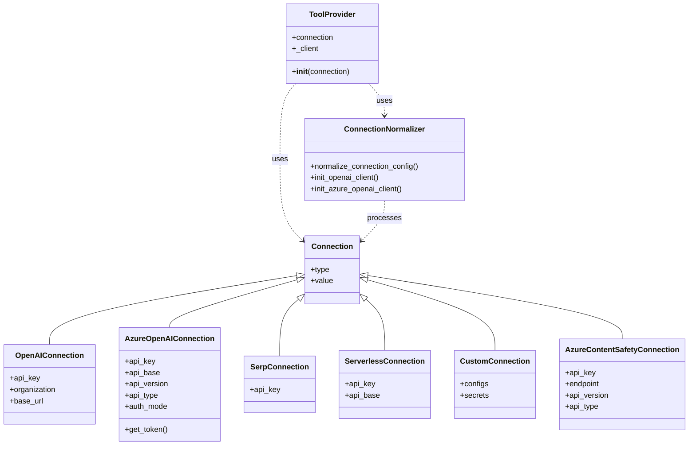
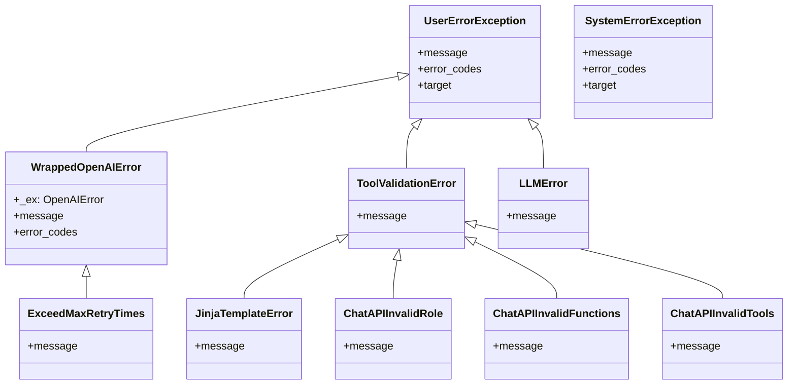
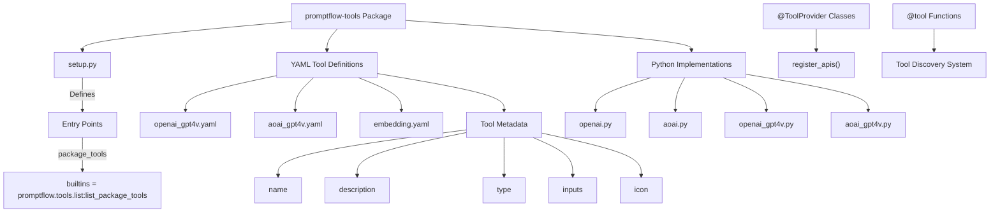

<!-- source: DeepWiki mcp.deepwiki.com · repo microsoft/promptflow · page 5 Built-in Tools · fetched 2026-10-26 -->

# Built-in Tools

Relevant source files

The following files were used as context for generating this wiki page:

- [docs/reference/tools-reference/aoai-gpt4-turbo-vision.md](docs/reference/tools-reference/aoai-gpt4-turbo-vision.md)
- [docs/reference/tools-reference/openai-gpt-4v-tool.md](docs/reference/tools-reference/openai-gpt-4v-tool.md)
- [scripts/distributing/publish_package.py](scripts/distributing/publish_package.py)
- [src/promptflow-evals/promptflow/evals/synthetic/_model_tools/models.py](src/promptflow-evals/promptflow/evals/synthetic/_model_tools/models.py)
- [src/promptflow-tools/CHANGELOG.md](src/promptflow-tools/CHANGELOG.md)
- [src/promptflow-tools/README.dev.md](src/promptflow-tools/README.dev.md)
- [src/promptflow-tools/README.md](src/promptflow-tools/README.md)
- [src/promptflow-tools/promptflow/tools/aoai.py](src/promptflow-tools/promptflow/tools/aoai.py)
- [src/promptflow-tools/promptflow/tools/aoai_gpt4v.py](src/promptflow-tools/promptflow/tools/aoai_gpt4v.py)
- [src/promptflow-tools/promptflow/tools/common.py](src/promptflow-tools/promptflow/tools/common.py)
- [src/promptflow-tools/promptflow/tools/exception.py](src/promptflow-tools/promptflow/tools/exception.py)
- [src/promptflow-tools/promptflow/tools/openai.py](src/promptflow-tools/promptflow/tools/openai.py)
- [src/promptflow-tools/promptflow/tools/openai_gpt4v.py](src/promptflow-tools/promptflow/tools/openai_gpt4v.py)
- [src/promptflow-tools/promptflow/tools/yamls/aoai_gpt4v.yaml](src/promptflow-tools/promptflow/tools/yamls/aoai_gpt4v.yaml)
- [src/promptflow-tools/promptflow/tools/yamls/embedding.yaml](src/promptflow-tools/promptflow/tools/yamls/embedding.yaml)
- [src/promptflow-tools/promptflow/tools/yamls/openai_gpt4v.yaml](src/promptflow-tools/promptflow/tools/yamls/openai_gpt4v.yaml)
- [src/promptflow-tools/promptflow/version.txt](src/promptflow-tools/promptflow/version.txt)
- [src/promptflow-tools/requirements.txt](src/promptflow-tools/requirements.txt)
- [src/promptflow-tools/setup.py](src/promptflow-tools/setup.py)
- [src/promptflow-tools/tests/pytest.ini](src/promptflow-tools/tests/pytest.ini)
- [src/promptflow-tools/tests/test_aoai.py](src/promptflow-tools/tests/test_aoai.py)
- [src/promptflow-tools/tests/test_aoai_gptv.py](src/promptflow-tools/tests/test_aoai_gptv.py)
- [src/promptflow-tools/tests/test_common.py](src/promptflow-tools/tests/test_common.py)
- [src/promptflow-tools/tests/test_embedding.py](src/promptflow-tools/tests/test_embedding.py)
- [src/promptflow-tools/tests/test_handle_openai_error.py](src/promptflow-tools/tests/test_handle_openai_error.py)
- [src/promptflow-tools/tests/test_openai.py](src/promptflow-tools/tests/test_openai.py)
- [src/promptflow-tools/tests/test_openai_gpt4v.py](src/promptflow-tools/tests/test_openai_gpt4v.py)
- [src/promptflow-tools/tests/test_serpapi.py](src/promptflow-tools/tests/test_serpapi.py)

This page documents the built-in tools provided by the `promptflow-tools` package, which offers ready-to-use integrations with popular AI services and utilities for building flows in PromptFlow. These tools are core components that enable interactions with language models, embeddings, and external APIs without requiring custom code implementation.

## Overview

The built-in tools in PromptFlow serve as pre-packaged functionality that can be used as nodes in a flow. They handle common tasks like invoking language models, generating embeddings, and interfacing with external services. These tools abstract away the complexities of API interactions, error handling, and response processing.

Sources:
- [src/promptflow-tools/promptflow/tools/openai.py:29-101]()
- [src/promptflow-tools/promptflow/tools/openai.py:102-158]()
- [src/promptflow-tools/promptflow/tools/aoai.py:28-100]()
- [src/promptflow-tools/promptflow/tools/aoai.py:102-173]()
- [src/promptflow-tools/promptflow/tools/openai_gpt4v.py:14-58]()
- [src/promptflow-tools/promptflow/tools/aoai_gpt4v.py:41-91]()
- [src/promptflow-tools/promptflow/tools/yamls/embedding.yaml:1-36]()
- [src/promptflow-tools/tests/test_serpapi.py:8-46]()

## Tool Architecture

Built-in tools follow a consistent architecture pattern that integrates with the PromptFlow core system. Tools are implemented as both class methods within `ToolProvider` classes and as standalone functions, allowing for flexible usage patterns.

Sources:
- [src/promptflow-tools/promptflow/tools/openai.py:24-162]()
- [src/promptflow-tools/promptflow/tools/aoai.py:13-177]()
- [src/promptflow-tools/promptflow/tools/openai_gpt4v.py:9-58]()
- [src/promptflow-tools/promptflow/tools/aoai_gpt4v.py:36-91]()

## Common Tool Patterns

All built-in tools share common implementation patterns, including:

1. **Decorators**: Tools use decorators like `@tool` and `@handle_openai_error()` for functionality and error handling
2. **Connection Parameters**: All tools accept a connection as their first parameter
3. **YAML Definitions**: Tool interfaces are defined in YAML files in the `tools/yamls` directory
4. **Dual Implementation**: Both class methods and standalone functions for the same tool functionality
5. **Security Features**: Protection against prompt injection and arbitrary code execution

### Error Handling Pattern

The error handling system in built-in tools is particularly important for ensuring robust operation, especially when dealing with external APIs. The diagram below shows the error handling flow for LLM tools:

Sources:
- [src/promptflow-tools/promptflow/tools/common.py:523-628]()
- [src/promptflow-tools/promptflow/tools/exception.py:74-107]()
- [src/promptflow-tools/tests/test_handle_openai_error.py:20-396]()

## LLM Tools

PromptFlow provides several LLM tools that integrate with OpenAI and Azure OpenAI services. These tools handle communication with language model APIs and include comprehensive error handling, retry logic, and response processing.

### OpenAI and Azure OpenAI Tools

The primary LLM tools include:

| Tool | Provider | Description | Main Parameters |
|------|----------|-------------|-----------------|
| `chat` | OpenAI | Calls OpenAI chat completion API | connection, prompt, model, temperature, seed, etc. |
| `completion` | OpenAI | Calls OpenAI completion API | connection, prompt, model, max_tokens, etc. |
| `chat` | AzureOpenAI | Calls Azure OpenAI chat completion API | connection, prompt, deployment_name, temperature, seed, etc. |
| `completion` | AzureOpenAI | Calls Azure OpenAI completion API | connection, prompt, deployment_name, max_tokens, etc. |

These tools handle:
- Prompt formatting and rendering using Jinja templates
- Error handling and retry logic for API errors
- Function/tool calling capabilities
- Streaming responses (when `stream=True`)
- Response format specifications (including JSON mode)
- Prompt injection protection via role escaping
- Reproducible outputs via seed parameter

Sources:
- [src/promptflow-tools/promptflow/tools/openai.py:29-101]()
- [src/promptflow-tools/promptflow/tools/openai.py:102-158]()
- [src/promptflow-tools/promptflow/tools/openai.py:164-203]()
- [src/promptflow-tools/promptflow/tools/openai.py:206-247]()
- [src/promptflow-tools/promptflow/tools/aoai.py:28-100]()
- [src/promptflow-tools/promptflow/tools/aoai.py:102-173]()
- [src/promptflow-tools/promptflow/tools/aoai.py:179-218]()
- [src/promptflow-tools/promptflow/tools/aoai.py:221-265]()

### Vision LLM Tools

PromptFlow also provides tools specifically designed for multimodal models that can process both text and images:

| Tool | Provider | YAML Definition | Description |
|------|----------|-----------------|-------------|
| `OpenAI GPT-4V` | OpenAI | openai_gpt4v.yaml | Integration with OpenAI's GPT-4 Vision model |
| `Azure OpenAI GPT-4 Turbo with Vision` | AzureOpenAI | aoai_gpt4v.yaml | Integration with Azure OpenAI's GPT-4 Turbo with Vision model |

These tools include specialized handling for:
- Image input processing
- Converting images to appropriate formats for API consumption
- Image detail level control (auto, low, high)
- Dynamic deployment listing for Azure OpenAI
- Markdown image syntax processing

Sources:
- [src/promptflow-tools/promptflow/tools/openai_gpt4v.py:14-58]()
- [src/promptflow-tools/promptflow/tools/aoai_gpt4v.py:41-91]()
- [src/promptflow-tools/promptflow/tools/yamls/openai_gpt4v.yaml:1-65]()
- [src/promptflow-tools/promptflow/tools/yamls/aoai_gpt4v.yaml:1-72]()
- [docs/reference/tools-reference/openai-gpt-4v-tool.md:1-45]()
- [docs/reference/tools-reference/aoai-gpt4-turbo-vision.md:1-46]()

## Chat Message Processing

A critical aspect of LLM tools is their ability to process and format chat messages appropriately for different API endpoints. The diagram below illustrates the message processing flow:

The system includes security features to prevent prompt injection and arbitrary code execution:

1. **Role Escaping**: The `Escaper` class handles escaping and unescaping of role identifiers to prevent prompt injection
2. **Safe Parsing**: Uses `ast.literal_eval` instead of `eval` for parsing tool calls to prevent arbitrary code execution
3. **Sandboxed Jinja Environment**: Uses `SandboxedEnvironment` for template rendering to prevent code execution

Sources:
- [src/promptflow-tools/promptflow/tools/common.py:274-340]()
- [src/promptflow-tools/promptflow/tools/common.py:343-368]()
- [src/promptflow-tools/promptflow/tools/common.py:659-793]()
- [src/promptflow-tools/promptflow/tools/common.py:795-818]()
- [src/promptflow-tools/tests/test_common.py:48-270]()
- [src/promptflow-tools/tests/test_common.py:574-614]()

## Embedding Tools

The embedding tool provides functionality for converting text into vector representations using various embedding models:

| Tool | Function | Supported Connections |
|------|----------|------------------------|
| `Embedding` | `embedding()` | AzureOpenAIConnection, OpenAIConnection, ServerlessConnection |

This tool offers:
- Support for multiple connection types
- Dynamic model selection based on connection type
- Automatic conversion of text to appropriate vector formats
- Manual entry option for model selection

Sources:
- [src/promptflow-tools/promptflow/tools/yamls/embedding.yaml:1-36]()
- [src/promptflow-tools/tests/test_embedding.py:1-36]()

## External API Tools

PromptFlow built-in tools also include integrations with external APIs for specialized functionality:

| Tool | Function | Description |
|------|----------|-------------|
| `SerpAPI` | `search()` | Integrates with search engines via SerpAPI |
| `AzureContentSafety` | `analyze_text()` | Analyzes text for harmful content using Azure Content Safety |

The SerpAPI tool supports multiple search engines:

These tools enable:
- Web search capabilities within flows
- Content moderation and safety filtering
- Safe mode options for search results

Sources:
- [src/promptflow-tools/tests/test_serpapi.py:8-46]()

## Connection Management

All built-in tools rely on a connection management system that handles authentication and configuration for different API providers. The diagram below shows how tools interact with connections:

The connection system supports multiple authentication methods:
- API key-based authentication
- Token-based authentication (MEID tokens for Azure OpenAI)
- Custom connection configurations

Sources:
- [src/promptflow-tools/promptflow/tools/common.py:383-484]()
- [src/promptflow-tools/tests/test_common.py:464-496]()

## Error Handling System

The built-in tools incorporate a sophisticated error handling system specifically designed for API interactions. This system categorizes errors and provides helpful messages to users:

| Error Type | Base Class | Purpose |
|------------|------------|---------|
| `WrappedOpenAIError` | `UserErrorException` | Wraps OpenAI API errors with helpful messages |
| `ExceedMaxRetryTimes` | `WrappedOpenAIError` | Indicates retry limit reached |
| `ToolValidationError` | `UserErrorException` | Base for tool input validation errors |
| `ChatAPIInvalidRole` | `ToolValidationError` | Invalid chat role error |
| `ChatAPIInvalidFunctions` | `ToolValidationError` | Invalid functions format error |
| `ChatAPIInvalidTools` | `ToolValidationError` | Invalid tools format error |
| `LLMError` | `UserErrorException` | Generic LLM-related errors |
| `JinjaTemplateError` | `ToolValidationError` | Template rendering errors |

The error handling system provides:
- Automatic retries for transient errors
- Detailed error messages with troubleshooting guidance
- Proper error categorization (user vs. system errors)
- Error code hierarchies for systematic error handling
- Special handling for unprocessable entity errors (422)
- Retry-after header processing for rate limiting

Sources:
- [src/promptflow-tools/promptflow/tools/exception.py:8-71]()
- [src/promptflow-tools/promptflow/tools/exception.py:74-229]()
- [src/promptflow-tools/promptflow/tools/common.py:523-628]()
- [src/promptflow-tools/tests/test_handle_openai_error.py:20-396]()

## Tool Registration and Discovery

Built-in tools are registered and made discoverable in the PromptFlow system through YAML definitions and entry points:

The YAML definitions provide rich metadata for tools, including:
- Tool name and description
- Input parameters with types and defaults
- Icons for visual representation in UIs
- Dynamic list capabilities for parameter selection
- Tool state (preview, stable)

Sources:
- [src/promptflow-tools/setup.py:34-70]()
- [src/promptflow-tools/promptflow/tools/yamls/openai_gpt4v.yaml:1-65]()
- [src/promptflow-tools/promptflow/tools/yamls/aoai_gpt4v.yaml:1-72]()
- [src/promptflow-tools/promptflow/tools/yamls/embedding.yaml:1-36]()

## Recent Updates to Built-in Tools

The built-in tools are actively maintained and receive regular updates. Recent enhancements include:

- Addition of "detail" parameter for vision models (v1.6.0)
- Prevention of unintended role parsing in prompt templates (v1.5.0)
- Introduction of universal contract LLM tool (v1.5.0)
- Support for token-based authentication in Azure OpenAI connection (v1.4.0)
- Addition of "seed" parameter to LLM tools for reproducibility (v1.4.0)
- Improved error handling for GPT-4 Vision models (v1.4.0)

Sources:
- [src/promptflow-tools/CHANGELOG.md:1-69]()
- [src/promptflow-tools/promptflow/version.txt:1-2]()

## Conclusion

The built-in tools in PromptFlow provide a robust foundation for building AI applications. They handle the complexities of API interactions, error management, and response processing, allowing developers to focus on application logic rather than integration details. As new AI services and capabilities emerge, the built-in tools collection continues to expand to support these advancements.

---

