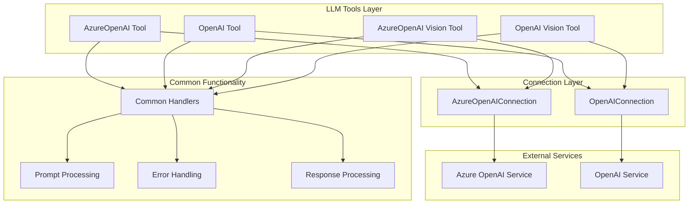
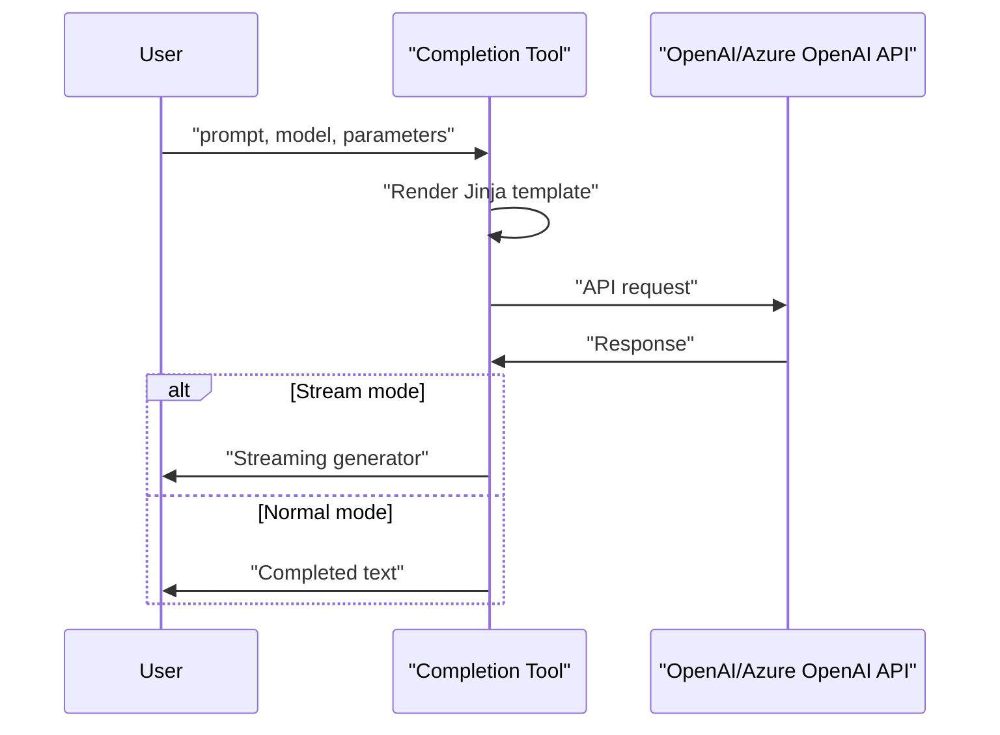
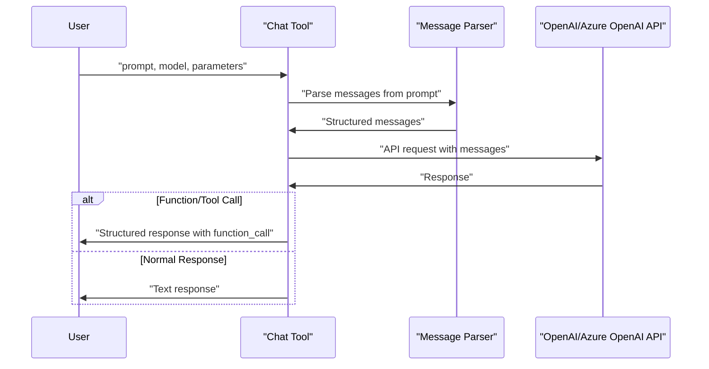
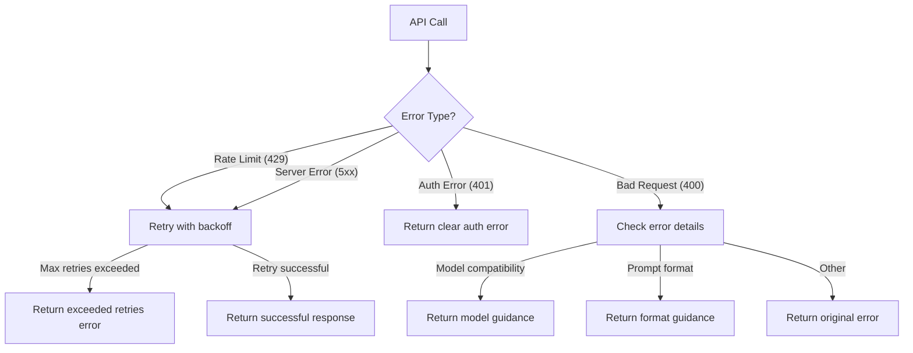
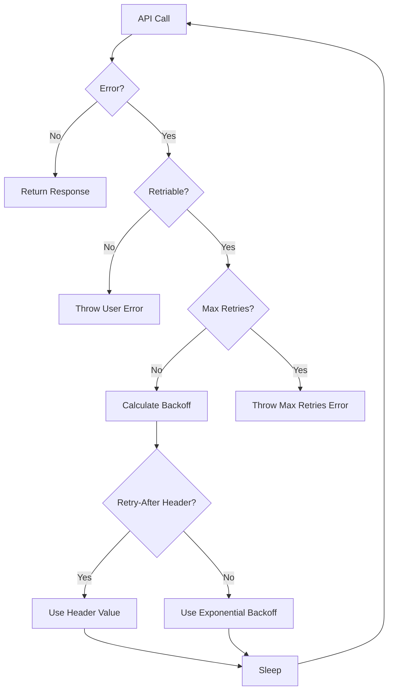

<!-- source: DeepWiki mcp.deepwiki.com · repo microsoft/promptflow · page 5.1 LLM Tools · fetched 2026-10-26 -->

# LLM Tools

<details>
<summary>Relevant source files</summary>

The following files were used as context for generating this wiki page:

- [.cspell.json](.cspell.json)
- [docs/reference/tools-reference/aoai-gpt4-turbo-vision.md](docs/reference/tools-reference/aoai-gpt4-turbo-vision.md)
- [docs/reference/tools-reference/openai-gpt-4v-tool.md](docs/reference/tools-reference/openai-gpt-4v-tool.md)
- [src/promptflow-tools/connections.json.example](src/promptflow-tools/connections.json.example)
- [src/promptflow-tools/promptflow/tools/aoai.py](src/promptflow-tools/promptflow/tools/aoai.py)
- [src/promptflow-tools/promptflow/tools/aoai_gpt4v.py](src/promptflow-tools/promptflow/tools/aoai_gpt4v.py)
- [src/promptflow-tools/promptflow/tools/common.py](src/promptflow-tools/promptflow/tools/common.py)
- [src/promptflow-tools/promptflow/tools/exception.py](src/promptflow-tools/promptflow/tools/exception.py)
- [src/promptflow-tools/promptflow/tools/openai.py](src/promptflow-tools/promptflow/tools/openai.py)
- [src/promptflow-tools/promptflow/tools/openai_gpt4v.py](src/promptflow-tools/promptflow/tools/openai_gpt4v.py)
- [src/promptflow-tools/promptflow/tools/yamls/aoai_gpt4v.yaml](src/promptflow-tools/promptflow/tools/yamls/aoai_gpt4v.yaml)
- [src/promptflow-tools/promptflow/tools/yamls/embedding.yaml](src/promptflow-tools/promptflow/tools/yamls/embedding.yaml)
- [src/promptflow-tools/promptflow/tools/yamls/openai_gpt4v.yaml](src/promptflow-tools/promptflow/tools/yamls/openai_gpt4v.yaml)
- [src/promptflow-tools/tests/conftest.py](src/promptflow-tools/tests/conftest.py)
- [src/promptflow-tools/tests/pytest.ini](src/promptflow-tools/tests/pytest.ini)
- [src/promptflow-tools/tests/test_acs.py](src/promptflow-tools/tests/test_acs.py)
- [src/promptflow-tools/tests/test_aoai.py](src/promptflow-tools/tests/test_aoai.py)
- [src/promptflow-tools/tests/test_aoai_gptv.py](src/promptflow-tools/tests/test_aoai_gptv.py)
- [src/promptflow-tools/tests/test_common.py](src/promptflow-tools/tests/test_common.py)
- [src/promptflow-tools/tests/test_embedding.py](src/promptflow-tools/tests/test_embedding.py)
- [src/promptflow-tools/tests/test_handle_openai_error.py](src/promptflow-tools/tests/test_handle_openai_error.py)
- [src/promptflow-tools/tests/test_openai.py](src/promptflow-tools/tests/test_openai.py)
- [src/promptflow-tools/tests/test_openai_gpt4v.py](src/promptflow-tools/tests/test_openai_gpt4v.py)
- [src/promptflow-tools/tests/test_serpapi.py](src/promptflow-tools/tests/test_serpapi.py)

</details>


This page documents the LLM (Large Language Model) tools available in Prompt Flow, which enable interaction with OpenAI and Azure OpenAI services. These tools allow you to leverage powerful language models for text completion, chat-based interactions, and vision capabilities.

For information about creating custom tools, see [Creating Custom Tools](#5.2).

## Overview

Prompt Flow provides built-in tools for interacting with LLM services through standardized interfaces. These tools handle authentication, API communication, error handling, and response processing, allowing you to focus on designing effective prompts and flows.

The LLM tools support:
- Text completion with various models
- Chat-based interactions with support for system, user, and assistant roles
- Function calling and tool usage capabilities
- Vision-based models that can process images
- Robust error handling and retry mechanisms

Sources:
- [src/promptflow-tools/promptflow/tools/aoai.py]()
- [src/promptflow-tools/promptflow/tools/openai.py]()
- [src/promptflow-tools/promptflow/tools/aoai_gpt4v.py]()
- [src/promptflow-tools/promptflow/tools/openai_gpt4v.py]()

## Architecture



Sources:
- [src/promptflow-tools/promptflow/tools/aoai.py]()
- [src/promptflow-tools/promptflow/tools/openai.py]()
- [src/promptflow-tools/promptflow/tools/common.py]()

## Tool Interfaces

The LLM tools provide two primary interfaces:

### Completion API

The completion API is designed for text completion tasks with models like `text-davinci-003`. It takes a prompt and generates a continuation of that text.



Sources:
- [src/promptflow-tools/promptflow/tools/aoai.py:28-100]()
- [src/promptflow-tools/promptflow/tools/openai.py:29-88]()

### Chat API

The chat API is designed for conversational interactions with models like `gpt-3.5-turbo` and `gpt-4`. It supports structured conversations with system, user, and assistant roles.



Sources:
- [src/promptflow-tools/promptflow/tools/aoai.py:102-173]()
- [src/promptflow-tools/promptflow/tools/openai.py:90-158]()

## Key Components

### Message Parsing

The tools parse chat prompts into structured messages that the OpenAI API can understand. The parser supports:

- System, user, and assistant roles
- Function and tool roles for function calling
- Name and content fields for function responses
- Tool call IDs for tool responses
- Image embedding for vision models

```python
# Example of parsed chat messages
[
    {"role": "system", "content": "You are a helpful assistant."},
    {"role": "user", "content": "What's the weather like?"},
    {"role": "assistant", "tool_calls": [
        {"id": "call_123", "function": {"name": "get_weather", "arguments": "{\"location\": \"San Francisco\"}"}}
    ]},
    {"role": "tool", "tool_call_id": "call_123", "content": "{\"temperature\": 72, \"condition\": \"sunny\"}"}
]
```

Sources:
- [src/promptflow-tools/promptflow/tools/common.py:277-343]()

### Error Handling

The tools provide robust error handling for OpenAI API errors, with different strategies for different error types:

- Retryable errors (rate limits, server errors) are automatically retried with backoff
- Authentication errors provide clear guidance on fixing connection issues
- Model compatibility errors explain which models support which features
- Prompt format errors help users correct their prompt structure



Sources:
- [src/promptflow-tools/promptflow/tools/common.py:526-631]()
- [src/promptflow-tools/promptflow/tools/exception.py:1-72]()

## Available Tools

### Azure OpenAI Tools

#### AzureOpenAI.completion

Used for text completion with Azure OpenAI models.

**Key Parameters:**
- `connection`: AzureOpenAIConnection object
- `prompt`: PromptTemplate to render
- `deployment_name`: Name of the Azure OpenAI deployment
- `max_tokens`: Maximum tokens to generate
- `temperature`: Controls randomness (0-1)
- Additional parameters for controlling generation

Sources:
- [src/promptflow-tools/promptflow/tools/aoai.py:28-100]()
- [src/promptflow-tools/promptflow/tools/aoai.py:180-218]()

#### AzureOpenAI.chat

Used for chat-based interactions with Azure OpenAI models.

**Key Parameters:**
- `connection`: AzureOpenAIConnection object
- `prompt`: PromptTemplate with chat format
- `deployment_name`: Name of the Azure OpenAI deployment
- `functions`: Optional list of functions the model can call
- `tools`: Optional list of tools the model can use
- Additional parameters for controlling generation

Sources:
- [src/promptflow-tools/promptflow/tools/aoai.py:102-173]()
- [src/promptflow-tools/promptflow/tools/aoai.py:222-265]()

#### AzureOpenAI Vision

Used for vision-based interactions with Azure OpenAI GPT-4 Vision models.

**Key Parameters:**
- `connection`: AzureOpenAIConnection object
- `prompt`: PromptTemplate with image references
- `deployment_name`: Name of the Azure OpenAI Vision deployment
- `detail`: Level of detail for image analysis (auto, low, high)
- Additional parameters for controlling generation

Sources:
- [src/promptflow-tools/promptflow/tools/aoai_gpt4v.py:41-91]()
- [src/promptflow-tools/promptflow/tools/yamls/aoai_gpt4v.yaml]()

### OpenAI Tools

#### OpenAI.completion

Used for text completion with OpenAI models.

**Key Parameters:**
- `connection`: OpenAIConnection object
- `prompt`: PromptTemplate to render
- `model`: OpenAI model name (e.g., text-davinci-003)
- `max_tokens`: Maximum tokens to generate
- `temperature`: Controls randomness (0-1)
- Additional parameters for controlling generation

Sources:
- [src/promptflow-tools/promptflow/tools/openai.py:29-88]()
- [src/promptflow-tools/promptflow/tools/openai.py:164-203]()

#### OpenAI.chat

Used for chat-based interactions with OpenAI models.

**Key Parameters:**
- `connection`: OpenAIConnection object
- `prompt`: PromptTemplate with chat format
- `model`: OpenAI model name (e.g., gpt-3.5-turbo)
- `functions`: Optional list of functions the model can call
- `tools`: Optional list of tools the model can use
- Additional parameters for controlling generation

Sources:
- [src/promptflow-tools/promptflow/tools/openai.py:90-158]()
- [src/promptflow-tools/promptflow/tools/openai.py:207-247]()

#### OpenAI Vision

Used for vision-based interactions with OpenAI GPT-4 Vision models.

**Key Parameters:**
- `connection`: OpenAIConnection object
- `prompt`: PromptTemplate with image references
- `model`: OpenAI model name (typically gpt-4-vision-preview)
- `detail`: Level of detail for image analysis (auto, low, high)
- Additional parameters for controlling generation

Sources:
- [src/promptflow-tools/promptflow/tools/openai_gpt4v.py:14-58]()
- [src/promptflow-tools/promptflow/tools/yamls/openai_gpt4v.yaml]()

## Prompt Format

### Chat Prompt Format

Chat prompts must follow a specific format with role delimiters:

```
# system:
You are a helpful assistant.

# user:
What's the weather like in Seattle?

# assistant:
I don't have real-time weather data, but I can help you find that information.
```

The supported roles are:
- `system`: Instructions for the assistant
- `user`: User messages
- `assistant`: Assistant responses
- `function`: Function responses (requires name and content)
- `tool`: Tool responses (requires tool_call_id and content)

Sources:
- [src/promptflow-tools/promptflow/tools/common.py:42]()
- [src/promptflow-tools/promptflow/tools/common.py:277-343]()

### Function Calling

Function calling allows the model to request specific information. The format for defining functions:

```json
[
  {
    "name": "get_weather",
    "parameters": {
      "type": "object",
      "properties": {
        "location": {
          "type": "string",
          "description": "The city and state"
        },
        "unit": {
          "type": "string",
          "enum": ["celsius", "fahrenheit"]
        }
      },
      "required": ["location"]
    },
    "description": "Get the current weather in a location"
  }
]
```

Sources:
- [src/promptflow-tools/promptflow/tools/common.py:161-182]()
- [src/promptflow-tools/promptflow/tools/common.py:124-158]()

### Tool Usage

Tool usage is similar to function calling but with a slightly different structure:

```json
[
  {
    "type": "function",
    "function": {
      "name": "get_weather",
      "description": "Get the current weather in a location",
      "parameters": {
        "type": "object",
        "properties": {
          "location": {
            "type": "string",
            "description": "The city and state"
          },
          "unit": {
            "type": "string",
            "enum": ["celsius", "fahrenheit"]
          }
        },
        "required": ["location"]
      }
    }
  }
]
```

Sources:
- [src/promptflow-tools/promptflow/tools/common.py:185-223]()

### Vision Prompts

Vision prompts include image references that are processed specially:

```
# system:
Describe the image in detail.

# user:
What can you see in this image?

```

The image references are converted to the appropriate format for the vision models.

Sources:
- [src/promptflow-tools/promptflow/tools/common.py:346-371]()
- [src/promptflow-tools/promptflow/tools/aoai_gpt4v.py:59-65]()
- [src/promptflow-tools/promptflow/tools/openai_gpt4v.py:32-37]()

## Connection Configuration

### Azure OpenAI Connection

```json
{
  "type": "AzureOpenAIConnection",
  "value": {
    "api_key": "your-api-key",
    "api_base": "https://your-resource-name.openai.azure.com/",
    "api_type": "azure",
    "api_version": "2023-07-01-preview"
  }
}
```

Sources:
- [src/promptflow-tools/connections.json.example:2-11]()

### OpenAI Connection

```json
{
  "type": "OpenAIConnection",
  "value": {
    "api_key": "your-api-key",
    "organization": "your-organization-id"
  }
}
```

Sources:
- [src/promptflow-tools/connections.json.example:62-69]()

## Error Handling and Retries

The LLM tools implement sophisticated error handling with automatic retries for transient errors:

1. **Retriable Errors**:
   - Rate limit errors (429)
   - Internal server errors (500+)
   - Connection errors
   - Timeout errors

2. **Non-Retriable Errors**:
   - Authentication errors
   - Bad request errors (except specific cases)
   - Invalid model errors

3. **Retry Strategy**:
   - Exponential backoff with jitter
   - Respects `Retry-After` headers when provided
   - Configurable maximum retry attempts



Sources:
- [src/promptflow-tools/promptflow/tools/common.py:526-631]()
- [src/promptflow-tools/promptflow/tools/exception.py:73-116]()

## Best Practices

### Prompt Design

1. **Use System Role Effectively**:
   - Set clear instructions and constraints
   - Define the assistant's persona and capabilities

2. **Structure User Inputs**:
   - Be specific in your requests
   - Provide context when needed

3. **Handle Function Calling**:
   - Define functions with clear parameter descriptions
   - Validate function outputs before using them

### Error Handling

1. **Handle Common Errors**:
   - Rate limit errors (retry with backoff)
   - Authentication errors (check connection settings)
   - Model compatibility errors (use appropriate models)

2. **Validate Inputs**:
   - Ensure prompts follow the correct format
   - Validate function definitions before passing to the API

3. **Monitor Token Usage**:
   - Set appropriate `max_tokens` to avoid truncated responses
   - Be aware of token limits for different models

Sources:
- [src/promptflow-tools/tests/test_handle_openai_error.py]()
- [src/promptflow-tools/tests/test_aoai.py]()
- [src/promptflow-tools/tests/test_openai.py]()

## Advanced Features

### Response Streaming

Both completion and chat tools support streaming responses, which is useful for:
- Displaying responses incrementally to users
- Processing long responses in chunks
- Reducing perceived latency

```python
# Example of streaming usage
result = chat(
    connection=connection,
    prompt=prompt,
    model="gpt-3.5-turbo",
    stream=True
)

for chunk in result:
    # Process each chunk as it arrives
    print(chunk, end="", flush=True)
```

Sources:
- [src/promptflow-tools/promptflow/tools/aoai.py:89-97]()
- [src/promptflow-tools/promptflow/tools/aoai.py:125-132]()

### Response Format Control

The chat API supports controlling the format of the response:

```python
# Request JSON output
result = chat(
    connection=connection,
    prompt=prompt,
    model="gpt-4-1106-preview",
    response_format={"type": "json_object"}
)
```

Sources:
- [src/promptflow-tools/promptflow/tools/aoai.py:161-162]()
- [src/promptflow-tools/promptflow/tools/openai.py:146-147]()

### Vision Capabilities

Vision models can process images along with text:

```python
# Example of vision usage
result = chat(
    connection=connection,
    prompt="# user:\nWhat's in this image?\n",
    model="gpt-4-vision-preview",
    image_input=image_object
)
```

Sources:
- [src/promptflow-tools/promptflow/tools/aoai_gpt4v.py:41-91]()
- [src/promptflow-tools/promptflow/tools/openai_gpt4v.py:14-58]()

## Troubleshooting

### Common Errors

| Error | Possible Cause | Solution |
|-------|----------------|----------|
| Authentication Error | Invalid API key | Check your connection settings and API key |
| Rate Limit Error | Too many requests | Implement backoff strategy or increase quota |
| Bad Request Error | Invalid parameters | Check model compatibility and parameter values |
| Model Not Found | Incorrect model name | Verify model name or deployment name |
| Context Length Exceeded | Too much input text | Reduce input length or use a model with larger context |
| Function Format Error | Incorrectly formatted functions | Validate function definitions against schema |

Sources:
- [src/promptflow-tools/promptflow/tools/exception.py:8-72]()
- [src/promptflow-tools/tests/test_handle_openai_error.py]()

### Debugging Tips

1. **Check Connection Settings**:
   - Verify API key, endpoint, and API version
   - Ensure the model or deployment exists

2. **Validate Prompt Format**:
   - Ensure chat prompts have proper role delimiters
   - Check for syntax errors in Jinja templates

3. **Monitor API Responses**:
   - Look for error messages in the response
   - Check HTTP status codes for API issues

4. **Test with Simpler Prompts**:
   - Start with basic prompts and add complexity
   - Isolate issues by testing components separately

Sources:
- [src/promptflow-tools/tests/test_aoai.py]()
- [src/promptflow-tools/tests/test_openai.py]()
- [src/promptflow-tools/tests/test_aoai_gptv.py]()
- [src/promptflow-tools/tests/test_openai_gpt4v.py]()

---

