<!-- source: DeepWiki mcp.deepwiki.com · repo microsoft/promptflow · page 5.2 Creating Custom Tools · fetched 2026-10-26 -->

# Creating Custom Tools

<details>
<summary>Relevant source files</summary>

The following files were used as context for generating this wiki page:

- [docs/reference/tools-reference/aoai-gpt4-turbo-vision.md](docs/reference/tools-reference/aoai-gpt4-turbo-vision.md)
- [docs/reference/tools-reference/openai-gpt-4v-tool.md](docs/reference/tools-reference/openai-gpt-4v-tool.md)
- [src/promptflow-tools/promptflow/tools/aoai.py](src/promptflow-tools/promptflow/tools/aoai.py)
- [src/promptflow-tools/promptflow/tools/aoai_gpt4v.py](src/promptflow-tools/promptflow/tools/aoai_gpt4v.py)
- [src/promptflow-tools/promptflow/tools/common.py](src/promptflow-tools/promptflow/tools/common.py)
- [src/promptflow-tools/promptflow/tools/exception.py](src/promptflow-tools/promptflow/tools/exception.py)
- [src/promptflow-tools/promptflow/tools/openai.py](src/promptflow-tools/promptflow/tools/openai.py)
- [src/promptflow-tools/promptflow/tools/openai_gpt4v.py](src/promptflow-tools/promptflow/tools/openai_gpt4v.py)
- [src/promptflow-tools/promptflow/tools/yamls/aoai_gpt4v.yaml](src/promptflow-tools/promptflow/tools/yamls/aoai_gpt4v.yaml)
- [src/promptflow-tools/promptflow/tools/yamls/embedding.yaml](src/promptflow-tools/promptflow/tools/yamls/embedding.yaml)
- [src/promptflow-tools/promptflow/tools/yamls/openai_gpt4v.yaml](src/promptflow-tools/promptflow/tools/yamls/openai_gpt4v.yaml)
- [src/promptflow-tools/tests/pytest.ini](src/promptflow-tools/tests/pytest.ini)
- [src/promptflow-tools/tests/test_aoai.py](src/promptflow-tools/tests/test_aoai.py)
- [src/promptflow-tools/tests/test_aoai_gptv.py](src/promptflow-tools/tests/test_aoai_gptv.py)
- [src/promptflow-tools/tests/test_common.py](src/promptflow-tools/tests/test_common.py)
- [src/promptflow-tools/tests/test_embedding.py](src/promptflow-tools/tests/test_embedding.py)
- [src/promptflow-tools/tests/test_handle_openai_error.py](src/promptflow-tools/tests/test_handle_openai_error.py)
- [src/promptflow-tools/tests/test_openai.py](src/promptflow-tools/tests/test_openai.py)
- [src/promptflow-tools/tests/test_openai_gpt4v.py](src/promptflow-tools/tests/test_openai_gpt4v.py)
- [src/promptflow-tools/tests/test_serpapi.py](src/promptflow-tools/tests/test_serpapi.py)
- [src/promptflow/tests/executor/e2etests/test_executor_validation.py](src/promptflow/tests/executor/e2etests/test_executor_validation.py)
- [src/promptflow/tests/executor/e2etests/test_script_tool_generator.py](src/promptflow/tests/executor/e2etests/test_script_tool_generator.py)
- [src/promptflow/tests/executor/unittests/_core/test_tool_settings_parser.py](src/promptflow/tests/executor/unittests/_core/test_tool_settings_parser.py)
- [src/promptflow/tests/executor/unittests/_core/test_tools_manager.py](src/promptflow/tests/executor/unittests/_core/test_tools_manager.py)
- [src/promptflow/tests/executor/unittests/_utils/test_generate_tool_meta_utils.py](src/promptflow/tests/executor/unittests/_utils/test_generate_tool_meta_utils.py)
- [src/promptflow/tests/executor/unittests/_utils/test_tool_utils.py](src/promptflow/tests/executor/unittests/_utils/test_tool_utils.py)
- [src/promptflow/tests/executor/unittests/executor/test_flow_validator.py](src/promptflow/tests/executor/unittests/executor/test_flow_validator.py)
- [src/promptflow/tests/executor/unittests/executor/test_input_assignment_parser.py](src/promptflow/tests/executor/unittests/executor/test_input_assignment_parser.py)
- [src/promptflow/tests/executor/unittests/executor/test_tool_resolver.py](src/promptflow/tests/executor/unittests/executor/test_tool_resolver.py)
- [src/promptflow/tests/test_configs/eager_flows/flow_with_dataclass_output/flow_with_dataclass.meta.json](src/promptflow/tests/test_configs/eager_flows/flow_with_dataclass_output/flow_with_dataclass.meta.json)
- [src/promptflow/tests/test_configs/eager_flows/flow_with_dataclass_output/flow_with_dataclass.py](src/promptflow/tests/test_configs/eager_flows/flow_with_dataclass_output/flow_with_dataclass.py)
- [src/promptflow/tests/test_configs/wrong_flows/aggregation_activate_reference_non_aggregation/flow.dag.yaml](src/promptflow/tests/test_configs/wrong_flows/aggregation_activate_reference_non_aggregation/flow.dag.yaml)
- [src/promptflow/tests/test_configs/wrong_flows/flow_llm_with_wrong_conn/flow.dag.yaml](src/promptflow/tests/test_configs/wrong_flows/flow_llm_with_wrong_conn/flow.dag.yaml)
- [src/promptflow/tests/test_configs/wrong_flows/flow_llm_with_wrong_conn/wrong_llm.jinja2](src/promptflow/tests/test_configs/wrong_flows/flow_llm_with_wrong_conn/wrong_llm.jinja2)
- [src/promptflow/tests/test_configs/wrong_flows/non_aggregation_reference_aggregation/flow.dag.yaml](src/promptflow/tests/test_configs/wrong_flows/non_aggregation_reference_aggregation/flow.dag.yaml)

</details>


This page explains how to create custom tools in PromptFlow. Custom tools extend the functionality of PromptFlow by allowing you to integrate your own code as reusable components within flows. While PromptFlow provides [built-in tools](#5.1) for common operations, custom tools enable you to implement specialized functionality tailored to your specific needs.

## What is a Custom Tool?

A custom tool is a Python function or class decorated with the `@tool` decorator that can be used as a node within a PromptFlow flow. Custom tools can:

- Execute Python code with defined inputs and outputs
- Integrate with external services and APIs
- Use connections to manage credentials securely
- Process various data types, including complex objects
- Support streaming outputs for real-time responses

### Custom Tool Architecture

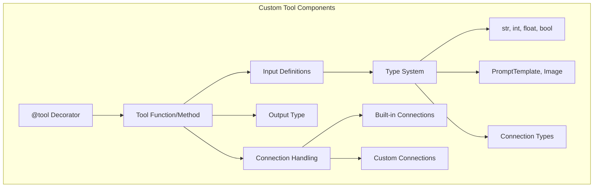

Sources: [src/promptflow-tools/promptflow/tools/aoai.py:13-18](), [src/promptflow/tests/executor/unittests/executor/test_tool_resolver.py:42-46]()

## Creating a Basic Custom Tool

To create a custom tool, you need to define a Python function and decorate it with the `@tool` decorator from the PromptFlow library.

### Simple Tool Example

Here's a basic example of a custom tool:

```python
from promptflow import tool

@tool
def my_custom_tool(input_text: str) -> str:
    """A simple custom tool that converts text to uppercase.
    
    Args:
        input_text: The text to convert to uppercase
        
    Returns:
        The uppercase version of the input text
    """
    return input_text.upper()
```

### Tool Types in PromptFlow

The `ToolResolver` supports different tool types and source types:

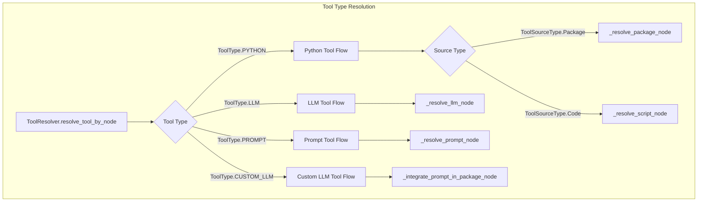

Sources: [src/promptflow/tests/executor/unittests/executor/test_tool_resolver.py:55-107]()

## Tool Decorator and Configuration

The `@tool` decorator is the key to creating custom tools. It can be used with various parameters to configure the tool's behavior.

### Basic Decorator Usage

```python
from promptflow import tool

@tool
def basic_tool(input_param: str) -> str:
    return input_param
```

### Streaming Support

For tools that need to support streaming outputs (like LLM responses), use the `streaming_option_parameter` parameter:

```python
@tool(streaming_option_parameter="stream_enabled")
def streaming_tool(prompt: str, stream_enabled: bool = False) -> str:
    # Implementation with streaming support
    if stream_enabled:
        # Return generator for streaming
        def generator():
            for chunk in response:
                yield chunk
        return generator()
    return result
```

### Tool Provider Classes

For more complex tools, you can create `ToolProvider` classes:

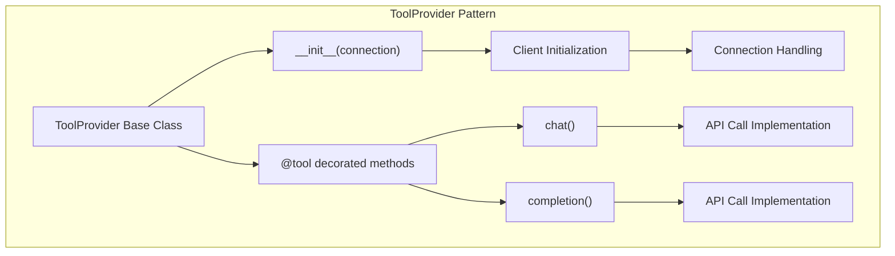

Sources: [src/promptflow-tools/promptflow/tools/aoai.py:13-18](), [src/promptflow/tests/executor/unittests/executor/test_tool_resolver.py:42-46]()

## Input and Output Types

Tools can define various input and output types to ensure proper data handling and validation.

### Basic Types

Tools support these basic input types:
- `str` - Text strings
- `int` - Integer numbers
- `float` - Floating-point numbers
- `bool` - Boolean values
- `list` - Lists of items
- `dict` - Dictionary objects

### Advanced Input Types

For more complex scenarios, you can use specialized types:

- `PromptTemplate` - For prompt inputs
- `Image` - For image data
- `AssistantDefinition` - For assistant configurations
- Connection types for credential management

### Type Validation Flow

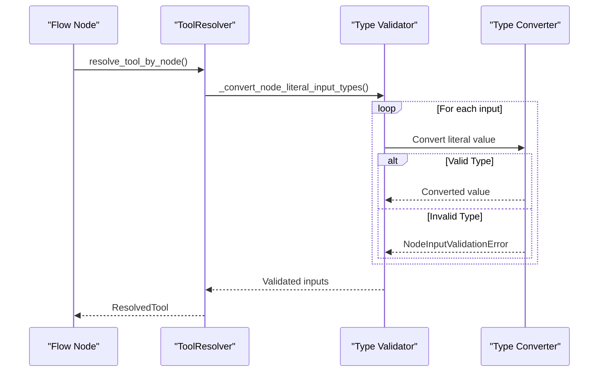

### Connection Type Handling

```python
from promptflow import tool
from promptflow.contracts.types import PromptTemplate
from promptflow.connections import AzureOpenAIConnection

@tool
def advanced_tool(
    prompt: PromptTemplate, 
    temperature: float, 
    connection: AzureOpenAIConnection
) -> str:
    # Implementation with connection
    return result
```

Sources: [src/promptflow/tests/executor/unittests/executor/test_tool_resolver.py:184-241](), [src/promptflow/tests/executor/unittests/executor/test_tool_resolver.py:404-437]()

## Connection Handling

Connections are a critical part of many custom tools, allowing secure credential management for external services.

### Connection Resolution Process

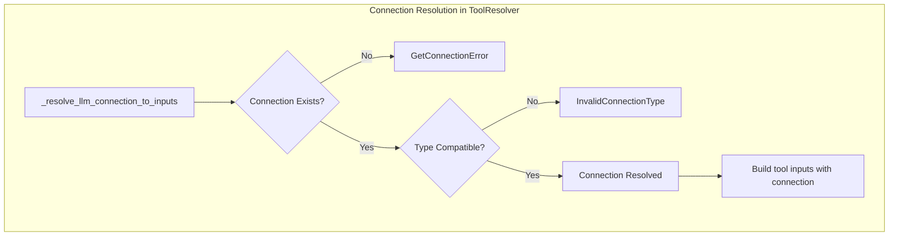

### Using Connections in Tools

```python
from promptflow import tool
from promptflow.connections import CustomConnection

@tool
def tool_with_connection(input_text: str, connection: CustomConnection) -> str:
    # Access connection configuration
    endpoint = connection.configs.get("api_base")
    
    # Access connection secrets
    api_key = connection.secrets.get("api_key")
    
    # Implement API call using these credentials
    return result
```

### Custom Strong-Typed Connections

The `ToolResolver` supports custom strong-typed connections:

```python
from promptflow import tool
from promptflow.connections import CustomStrongTypeConnection
from promptflow.contracts.tool import Secret

class MyFirstCSTConnection(CustomStrongTypeConnection):
    api_key: Secret
    api_base: str

@tool
def tool_with_custom_connection(input_text: str, connection: MyFirstCSTConnection) -> str:
    # Use strongly typed properties
    endpoint = connection.api_base
    api_key = connection.api_key
    
    return f"Connected to {endpoint}"
```

Sources: [src/promptflow/tests/executor/unittests/executor/test_tool_resolver.py:261-329](), [src/promptflow/tests/executor/unittests/executor/test_tool_resolver.py:500-514]()

## Advanced Tool Features

PromptFlow offers several advanced features for building more sophisticated tools.

### Assistant Tool Integration

PromptFlow supports assistant tools with complex definitions:

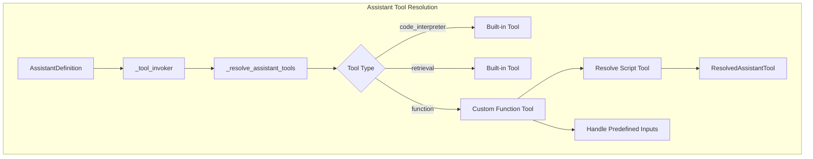

### Dynamic List Functions

Tools can have dynamically populated input lists:

```python
def my_list_func(prefix: str) -> list:
    """Generate dynamic list options"""
    return [
        {"value": f"{prefix}_option1", "display_value": "Option 1"},
        {"value": f"{prefix}_option2", "display_value": "Option 2"}
    ]

@tool
def tool_with_dynamic_list(prefix: str, selected: str) -> str:
    return f"Selected: {selected}"
```

### Tool Function Call Scenarios

The system supports different tool function call scenarios:

```python
from promptflow.contracts.tool import ToolFuncCallScenario

# DYNAMIC_LIST - for populating dropdown options
# GENERATED_BY - for generating dependent input values  
# REVERSE_GENERATED_BY - for parsing generated values back
```

### Error Handling in Tools

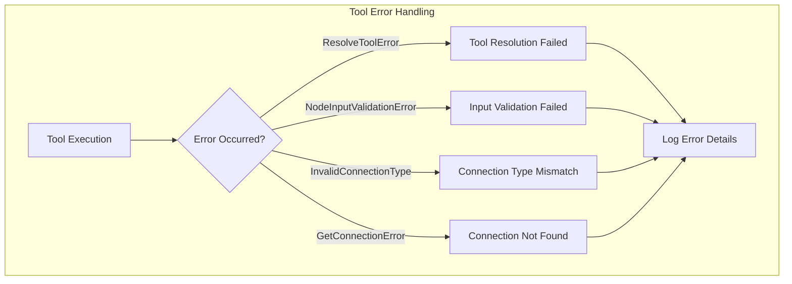

Sources: [src/promptflow/tests/executor/unittests/executor/test_tool_resolver.py:544-652](), [src/promptflow/tests/executor/unittests/_core/test_tools_manager.py:272-333]()

## Packaging Custom Tools

To make your custom tools available for use in PromptFlow, you need to package them properly.

### Tool Collection and Registration

```mermaid
flowchart TB
    subgraph "Tool Collection Process"
        EntryPoints["Entry Points Discovery"] --> CollectTools["collect_package_tools()"]
        CollectTools --> ToolDict["Package Tools Dictionary"]
        
        ToolDict --> ToolLoader["ToolLoader"]
        ToolLoader --> LoadPackageNode["load_tool_for_package_node()"]
        LoadPackageNode --> BuiltinsManager["BuiltinsManager._load_package_tool()"]
        
        BuiltinsManager --> ResolvedTool["Tool Function + Init Args"]
    end
    
    subgraph "Tool Registration Flow"
        PackageTools["Package Tools Registry"] --> ToolResolver["ToolResolver"]
        ToolResolver --> NodeResolution["resolve_tool_by_node()"]
        NodeResolution --> ExecutableRool["Executable Tool"]
    end
```

### Creating a Tool Package

1. Create a Python package with the following structure:

```
my_tools_package/
├── setup.py
├── my_tools_package/
│   ├── __init__.py
│   ├── tools/
│   │   ├── __init__.py
│   │   ├── my_tool.py
│   │   └── list.py
│   └── connections.py  # Optional: Custom connections
```

2. Implement your tools in `my_tool.py`:

```python
from promptflow import tool

@tool
def my_tool(input_text: str) -> str:
    return input_text.upper()
```

3. Create a function to list your package tools in `list.py`:

```python
def list_package_tools():
    """Return dictionary of available tools in this package"""
    return {
        "my_tools_package.tools.my_tool.my_tool": {
            "name": "My Tool",
            "description": "A tool that converts text to uppercase", 
            "type": "python",
            "module": "my_tools_package.tools.my_tool",
            "function": "my_tool",
            "inputs": {
                "input_text": {"type": ["string"]}
            }
        }
    }
```

### Entry Point Configuration

Configure your `setup.py` to register tools with the package system:

```python
from setuptools import setup, find_packages

setup(
    name="my-tools-package",
    version="0.1.0", 
    packages=find_packages(),
    entry_points={
        "package_tools": [
            "my_tools = my_tools_package.tools.list:list_package_tools"
        ],
    },
)
```

### Tool Input Index Assignment

The system automatically assigns UI hint indices to tool inputs:

```python
# Tool inputs will get assigned indices automatically:
# connection: index 0
# deployment_name: index 1  
# api: index 2
# etc.
```

Sources: [src/promptflow/tests/executor/unittests/_core/test_tools_manager.py:65-95](), [src/promptflow/tests/executor/unittests/_core/test_tools_manager.py:176-216](), [src/promptflow/tests/executor/unittests/_core/test_tools_manager.py:218-270]()

### Custom Tool Resolution Process

The following diagram illustrates how tools are resolved in PromptFlow:

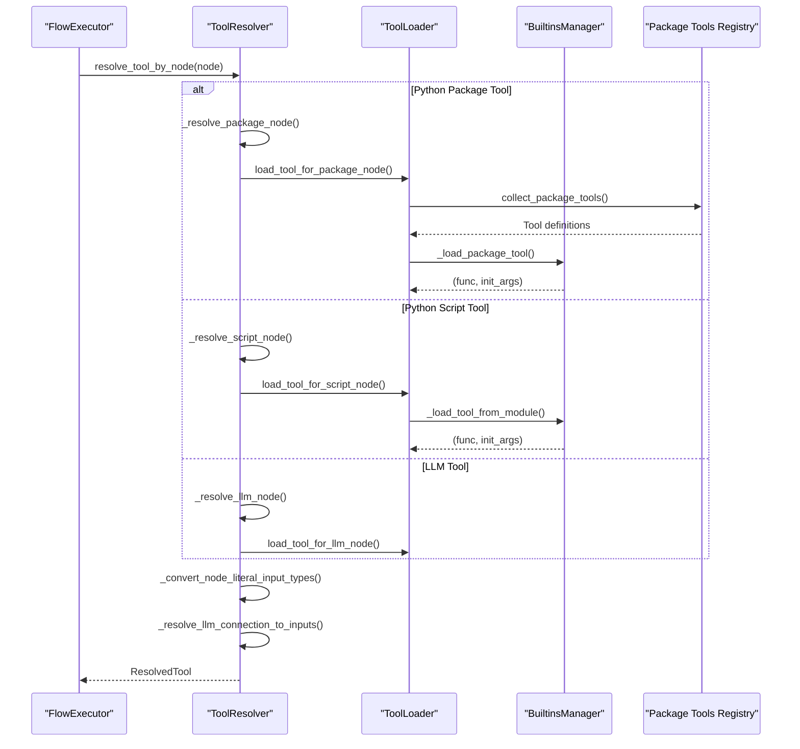

Sources: [src/promptflow/tests/executor/unittests/executor/test_tool_resolver.py:55-107](), [src/promptflow/tests/executor/unittests/_core/test_tools_manager.py:65-95]()

## Best Practices for Custom Tools

When creating custom tools, follow these best practices:

1. **Clear Documentation**: Provide descriptive docstrings for your tools
2. **Input Validation**: Validate inputs to provide clear error messages
3. **Error Handling**: Use proper error handling with appropriate exceptions
4. **Connection Management**: Use connections for credentials rather than hardcoding
5. **Tool Naming**: Use clear, descriptive names for your tools
6. **Testing**: Test your tools thoroughly before integrating them into flows

## Testing Custom Tools

Testing is essential for ensuring your custom tools work correctly. Create unit tests for your tools using frameworks like pytest.

```python
import pytest
from my_tools_package.tools.my_tool import my_tool

def test_my_tool():
    # Test basic functionality
    result = my_tool("hello")
    assert result == "HELLO"
    
    # Test edge cases
    result = my_tool("")
    assert result == ""
```

For tools that use connections, you can create mock connections for testing:

```python
from promptflow.connections import CustomConnection

def test_tool_with_connection(mocker):
    # Create a mock connection
    mock_connection = CustomConnection(
        configs={"api_base": "https://example.com"},
        secrets={"api_key": "test-key"}
    )
    
    # Test the tool with the mock connection
    result = my_tool_with_connection("test input", mock_connection)
    assert "expected result" in result
```

Sources: src/promptflow-tools/tests/conftest.py

## Example: Creating a Custom LLM Tool

Let's examine how built-in LLM tools are structured, which serves as a template for custom LLM tools:

### Azure OpenAI Tool Pattern

```python
from promptflow._internal import ToolProvider, tool
from promptflow.connections import AzureOpenAIConnection
from promptflow.contracts.types import PromptTemplate

class AzureOpenAI(ToolProvider):
    def __init__(self, connection: AzureOpenAIConnection):
        super().__init__()
        self.connection = connection
        self._client = init_azure_openai_client(connection)

    @tool
    @handle_openai_error()
    def chat(
        self,
        prompt: PromptTemplate,
        deployment_name: str,
        temperature: float = 1.0,
        # stream is hidden, set by executor
        stream: bool = False,
        max_tokens: int = None,
        **kwargs
    ):
        # Tool implementation
        messages = build_messages(prompt, **kwargs)
        # API call logic
        completion = self._client.chat.completions.create(...)
        return post_process_chat_api_response(completion, stream)
```

### Custom LLM Tool Structure

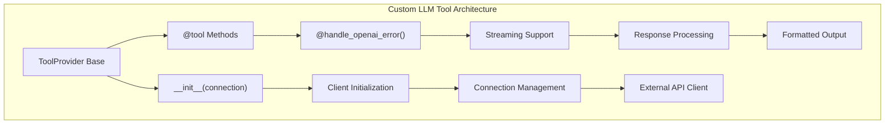

### Complete Custom LLM Example

```python
from promptflow._internal import ToolProvider, tool
from promptflow.contracts.types import PromptTemplate
from promptflow.connections import CustomStrongTypeConnection
from promptflow.contracts.tool import Secret
from promptflow.tools.common import handle_openai_error

class MyLLMConnection(CustomStrongTypeConnection):
    api_key: Secret
    api_base: str

class MyLLMTool(ToolProvider):
    def __init__(self, connection: MyLLMConnection):
        super().__init__()
        self.connection = connection
        # Initialize your client here

    @tool(streaming_option_parameter="stream")
    @handle_openai_error()
    def generate(
        self,
        prompt: PromptTemplate,
        temperature: float = 0.7,
        max_tokens: int = 500,
        stream: bool = False,
        **kwargs
    ) -> str:
        # Render template and make API call
        rendered_prompt = render_jinja_template(prompt, **kwargs)
        
        # Implementation with streaming support
        if stream:
            def generator():
                # Streaming logic
                yield chunk
            return generator()
        else:
            return response_text
```

Sources: [src/promptflow-tools/promptflow/tools/aoai.py:13-100](), [src/promptflow-tools/promptflow/tools/openai.py:24-88]()

## Troubleshooting

Here are some common issues when creating custom tools:

### Common Error Types

| Error Type | Description | Resolution |
|------------|-------------|-----------|
| `ResolveToolError` | Tool resolution failed | Check tool definition and package registration |
| `NodeInputValidationError` | Input validation failed | Verify input types match tool definition |
| `GetConnectionError` | Connection not found | Ensure connection exists and is properly named |
| `InvalidConnectionType` | Connection type mismatch | Check connection type compatibility |
| `PackageToolNotFoundError` | Package tool not found | Verify tool is properly registered in package |

### Tool Loading Issues

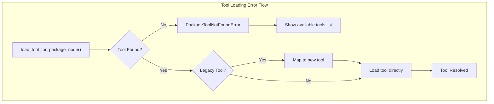

### Debugging Tool Resolution

1. **Check tool registration**: Verify entry points are correctly configured
2. **Validate input types**: Use `_convert_node_literal_input_types()` validation
3. **Test connection compatibility**: Ensure connection types match tool requirements  
4. **Review package installation**: Confirm package is properly installed and discoverable

### Input Validation Debugging

When tools fail input validation, the `ToolResolver` provides detailed error messages:

- Value type mismatches (e.g., passing string when int expected)
- Missing required inputs
- Invalid image data in lists
- Malformed assistant definition paths

Sources: [src/promptflow/tests/executor/e2etests/test_executor_validation.py:36-151](), [src/promptflow/tests/executor/unittests/_core/test_tools_manager.py:88-95]()

## Summary

Creating custom tools in PromptFlow allows you to extend its capabilities with your own code. By following the guidelines in this document, you can create, package, and use custom tools in your flows to implement specialized functionality tailored to your needs.

Remember that well-designed tools should be:
- Focused on a single responsibility
- Well-documented with clear input and output definitions
- Properly error-handled for robustness
- Packaged for easy distribution and reuse

---

