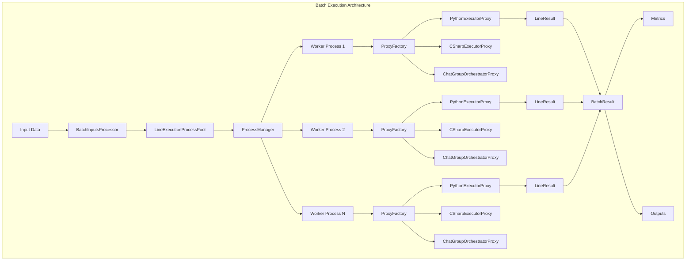
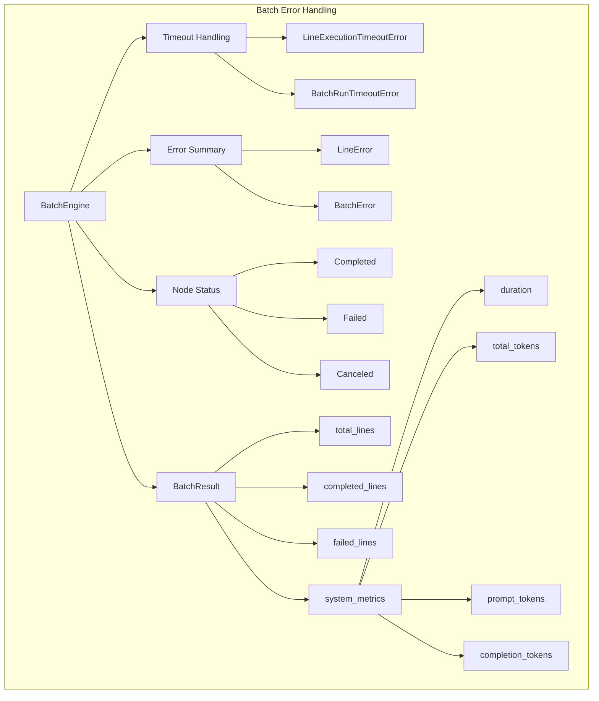
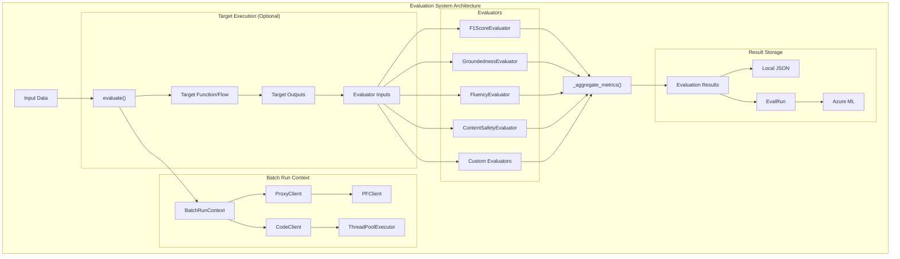
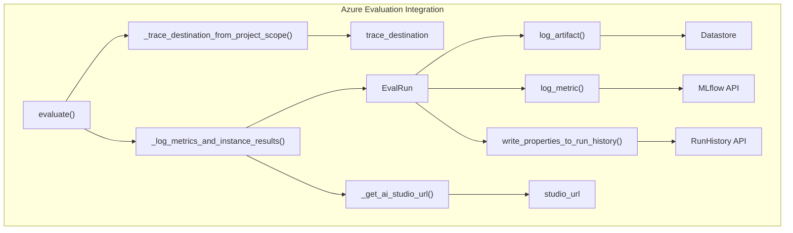
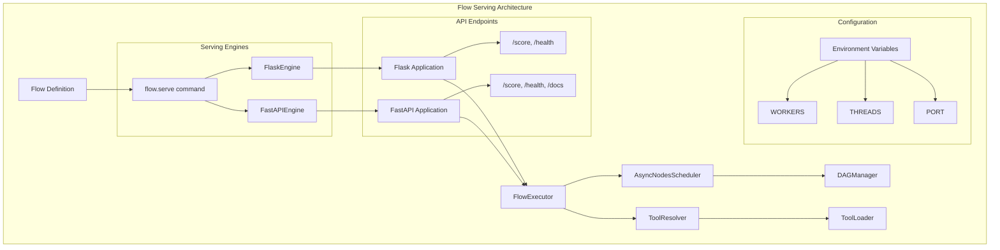
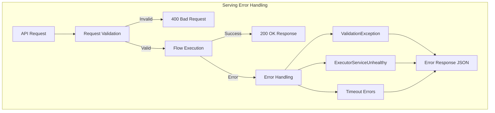
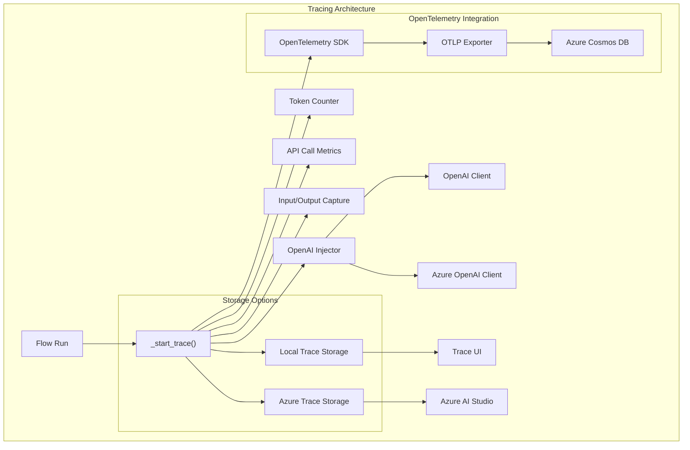
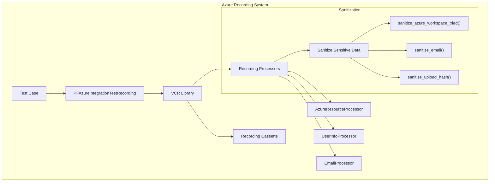

<!-- source: DeepWiki mcp.deepwiki.com · repo microsoft/promptflow · page 6 Advanced Features · fetched 2026-10-26 -->

# Advanced Features

<details>
<summary>Relevant source files</summary>

The following files were used as context for generating this wiki page:

- [pylintrc](pylintrc)
- [src/promptflow-azure/tests/conftest.py](src/promptflow-azure/tests/conftest.py)
- [src/promptflow-devkit/tests/sdk_cli_test/e2etests/test_csharp_sdk.py](src/promptflow-devkit/tests/sdk_cli_test/e2etests/test_csharp_sdk.py)
- [src/promptflow-evals/promptflow/evals/_constants.py](src/promptflow-evals/promptflow/evals/_constants.py)
- [src/promptflow-evals/promptflow/evals/evaluate/_batch_run_client/__init__.py](src/promptflow-evals/promptflow/evals/evaluate/_batch_run_client/__init__.py)
- [src/promptflow-evals/promptflow/evals/evaluate/_batch_run_client/batch_run_context.py](src/promptflow-evals/promptflow/evals/evaluate/_batch_run_client/batch_run_context.py)
- [src/promptflow-evals/promptflow/evals/evaluate/_batch_run_client/code_client.py](src/promptflow-evals/promptflow/evals/evaluate/_batch_run_client/code_client.py)
- [src/promptflow-evals/promptflow/evals/evaluate/_batch_run_client/proxy_client.py](src/promptflow-evals/promptflow/evals/evaluate/_batch_run_client/proxy_client.py)
- [src/promptflow-evals/promptflow/evals/evaluate/_eval_run.py](src/promptflow-evals/promptflow/evals/evaluate/_eval_run.py)
- [src/promptflow-evals/promptflow/evals/evaluate/_evaluate.py](src/promptflow-evals/promptflow/evals/evaluate/_evaluate.py)
- [src/promptflow-evals/promptflow/evals/evaluate/_utils.py](src/promptflow-evals/promptflow/evals/evaluate/_utils.py)
- [src/promptflow-evals/pyproject.toml](src/promptflow-evals/pyproject.toml)
- [src/promptflow-evals/tests/evals/e2etests/custom_evaluators/answer_length_with_aggregation.py](src/promptflow-evals/tests/evals/e2etests/custom_evaluators/answer_length_with_aggregation.py)
- [src/promptflow-evals/tests/evals/e2etests/test_evaluate.py](src/promptflow-evals/tests/evals/e2etests/test_evaluate.py)
- [src/promptflow-evals/tests/evals/e2etests/test_metrics_upload.py](src/promptflow-evals/tests/evals/e2etests/test_metrics_upload.py)
- [src/promptflow-evals/tests/evals/unittests/test_batch_run_context.py](src/promptflow-evals/tests/evals/unittests/test_batch_run_context.py)
- [src/promptflow-evals/tests/evals/unittests/test_eval_run.py](src/promptflow-evals/tests/evals/unittests/test_eval_run.py)
- [src/promptflow-evals/tests/evals/unittests/test_evaluate.py](src/promptflow-evals/tests/evals/unittests/test_evaluate.py)
- [src/promptflow-evals/tests/recordings/azure/test_metrics_upload_TestMetricsUpload_test_log_artifact.yaml](src/promptflow-evals/tests/recordings/azure/test_metrics_upload_TestMetricsUpload_test_log_artifact.yaml)
- [src/promptflow-evals/tests/recordings/azure/test_metrics_upload_TestMetricsUpload_test_logging_metrics.yaml](src/promptflow-evals/tests/recordings/azure/test_metrics_upload_TestMetricsUpload_test_logging_metrics.yaml)
- [src/promptflow-evals/tests/recordings/azure/test_metrics_upload_TestMetricsUpload_test_writing_to_run_history.yaml](src/promptflow-evals/tests/recordings/azure/test_metrics_upload_TestMetricsUpload_test_writing_to_run_history.yaml)
- [src/promptflow-recording/promptflow/recording/azure/bases.py](src/promptflow-recording/promptflow/recording/azure/bases.py)
- [src/promptflow-recording/promptflow/recording/azure/constants.py](src/promptflow-recording/promptflow/recording/azure/constants.py)
- [src/promptflow-recording/promptflow/recording/azure/processors.py](src/promptflow-recording/promptflow/recording/azure/processors.py)
- [src/promptflow-recording/promptflow/recording/azure/utils.py](src/promptflow-recording/promptflow/recording/azure/utils.py)
- [src/promptflow/tests/executor/e2etests/test_batch_engine.py](src/promptflow/tests/executor/e2etests/test_batch_engine.py)
- [src/promptflow/tests/executor/e2etests/test_batch_timeout.py](src/promptflow/tests/executor/e2etests/test_batch_timeout.py)
- [src/promptflow/tests/executor/e2etests/test_csharp_executor_proxy.py](src/promptflow/tests/executor/e2etests/test_csharp_executor_proxy.py)
- [src/promptflow/tests/executor/mock_execution_server.py](src/promptflow/tests/executor/mock_execution_server.py)
- [src/promptflow/tests/executor/unittests/batch/test_base_executor_proxy.py](src/promptflow/tests/executor/unittests/batch/test_base_executor_proxy.py)
- [src/promptflow/tests/executor/unittests/batch/test_batch_engine.py](src/promptflow/tests/executor/unittests/batch/test_batch_engine.py)
- [src/promptflow/tests/executor/unittests/batch/test_csharp_executor_proxy.py](src/promptflow/tests/executor/unittests/batch/test_csharp_executor_proxy.py)

</details>


This page provides a technical overview of advanced capabilities in PromptFlow that enhance development, testing, and deployment workflows. These features are designed for users who need sophisticated tools for processing large datasets, evaluating model outputs, serving flows as APIs, and implementing robust tracing capabilities.

For basic usage of PromptFlow, please refer to [Overview](#1). For CLI and SDK operations, see [CLI and SDK](#3).

## Batch Execution

Batch execution enables processing large datasets efficiently by parallelizing flow execution across multiple processes. This feature is critical for production workflows that need to process thousands or millions of inputs.



Sources: 
- [src/promptflow/tests/executor/e2etests/test_batch_engine.py:111-166]()
- [src/promptflow/tests/executor/e2etests/test_batch_timeout.py:22-200]()
- [src/promptflow-evals/promptflow/evals/_constants.py:44-50]()

### Configuration Options

Batch execution can be customized through environment variables and parameters:

| Parameter | Description | Default Value |
|-----------|-------------|---------------|
| `PF_BATCH_TIMEOUT_SEC` | Maximum execution time for batch runs | 3600 (seconds) |
| `PF_BATCH_METHOD` | Process start method (spawn, fork, forkserver) | System dependent |
| `line_timeout_sec` | Maximum execution time for a single line | Varies |
| Worker Count | Number of worker processes | System dependent |

The batch engine supports different multiprocessing start methods, which can be important for compatibility across operating systems:

```python
# Example: Create a batch run with CLI
pf run create --flow ./my_flow --data ./large_dataset.jsonl

# Example: Create a batch run with SDK
from promptflow.batch import BatchEngine
batch_engine = BatchEngine(
    flow_file="flow.yaml",
    working_dir="./my_flow",
    line_timeout_sec=60,
    batch_timeout_sec=3600
)
result = batch_engine.run(input_dirs, inputs_mapping, output_dir)
```

Sources:
- [src/promptflow/tests/executor/e2etests/test_batch_engine.py:186-234]()
- [src/promptflow/tests/executor/e2etests/test_batch_timeout.py:22-200]()
- [src/promptflow-evals/promptflow/evals/_constants.py:46-50]()

### Performance and Error Handling

The batch execution system provides robust error handling and performance features:

- **Timeout Management**: Both per-line and overall batch timeouts
- **Error Isolation**: Failures in one line don't affect others
- **Detailed Metrics**: Tracks completion status, duration, and token usage
- **Resume Capability**: Can resume from interrupted runs



The batch engine also supports resuming interrupted runs:

```python
# Resume a batch run from a previous one
batch_engine.run(
    input_dirs,
    inputs_mapping,
    output_dir,
    resume_run_id="new_run_id",
    resume_from_run_storage=previous_run_storage,
    resume_from_run_output_dir=previous_output_dir
)
```

Sources:
- [src/promptflow/tests/executor/e2etests/test_batch_engine.py:383-464]()
- [src/promptflow/tests/executor/e2etests/test_batch_timeout.py:22-200]()
- [src/promptflow/tests/executor/unittests/batch/test_batch_engine.py:22-118]()

## Evaluation System

The evaluation system (`promptflow-evals`) provides a comprehensive framework for testing and validating flows, particularly useful for assessing LLM outputs on metrics like groundedness, fluency, and content safety.



Sources:
- [src/promptflow-evals/promptflow/evals/evaluate/_evaluate.py:356-605]()
- [src/promptflow-evals/promptflow/evals/evaluate/_eval_run.py:76-466]()
- [src/promptflow-evals/tests/evals/e2etests/test_evaluate.py:98-132]()
- [src/promptflow-evals/promptflow/evals/evaluate/_batch_run_client/batch_run_context.py:22-72]()

### Built-in Evaluators

PromptFlow provides several built-in evaluators:

| Evaluator | Purpose | Type | Metrics |
|-----------|---------|------|---------|
| F1ScoreEvaluator | Measures F1 score between output and reference | Metric | f1_score |
| GroundednessEvaluator | Checks if output is grounded in context | LLM-based | gpt_groundedness |
| FluencyEvaluator | Evaluates language fluency | LLM-based | gpt_fluency |
| ContentSafetyEvaluator | Detects potentially harmful content | Safety | sexual_defect_rate, violence_defect_rate, self_harm_defect_rate, hate_unfairness_defect_rate |
| ProtectedMaterialEvaluator | Identifies protected/copyrighted content | Safety | protected_material_defect_rate |
| ECIEvaluator | Evaluates copyright infringement | Safety | eci_defect_rate |

The system automatically calculates appropriate metrics based on evaluator type. For safety evaluators, it computes defect rates that represent the percentage of outputs exceeding safety thresholds.

Sources:
- [src/promptflow-evals/promptflow/evals/_constants.py:6-32]()
- [src/promptflow-evals/promptflow/evals/evaluate/_evaluate.py:33-148]()
- [src/promptflow-evals/tests/evals/unittests/test_evaluate.py:464-487]()

### Evaluation Workflow

The evaluation system follows this detailed process:

1. **Data Loading**: Validates and loads input data from JSONL files
2. **Target Execution** (Optional): Runs data through a target function/flow to generate outputs
3. **Batch Execution Context**: Sets up environment for parallel evaluator execution
4. **Evaluator Execution**: Runs multiple evaluators in parallel using thread pools
5. **Metrics Aggregation**: Computes summary statistics from individual results
6. **Result Storage**: Outputs results locally and/or to Azure ML

The `evaluate()` function provides a unified interface for this workflow:

```python
from promptflow.evals.evaluate import evaluate
from promptflow.evals.evaluators import GroundednessEvaluator, F1ScoreEvaluator

# Evaluate with multiple evaluators
results = evaluate(
    evaluation_name="my_evaluation",
    data="test_data.jsonl",
    evaluators={
        "groundedness": GroundednessEvaluator(model_config),
        "f1_score": F1ScoreEvaluator()
    },
    evaluator_config={
        "groundedness": {
            "answer": "${data.answer}",
            "context": "${data.context}"
        }
    },
    output_path="evaluation_results"
)
```

The `evaluator_config` parameter allows mapping columns from the input data to the expected inputs for each evaluator.

Sources:
- [src/promptflow-evals/promptflow/evals/evaluate/_evaluate.py:356-605]()
- [src/promptflow-evals/tests/evals/e2etests/test_evaluate.py:98-132]()
- [src/promptflow-evals/tests/evals/e2etests/test_evaluate.py:291-331]()

### Content Safety and Defect Rate Calculation

The evaluation system automatically calculates defect rates for content safety metrics to help identify potential issues:

```python
# From _aggregate_content_safety_metrics function
content_safety_metrics = [
    EvaluationMetrics.SEXUAL,        # "sexual"
    EvaluationMetrics.SELF_HARM,     # "self_harm"
    EvaluationMetrics.HATE_UNFAIRNESS, # "hate_unfairness"
    EvaluationMetrics.VIOLENCE,      # "violence"
]
```

Defect rates represent the percentage of outputs that exceed safety thresholds (default threshold is 4 on a scale of 0-10). The system also handles label-based metrics like protected material detection:

```python
# From _aggregate_label_defect_metrics function
handled_metrics = [
    EvaluationMetrics.PROTECTED_MATERIAL,  # "protected_material"
    _InternalEvaluationMetrics.ECI,        # "eci" (copyright infringement)
    EvaluationMetrics.XPIA,                # "xpia"
]
```

These metrics are automatically aggregated into summary statistics that provide an easily interpretable overview of content safety.

Sources:
- [src/promptflow-evals/promptflow/evals/evaluate/_evaluate.py:33-112]()
- [src/promptflow-evals/promptflow/evals/_constants.py:6-44]()
- [src/promptflow-evals/tests/evals/unittests/test_evaluate.py:464-487]()

### Cloud Integration for Evaluation

Evaluation results can be automatically logged to Azure AI Studio using the `EvalRun` system:

```python
# Log evaluation results to Azure
results = evaluate(
    data="test_data.jsonl",
    evaluators={"f1_score": F1ScoreEvaluator()},
    azure_ai_project={
        "subscription_id": "...",
        "resource_group_name": "...",
        "project_name": "..."
    }
)
```



This integration creates a trackable experiment in Azure with:
- Metrics visualization in Azure ML
- Instance-level result exploration
- Artifact storage for detailed analysis
- Shareable links to results via the `studio_url` field

The system handles authentication, data upload, and proper formatting of metrics for Azure ML consumption.

Sources:
- [src/promptflow-evals/promptflow/evals/evaluate/_utils.py:63-143]()
- [src/promptflow-evals/promptflow/evals/evaluate/_eval_run.py:76-466]()
- [src/promptflow-evals/tests/evals/e2etests/test_metrics_upload.py:152-212]()
- [src/promptflow-evals/tests/evals/e2etests/test_evaluate.py:383-470]()

## Flow Serving

Flow serving enables deploying flows as APIs or interactive UIs, allowing integration with other applications or direct human interaction.



Sources:
- [src/promptflow/tests/executor/e2etests/test_csharp_executor_proxy.py:1-149]()
- [src/promptflow/tests/executor/mock_execution_server.py:1-141]()

### Serving Engines and Proxies

PromptFlow supports multiple serving engines and executor proxies for different flow types:

| Component | Type | Purpose |
|-----------|------|---------|
| FlaskEngine | Serving Engine | Default HTTP server with wide compatibility |
| FastAPIEngine | Serving Engine | Modern async HTTP server with OpenAPI docs |
| PythonExecutorProxy | Executor | Executes Python-based flows |
| CSharpExecutorProxy | Executor | Executes C#-based flows |
| ChatGroupOrchestratorProxy | Executor | Manages chat-based flows |

The executor proxies are managed by the `ProxyFactory` which selects the appropriate executor based on the flow language:

```python
# ProxyFactory registration
ProxyFactory.register_executor(FlowLanguage.Python, PythonExecutorProxy)
ProxyFactory.register_executor(FlowLanguage.CSharp, CSharpExecutorProxy)

# Serve with FastAPI
pf flow serve --flow ./my_flow --engine fastapi
```

Sources:
- [src/promptflow/tests/executor/e2etests/test_csharp_executor_proxy.py:1-149]()
- [src/promptflow/tests/executor/unittests/batch/test_base_executor_proxy.py:1-100]()
- [src/promptflow/tests/executor/unittests/batch/test_csharp_executor_proxy.py:1-100]()

### API Endpoints and Health Monitoring

Flow serving exposes several key endpoints:

| Endpoint | Method | Purpose |
|----------|--------|---------|
| `/score` | POST | Main endpoint for flow execution |
| `/health` | GET | Health check endpoint |
| `/docs` | GET | API documentation (FastAPI only) |

The health endpoint is particularly important for monitoring and integration with container orchestration systems:

```python
async def _handle_health(request: web.Request):
    return web.Response(text="Healthy")
```

For execution, the server processes JSON requests and returns results:

```python
async def _handle_execution(request: web.Request, has_error=False):
    try:
        request = await request.json()
        return _get_execution_result(request, has_error=has_error)
    except json.JSONDecodeError:
        return web.Response(status=400, text="Bad Request: Invalid JSON")
```

Sources:
- [src/promptflow/tests/executor/mock_execution_server.py:9-140]()
- [src/promptflow/tests/executor/e2etests/test_csharp_executor_proxy.py:1-149]()

### Error Handling and Validation

The serving system includes robust error handling for various failure scenarios:



The system validates connections and inputs before execution, providing clear error messages:

```python
# Example error response structure
error_dict = {
    "error": {
        "message": "error for tests",
        "messageFormat": "",
        "messageParameters": {},
        "referenceCode": None,
        "debugInfo": {
            "type": "Exception",
            "message": "error for tests",
            "stackTrace": "...",
            "innerException": None,
        },
        "additionalInfo": None,
        "code": "UserError",
        "innerError": {"code": "Exception", "innerError": None},
    },
}
```

Sources:
- [src/promptflow/tests/executor/mock_execution_server.py:9-140]()
- [src/promptflow/tests/executor/unittests/batch/test_base_executor_proxy.py:22-100]()
- [src/promptflow/tests/executor/unittests/batch/test_csharp_executor_proxy.py:33-100]()

## Tracing and Telemetry

The tracing system provides visibility into flow execution, capturing detailed information about each step and integrating with OpenTelemetry for advanced monitoring.



Sources:
- [src/promptflow-evals/promptflow/evals/evaluate/_batch_run_client/batch_run_context.py:22-72]()
- [src/promptflow-evals/tests/evals/e2etests/test_metrics_upload.py:152-212]()
- [src/promptflow-evals/promptflow/evals/_constants.py:49-50]()

### Trace Configuration

Tracing can be configured through environment variables and SDK settings:

| Variable | Purpose | Default |
|----------|---------|---------|
| `OTEL_EXPORTER_OTLP_TRACES_TIMEOUT` | Timeout for trace export | 60 seconds |
| `PF_EVALS_BATCH_USE_ASYNC` | Enable async batch execution for evaluations | "false" |
| `trace.destination` | Azure ML workspace for trace storage | None |

The `BatchRunContext` class manages tracing environment setup and cleanup:

```python
def __enter__(self):
    if isinstance(self.client, CodeClient):
        ClientUserAgentUtil.append_user_agent(USER_AGENT)
        inject_openai_api()

    if isinstance(self.client, ProxyClient):
        os.environ[PF_FLOW_ENTRY_IN_TMP] = "true"
        os.environ[PF_FLOW_META_LOAD_IN_SUBPROCESS] = "false"

        # For dealing with the timeout issue of OpenTelemetry exporter
        if os.environ.get(OTEL_EXPORTER_OTLP_TRACES_TIMEOUT) is None:
            os.environ[OTEL_EXPORTER_OTLP_TRACES_TIMEOUT] = str(OTEL_EXPORTER_OTLP_TRACES_TIMEOUT_DEFAULT)
            self._is_otel_timeout_set_by_system = True
```

Sources:
- [src/promptflow-evals/promptflow/evals/evaluate/_batch_run_client/batch_run_context.py:22-72]()
- [src/promptflow-evals/promptflow/evals/_constants.py:49-50]()
- [src/promptflow-evals/tests/evals/unittests/test_batch_run_context.py:1-50]()

### OpenAI Integration and Injection

The tracing system includes special handling for OpenAI API calls to capture token usage and other metrics:

```python
# OpenAI API injection for tracing
def inject_openai_api():
    """Inject OpenAI API to capture token usage and other metrics."""
    if not _is_openai_available():
        return
    
    # Inject OpenAI API
    if not _is_openai_injected():
        _inject_openai()
        _inject_azure_openai()
        _set_openai_injected(True)

def recover_openai_api():
    """Recover OpenAI API to original state."""
    if not _is_openai_available() or not _is_openai_injected():
        return
    
    # Recover OpenAI API
    _recover_openai()
    _recover_azure_openai()
    _set_openai_injected(False)
```

This injection mechanism allows the system to automatically track token usage, latency, and other metrics for OpenAI API calls without requiring changes to user code.

Sources:
- [src/promptflow-evals/promptflow/evals/evaluate/_batch_run_client/batch_run_context.py:22-72]()
- [src/promptflow-evals/tests/evals/e2etests/test_metrics_upload.py:152-212]()

### Cloud-Based Tracing and Recording

Traces can be uploaded to Azure for persistent storage and team sharing:

```python
# Configure cloud-based trace destination
trace_destination = _trace_destination_from_project_scope(project_scope)
# Format: "azureml://subscriptions/{subscription_id}/resourceGroups/{resource_group_name}/providers/Microsoft.MachineLearningServices/workspaces/{workspace_name}"
```

The system includes sophisticated recording and replay capabilities for testing:



When cloud tracing is enabled:
- Run details are automatically uploaded to Azure ML
- Trace data is stored in Cosmos DB via OpenTelemetry
- Metrics are logged to MLflow
- Artifacts are stored in Azure Blob Storage
- A studio URL is generated for sharing results

Sources:
- [src/promptflow-evals/promptflow/evals/evaluate/_utils.py:133-143]()
- [src/promptflow-evals/promptflow/evals/evaluate/_eval_run.py:76-466]()
- [src/promptflow-recording/promptflow/recording/azure/bases.py:1-100]()
- [src/promptflow-recording/promptflow/recording/azure/utils.py:1-100]()

## Summary of Advanced Features

PromptFlow's advanced features provide a comprehensive environment for developing, testing, and deploying LLM applications:

| Feature | Key Capabilities | Use Cases |
|---------|------------------|-----------|
| Batch Execution | Process large datasets in parallel | Production data processing, bulk testing |
| Evaluation | Assess quality, safety, and performance | Model validation, comparison, safety checks |
| Flow Serving | Deploy as APIs or interactive UIs | Integration with applications, user interfaces |
| Tracing | Monitor execution details | Debugging, performance analysis, compliance |

These advanced features enable sophisticated LLM application development workflows, from experimentation to production deployment, with the tools needed for quality assurance and monitoring.

Sources:
- [src/promptflow/CHANGELOG.md]()
- [src/promptflow-devkit/CHANGELOG.md]()
- [src/promptflow-evals/pyproject.toml:40-53]()
- [src/promptflow-core/pyproject.toml:41-59]()

---

