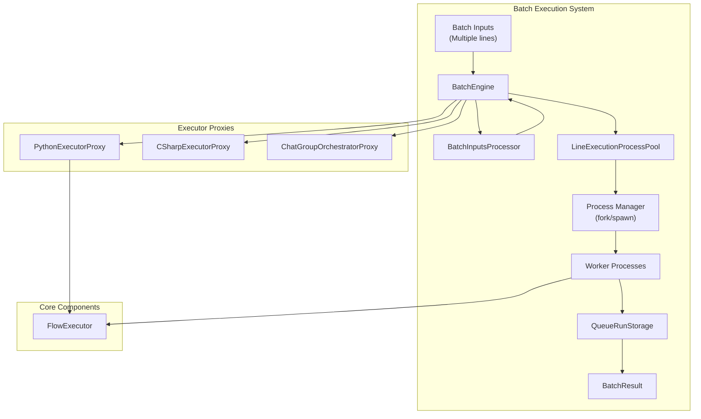
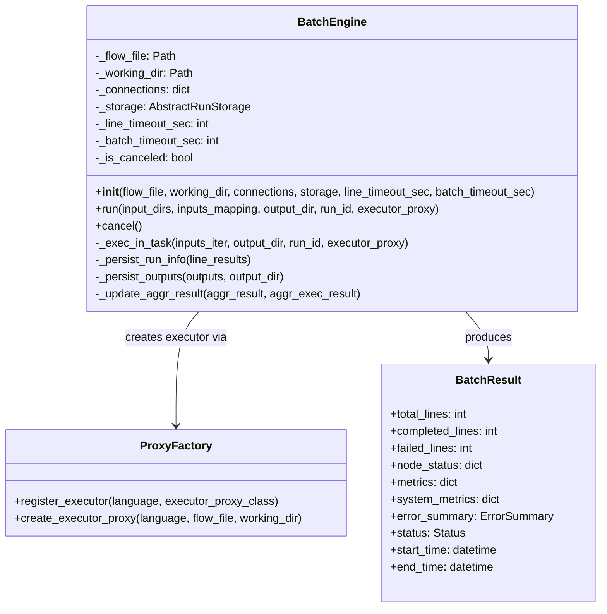
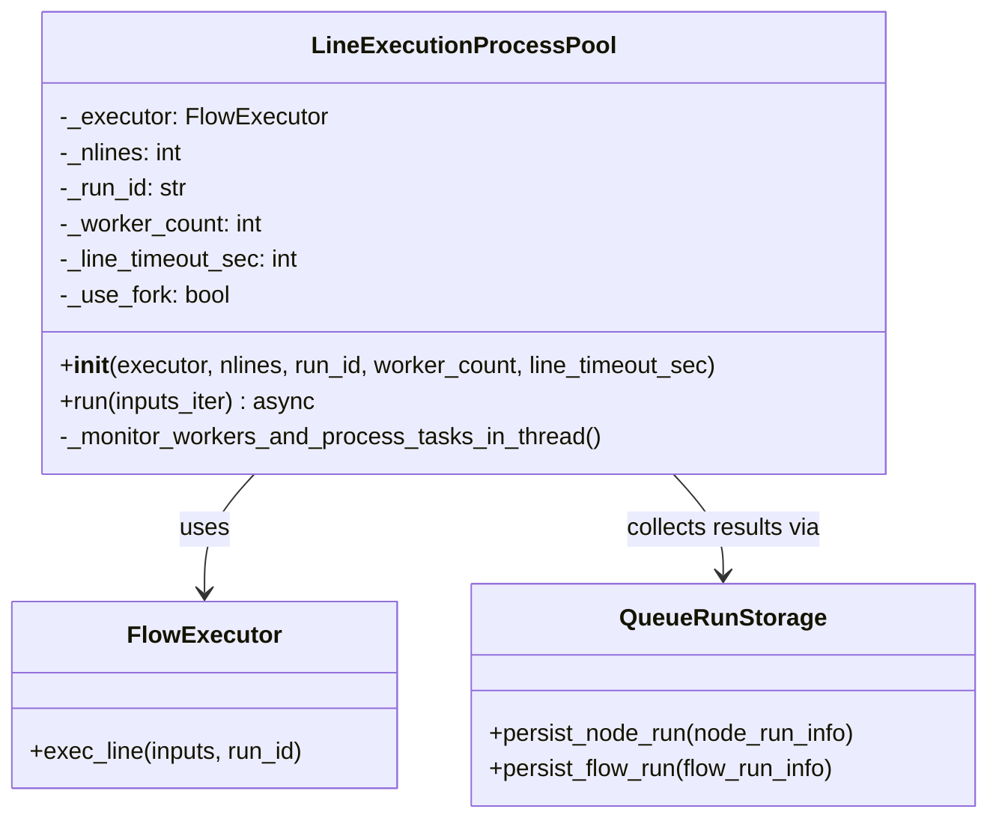
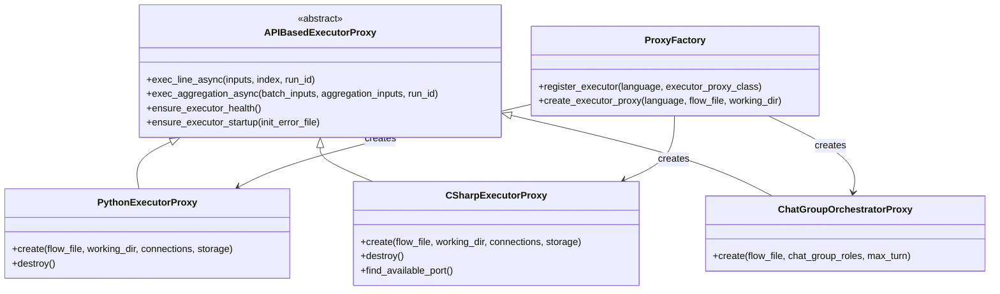
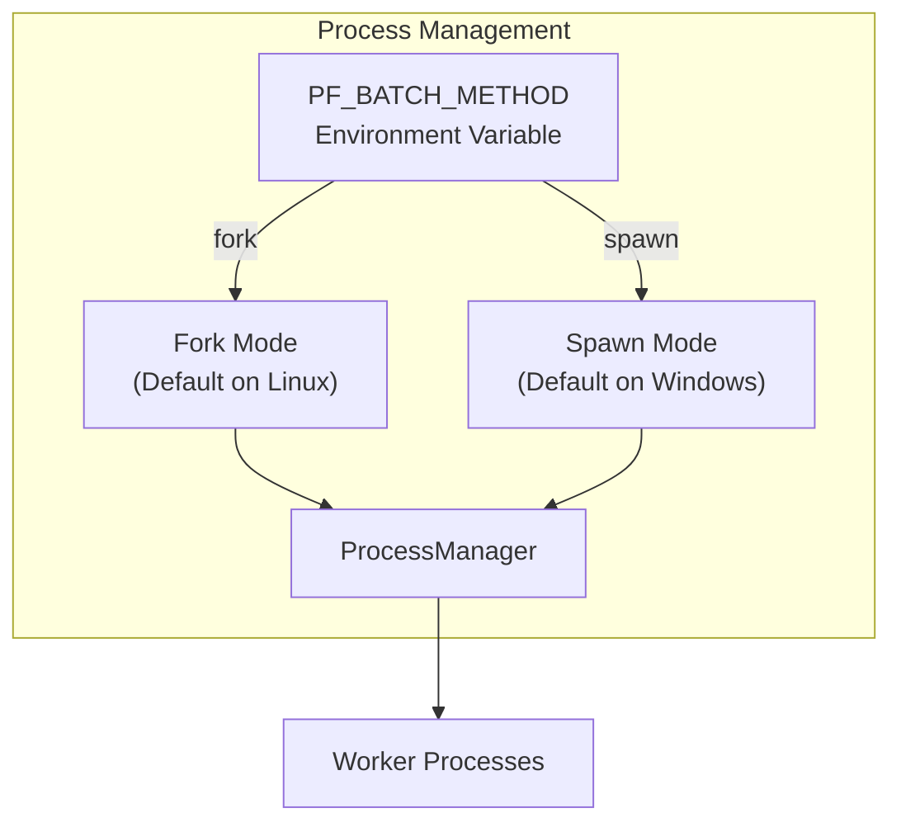
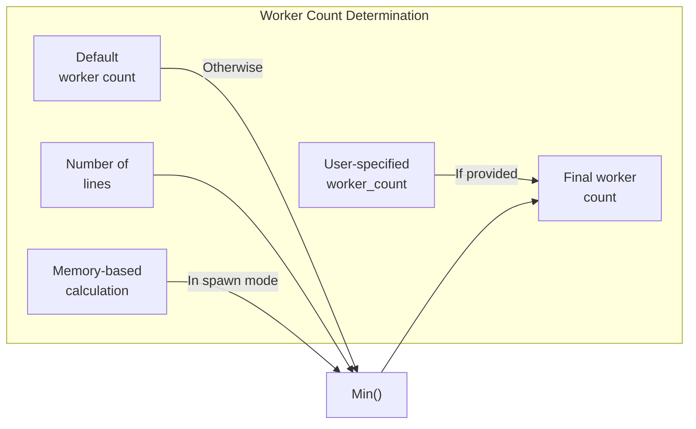
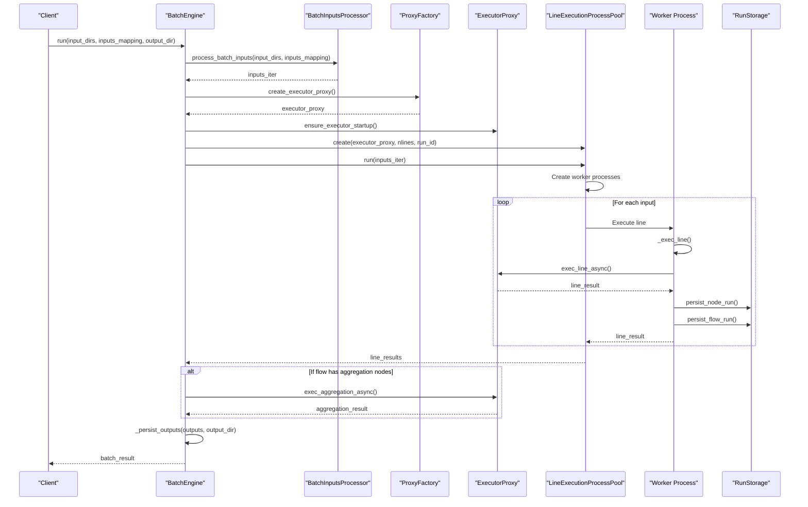
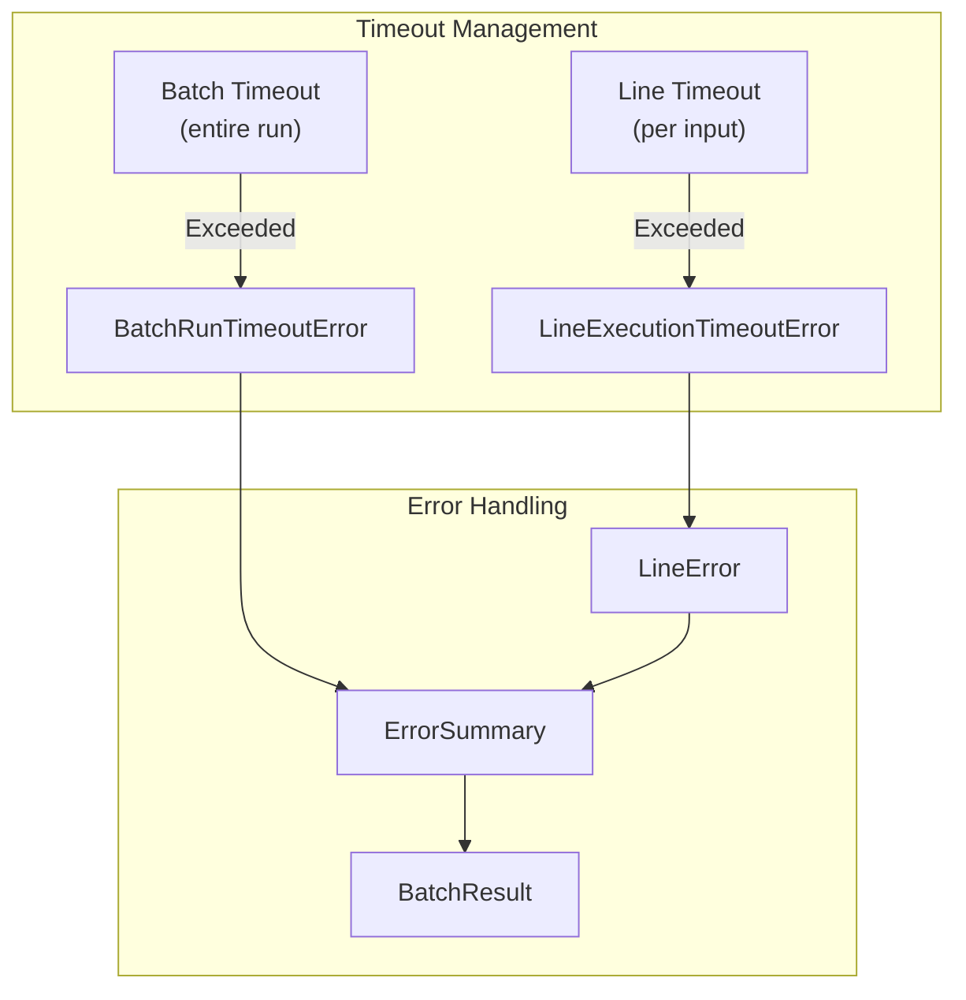
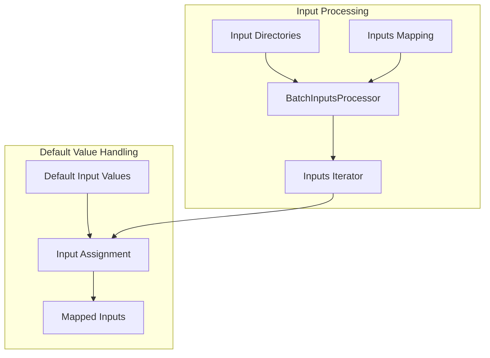
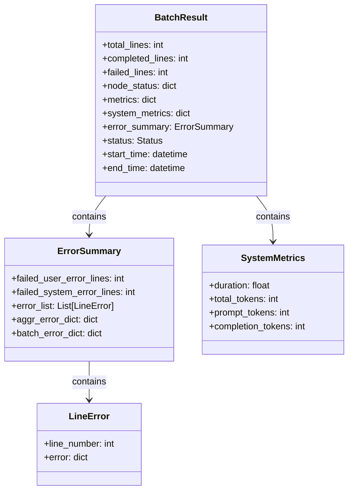

<!-- source: DeepWiki mcp.deepwiki.com · repo microsoft/promptflow · page 6.1 Batch Execution · fetched 2026-10-26 -->

# Batch Execution

Relevant source files

The following files were used as context for generating this wiki page:

- [src/promptflow-devkit/tests/sdk_cli_test/e2etests/test_csharp_sdk.py](src/promptflow-devkit/tests/sdk_cli_test/e2etests/test_csharp_sdk.py)
- [src/promptflow/tests/executor/e2etests/test_batch_engine.py](src/promptflow/tests/executor/e2etests/test_batch_engine.py)
- [src/promptflow/tests/executor/e2etests/test_batch_timeout.py](src/promptflow/tests/executor/e2etests/test_batch_timeout.py)
- [src/promptflow/tests/executor/e2etests/test_csharp_executor_proxy.py](src/promptflow/tests/executor/e2etests/test_csharp_executor_proxy.py)
- [src/promptflow/tests/executor/mock_execution_server.py](src/promptflow/tests/executor/mock_execution_server.py)
- [src/promptflow/tests/executor/unittests/_utils/test_process_utils.py](src/promptflow/tests/executor/unittests/_utils/test_process_utils.py)
- [src/promptflow/tests/executor/unittests/batch/test_base_executor_proxy.py](src/promptflow/tests/executor/unittests/batch/test_base_executor_proxy.py)
- [src/promptflow/tests/executor/unittests/batch/test_batch_engine.py](src/promptflow/tests/executor/unittests/batch/test_batch_engine.py)
- [src/promptflow/tests/executor/unittests/batch/test_csharp_executor_proxy.py](src/promptflow/tests/executor/unittests/batch/test_csharp_executor_proxy.py)
- [src/promptflow/tests/executor/unittests/executor/test_line_execution_process_pool.py](src/promptflow/tests/executor/unittests/executor/test_line_execution_process_pool.py)
- [src/promptflow/tests/executor/unittests/storage/test_queue_run_storage.py](src/promptflow/tests/executor/unittests/storage/test_queue_run_storage.py)

Batch Execution in PromptFlow enables processing multiple flow inputs simultaneously in a parallel, resource-optimized manner. This feature allows you to run flows against large datasets efficiently by distributing the workload across multiple processes, making it ideal for high-throughput scenarios like bulk testing, evaluation, or production batch processing.

For information about evaluating flows across multiple inputs, see [Evaluation System](#6.2). For deploying flows as APIs for real-time inference, see [Flow Serving](#6.3).

## Architecture Overview

Batch execution in PromptFlow is primarily implemented through the `BatchEngine` and a process pool architecture that manages parallel execution of flow runs.

The batch execution system operates by:
1. Taking a collection of inputs (lines) through the `BatchInputsProcessor`
2. Creating a process pool for parallel execution via `LineExecutionProcessPool`
3. Running each input through the flow in a separate process using the appropriate executor proxy
4. Collecting and aggregating the results into a `BatchResult`

Sources: [src/promptflow/tests/executor/e2etests/test_batch_engine.py:70-95](), [src/promptflow/tests/executor/unittests/batch/test_batch_engine.py:23-118]()

## Key Components

### BatchEngine

The `BatchEngine` is the main entry point for batch execution, orchestrating the entire process from input processing to result collection.

The `BatchEngine` initializes with:
- Flow file path
- Working directory
- Connections dictionary
- Storage for run information
- Optional line timeout
- Optional batch timeout

Sources: [src/promptflow/tests/executor/unittests/batch/test_batch_engine.py:23-118](), [src/promptflow/tests/executor/e2etests/test_batch_engine.py:70-95]()

### LineExecutionProcessPool

The `LineExecutionProcessPool` manages a pool of processes that execute individual lines (inputs) in parallel.

The `LineExecutionProcessPool` initializes with:
- A `FlowExecutor` instance
- Number of lines to process
- Run ID for tracking
- Optional worker count
- Optional timeout for each line execution

Sources: [src/promptflow/tests/executor/unittests/executor/test_line_execution_process_pool.py:194-226](), [src/promptflow/tests/executor/unittests/storage/test_queue_run_storage.py:10-60]()

### Executor Proxies

The batch execution system supports different types of flows through specialized executor proxies:

- **PythonExecutorProxy**: Executes Python-based flows
- **CSharpExecutorProxy**: Executes C#-based flows through a separate process
- **ChatGroupOrchestratorProxy**: Manages chat-based flows with multiple roles and turns

Sources: [src/promptflow/tests/executor/e2etests/test_csharp_executor_proxy.py:25-149](), [src/promptflow/tests/executor/unittests/batch/test_csharp_executor_proxy.py:21-160](), [src/promptflow/tests/executor/unittests/batch/test_base_executor_proxy.py:20-212]()

### Process Management

The batch execution system supports different methods for creating worker processes:

- **Fork mode**: Creates processes by forking the parent process (default on Linux)
- **Spawn mode**: Creates processes by spawning new Python interpreters (default on Windows, available on all platforms)

The process creation method can be configured through the `PF_BATCH_METHOD` environment variable.

Sources: [src/promptflow/tests/executor/unittests/executor/test_line_execution_process_pool.py:338-417]()

## Worker Count Optimization

A key aspect of batch execution is determining the optimal number of worker processes to maximize throughput while managing system resources.

The worker count is determined by:

1. Using the user-specified `worker_count` if provided
2. Otherwise, calculating based on:
   - Default worker count
   - Number of lines to process
   - Available system memory (in spawn mode)
   - Current process memory usage (in spawn mode)

This optimization ensures efficient resource usage while preventing memory exhaustion. The system logs the factors considered in determining the worker count, providing transparency into the decision-making process.

Sources: [src/promptflow/tests/executor/unittests/executor/test_line_execution_process_pool.py:336-393](), [src/promptflow/tests/executor/unittests/_utils/test_process_utils.py:8-38]()

## Batch Execution Process

The complete batch execution process involves multiple components working together:

The process involves:
1. Processing batch inputs through `BatchInputsProcessor`
2. Creating an appropriate executor proxy via `ProxyFactory`
3. Setting up the `LineExecutionProcessPool` for parallel execution
4. Executing each line in a separate worker process
5. Collecting results and persisting them
6. Optionally executing aggregation nodes
7. Returning the final `BatchResult`

Sources: [src/promptflow/tests/executor/unittests/executor/test_line_execution_process_pool.py:254-302](), [src/promptflow/tests/executor/e2etests/test_batch_engine.py:111-126]()

## Error Handling and Timeout Management

The batch execution system includes robust error handling to manage various failure scenarios:

Key error handling features include:

- **Line timeouts**: Lines that exceed the specified `line_timeout_sec` are terminated and marked as failed with a `LineExecutionTimeoutError`
- **Batch timeouts**: The entire batch run can be limited by `batch_timeout_sec`, resulting in a `BatchRunTimeoutError` if exceeded
- **Process failures**: Failed processes are captured and their errors are reported in the `ErrorSummary`
- **Memory constraints**: The system estimates memory requirements to prevent out-of-memory errors
- **Partial failures**: The system can continue processing other inputs even if some fail, tracking both completed and failed lines

The `BatchResult` includes detailed error information, including counts of user errors vs. system errors, and specific error messages for each failed line.

Sources: [src/promptflow/tests/executor/e2etests/test_batch_timeout.py:19-200](), [src/promptflow/tests/executor/unittests/executor/test_line_execution_process_pool.py:234-252]()

## Input Processing and Default Value Handling

The `BatchInputsProcessor` component handles input preparation for batch execution:

When running batch executions, the system handles default values for flow inputs:

1. If an input has a default value and is not provided in the batch inputs, the default value is used
2. Default values are properly replicated across all lines in the batch
3. Different value types (strings, numbers, booleans, etc.) are handled appropriately with proper type conversion

This ensures that flows with default input values work correctly in batch scenarios, as demonstrated in tests like `test_batch_with_default_input`.

Sources: [src/promptflow/tests/executor/e2etests/test_batch_engine.py:305-321](), [src/promptflow/tests/executor/unittests/executor/test_flow_executor.py:19-88]()

## Results Collection and Aggregation

Results from batch execution are collected and organized into a comprehensive `BatchResult`:

During execution:
1. Individual line results are collected using `QueueRunStorage`, which passes data through multiprocessing queues
2. Node and flow run information is persisted via the storage mechanism
3. Results are aggregated into a `BatchResult` with detailed statistics and metrics
4. For flows with aggregation nodes, the `_update_aggr_result` method combines results from all lines

The `BatchResult` provides comprehensive information about the execution, including:
- Counts of total, completed, and failed lines
- Status summary for each node in the flow
- Metrics from aggregation nodes
- System metrics like duration and token usage
- Detailed error information

Sources: [src/promptflow/tests/executor/unittests/storage/test_queue_run_storage.py:10-60](), [src/promptflow/tests/executor/unittests/batch/test_batch_engine.py:94-118](), [src/promptflow/tests/executor/e2etests/test_batch_engine.py:254-266]()

## Practical Considerations

When using batch execution, consider the following:

1. **Memory usage**: Each worker process requires memory, so monitor system resources when processing large batches
2. **Timeouts**: Set appropriate timeouts for line execution based on your flow's expected completion time
3. **Error handling**: Batch execution continues even if some lines fail, allowing for partial success
4. **Process mode**: Fork mode is generally more efficient but has limitations on Windows; spawn mode works across all platforms

For best performance:
- Allow the system to automatically determine the optimal worker count based on system resources
- Use fork mode on Linux systems when possible
- Monitor memory usage when processing large batches or complex flows

---

