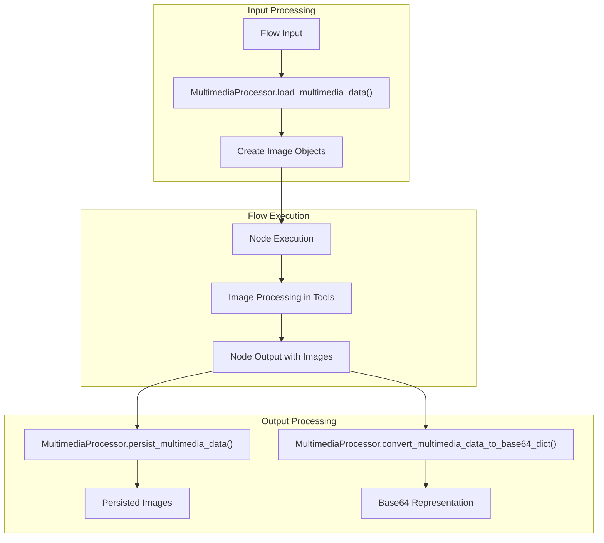
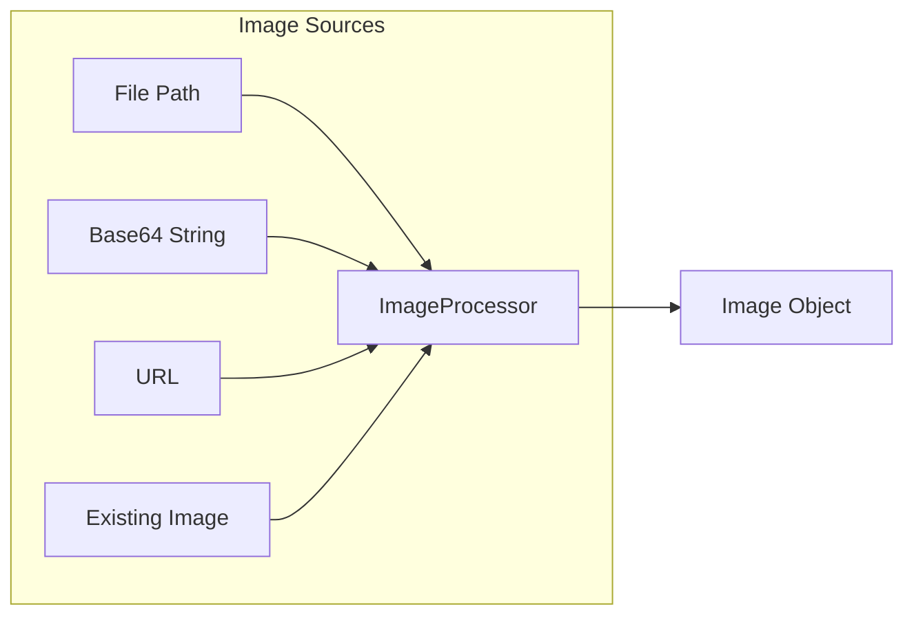
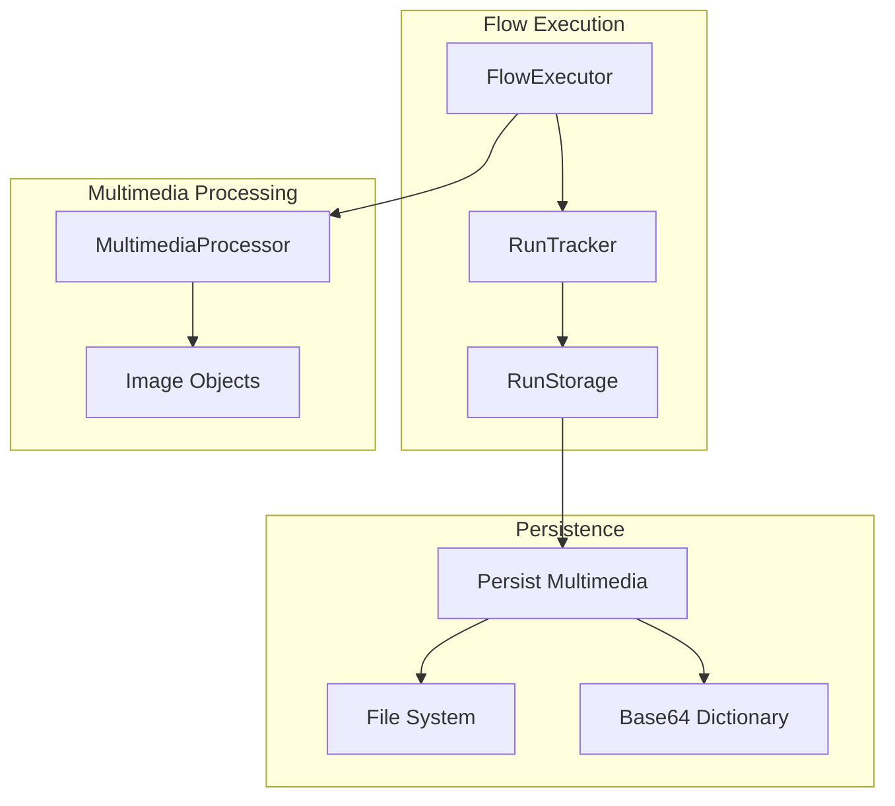
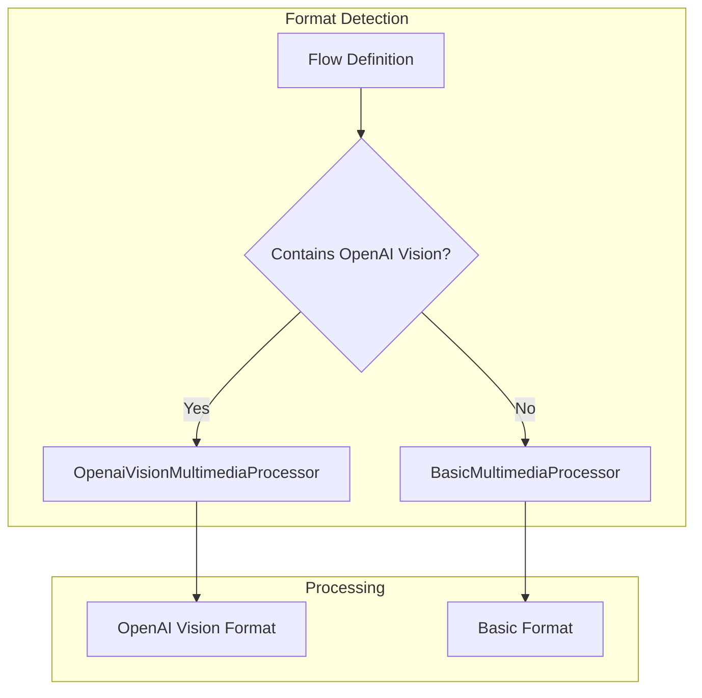
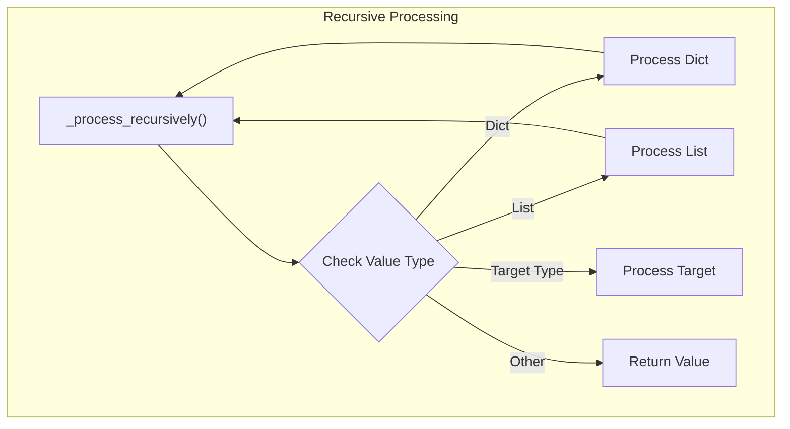

<!-- source: DeepWiki mcp.deepwiki.com · repo microsoft/promptflow · page 6.4 Multimedia Processing · fetched 2026-10-26 -->

# Multimedia Processing

<details>
<summary>Relevant source files</summary>

The following files were used as context for generating this wiki page:

- [src/promptflow-tracing/tests/unittests/test_utils.py](src/promptflow-tracing/tests/unittests/test_utils.py)
- [src/promptflow/tests/executor/unittests/_core/test_run_tracker.py](src/promptflow/tests/executor/unittests/_core/test_run_tracker.py)
- [src/promptflow/tests/executor/unittests/_utils/test_dataclass_serializer.py](src/promptflow/tests/executor/unittests/_utils/test_dataclass_serializer.py)
- [src/promptflow/tests/executor/unittests/_utils/test_multimedia_utils.py](src/promptflow/tests/executor/unittests/_utils/test_multimedia_utils.py)
- [src/promptflow/tests/executor/unittests/_utils/test_run_tracker_utils.py](src/promptflow/tests/executor/unittests/_utils/test_run_tracker_utils.py)
- [src/promptflow/tests/executor/unittests/contracts/test_multimedia.py](src/promptflow/tests/executor/unittests/contracts/test_multimedia.py)
- [src/promptflow/tests/executor/unittests/contracts/test_run_mode.py](src/promptflow/tests/executor/unittests/contracts/test_run_mode.py)
- [src/promptflow/tests/executor/unittests/storage/test_local_storage_operations.py](src/promptflow/tests/executor/unittests/storage/test_local_storage_operations.py)
- [src/promptflow/tests/test_configs/wrong_flows/invalid_activate_config/flow.dag.yaml](src/promptflow/tests/test_configs/wrong_flows/invalid_activate_config/flow.dag.yaml)

</details>


This document describes the multimedia processing capabilities in Prompt Flow, focusing on how the system handles images and other multimedia content within flows. The multimedia processing system enables flows to work with images as inputs and outputs, supporting various formats and processing methods.

## Overview

Prompt Flow's multimedia processing system provides a structured way to handle non-text data types, particularly images, within flows. This includes capabilities for:

1. Loading images from various sources (files, URLs, base64 strings)
2. Converting between different image formats
3. Passing images between flow nodes
4. Persisting images to storage
5. Supporting different message format types for integration with vision-capable LLMs

Sources: [src/promptflow/tests/executor/unittests/_utils/test_multimedia_utils.py:7-18]()

## Core Components

The multimedia processing system is built around several key components that work together to handle different types of multimedia content.

```mermaid
classDiagram
    class "MultimediaProcessor" {
        <<abstract>>
        +create(message_format_type)
        +create_from_yaml(flow_file, working_dir)
        +load_multimedia_data(inputs, line_inputs)
        +create_image(image_input)
        +resolve_multimedia_data_recursively(input_dir, value)
        +persist_multimedia_data(data, base_dir)
        +convert_multimedia_data_to_base64_dict(data)
    }
    
    class "BasicMultimediaProcessor" {
        +is_multimedia_dict(multimedia_dict)
        +create_image(image_input)
    }
    
    class "OpenaiVisionMultimediaProcessor" {
        +is_multimedia_dict(multimedia_dict)
        +create_image(image_input)
    }
    
    class "ImageProcessor" {
        <<utility>>
        +get_extension_from_mime_type(mime_type)
        +get_multimedia_info(key)
        +is_url(url)
        +is_base64(base64_str)
        +create_image_from_file(file_path)
        +create_image_from_base64(base64_str)
        +create_image_from_url(url, mime_type)
    }
    
    class "TextProcessor" {
        <<utility>>
        +is_text_dict(text_dict)
        +create_text_from_dict(text_dict)
    }
    
    MultimediaProcessor <|-- BasicMultimediaProcessor
    MultimediaProcessor <|-- OpenaiVisionMultimediaProcessor
    BasicMultimediaProcessor --> ImageProcessor: uses
    OpenaiVisionMultimediaProcessor --> ImageProcessor: uses
    MultimediaProcessor --> TextProcessor: uses
```

Sources: [src/promptflow/tests/executor/unittests/_utils/test_multimedia_utils.py:25-108](), [src/promptflow/tests/executor/unittests/_utils/test_multimedia_utils.py:109-129](), [src/promptflow/tests/executor/unittests/_utils/test_multimedia_utils.py:196-354](), [src/promptflow/tests/executor/unittests/_utils/test_multimedia_utils.py:357-558]()

## Multimedia Data Contracts

The system defines specific contracts for handling multimedia data, ensuring consistent representation across the flow execution pipeline.

```mermaid
classDiagram
    class "PFBytes" {
        -_value: bytes
        -_mime_type: str
        -_hash: str
        -source_url: str
        +to_base64(with_type)
        +__bytes__()
    }
    
    class "Image" {
        +_mime_type: str
        +source_url: str
        +to_base64(with_type)
        +serialize(serializer)
        +__str__()
        +__repr__()
    }
    
    class "Text" {
        +value: str
        +annotations: list
        +__str__()
        +__repr__()
    }
    
    PFBytes <|-- Image
```

The `Image` class extends `PFBytes` and provides specialized functionality for image data. It stores the binary content of an image along with metadata like MIME type and source URL. The `Text` class represents text content that may include annotations.

Sources: [src/promptflow/tests/executor/unittests/contracts/test_multimedia.py:1-50]()

## Multimedia Format Types

Prompt Flow supports different multimedia format types to accommodate various LLM providers and use cases:

1. **Basic Format** - The default format used for general image handling
2. **OpenAI Vision Format** - Specialized format for OpenAI's vision models

### Basic Format

The basic format represents images using a dictionary with a single key-value pair:

```
{
    "data:<mime_type>;<source_type>": <value>
}
```

Where:
- `<mime_type>` is the MIME type of the image (e.g., "image/jpeg")
- `<source_type>` can be "path", "base64", or "url"
- `<value>` is the corresponding path, base64 string, or URL

Example:
```
{"data:image/jpeg;path": "/path/to/image.jpg"}
```

### OpenAI Vision Format

The OpenAI Vision format follows OpenAI's API requirements:

```
{
    "type": "image_url",
    "image_url": {
        "url": "<url_or_base64>"
    }
}
```

or

```
{
    "type": "image_file",
    "image_file": {
        "path": "<file_path>"
    }
}
```

Sources: [src/promptflow/tests/executor/unittests/_utils/test_multimedia_utils.py:196-233](), [src/promptflow/tests/executor/unittests/_utils/test_multimedia_utils.py:357-397]()

## Multimedia Processing Flow

The following diagram illustrates how multimedia data flows through the system during flow execution:



Sources: [src/promptflow/tests/executor/unittests/_utils/test_multimedia_utils.py:276-316](), [src/promptflow/tests/executor/unittests/_utils/test_multimedia_utils.py:334-353](), [src/promptflow/tests/executor/unittests/_utils/test_multimedia_utils.py:466-506](), [src/promptflow/tests/executor/unittests/_utils/test_multimedia_utils.py:524-558]()

## Image Processing Capabilities

### Image Creation

The system can create `Image` objects from various sources:

1. **From File Path**: Load an image from a local file system path
2. **From Base64 String**: Create an image from a base64-encoded string
3. **From URL**: Fetch an image from a remote URL
4. **From Existing Image**: Clone an existing `Image` object



Sources: [src/promptflow/tests/executor/unittests/_utils/test_multimedia_utils.py:67-106](), [src/promptflow/tests/executor/unittests/_utils/test_multimedia_utils.py:234-254](), [src/promptflow/tests/executor/unittests/_utils/test_multimedia_utils.py:399-443]()

### Image Format Detection

The system can detect and handle various image formats:

| Format | MIME Type | Extension |
|--------|-----------|-----------|
| JPEG   | image/jpeg | jpeg, jpg |
| PNG    | image/png  | png |
| GIF    | image/gif  | gif |
| WebP   | image/webp | webp |

Sources: [src/promptflow/tests/executor/unittests/_utils/test_multimedia_utils.py:27-34](), [src/promptflow/tests/executor/unittests/_utils/test_multimedia_utils.py:72-80]()

## Integration with Flow Execution

### Loading Multimedia Data

During flow execution, the `MultimediaProcessor` loads multimedia data from inputs:

1. The processor examines input definitions to identify image inputs
2. For each image input, it converts the input value to an `Image` object
3. The process is recursive, handling nested structures (lists, dictionaries)
4. For aggregation nodes, it processes lists of inputs

Sources: [src/promptflow/tests/executor/unittests/_utils/test_multimedia_utils.py:276-316](), [src/promptflow/tests/executor/unittests/_utils/test_multimedia_utils.py:466-506]()

### Resolving Multimedia Paths

When loading flows, the system resolves relative paths for multimedia:

1. The processor identifies multimedia dictionaries in the input
2. It resolves relative paths against the input directory
3. The process is recursive, handling nested structures

Sources: [src/promptflow/tests/executor/unittests/_utils/test_multimedia_utils.py:318-332](), [src/promptflow/tests/executor/unittests/_utils/test_multimedia_utils.py:508-522]()

### Persisting Multimedia Data

When storing flow outputs, the system persists multimedia data:

1. The processor identifies `Image` objects in the output
2. It saves each image to a file with a unique name
3. It replaces the `Image` objects with dictionaries containing paths
4. The process is recursive, handling nested structures

Sources: [src/promptflow/tests/executor/unittests/_utils/test_multimedia_utils.py:334-353](), [src/promptflow/tests/executor/unittests/_utils/test_multimedia_utils.py:524-544]()

### Converting to Base64

For serialization purposes, the system can convert multimedia data to base64:

1. The processor identifies `Image` objects in the data
2. It converts each image to a base64 representation
3. It replaces the `Image` objects with dictionaries containing base64 strings
4. The process is recursive, handling nested structures

Sources: [src/promptflow/tests/executor/unittests/_utils/test_multimedia_utils.py:345-353](), [src/promptflow/tests/executor/unittests/_utils/test_multimedia_utils.py:546-558]()

## Integration with Run Storage

The multimedia processing system integrates with the run storage system to persist and retrieve multimedia data during flow execution.



The `RunTracker` component handles the serialization of run information, including multimedia data. When persisting run information, it uses the `MultimediaProcessor` to convert `Image` objects to a format suitable for storage.

Sources: [src/promptflow/tests/executor/unittests/_core/test_run_tracker.py:1-132](), [src/promptflow/tests/executor/unittests/storage/test_local_storage_operations.py:1-127]()

## Format Detection and Automatic Processing

The system automatically detects the appropriate multimedia format based on the flow definition:

1. For flows using OpenAI vision models, it uses the OpenAI Vision format
2. For other flows, it uses the Basic format



Sources: [src/promptflow/tests/executor/unittests/_utils/test_multimedia_utils.py:130-163]()

## Error Handling

The system includes robust error handling for multimedia processing:

1. **InvalidImageInput**: Raised when an image input is invalid (wrong format, inaccessible URL, etc.)
2. **InvalidMessageFormatType**: Raised when an unsupported message format type is specified
3. **LoadMultimediaDataError**: Raised when there's an error loading multimedia data

Sources: [src/promptflow/tests/executor/unittests/_utils/test_multimedia_utils.py:255-275](), [src/promptflow/tests/executor/unittests/_utils/test_multimedia_utils.py:444-464]()

## Recursive Processing

The system includes utilities for recursively processing multimedia data in complex nested structures:



This recursive processing is used throughout the multimedia processing system to handle nested structures containing multimedia data.

Sources: [src/promptflow/tests/executor/unittests/_utils/test_multimedia_utils.py:561-587]()

## Serialization and Deserialization

The system includes utilities for serializing and deserializing multimedia data:

1. `Image` objects can be serialized to strings or dictionaries
2. Serialized data can be deserialized back to `Image` objects
3. The serialization process handles nested structures

Sources: [src/promptflow/tests/executor/unittests/_utils/test_dataclass_serializer.py:1-230](), [src/promptflow-tracing/tests/unittests/test_utils.py:1-86]()

## Usage in Flows

To use multimedia processing in a flow:

1. Define inputs with type `image` in the flow definition
2. Use the appropriate format for the image input (Basic or OpenAI Vision)
3. Process the image in flow nodes
4. Return images as outputs if needed

The system will automatically handle the conversion between different formats and the persistence of image data.

Sources: [src/promptflow/tests/executor/unittests/_utils/test_multimedia_utils.py:276-316](), [src/promptflow/tests/executor/unittests/_utils/test_multimedia_utils.py:466-506]()

## Integration with Generator Types

The system can handle generator types in flow inputs and outputs, extracting items from `IteratorProxy` objects during serialization.

Sources: [src/promptflow/tests/executor/unittests/_utils/test_run_tracker_utils.py:1-39]()

---

