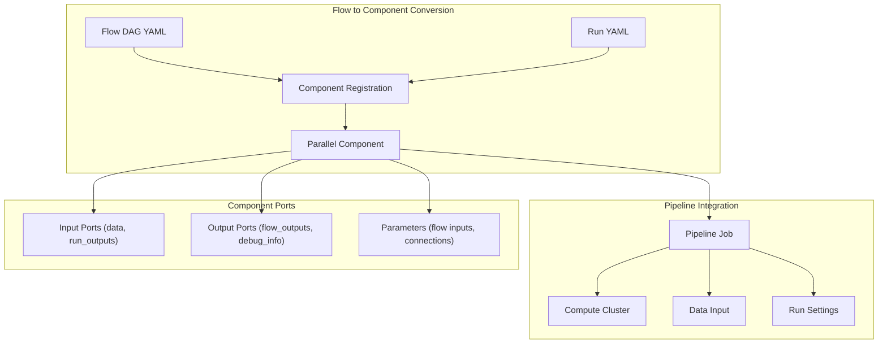
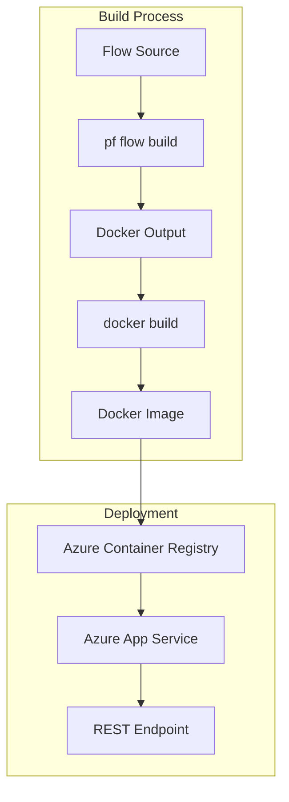
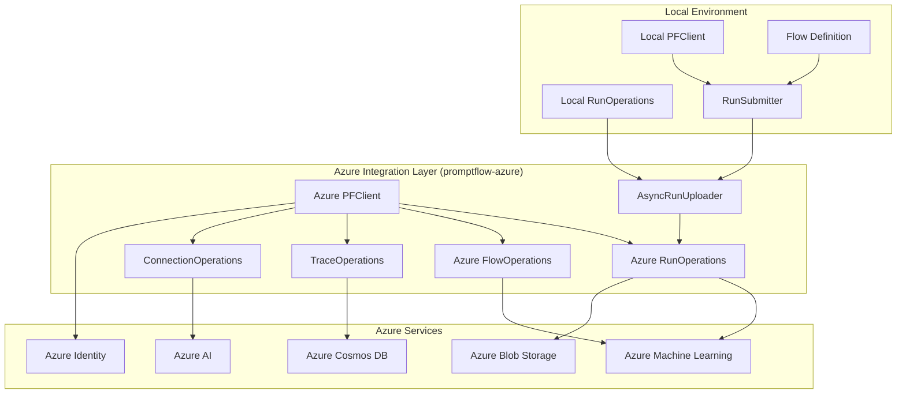
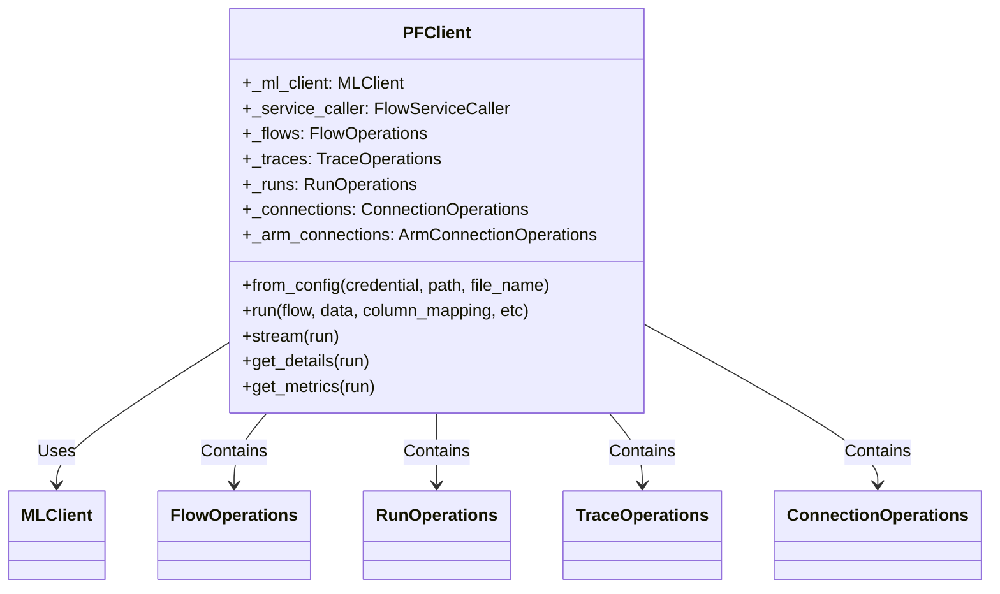
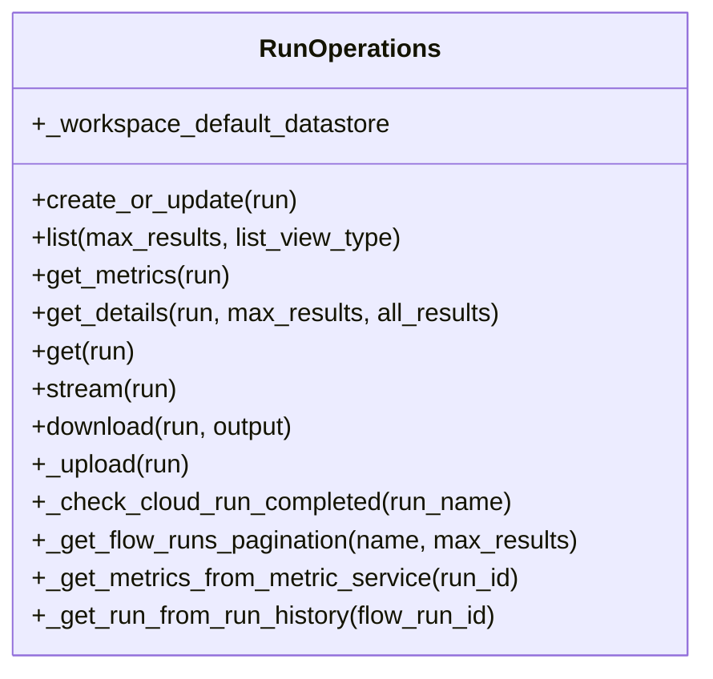
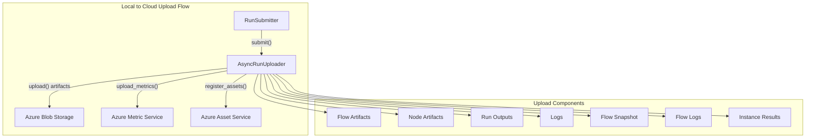
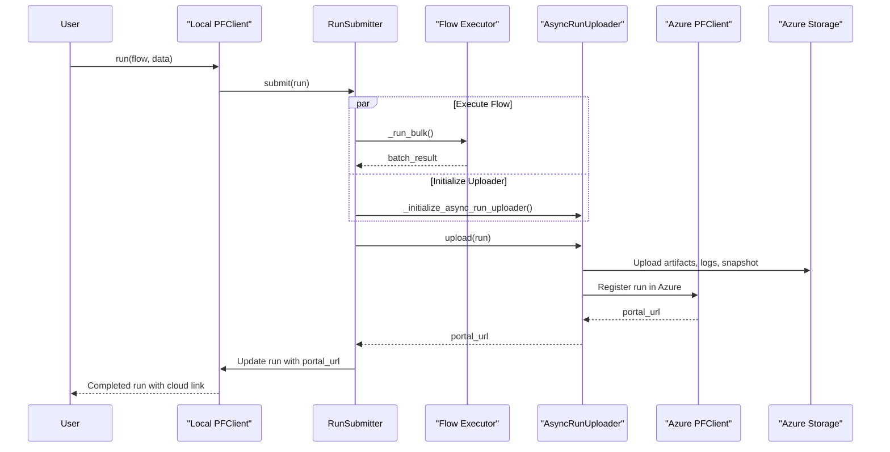
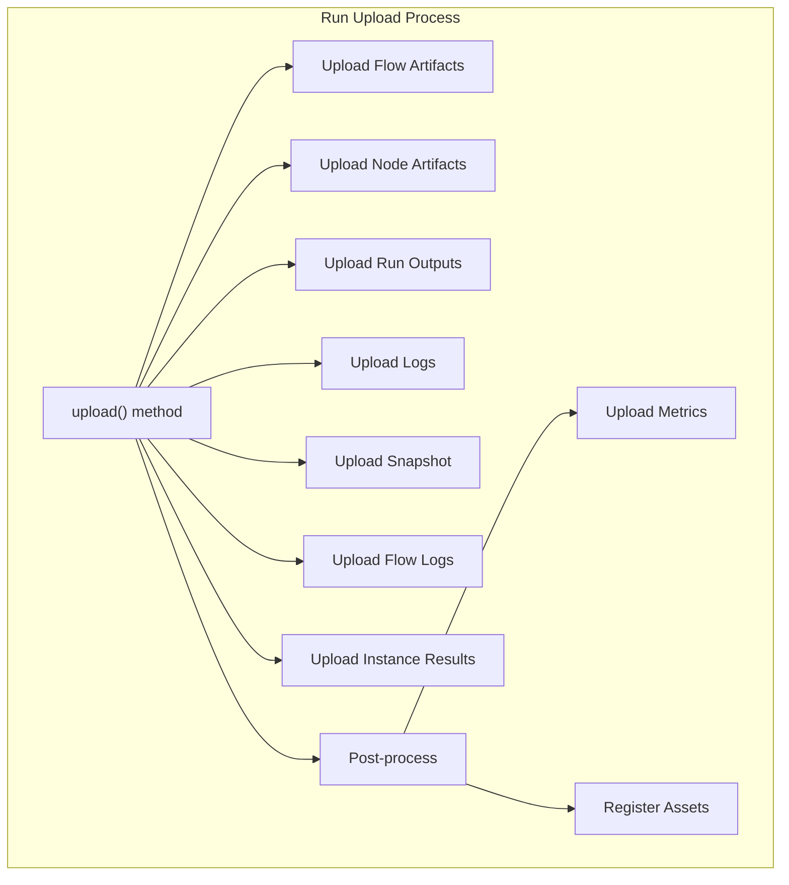
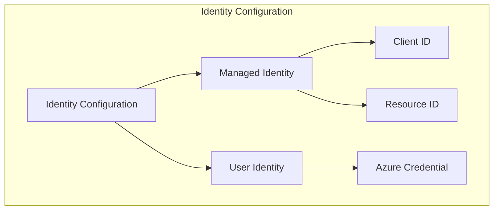
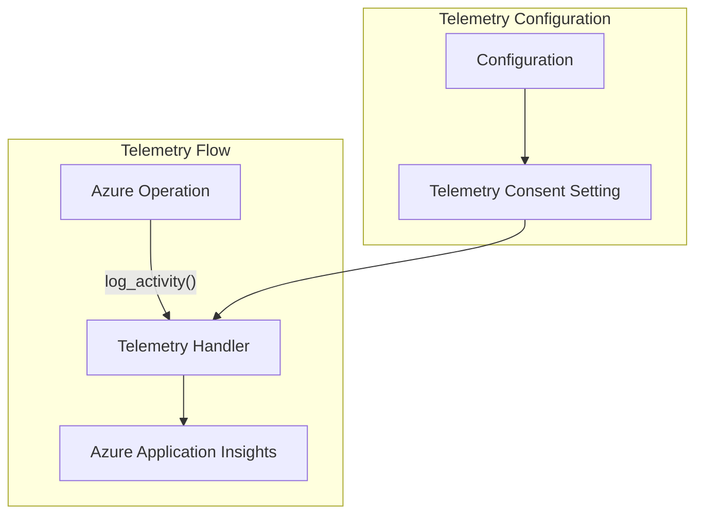

<!-- source: DeepWiki mcp.deepwiki.com · repo microsoft/promptflow · page 7 Azure Integration · fetched 2026-10-26 -->

## Azure ML Pipeline Integration

PromptFlow flows can be integrated into Azure ML pipelines as components, enabling large-scale parallel execution and integration with existing ML workflows.

### Flow as a Pipeline Component

When a flow is registered as a component, it becomes a parallel component in Azure ML that can be used in pipeline jobs.



Sources:
- [docs/cloud/azureai/use-flow-in-azure-ml-pipeline.md]()

### Component Ports and Run Settings

When a flow is used as a component in a pipeline, it exposes specific ports and settings:

| Port/Setting | Type | Description |
|--------------|------|-------------|
| `data` | Input | Required input data (mltable or jsonl files) |
| `run_outputs` | Input | Optional input from previous flow node |
| `flow_outputs` | Output | Output folder with jsonl files containing results |
| `debug_info` | Output | Debug information folder |
| `instance_count` | Setting | Number of nodes to use (default: 1) |
| `max_concurrency_per_instance` | Setting | Number of processors per node |
| `mini_batch_error_threshold` | Setting | Number of failed mini batches to ignore |
| `retry_settings.max_retries` | Setting | Number of retries for failed mini-batches |
| `retry_settings.timeout` | Setting | Timeout in seconds for execution |

Sources:
- [docs/cloud/azureai/use-flow-in-azure-ml-pipeline.md]()

## Deployment Options

PromptFlow provides several options for deploying flows to production environments in Azure.

### Azure App Service Deployment

Flows can be built into Docker containers and deployed to Azure App Service for production serving.



Sources:
- [docs/cloud/azureai/deploy-to-azure-appservice.md]()
- [docs/reference/pf-command-reference.md]()

## Transition Scenarios from Local to Cloud

There are several common scenarios for transitioning from local development to Azure cloud:

| Scenario | Benefit | Method |
|----------|---------|--------|
| Collaborative development | Share flows across teams | `pfazure flow create` |
| Large-scale data processing | Process data in parallel | Use flow in Azure ML pipeline |
| Production deployment | High availability and security | `pf flow build` and deploy to Azure App Service |
| Data security and compliance | Secure data handling | Use Azure identity and access controls |

Sources:
- [docs/cloud/index.md]()
- [docs/cloud/azureai/manage-flows.md]()
# Azure Integration

<details>
<summary>Relevant source files</summary>

The following files were used as context for generating this wiki page:

- [docs/cloud/azureai/create-run-with-compute-session.md](docs/cloud/azureai/create-run-with-compute-session.md)
- [docs/cloud/azureai/manage-flows.md](docs/cloud/azureai/manage-flows.md)
- [docs/cloud/azureai/run-promptflow-in-azure-ai.md](docs/cloud/azureai/run-promptflow-in-azure-ai.md)
- [docs/cloud/azureai/runtime-change-log.md](docs/cloud/azureai/runtime-change-log.md)
- [docs/cloud/azureai/use-flow-in-azure-ml-pipeline.md](docs/cloud/azureai/use-flow-in-azure-ml-pipeline.md)
- [docs/cloud/index.md](docs/cloud/index.md)
- [docs/media/cloud/azureml/llmops_cloud_value.png](docs/media/cloud/azureml/llmops_cloud_value.png)
- [docs/media/cloud/manage-flows/flow_create_2.png](docs/media/cloud/manage-flows/flow_create_2.png)
- [docs/media/cloud/runtime-change-log/runtime-version.png](docs/media/cloud/runtime-change-log/runtime-version.png)
- [docs/media/trace/trace-ui-portal-demo.gif](docs/media/trace/trace-ui-portal-demo.gif)
- [docs/reference/pf-command-reference.md](docs/reference/pf-command-reference.md)
- [docs/reference/pfazure-command-reference.md](docs/reference/pfazure-command-reference.md)
- [examples/configuration.ipynb](examples/configuration.ipynb)
- [src/promptflow-azure/CHANGELOG.md](src/promptflow-azure/CHANGELOG.md)
- [src/promptflow-azure/pyproject.toml](src/promptflow-azure/pyproject.toml)
- [src/promptflow-core/CHANGELOG.md](src/promptflow-core/CHANGELOG.md)
- [src/promptflow-core/pyproject.toml](src/promptflow-core/pyproject.toml)
- [src/promptflow-devkit/CHANGELOG.md](src/promptflow-devkit/CHANGELOG.md)
- [src/promptflow-devkit/pyproject.toml](src/promptflow-devkit/pyproject.toml)
- [src/promptflow-tracing/CHANGELOG.md](src/promptflow-tracing/CHANGELOG.md)
- [src/promptflow-tracing/pyproject.toml](src/promptflow-tracing/pyproject.toml)
- [src/promptflow/CHANGELOG.md](src/promptflow/CHANGELOG.md)
- [src/promptflow/promptflow/_version.py](src/promptflow/promptflow/_version.py)

</details>


This page covers the Azure integration capabilities within PromptFlow, focusing on how the system interacts with Azure services, particularly Azure AI and Azure Machine Learning. It details the architecture components for cloud execution, run management, and integration with Azure resources.

For detailed information about running flows locally, see [Flow Execution Model](2.2).

## Integration Architecture

The Azure integration in PromptFlow enables seamless execution and management of flows in the Azure cloud. The integration layer bridges the local development experience with Azure's cloud capabilities through the `promptflow-azure` package.



Sources:
- [src/promptflow-azure/promptflow/azure/_pf_client.py]()
- [src/promptflow-azure/promptflow/azure/operations/_run_operations.py]()
- [src/promptflow-devkit/promptflow/_sdk/_orchestrator/run_submitter.py]()

## Core Components

The Azure integration in PromptFlow consists of several key components that work together to provide a seamless experience when working with Azure services.

### Azure PFClient

The `PFClient` class in the Azure context serves as the main client for interacting with Azure Prompt Flow services. It provides access to various operations for managing flows, runs, connections, and traces in Azure.



Sources:
- [src/promptflow-azure/promptflow/azure/_pf_client.py]()

### Run Operations in Azure

The `RunOperations` class manages runs in Azure, including creating, listing, retrieving, and managing run data. It handles the communication with Azure services for run-related operations.



Sources:
- [src/promptflow-azure/promptflow/azure/operations/_run_operations.py]()

### Async Run Uploader

The `AsyncRunUploader` handles the process of uploading local run data to Azure cloud. It manages the transfer of run artifacts, metrics, logs, and other run-related data to Azure storage and services.



Sources:
- [src/promptflow-azure/promptflow/azure/operations/_async_run_uploader.py]()
- [src/promptflow-devkit/promptflow/_sdk/_orchestrator/run_submitter.py]()

## Local to Cloud Integration

One of the key features of Azure integration is the ability to create runs locally and then upload them to Azure for management, sharing, and visualization.

### Local to Cloud Run Flow



Sources:
- [src/promptflow-devkit/promptflow/_sdk/_orchestrator/run_submitter.py]()
- [src/promptflow-azure/promptflow/azure/operations/_async_run_uploader.py]()
- [src/promptflow-azure/tests/sdk_cli_azure_test/e2etests/test_run_upload.py]()

### Upload Process Details

When uploading a run to Azure, the `AsyncRunUploader` handles various artifacts and data:

1. **Flow artifacts** - The outputs of flow execution
2. **Node artifacts** - Individual node execution results
3. **Run outputs** - Final outputs of the run
4. **Logs** - Execution logs
5. **Snapshot** - Flow definition and dependencies
6. **Flow logs** - Per-line execution logs
7. **Instance results** - Individual run instances



Sources:
- [src/promptflow-azure/promptflow/azure/operations/_async_run_uploader.py]()

## Identity and Authentication

Azure integration in PromptFlow supports different identity configurations for authentication with Azure services.

### Identity Types

1. **Managed Identity** - Uses Azure Managed Identities for authenticating with Azure services
2. **User Identity** - Uses user credentials for authentication



Sources:
- [src/promptflow-devkit/promptflow/_sdk/schemas/_run.py]()
- [src/promptflow-azure/tests/sdk_cli_azure_test/unittests/test_run_operations.py]()

## CLI Commands for Azure Integration

The Azure integration provides a set of CLI commands (`pfazure`) for interacting with Azure services.

### Main Azure CLI Commands

| Command | Description |
|---------|-------------|
| `pfazure flow create` | Create a flow in Azure |
| `pfazure flow update` | Update a flow in Azure |
| `pfazure flow list` | List flows in Azure |
| `pfazure run create` | Create a run in Azure |
| `pfazure run list` | List runs in Azure |
| `pfazure run stream` | Stream logs from a run in Azure |
| `pfazure run show` | Show details of a run in Azure |
| `pfazure run show-details` | Show detailed results of a run in Azure |
| `pfazure run show-metrics` | Show metrics of a run in Azure |
| `pfazure run cancel` | Cancel a run in Azure |
| `pfazure run visualize` | Visualize run results in a browser |
| `pfazure run archive` | Archive a run in Azure |
| `pfazure run restore` | Restore an archived run in Azure |
| `pfazure run update` | Update run metadata in Azure |
| `pfazure run download` | Download a run from Azure |

Sources:
- [src/promptflow-azure/promptflow/azure/_cli/_run.py]()
- [src/promptflow-azure/promptflow/azure/_cli/_flow.py]()
- [docs/reference/pfazure-command-reference.md]()

## Configuration

PromptFlow provides configuration options for Azure integration, which can be set using the `pf config` commands.

### Setting Azure Configuration

```
# Configure connection provider to use Azure
pf config set connection.provider="azureml://subscriptions/<subscription-id>/resourceGroups/<resource-group>/providers/Microsoft.MachineLearningServices/workspaces/<workspace-name>"
```

This configuration enables PromptFlow to use Azure Machine Learning workspace for connection management, authentication, and other Azure features.

Sources:
- [src/promptflow-devkit/promptflow/_cli/_pf/_config.py:13-21]()

## Telemetry in Azure Integration

Azure integration includes telemetry capabilities to help monitor and understand usage patterns.



Sources:
- [src/promptflow-azure/tests/sdk_cli_azure_test/e2etests/test_telemetry.py:71-133]()

## Environment Variables and Authentication

Azure integration in PromptFlow supports various environment variables for configuration and authentication.

### Key Environment Variables

| Environment Variable | Description |
|----------------------|-------------|
| `PF_NO_INTERACTIVE_LOGIN` | Set to disable interactive login for Azure authentication |
| `PF_USE_AZURE_CLI_CREDENTIAL` | Set to true to use Azure CLI credential |
| `PF_HOME_DIRECTORY` | Configure PromptFlow home directory |
| `AZURE_CLIENT_ID` | Azure client ID for service principal authentication |
| `AZURE_TENANT_ID` | Azure tenant ID for authentication |
| `AZURE_CLIENT_SECRET` | Secret for service principal authentication |

Environment variables can also be used within Prompty templates for dynamic configuration:

```
azure_deployment: ${env:MOCK_AZURE_DEVELOPMENT}
api_key: ${env:MOCK_AZURE_API_KEY}
api_version: ${env:MOCK_AZURE_API_VERSION}
azure_endpoint: ${env:MOCK_AZURE_ENDPOINT}
```

Sources:
- [src/promptflow/CHANGELOG.md:306-311]()
- [src/promptflow/tests/test_configs/prompty/prompty_with_env.prompty:1-39]()

## Compatibility and Version Information

The Azure integration components are regularly updated along with the core PromptFlow packages. Here's a summary of recent changes:

| Version | Key Changes |
|---------|-------------|
| v1.17.0 | Dropped Python 3.8 support for security reasons |
| v1.15.0 | Fixed Connection aborted error for local to cloud run |
| v1.13.0 | Reduced time latency for local to cloud run by caching ARM token |
| v1.12.0 | Fixed timezone issues in local to cloud run |
| v1.11.0 | Improved trace Cosmos DB setup process and workspace experience |

Sources:
- [src/promptflow-azure/CHANGELOG.md:1-39]()

---

