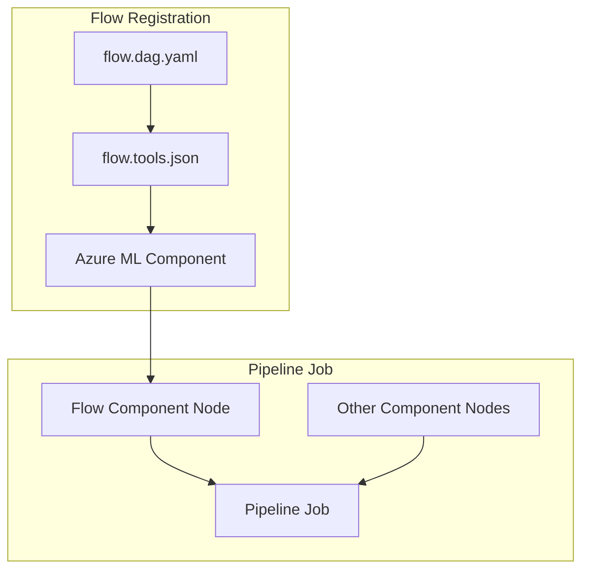
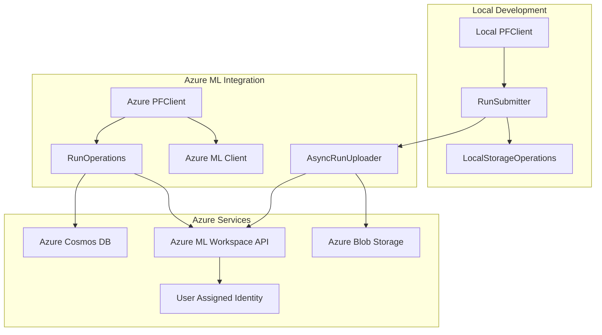
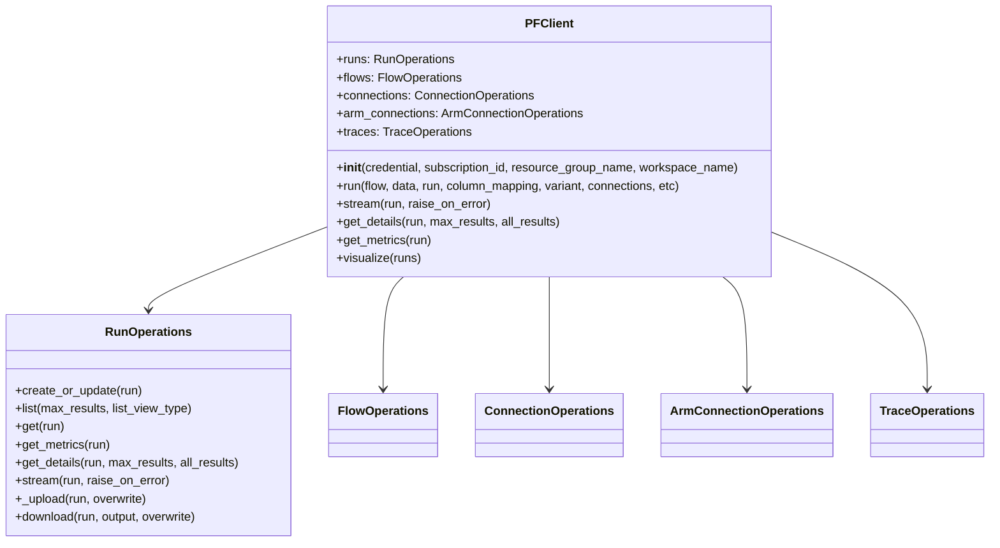
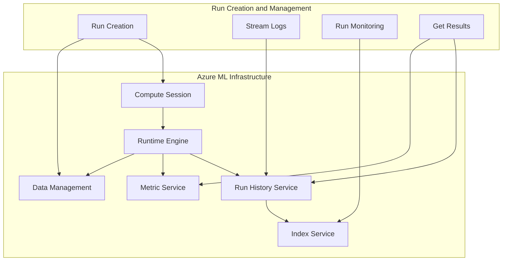
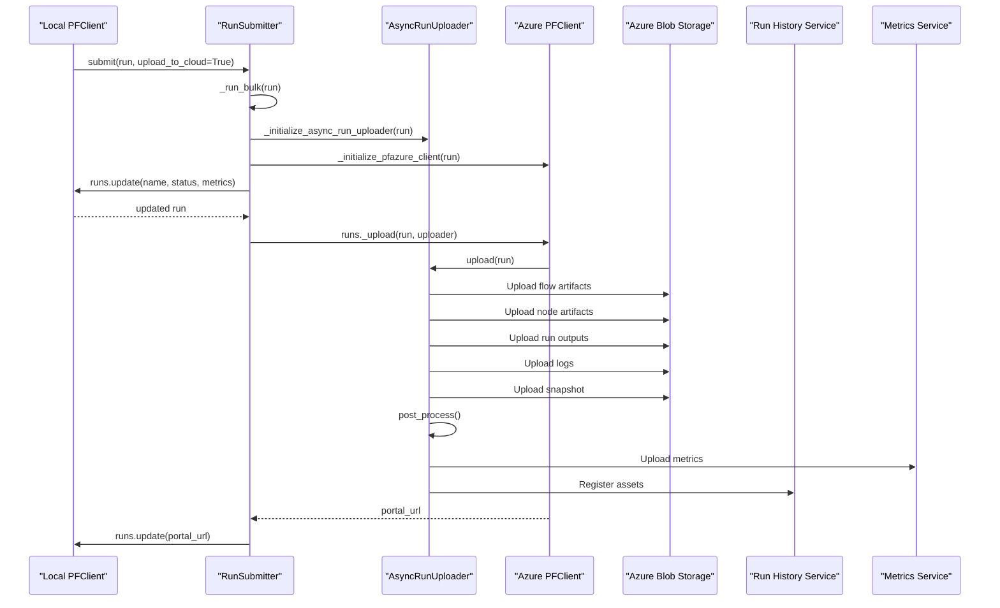
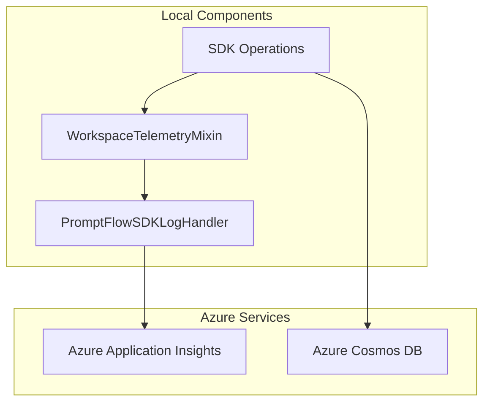
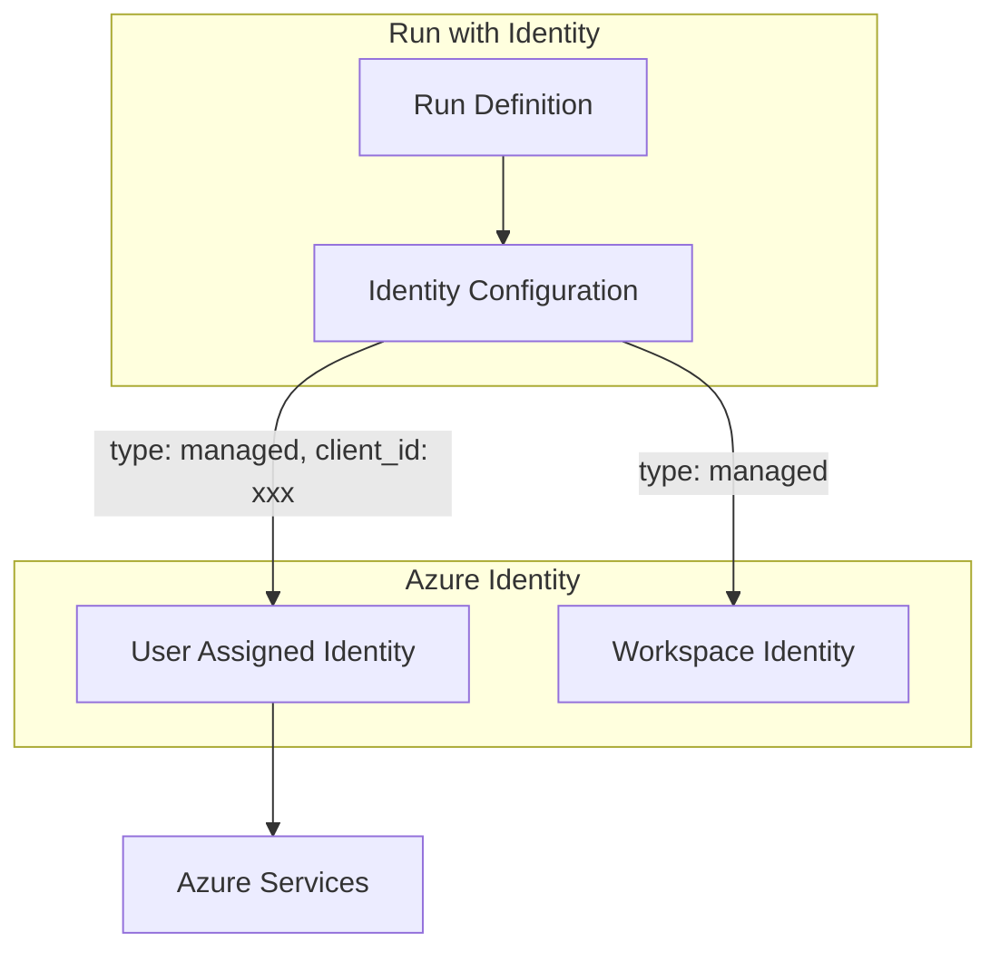

<!-- source: DeepWiki mcp.deepwiki.com · repo microsoft/promptflow · page 7.1 Azure ML Integration · fetched 2026-10-26 -->

## Runtime Environment

Azure ML provides a default runtime environment for executing flows in the cloud. This runtime is a Docker image that contains all the necessary dependencies for running Promptflow.

### Runtime Versions

The runtime image is continuously updated with new features and bug fixes. You can check the runtime image version from the flow execution log.

```
mcr.microsoft.com/azureml/promptflow/promptflow-runtime-stable:<runtime_version>
```

### Environment Customization

You can customize the environment for your flow by specifying Python requirements:

```yaml
# In flow.dag.yaml

<details>
<summary>Relevant source files</summary>

The following files were used as context for generating this wiki page:

- [docs/cloud/azureai/create-run-with-compute-session.md](docs/cloud/azureai/create-run-with-compute-session.md)
- [docs/cloud/azureai/manage-flows.md](docs/cloud/azureai/manage-flows.md)
- [docs/cloud/azureai/run-promptflow-in-azure-ai.md](docs/cloud/azureai/run-promptflow-in-azure-ai.md)
- [docs/cloud/azureai/runtime-change-log.md](docs/cloud/azureai/runtime-change-log.md)
- [docs/cloud/azureai/use-flow-in-azure-ml-pipeline.md](docs/cloud/azureai/use-flow-in-azure-ml-pipeline.md)
- [docs/cloud/index.md](docs/cloud/index.md)
- [docs/media/cloud/azureml/llmops_cloud_value.png](docs/media/cloud/azureml/llmops_cloud_value.png)
- [docs/media/cloud/manage-flows/flow_create_2.png](docs/media/cloud/manage-flows/flow_create_2.png)
- [docs/media/cloud/runtime-change-log/runtime-version.png](docs/media/cloud/runtime-change-log/runtime-version.png)
- [docs/media/trace/trace-ui-portal-demo.gif](docs/media/trace/trace-ui-portal-demo.gif)
- [docs/reference/pf-command-reference.md](docs/reference/pf-command-reference.md)
- [docs/reference/pfazure-command-reference.md](docs/reference/pfazure-command-reference.md)
- [examples/configuration.ipynb](examples/configuration.ipynb)
- [src/promptflow-azure/promptflow/azure/_cli/_run.py](src/promptflow-azure/promptflow/azure/_cli/_run.py)
- [src/promptflow-azure/promptflow/azure/_pf_client.py](src/promptflow-azure/promptflow/azure/_pf_client.py)
- [src/promptflow-azure/promptflow/azure/operations/_async_run_uploader.py](src/promptflow-azure/promptflow/azure/operations/_async_run_uploader.py)
- [src/promptflow-azure/promptflow/azure/operations/_run_operations.py](src/promptflow-azure/promptflow/azure/operations/_run_operations.py)
- [src/promptflow-azure/tests/sdk_cli_azure_test/e2etests/test_run_upload.py](src/promptflow-azure/tests/sdk_cli_azure_test/e2etests/test_run_upload.py)
- [src/promptflow-azure/tests/sdk_cli_azure_test/e2etests/test_telemetry.py](src/promptflow-azure/tests/sdk_cli_azure_test/e2etests/test_telemetry.py)
- [src/promptflow-azure/tests/sdk_cli_azure_test/unittests/test_run_operations.py](src/promptflow-azure/tests/sdk_cli_azure_test/unittests/test_run_operations.py)
- [src/promptflow-devkit/promptflow/_cli/_params.py](src/promptflow-devkit/promptflow/_cli/_params.py)
- [src/promptflow-devkit/promptflow/_cli/_pf/_config.py](src/promptflow-devkit/promptflow/_cli/_pf/_config.py)
- [src/promptflow-devkit/promptflow/_cli/_pf/_run.py](src/promptflow-devkit/promptflow/_cli/_pf/_run.py)
- [src/promptflow-devkit/promptflow/_sdk/_errors.py](src/promptflow-devkit/promptflow/_sdk/_errors.py)
- [src/promptflow-devkit/promptflow/_sdk/_orchestrator/run_submitter.py](src/promptflow-devkit/promptflow/_sdk/_orchestrator/run_submitter.py)
- [src/promptflow-devkit/promptflow/_sdk/_pf_client.py](src/promptflow-devkit/promptflow/_sdk/_pf_client.py)
- [src/promptflow-devkit/promptflow/_sdk/entities/_run.py](src/promptflow-devkit/promptflow/_sdk/entities/_run.py)
- [src/promptflow-devkit/promptflow/_sdk/schemas/_run.py](src/promptflow-devkit/promptflow/_sdk/schemas/_run.py)
- [src/promptflow/tests/test_configs/datas/webClassification.json](src/promptflow/tests/test_configs/datas/webClassification.json)
- [src/promptflow/tests/test_configs/eager_flows/basic_callable_class/init.json](src/promptflow/tests/test_configs/eager_flows/basic_callable_class/init.json)
- [src/promptflow/tests/test_configs/eager_flows/basic_callable_class/run_init_file.yaml](src/promptflow/tests/test_configs/eager_flows/basic_callable_class/run_init_file.yaml)
- [src/promptflow/tests/test_configs/prompty/prompty_with_env.prompty](src/promptflow/tests/test_configs/prompty/prompty_with_env.prompty)

</details>


environment:
  python_requirements_txt: requirements.txt
```

Or by using an existing Azure ML environment:

```yaml
# In run.yaml
$schema: https://azuremlschemas.azureedge.net/promptflow/latest/Run.schema.json
flow: <my-flow-directory>
azureml:
  environment: azureml:my-environment:1
```

Sources:
- [docs/cloud/azureai/runtime-change-log.md:1-17](https://github.com/microsoft/promptflow/blob/main/docs/cloud/azureai/runtime-change-log.md#L1-L17)
- [docs/cloud/azureai/use-flow-in-azure-ml-pipeline.md:298-317](https://github.com/microsoft/promptflow/blob/main/docs/cloud/azureai/use-flow-in-azure-ml-pipeline.md#L298-L317)
## Using Flows in Azure ML Pipeline Jobs

Promptflow integrates with Azure ML pipelines, allowing you to use flows as components in pipeline jobs. This enables you to:

1. Process large amounts of data in parallel
2. Integrate flows with other Azure ML components
3. Orchestrate complex workflows involving multiple flows

### Flow as a Component

When you register a flow as a component, it becomes a parallel component in Azure ML:



You can register a flow as a component using CLI or SDK:

```bash
# Register flow as a component using CLI
az ml component create --file <my-flow-directory>/flow.dag.yaml
```

```python
# Register flow as a component using SDK
from azure.ai.ml import MLClient, load_component

ml_client = MLClient()
flow_component = load_component("<my-flow-directory>/flow.dag.yaml")
ml_client.components.create_or_update(flow_component)
```

### Component Ports and Settings

When a flow is registered as a component, it exposes the following ports:

| Port | Type | Description |
|------|------|-------------|
| data | uri_folder/uri_file | Required input data |
| run_outputs | uri_folder | Optional input from another flow |
| flow_outputs | uri_folder | Output containing flow results |
| debug_info | uri_folder | Output containing debug information |

You can also configure run settings for the flow component in a pipeline job:

```python
flow_node = flow_component(
    data=data,
    url="${data.url}",
    connections={
        "summarize_text_content": {
            "connection": "azure_open_ai_connection",
            "deployment_name": "text-davinci-003",
        },
    },
    environment_variables={
        "AZURE_OPENAI_API_KEY": "${my_connection.api_key}",
        "AZURE_OPENAI_API_BASE": "${my_connection.api_base}",
    }
)
flow_node.compute = "cpu-cluster"
flow_node.instance_count = 2
flow_node.max_concurrency_per_instance = 2
```

Sources:
- [docs/cloud/azureai/use-flow-in-azure-ml-pipeline.md:30-131](https://github.com/microsoft/promptflow/blob/main/docs/cloud/azureai/use-flow-in-azure-ml-pipeline.md#L30-L131)
- [docs/cloud/azureai/use-flow-in-azure-ml-pipeline.md:219-246](https://github.com/microsoft/promptflow/blob/main/docs/cloud/azureai/use-flow-in-azure-ml-pipeline.md#L219-L246)
- [docs/cloud/azureai/use-flow-in-azure-ml-pipeline.md:326-338](https://github.com/microsoft/promptflow/blob/main/docs/cloud/azureai/use-flow-in-azure-ml-pipeline.md#L326-L338)
# Azure ML Integration

This page explains how Promptflow integrates with Azure Machine Learning (Azure ML), enabling users to run flows in the cloud, leverage Azure ML infrastructure, and manage resources within Azure ML workspaces. For information about running flows locally, see [Flow Execution Model](2.2).

## Overview of Azure ML Integration

Promptflow provides integration with Azure Machine Learning to enable cloud-based execution, management, and scaling of prompt flows. This integration allows users to:

1. Run flows on Azure ML compute infrastructure
2. Upload local flow runs to Azure ML for tracking and collaboration
3. Manage connections to Azure services
4. Configure tracing and telemetry to Azure services
5. Utilize Azure ML's identity and authentication mechanisms

The integration is primarily provided through the `promptflow-azure` package, which offers an Azure-specific client (`PFClient`) and operations classes that interact with Azure ML services.



Sources:
- [src/promptflow-devkit/promptflow/_sdk/_orchestrator/run_submitter.py](https://github.com/microsoft/promptflow/blob/main/src/promptflow-devkit/promptflow/_sdk/_orchestrator/run_submitter.py)
- [src/promptflow-azure/promptflow/azure/_pf_client.py](https://github.com/microsoft/promptflow/blob/main/src/promptflow-azure/promptflow/azure/_pf_client.py)
- [src/promptflow-azure/promptflow/azure/operations/_run_operations.py](https://github.com/microsoft/promptflow/blob/main/src/promptflow-azure/promptflow/azure/operations/_run_operations.py)
- [src/promptflow-azure/promptflow/azure/operations/_async_run_uploader.py](https://github.com/microsoft/promptflow/blob/main/src/promptflow-azure/promptflow/azure/operations/_async_run_uploader.py)

## Azure PFClient

The Azure `PFClient` is the main entry point for interacting with Promptflow services in Azure ML. It provides methods for creating and managing runs, flows, connections, and traces in Azure ML.



### Initializing an Azure PFClient

To use the Azure ML integration, you need to create an Azure `PFClient` instance:

```python
from azure.identity import DefaultAzureCredential
from promptflow.azure import PFClient

# Method 1: Initialize with individual parameters
credential = DefaultAzureCredential()
pf = PFClient(
    credential=credential,
    subscription_id="your-subscription-id",
    resource_group_name="your-resource-group",
    workspace_name="your-workspace-name"
)

# Method 2: Initialize from a configuration file
pf = PFClient.from_config(
    credential=credential,
    path="path/to/config"
)
```

The client requires Azure credentials and information about the Azure ML workspace to connect to. It internally creates an Azure ML client and service callers to interact with various Azure services.

Sources:
- [src/promptflow-azure/promptflow/azure/_pf_client.py](https://github.com/microsoft/promptflow/blob/main/src/promptflow-azure/promptflow/azure/_pf_client.py)
- [src/promptflow-azure/promptflow/azure/operations/_run_operations.py](https://github.com/microsoft/promptflow/blob/main/src/promptflow-azure/promptflow/azure/operations/_run_operations.py)

## Run Management in Azure ML

### Creating and Managing Runs

The Azure `PFClient` provides methods to create and manage runs in Azure ML:

```python
# Create a run in Azure
run = pf.run(
    flow="path/to/flow",
    data="path/to/data.jsonl",
    column_mapping={"input": "${data.text}"}
)

# Stream run logs
pf.stream(run.name)

# Get run details
details = pf.get_details(run.name)

# Get run metrics
metrics = pf.get_metrics(run.name)
```

These operations communicate with Azure ML services to execute the flow in the cloud, monitor progress, and retrieve results.

### Run Architecture in Azure ML

Runs in Azure ML use the following components:



The Azure `RunOperations` class handles all interactions with these Azure ML services to submit, monitor, and retrieve run data.

Sources:
- [src/promptflow-azure/promptflow/azure/operations/_run_operations.py](https://github.com/microsoft/promptflow/blob/main/src/promptflow-azure/promptflow/azure/operations/_run_operations.py)
- [src/promptflow-azure/promptflow/azure/_pf_client.py](https://github.com/microsoft/promptflow/blob/main/src/promptflow-azure/promptflow/azure/_pf_client.py)

## Local to Cloud Integration

A key feature of the Azure ML integration is the ability to upload local flow runs to Azure ML for tracking and collaboration.

### Upload Process



This process allows users to:
1. Develop and test flows locally
2. Execute runs locally with full visibility into the execution
3. Upload selected runs to Azure ML for sharing, collaboration, and tracking

### AsyncRunUploader

The `AsyncRunUploader` is a key component in the local-to-cloud integration. It handles:

1. Uploading run artifacts to Azure Blob Storage
2. Registering assets in Azure ML
3. Uploading metrics to the Azure ML metrics service
4. Providing portal links to the uploaded runs

Sources:
- [src/promptflow-devkit/promptflow/_sdk/_orchestrator/run_submitter.py:42-62](https://github.com/microsoft/promptflow/blob/main/src/promptflow-devkit/promptflow/_sdk/_orchestrator/run_submitter.py#L42-L62)
- [src/promptflow-devkit/promptflow/_sdk/_orchestrator/run_submitter.py:282-304](https://github.com/microsoft/promptflow/blob/main/src/promptflow-devkit/promptflow/_sdk/_orchestrator/run_submitter.py#L282-L304)
- [src/promptflow-azure/promptflow/azure/operations/_async_run_uploader.py](https://github.com/microsoft/promptflow/blob/main/src/promptflow-azure/promptflow/azure/operations/_async_run_uploader.py)
- [src/promptflow-azure/tests/sdk_cli_azure_test/e2etests/test_run_upload.py](https://github.com/microsoft/promptflow/blob/main/src/promptflow-azure/tests/sdk_cli_azure_test/e2etests/test_run_upload.py)

## Tracing and Telemetry

The Azure ML integration includes tracing and telemetry capabilities that can send data to Azure services.

### Trace Configuration

Traces can be configured to be stored in Azure Cosmos DB through configuration settings:

```python
# Configure trace destination in configuration
pf.config.set("trace.destination", "azureml://subscriptions/<subscription-id>/resourceGroups/<resource-group-name>/providers/Microsoft.MachineLearningServices/workspaces/<workspace-name>")
```

When traces are enabled and configured for cloud storage, they are uploaded to Azure Cosmos DB for centralized storage and analysis.

### Telemetry Architecture



The trace and telemetry system provides:
1. Detailed execution traces for debugging and monitoring
2. Usage telemetry for understanding patterns
3. Error tracking for quick problem resolution

Sources:
- [src/promptflow-azure/tests/sdk_cli_azure_test/e2etests/test_telemetry.py](https://github.com/microsoft/promptflow/blob/main/src/promptflow-azure/tests/sdk_cli_azure_test/e2etests/test_telemetry.py)
- [docs/reference/pf-command-reference.md:885-929](https://github.com/microsoft/promptflow/blob/main/docs/reference/pf-command-reference.md#L885-L929)

## Authentication and Identity

The Azure ML integration leverages Azure's authentication and identity mechanisms.

### Authentication Methods

When interacting with Azure services, the following authentication methods are supported:

1. Azure CLI credentials
2. Environment variables
3. Managed identities
4. Service principals
5. Interactive browser login

```python
from azure.identity import DefaultAzureCredential, InteractiveBrowserCredential

try:
    credential = DefaultAzureCredential()
    # Check if given credential can get token successfully.
    credential.get_token("https://management.azure.com/.default")
except Exception as ex:
    # Fall back to InteractiveBrowserCredential in case DefaultAzureCredential not work
    credential = InteractiveBrowserCredential()
```

### User-Assigned Identity Support

Promptflow supports using user-assigned identities for run execution:



This allows runs to access Azure resources securely without embedding credentials in the flow.

Sources:
- [src/promptflow-azure/tests/sdk_cli_azure_test/unittests/test_run_operations.py:31-85](https://github.com/microsoft/promptflow/blob/main/src/promptflow-azure/tests/sdk_cli_azure_test/unittests/test_run_operations.py#L31-L85)
- [src/promptflow-devkit/promptflow/_sdk/entities/_run.py:38-52](https://github.com/microsoft/promptflow/blob/main/src/promptflow-devkit/promptflow/_sdk/entities/_run.py#L38-L52)
- [docs/cloud/azureai/manage-flows.md:51-66](https://github.com/microsoft/promptflow/blob/main/docs/cloud/azureai/manage-flows.md#L51-L66)

## Configuration

The integration with Azure ML can be configured through various settings:

### Environment Variables

```
PF_USE_AZURE_CLI_CREDENTIAL=true  # Use Azure CLI credential directly
PF_NO_INTERACTIVE_LOGIN=true      # Disable interactive login when using azureml connection provider
PF_LOGGING_LEVEL=INFO             # Control logging level
```

### Config Settings

```python
# Set connection provider to an Azure ML workspace
pf.config.set("connection.provider", "azureml://subscriptions/<subscription-id>/resourceGroups/<resource-group>/providers/Microsoft.MachineLearningServices/workspaces/<workspace-name>")

# Configure trace destination
pf.config.set("trace.destination", "azureml://subscriptions/<subscription-id>/resourceGroups/<resource-group>/providers/Microsoft.MachineLearningServices/workspaces/<workspace-name>")
```

These configuration options allow customizing how Promptflow interacts with Azure ML services.

You can also use the CLI to configure these settings:

```bash
# Set connection provider to Azure ML workspace
pf config set connection.provider="azureml://subscriptions/<subscription-id>/resourceGroups/<resource-group-name>/providers/Microsoft.MachineLearningServices/workspaces/<workspace-name>"

# Set trace destination to Azure ML workspace
pf config set trace.destination="azureml://subscriptions/<subscription-id>/resourceGroups/<resource-group-name>/providers/Microsoft.MachineLearningServices/workspaces/<workspace-name>"
```

Sources:
- [src/promptflow-devkit/promptflow/_cli/_pf/_config.py:14-19](https://github.com/microsoft/promptflow/blob/main/src/promptflow-devkit/promptflow/_cli/_pf/_config.py#L14-L19)
- [docs/reference/pf-command-reference.md:885-929](https://github.com/microsoft/promptflow/blob/main/docs/reference/pf-command-reference.md#L885-L929)
- [src/promptflow-azure/tests/sdk_cli_azure_test/e2etests/test_telemetry.py:45-70](https://github.com/microsoft/promptflow/blob/main/src/promptflow-azure/tests/sdk_cli_azure_test/e2etests/test_telemetry.py#L45-L70)

## Command Line Interface

The Azure ML integration includes command-line interfaces for managing resources in Azure ML:

```bash
# Create a run in Azure ML
pfazure run create --flow <path-to-flow> --data <path-to-data> --column-mapping input="${data.text}"

# List runs in Azure ML
pfazure run list

# Stream run logs
pfazure run stream --name <run-name>

# Download a run from Azure ML
pfazure run download --name <run-name> --output <output-path>
```

The `pfazure` CLI provides commands for managing both flows and runs:

| Command | Description |
|---------|-------------|
| `pfazure flow create` | Create a flow in Azure AI from a local flow folder |
| `pfazure flow update` | Update a flow's metadata |
| `pfazure flow list` | List flows in a workspace |
| `pfazure run create` | Create a run |
| `pfazure run list` | List runs in a workspace |
| `pfazure run show` | Show details for a run |
| `pfazure run stream` | Stream run logs to the console |
| `pfazure run show-details` | Show a run details |
| `pfazure run show-metrics` | Show run metrics |
| `pfazure run visualize` | Visualize a run |
| `pfazure run archive` | Archive a run |
| `pfazure run restore` | Restore a run |
| `pfazure run update` | Update a run |
| `pfazure run download` | Download a run |

These commands provide a convenient way to interact with Azure ML resources without writing code.

Sources:
- [src/promptflow-azure/promptflow/azure/_cli/_run.py](https://github.com/microsoft/promptflow/blob/main/src/promptflow-azure/promptflow/azure/_cli/_run.py)
- [docs/reference/pfazure-command-reference.md:1-180](https://github.com/microsoft/promptflow/blob/main/docs/reference/pfazure-command-reference.md#L1-L180)
- [src/promptflow-devkit/promptflow/_cli/_params.py](https://github.com/microsoft/promptflow/blob/main/src/promptflow-devkit/promptflow/_cli/_params.py)

## Run Resume and Recovery

The Azure ML integration supports resuming runs, which allows recovering from failures or continuing execution from a specific point:

```python
# Resume a run
pf.run(resume_from="previous-run-name")
```

You can also use the CLI to resume a run:

```bash
# Resume a run
pfazure run create --resume-from <original-run-name>

# Resume a run with custom name and metadata
pfazure run create --resume-from <original-run-name> --name <new-run-name> --set display_name='A new run' description='my run description' tags.Type=Test
```

This functionality helps in scenarios where:
1. A run was interrupted due to infrastructure issues
2. You want to reprocess only failed items
3. You're iteratively improving a flow and want to reuse previous results

The resume functionality works by:
1. Checking if the original run is completed
2. Creating a new run with the same properties as the original run
3. Reusing the succeeded line results from the original run
4. Only running the remaining/failed lines

Sources:
- [src/promptflow-devkit/promptflow/_sdk/_orchestrator/run_submitter.py:65-85](https://github.com/microsoft/promptflow/blob/main/src/promptflow-devkit/promptflow/_sdk/_orchestrator/run_submitter.py#L65-L85)
- [src/promptflow-devkit/promptflow/_sdk/_pf_client.py:144-167](https://github.com/microsoft/promptflow/blob/main/src/promptflow-devkit/promptflow/_sdk/_pf_client.py#L144-L167)
- [docs/reference/pfazure-command-reference.md:255-258](https://github.com/microsoft/promptflow/blob/main/docs/reference/pfazure-command-reference.md#L255-L258)

## Error Handling and Diagnostics

The Azure ML integration includes error handling and diagnostic capabilities:

1. Error detection and reporting during run execution
2. Detailed error messages and context
3. Error tracking in Azure Application Insights
4. Run status monitoring and reporting

These capabilities help in quickly identifying and resolving issues when working with Azure ML.

Sources:
- [src/promptflow-devkit/promptflow/_sdk/_errors.py]()
- [src/promptflow-azure/promptflow/azure/operations/_run_operations.py:447-449]()

---

