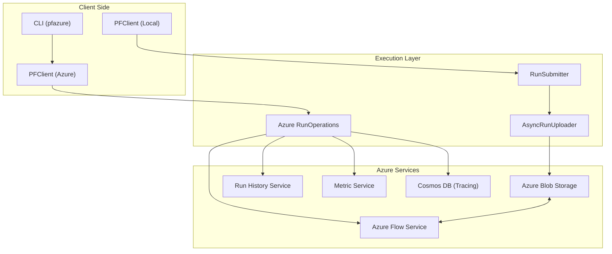
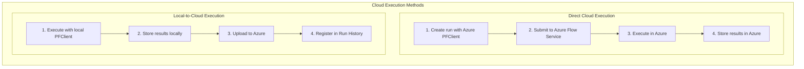
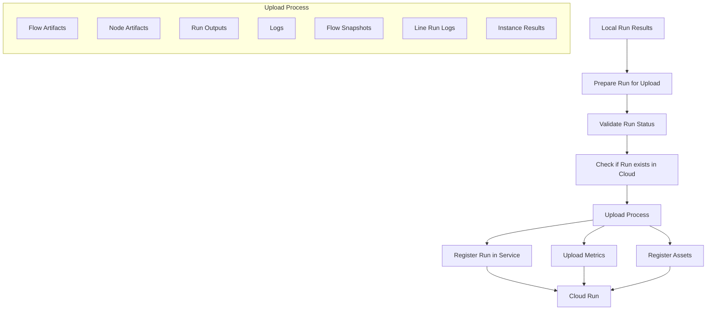
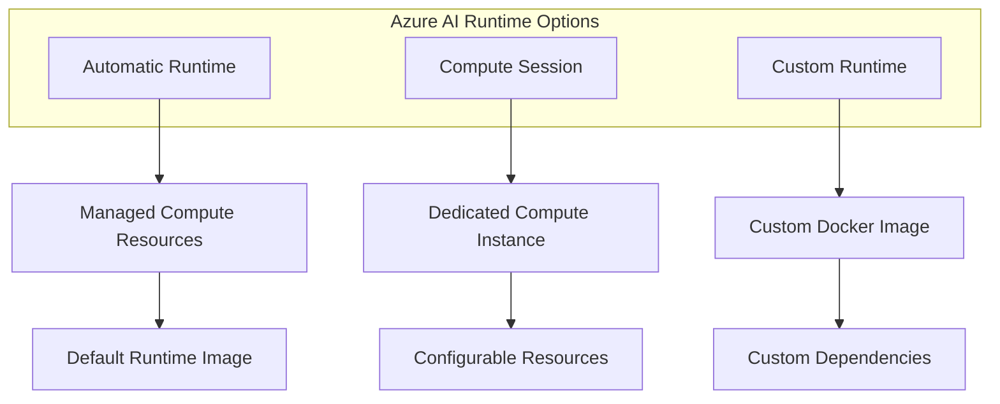

<!-- source: DeepWiki mcp.deepwiki.com · repo microsoft/promptflow · page 7.2 Cloud Execution · fetched 2026-10-26 -->

# Cloud Execution

<details>
<summary>Relevant source files</summary>

The following files were used as context for generating this wiki page:

- [docs/cloud/azureai/create-run-with-compute-session.md](docs/cloud/azureai/create-run-with-compute-session.md)
- [docs/cloud/azureai/manage-flows.md](docs/cloud/azureai/manage-flows.md)
- [docs/cloud/azureai/run-promptflow-in-azure-ai.md](docs/cloud/azureai/run-promptflow-in-azure-ai.md)
- [docs/cloud/azureai/runtime-change-log.md](docs/cloud/azureai/runtime-change-log.md)
- [docs/cloud/azureai/use-flow-in-azure-ml-pipeline.md](docs/cloud/azureai/use-flow-in-azure-ml-pipeline.md)
- [docs/cloud/index.md](docs/cloud/index.md)
- [docs/media/cloud/azureml/llmops_cloud_value.png](docs/media/cloud/azureml/llmops_cloud_value.png)
- [docs/media/cloud/manage-flows/flow_create_2.png](docs/media/cloud/manage-flows/flow_create_2.png)
- [docs/media/cloud/runtime-change-log/runtime-version.png](docs/media/cloud/runtime-change-log/runtime-version.png)
- [docs/media/trace/trace-ui-portal-demo.gif](docs/media/trace/trace-ui-portal-demo.gif)
- [docs/reference/pf-command-reference.md](docs/reference/pf-command-reference.md)
- [docs/reference/pfazure-command-reference.md](docs/reference/pfazure-command-reference.md)
- [examples/configuration.ipynb](examples/configuration.ipynb)
- [src/promptflow-azure/CHANGELOG.md](src/promptflow-azure/CHANGELOG.md)
- [src/promptflow-azure/pyproject.toml](src/promptflow-azure/pyproject.toml)
- [src/promptflow-core/CHANGELOG.md](src/promptflow-core/CHANGELOG.md)
- [src/promptflow-core/pyproject.toml](src/promptflow-core/pyproject.toml)
- [src/promptflow-devkit/CHANGELOG.md](src/promptflow-devkit/CHANGELOG.md)
- [src/promptflow-devkit/pyproject.toml](src/promptflow-devkit/pyproject.toml)
- [src/promptflow-tracing/CHANGELOG.md](src/promptflow-tracing/CHANGELOG.md)
- [src/promptflow-tracing/pyproject.toml](src/promptflow-tracing/pyproject.toml)
- [src/promptflow/CHANGELOG.md](src/promptflow/CHANGELOG.md)
- [src/promptflow/promptflow/_version.py](src/promptflow/promptflow/_version.py)

</details>


This page documents how promptflow supports executing flows in the Azure cloud environment. Cloud execution enables scaling, collaboration, and integration with Azure AI services. This includes running flows directly in the cloud and uploading local runs to Azure for tracking and sharing.

For information about local execution, see [Flow Execution Model](#2.2). For information about specific Azure ML integration capabilities, see [Azure ML Integration](#7.1).

## Architecture Overview

Promptflow's cloud execution capability is built on a multi-layered architecture that supports both direct cloud execution and local-to-cloud execution patterns.



Sources: [src/promptflow-devkit/promptflow/_sdk/_orchestrator/run_submitter.py](). [src/promptflow-azure/promptflow/azure/operations/_run_operations.py](). [src/promptflow-azure/promptflow/azure/operations/_async_run_uploader.py](). [src/promptflow-azure/promptflow/azure/_pf_client.py]().

### Key Components

- **Azure PFClient**: The main client for interacting with Azure AI services for cloud execution
- **RunOperations**: Provides operations for creating, managing and monitoring cloud runs
- **AsyncRunUploader**: Manages asynchronous upload of run artifacts to Azure Blob Storage
- **FlowServiceCaller**: Handles direct API calls to Azure Flow Service

## Cloud Execution Methods

Promptflow supports two primary methods for cloud execution:



Sources: [src/promptflow-azure/promptflow/azure/operations/_run_operations.py](). [src/promptflow-devkit/promptflow/_sdk/_orchestrator/run_submitter.py]().

### Direct Cloud Execution

With direct cloud execution, the flow definition and inputs are sent directly to Azure for execution. This method leverages Azure's compute resources for the entire execution lifecycle and is ideal for:

- Executing resource-intensive flows
- Running flows against large datasets
- Long-running operations
- Team collaboration on flows

### Local-to-Cloud Execution

With local-to-cloud execution, flows are first executed locally and then the results are uploaded to Azure. This pattern is useful for:

- Developing and testing flows locally before sharing
- Preserving execution history in a central location
- Sharing results with team members
- Hybrid development workflows

The local-to-cloud pattern is automatically enabled when the trace destination is configured to use Azure, or can be triggered explicitly.

## Using Cloud Execution

### Python SDK

#### Direct Cloud Execution

```python
from promptflow.azure import PFClient

# Initialize Azure client
pf = PFClient(
    subscription_id="<subscription-id>",
    resource_group_name="<resource-group>",
    workspace_name="<workspace>"
)

# Execute flow in Azure
run = pf.run(
    flow="./path/to/flow_directory",
    data="./path/to/data.jsonl",
    column_mapping={"question": "${data.question}"},
    connections={"openai_connection": {"deployment_name": "gpt-35-turbo"}},
    runtime="example-runtime",  # Optional: Specify compute
)

# Stream logs in real-time
pf.stream(run)

# Retrieve results
details = pf.get_details(run)
metrics = pf.get_metrics(run)
```

#### Local-to-Cloud Execution

```python
from promptflow import PFClient as LocalPFClient
from promptflow.azure import PFClient as AzurePFClient

# Configure connection provider to Azure
# pf config set connection.provider="azureml://subscriptions/<subscription>/resourceGroups/<resource-group>/providers/Microsoft.MachineLearningServices/workspaces/<workspace>"

# Run flow locally 
local_pf = LocalPFClient()
local_run = local_pf.run(
    flow="./path/to/flow_directory",
    data="./path/to/data.jsonl",
    column_mapping={"question": "${data.question}"}
)

# Upload to Azure
azure_pf = AzurePFClient(
    subscription_id="<subscription-id>",
    resource_group_name="<resource-group>",
    workspace_name="<workspace>"
)
azure_run = azure_pf.runs._upload(run=local_run)
```

Sources: [src/promptflow-azure/promptflow/azure/_pf_client.py](). [src/promptflow-azure/tests/sdk_cli_azure_test/e2etests/test_run_upload.py]().

### CLI Commands

#### Direct Cloud Execution

```bash
# Create and execute run in Azure
pfazure run create --flow ./path/to/flow_directory \
                  --data ./path/to/data.jsonl \
                  --column-mapping question='${data.question}' \
                  --stream

# List runs
pfazure run list

# Show run details
pfazure run show --name <run-name>

# Get run metrics
pfazure run show-metrics --name <run-name>

# Stream run logs
pfazure run stream --name <run-name>

# Visualize run
pfazure run visualize --name <run-name>
```

#### Local-to-Cloud Execution

The CLI automatically handles local-to-cloud upload when the connection provider is configured to Azure:

```bash
# Configure connection provider
pf config set connection.provider="azureml://subscriptions/<subscription>/resourceGroups/<resource-group>/providers/Microsoft.MachineLearningServices/workspaces/<workspace>"

# Run flow locally (will be automatically uploaded to cloud if trace destination is cloud)
pf run create --flow ./path/to/flow_directory \
              --data ./path/to/data.jsonl \
              --column-mapping question='${data.question}'
```

Sources: [src/promptflow-azure/promptflow/azure/_cli/_run.py](). [src/promptflow-devkit/promptflow/_cli/_pf/_config.py]().

## Upload Process

When a run is uploaded to the cloud, multiple components are packaged and transferred to Azure. The `AsyncRunUploader` handles this process asynchronously:



Sources: [src/promptflow-azure/promptflow/azure/operations/_async_run_uploader.py](). [src/promptflow-devkit/promptflow/_sdk/_orchestrator/run_submitter.py]().

## Configuration Options

### Runtime and Compute

You can configure the compute resources used for cloud execution:

```python
# Using Python SDK
run = pf.run(
    flow="./path/to/flow",
    data="./path/to/data.jsonl",
    runtime="example-compute-instance"  # Specify compute instance
)
```

```yaml
# Using YAML configuration
resources:
  instance_type: "Standard_D4s_v3"
  compute: "example-compute-instance"
```

The runtime configuration determines which compute resources will be used to execute your flow in the cloud. Azure AI provides different runtime options:



Sources: [src/promptflow-azure/promptflow/azure/operations/_run_operations.py](). [src/promptflow-devkit/promptflow/_sdk/schemas/_run.py]().

### Identity

Cloud execution supports different identity types for authentication:

```yaml
# Using managed identity
identity:
  type: "managed"
  client_id: "<client-id>"  # Optional, uses default if not specified

# Using user identity
identity:
  type: "user_identity"
```

Sources: [src/promptflow-devkit/promptflow/_sdk/schemas/_run.py](). [src/promptflow-azure/tests/sdk_cli_azure_test/unittests/test_run_operations.py]().

### Environment Variables

Environment variables can be specified for cloud execution:

```python
# Using Python SDK
run = pf.run(
    flow="./path/to/flow",
    data="./path/to/data.jsonl",
    environment_variables={
        "API_KEY": "${my_connection.api_key}",
        "DEPLOYMENT_NAME": "gpt-35-turbo"
    }
)
```

```yaml
# Using .env file
environment_variables: path/to/.env
```

Sources: [src/promptflow/tests/test_configs/prompty/prompty_with_env.prompty](). [src/promptflow-devkit/promptflow/_cli/_params.py]().

## Advanced Scenarios

### Uploading Different Flow Types

Promptflow supports uploading various flow types to Azure:

- **Standard flows**: Traditional DAG-based flows
- **Flex flows**: Function or class-based flows with or without YAML configuration
- **Prompty flows**: Flows using the .prompty format for prompt engineering

```python
# Upload flex flow with YAML
run = local_pf.run(
    flow=Path("./path/to/flex_flow_with_yaml"),
    data="./path/to/data.jsonl",
    column_mapping={"input_val": "${data.input_val}"}
)

# Upload flex flow without YAML
run = local_pf.run(
    flow="entry:my_flow",
    code="./path/to/flex_flow_without_yaml",
    data="./path/to/data.jsonl",
    column_mapping={"input_val": "${data.input_val}"}
)

# Upload prompty flow
run = local_pf.run(
    flow="./path/to/flow.prompty",
    data="./path/to/data.jsonl"
)
```

### Uploading Evaluation Runs

Evaluation runs that reference other runs can be uploaded to Azure, preserving the run relationships:

```python
# Create and upload main run
main_run = local_pf.run(
    flow="./path/to/flow",
    data="./path/to/data.jsonl",
    name="main-run"
)

# Create and upload evaluation run
eval_run = local_pf.run(
    flow="./path/to/eval_flow",
    run="main-run",
    column_mapping={
        "prediction": "${run.outputs.result}",
        "ground_truth": "${run.inputs.answer}"
    }
)
```

Sources: [src/promptflow-azure/tests/sdk_cli_azure_test/e2etests/test_run_upload.py:147-202](). [src/promptflow-azure/tests/sdk_cli_azure_test/e2etests/test_run_upload.py:227-258]().

### Customizing Run Properties

You can customize properties for cloud runs:

```python
# Set custom run properties
run = local_pf._run(
    flow="./path/to/flow",
    data="./path/to/data.jsonl",
    properties={"run_type": "custom_run_type"}
)
```

Sources: [src/promptflow-azure/tests/sdk_cli_azure_test/e2etests/test_run_upload.py:205-225]().

## Resuming Runs in the Cloud

You can resume a run from a previous run in the cloud:

```python
# Using Python SDK
run = pf.run(
    resume_from="previous-run-name",
    name="new-run-name"
)

# Using CLI
pfazure run create --resume-from previous-run-name --name new-run-name
```

This is useful for continuing runs that were interrupted or for iterating on a flow without rerunning everything.

Sources: [src/promptflow-devkit/promptflow/_sdk/_orchestrator/run_submitter.py:65-85](). [src/promptflow-devkit/promptflow/_cli/_pf/_run.py:99-103]().

---

