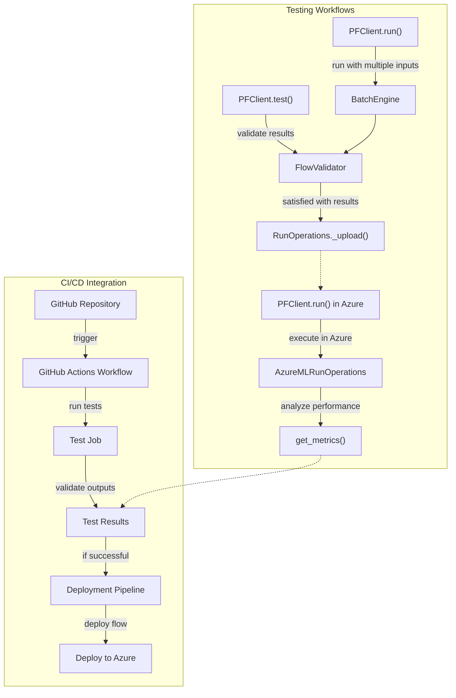
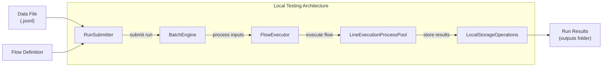
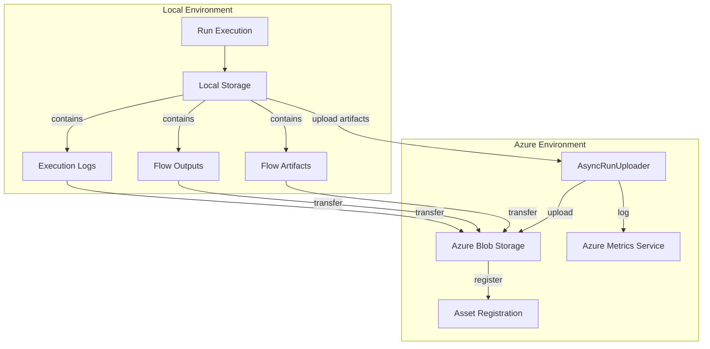
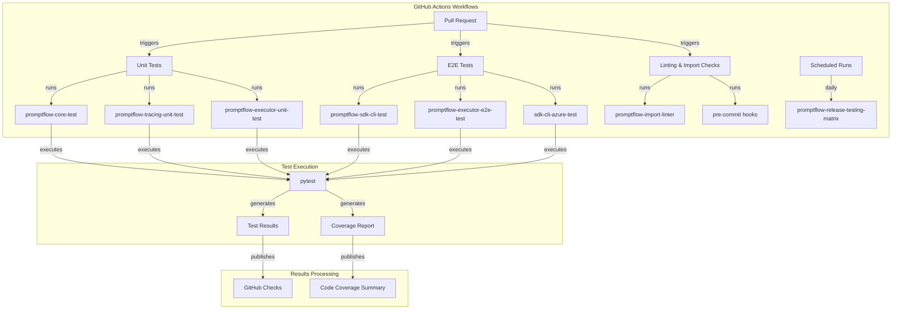
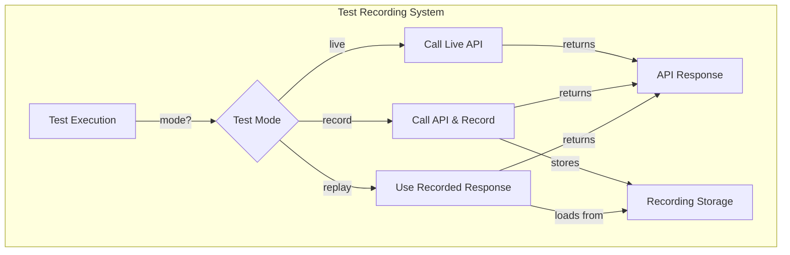

<!-- source: DeepWiki mcp.deepwiki.com · repo microsoft/promptflow · page 8 Testing and CI/CD · fetched 2026-10-26 -->

# Testing and CI/CD

<details>
<summary>Relevant source files</summary>

The following files were used as context for generating this wiki page:

- [.github/actions/step_generate_configs/action.yml](.github/actions/step_generate_configs/action.yml)
- [.github/actions/step_publish_test_results/action.yml](.github/actions/step_publish_test_results/action.yml)
- [.github/actions/step_sdk_setup/action.yml](.github/actions/step_sdk_setup/action.yml)
- [.github/workflows/promptflow-core-test.yml](.github/workflows/promptflow-core-test.yml)
- [.github/workflows/promptflow-executor-e2e-test.yml](.github/workflows/promptflow-executor-e2e-test.yml)
- [.github/workflows/promptflow-executor-unit-test.yml](.github/workflows/promptflow-executor-unit-test.yml)
- [.github/workflows/promptflow-global-config-test.yml](.github/workflows/promptflow-global-config-test.yml)
- [.github/workflows/promptflow-import-linter.yml](.github/workflows/promptflow-import-linter.yml)
- [.github/workflows/promptflow-release-testing-matrix.yml](.github/workflows/promptflow-release-testing-matrix.yml)
- [.github/workflows/promptflow-sdk-cli-test.yml](.github/workflows/promptflow-sdk-cli-test.yml)
- [.github/workflows/promptflow-tracing-e2e-test.yml](.github/workflows/promptflow-tracing-e2e-test.yml)
- [.github/workflows/promptflow-tracing-unit-test.yml](.github/workflows/promptflow-tracing-unit-test.yml)
- [.github/workflows/sdk-cli-azure-test-production.yml](.github/workflows/sdk-cli-azure-test-production.yml)
- [.github/workflows/sdk-cli-azure-test-pull-request.yml](.github/workflows/sdk-cli-azure-test-pull-request.yml)
- [.pre-commit-config.yaml](.pre-commit-config.yaml)
- [scripts/import_linter/import_linter.py](scripts/import_linter/import_linter.py)
- [src/promptflow-devkit/tests/sdk_cli_global_config_test/e2etests/test_global_config.py](src/promptflow-devkit/tests/sdk_cli_global_config_test/e2etests/test_global_config.py)
- [src/promptflow-tracing/promptflow/tracing/_utils.py](src/promptflow-tracing/promptflow/tracing/_utils.py)
- [src/promptflow/tests/executor/conftest.py](src/promptflow/tests/executor/conftest.py)
- [src/promptflow/tests/test_configs/flows/web_classification_invalid/convert_to_dict.py](src/promptflow/tests/test_configs/flows/web_classification_invalid/convert_to_dict.py)
- [src/promptflow/tests/test_configs/flows/web_classification_invalid/flow.dag.yaml](src/promptflow/tests/test_configs/flows/web_classification_invalid/flow.dag.yaml)

</details>


This page covers the testing framework and continuous integration/continuous deployment (CI/CD) capabilities of the Prompt Flow system. It explains how to test flows both locally and in the cloud, and how to integrate them into automated CI/CD pipelines. For information about evaluating flow performance specifically, see [Evaluation System](6.2).

## Testing Framework Overview

The Prompt Flow testing framework enables developers to validate flows through various methods, from simple single-input tests to comprehensive batch testing with multiple inputs. This section outlines the core components and workflows involved in testing Prompt Flow applications.

### Testing Workflow Architecture



Sources:
- [.github/workflows/promptflow-sdk-cli-test.yml:1-125]()
- [.github/workflows/promptflow-executor-e2e-test.yml:1-197]()
- [src/promptflow-devkit/promptflow/_sdk/_pf_client.py]()

## Local Testing

Local testing allows developers to validate flows on their development machines before deploying to production environments. The Prompt Flow SDK provides several methods for local testing.

### Single Flow Testing

The simplest form of testing is to run a flow with a single set of inputs:

```python
from promptflow import PFClient

pf = PFClient()
result = pf.test(
    flow="path/to/flow",
    inputs={"input_parameter": "test value"},
    variant="node_name.variant_name"  # Optional: test specific variant
)
print(result)  # Examine flow outputs
```

This method is useful for quick development iterations and debugging.

### Batch Testing

For more comprehensive testing, you can run a flow against a dataset:

```python
from promptflow import PFClient

pf = PFClient()
run = pf.run(
    flow="path/to/flow",
    data="path/to/data.jsonl",
    column_mapping={"flow_input": "${data.column_name}"}
)
```

The system executes the flow for each record in the data file, storing inputs and outputs for analysis.

### Local Testing Architecture



Sources:
- [src/promptflow-devkit/promptflow/_sdk/_pf_client.py]()
- [src/promptflow/promptflow/executor/_line_execution_process_pool.py]()
- [src/promptflow-devkit/promptflow/_sdk/_orchestrator/run_submitter.py]()

### Run Management

After executing tests, you can analyze the results using the `RunOperations` interface:

```python
# Get run details including inputs and outputs
details = pf.get_details(run="run_name")

# Get run metrics
metrics = pf.get_metrics(run="run_name")

# Visualize run results
pf.visualize(runs=["run_name_1", "run_name_2"])
```

These operations help developers understand flow performance and diagnose issues.

Sources:
- [src/promptflow-devkit/promptflow/_sdk/_pf_client.py]()
- [src/promptflow-devkit/promptflow/_sdk/operations/_run_operations.py]()

## Cloud Testing

Cloud testing leverages Azure infrastructure to execute flows at scale, providing more powerful testing capabilities and enabling integration with other Azure services.

### Submitting Runs to Azure

To run tests in the cloud:

```python
from promptflow.azure import PFClient

pf = PFClient(
    subscription_id="your_subscription_id",
    resource_group_name="your_resource_group",
    workspace_name="your_workspace"
)

run = pf.run(
    flow="path/to/flow",
    data="path/to/data.jsonl",  # Can also be Azure data: "azureml:dataset_name:version"
    column_mapping={"flow_input": "${data.column_name}"}
)
```

This submits the flow for execution in Azure ML, handling resource allocation and execution monitoring.

### Uploading Local Runs to Cloud

Testing workflows often begin locally and then move to the cloud. Promptflow allows uploading local runs to Azure:

```python
from promptflow import PFClient as LocalPFClient
from promptflow.azure import PFClient as AzurePFClient

# Create local run
local_pf = LocalPFClient()
run = local_pf.run(
    flow="path/to/flow",
    data="path/to/data.jsonl"
)

# Upload to Azure
azure_pf = AzurePFClient(
    subscription_id="your_subscription_id",
    resource_group_name="your_resource_group",
    workspace_name="your_workspace"
)
portal_url = azure_pf.runs._upload(run=run.name)
```

When uploading runs, promptflow transfers all artifacts, metrics, and logs to the Azure environment.



Sources:
- [src/promptflow-azure/promptflow/azure/operations/_async_run_uploader.py:131-169](src/promptflow-azure/promptflow/azure/operations/_async_run_uploader.py:131-169)
- [src/promptflow-azure/tests/sdk_cli_azure_test/e2etests/test_run_upload.py:124-150](src/promptflow-azure/tests/sdk_cli_azure_test/e2etests/test_run_upload.py:124-150)

## Run Monitoring and Analysis

After executing tests, you can monitor and analyze the results to evaluate flow performance.

### Streaming Logs

To view real-time execution logs:

```python
pf.stream(run="run_name")
```

This shows the execution progress and any output messages.

### Retrieving Run Details and Metrics

To analyze run results:

```python
# Get run details with inputs and outputs
details = pf.runs.get_details(run="run_name")

# Get run metrics
metrics = pf.runs.get_metrics(run="run_name")
```

The details provide a DataFrame with all inputs and outputs, while metrics show performance measurements like accuracy or token counts.

Sources:
- [src/promptflow-azure/promptflow/azure/operations/_run_operations.py:258-291](src/promptflow-azure/promptflow/azure/operations/_run_operations.py:258-291)
- [src/promptflow-azure/promptflow/azure/operations/_run_operations.py:608-657](src/promptflow-azure/promptflow/azure/operations/_run_operations.py:608-657)

## CI/CD Integration

Prompt Flow has a comprehensive CI/CD system that automates testing and deployment, ensuring consistent quality across the codebase. The project uses GitHub Actions for continuous integration and testing.

### CI/CD Architecture in Prompt Flow



Sources:
- [.github/workflows/promptflow-sdk-cli-test.yml:1-125]()
- [.github/workflows/promptflow-executor-e2e-test.yml:1-197]()
- [.github/workflows/promptflow-executor-unit-test.yml:1-200]()
- [.github/workflows/promptflow-release-testing-matrix.yml:1-469]()

### GitHub Actions Workflows

Prompt Flow uses several GitHub Actions workflows to test different components of the system:

| Workflow | Purpose | Trigger |
|----------|---------|---------|
| `promptflow-sdk-cli-test` | Tests the SDK and CLI functionality | PR, daily schedule |
| `promptflow-executor-e2e-test` | End-to-end tests for the executor | PR, daily schedule |
| `promptflow-executor-unit-test` | Unit tests for the executor | PR, daily schedule |
| `promptflow-core-test` | Tests for the core package | PR, daily schedule |
| `promptflow-tracing-unit-test` | Unit tests for the tracing package | PR, daily schedule |
| `promptflow-tracing-e2e-test` | E2E tests for the tracing package | PR, daily schedule |
| `promptflow-import-linter` | Checks for import issues | PR |
| `promptflow-release-testing-matrix` | Comprehensive test matrix across OS/Python versions | Manual, release |
| `promptflow-global-config-test` | Tests for global configuration | PR |

Each workflow is configured to run on specific triggers (pull requests, scheduled runs) and test specific components of the system.

Sources:
- [.github/workflows/promptflow-sdk-cli-test.yml:2-14]()
- [.github/workflows/promptflow-executor-e2e-test.yml:2-28]()
- [.github/workflows/promptflow-executor-unit-test.yml:2-29]()
- [.github/workflows/promptflow-core-test.yml:1-13]()
- [.github/workflows/promptflow-tracing-unit-test.yml:1-11]()
- [.github/workflows/promptflow-import-linter.yml:1-12]()

### Test Environment Configuration

The CI system uses environment variables to configure the test environment:

```yaml
env:
  IS_IN_CI_PIPELINE: "true"
  PF_DISABLE_TRACING: "false"
  RECORD_DIRECTORY: ${{ github.workspace }}/src/promptflow-recording
  TRACING_DIRECTORY: ${{ github.workspace }}/src/promptflow-tracing
  CORE_DIRECTORY: ${{ github.workspace }}/src/promptflow-core
  WORKING_DIRECTORY: ${{ github.workspace }}/src/promptflow-devkit
  PROMPTFLOW_DIRECTORY: ${{ github.workspace }}/src/promptflow
  TOOL_DIRECTORY: ${{ github.workspace }}/src/promptflow-tools
```

For tests that require Azure resources, the workflows use Azure login and generate test configurations:

```yaml
- name: Azure Login
  uses: azure/login@v1
  with:
    subscription-id: ${{secrets.AZURE_SUBSCRIPTION_ID}}
    tenant-id: ${{secrets.AZURE_TENANT_ID}}
    client-id: ${{secrets.AZURE_CLIENT_ID}}
- name: Generate Configs
  uses: "./.github/actions/step_generate_configs"
  with:
    targetFolder: ${{ env.PROMPTFLOW_DIRECTORY }}
```

Sources:
- [.github/workflows/promptflow-sdk-cli-test.yml:24-32]()
- [.github/workflows/promptflow-executor-e2e-test.yml:29-38]()
- [.github/actions/step_generate_configs/action.yml:1-17]()

## Testing Strategies in Prompt Flow

### Test Types and Execution Modes

Prompt Flow uses different test types and execution modes to ensure comprehensive coverage:

| Test Type | Purpose | Implementation |
|-----------|---------|----------------|
| Unit Tests | Test individual components | `pytest -m unittest` |
| E2E Tests | Test complete workflows | `pytest -m e2etest` |
| Replay Tests | Test with recorded API responses | `PROMPT_FLOW_TEST_MODE=replay pytest` |
| Live Tests | Test with actual API calls | `PROMPT_FLOW_TEST_MODE=live pytest` |

### Test Recording and Replay System

Prompt Flow implements a sophisticated recording and replay system for tests that interact with external APIs:



The recording system is implemented in the `promptflow-recording` package and is used extensively in CI/CD workflows to ensure tests are deterministic and don't require actual API calls.

Sources:
- [src/promptflow/tests/executor/conftest.py:20-116]()
- [.github/workflows/promptflow-sdk-cli-test.yml:44-47]()
- [.github/workflows/promptflow-executor-e2e-test.yml:96-97]()

### Test Coverage and Reporting

Prompt Flow CI/CD workflows include comprehensive test coverage reporting:

```yaml
- name: Run Coverage Test
  shell: pwsh
  working-directory: ${{ github.workspace }}
  run: |
    python scripts/building/run_coverage_tests.py `
      -p ${{ env.testWorkingDirectory }}/promptflow `
      -t ${{ env.testWorkingDirectory }}/tests/executor/unittests `
      -l eastus `
      -m "all" `
      -n ${{ steps.cpu-cores.outputs.count }} `
      --coverage-config ${{ env.testWorkingDirectory }}/tests/executor/.coveragerc `
      --disable-cov-branch
```

Coverage reports are published as GitHub check results:

```yaml
- name: Publish Test Results
  uses: "./.github/actions/step_publish_test_results"
  with:
    testActionFileName: promptflow-executor-unit-test.yml
    testResultTitle: Executor Unit Test Result
    osVersion: ubuntu-latest
    pythonVersion: 3.9
    coverageThreshold: 50
    context: test/executor_unit
```

Sources:
- [.github/workflows/promptflow-executor-unit-test.yml:148-162]()
- [.github/workflows/promptflow-executor-unit-test.yml:190-199]()
- [.github/actions/step_publish_test_results/action.yml:1-56]()

### Cross-Platform and Multi-Version Testing

Prompt Flow tests run on multiple operating systems and Python versions to ensure compatibility:

```yaml
strategy:
  fail-fast: false
  matrix:
    os: [ubuntu-latest, windows-latest, macos-13]
    pythonVersion: ['3.9', '3.10', '3.11']
```

This matrix testing approach ensures that Prompt Flow works consistently across different environments.

Sources:
- [.github/workflows/promptflow-release-testing-matrix.yml:82-84]()
- [.github/workflows/promptflow-release-testing-matrix.yml:138-140]()

## Telemetry and Monitoring

The promptflow system includes built-in telemetry capabilities to help track flow execution and performance:

```python
# Enable telemetry collection
from promptflow._sdk._configuration import Configuration
config = Configuration.get_instance()
config.set_telemetry_consent(True)
```

This telemetry data can be used to monitor flow performance over time and identify issues.

For sensitive environments, telemetry can be disabled:

```python
# Disable telemetry collection
config.set_telemetry_consent(False)
```

Sources:
- [src/promptflow-azure/tests/sdk_cli_azure_test/e2etests/test_telemetry.py:76-93](src/promptflow-azure/tests/sdk_cli_azure_test/e2etests/test_telemetry.py:76-93)
- [src/promptflow-devkit/promptflow/_cli/_pf/_config.py:59-83](src/promptflow-devkit/promptflow/_cli/_pf/_config.py:59-83)

## Command Line Testing

For automation scripts and CI/CD pipelines, promptflow provides CLI commands for testing:

```bash
# Test a flow with inputs
pf flow test --flow path/to/flow --inputs param1=value1 param2=value2

# Run a flow with data
pf run create --flow path/to/flow --data path/to/data.jsonl

# Get run details
pf run show-details --name run_name

# Stream run logs
pf run stream --name run_name
```

These commands can be incorporated into shell scripts for automation.

Sources:
- [src/promptflow-devkit/promptflow/_cli/_pf/_run.py:45-65](src/promptflow-devkit/promptflow/_cli/_pf/_run.py:45-65)
- [src/promptflow-devkit/promptflow/_cli/_params.py:295-309](src/promptflow-devkit/promptflow/_cli/_params.py:295-309)

## Conclusion

The promptflow testing and CI/CD capabilities enable developers to validate flows locally, execute them at scale in Azure, and integrate them into automated pipelines. By following the best practices outlined above, teams can ensure consistent quality and streamline their development process, making it easier to build, test, and deploy reliable AI flows.

---

