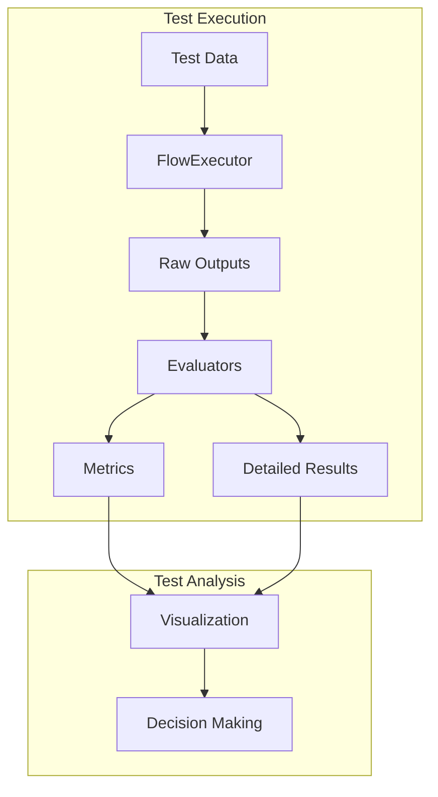
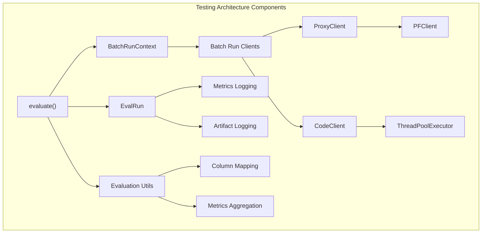
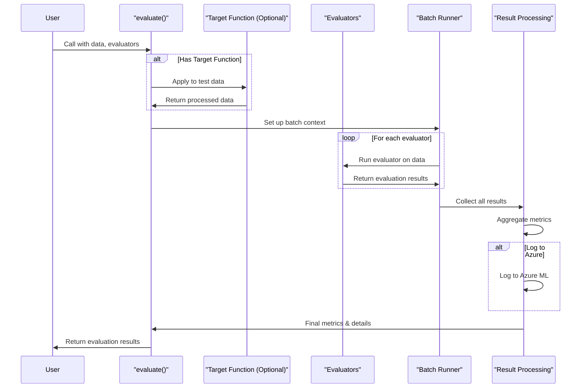
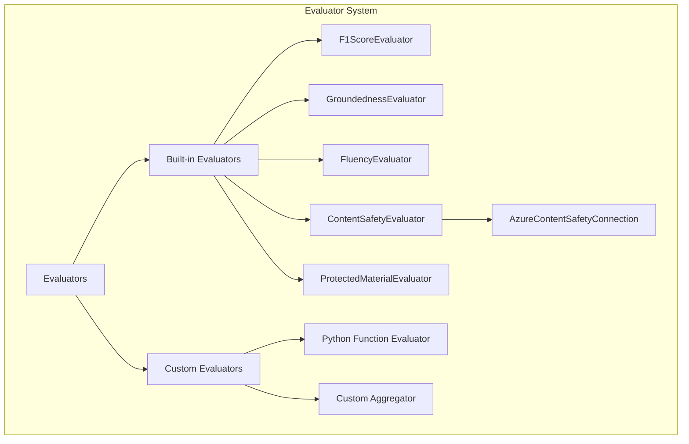
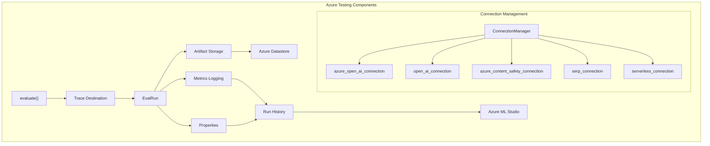
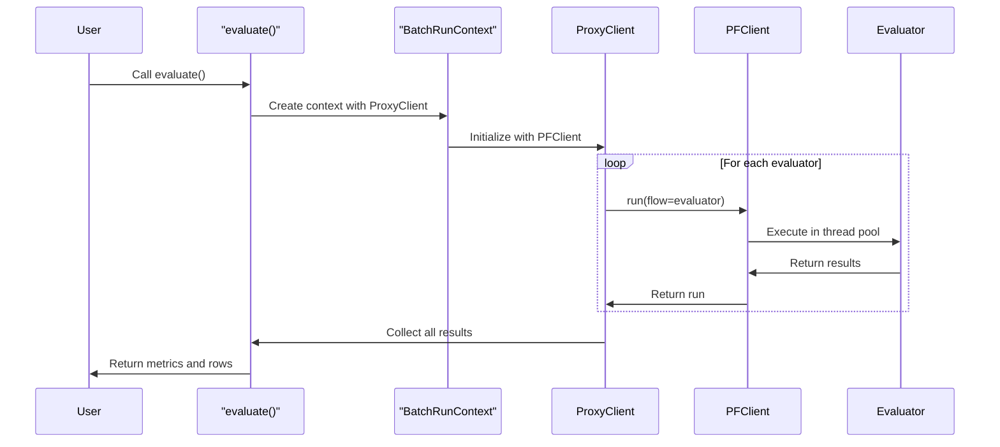
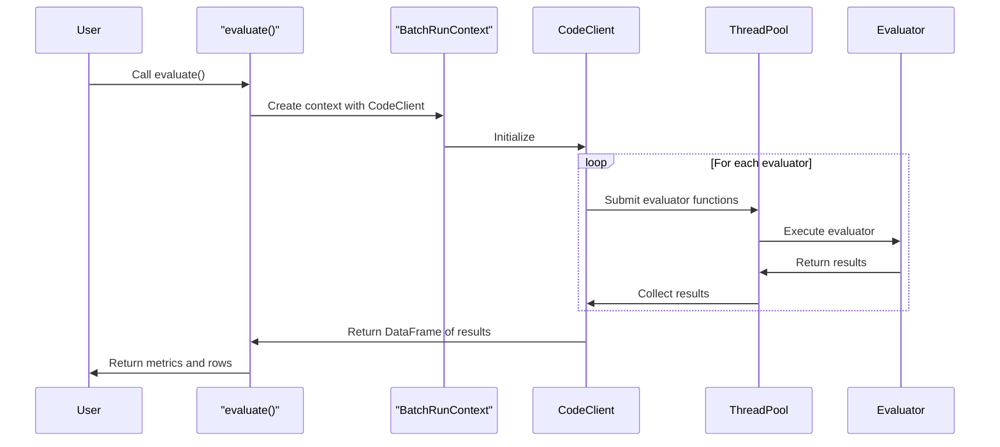

<!-- source: DeepWiki mcp.deepwiki.com · repo microsoft/promptflow · page 8.1 Testing Flows · fetched 2026-10-26 -->

# Testing Flows

<details>
<summary>Relevant source files</summary>

The following files were used as context for generating this wiki page:

- [.cspell.json](.cspell.json)
- [src/promptflow-tools/connections.json.example](src/promptflow-tools/connections.json.example)
- [src/promptflow-tools/tests/conftest.py](src/promptflow-tools/tests/conftest.py)
- [src/promptflow-tools/tests/test_acs.py](src/promptflow-tools/tests/test_acs.py)
- [src/promptflow/tests/test_configs/flows/web_classification_invalid/convert_to_dict.py](src/promptflow/tests/test_configs/flows/web_classification_invalid/convert_to_dict.py)
- [src/promptflow/tests/test_configs/flows/web_classification_invalid/flow.dag.yaml](src/promptflow/tests/test_configs/flows/web_classification_invalid/flow.dag.yaml)

</details>


This document provides technical guidance on how to test flows in Prompt Flow. It covers both local and cloud-based testing approaches, various evaluation methods, and best practices for testing your flows effectively.

Testing flows is a critical part of Prompt Flow development, ensuring that your flows produce expected outputs and meet quality standards before deployment. For information about integrating testing into CI/CD pipelines, see [CI/CD Integration](#8.2).

## Flow Testing Overview

In Prompt Flow, testing flows involves:

1. **Running flows with test data**: Executing your flow with known inputs
2. **Evaluating outputs**: Applying evaluation metrics to measure flow quality
3. **Analyzing results**: Interpreting metrics and identifying issues

### Flow Testing Pipeline



Sources:
- [src/promptflow-evals/promptflow/evals/evaluate/_evaluate.py:356-464]()
- [src/promptflow-evals/tests/evals/e2etests/test_evaluate.py:95-132]()
- [src/promptflow/tests/test_configs/flows/web_classification_invalid/flow.dag.yaml:1-139]()

## Flow Testing Architecture

The testing architecture in Prompt Flow combines several components to provide comprehensive testing capabilities.

### Testing System Components



Sources:
- [src/promptflow-evals/promptflow/evals/evaluate/_evaluate.py:356-464]()
- [src/promptflow-evals/promptflow/evals/evaluate/_eval_run.py:76-144]()
- [src/promptflow-evals/promptflow/evals/evaluate/_batch_run_client/batch_run_context.py:22-72]()

### Evaluation Process

The evaluation process follows a defined sequence:



Sources:
- [src/promptflow-evals/promptflow/evals/evaluate/_evaluate.py:356-464]()
- [src/promptflow-evals/promptflow/evals/evaluate/_evaluate.py:241-298]()
- [src/promptflow-evals/promptflow/evals/evaluate/_utils.py:62-132]()

## Testing Methods

There are several ways to test flows in PromptFlow:

### Local Testing

Local testing is the simplest way to test flows and is suitable for development and initial validation.

```python
from promptflow.evals.evaluate import evaluate
from promptflow.evals.evaluators import F1ScoreEvaluator

# Run evaluation
result = evaluate(
    data="test_data.jsonl",  # Path to test data
    evaluators={
        "f1_score": F1ScoreEvaluator()
    }
)

# Access results
metrics = result["metrics"]
instance_results = result["rows"]
```

Sources:
- [src/promptflow-evals/tests/evals/e2etests/test_evaluate.py:98-132]()
- [src/promptflow-evals/tests/evals/unittests/test_evaluate.py:348-376]()

### Cloud-Based Testing

For larger-scale testing or integration with Azure ML, you can run evaluations in the cloud:

```python
from promptflow.evals.evaluate import evaluate
from promptflow.evals.evaluators import F1ScoreEvaluator

# Run evaluation with Azure tracking
result = evaluate(
    data="test_data.jsonl",
    evaluators={"f1_score": F1ScoreEvaluator()},
    azure_ai_project={
        "subscription_id": "...",
        "resource_group_name": "...",
        "project_name": "..."
    },
    evaluation_name="my_cloud_evaluation"
)

# Access Azure ML Studio URL
studio_url = result["studio_url"]
```

Sources:
- [src/promptflow-evals/tests/evals/e2etests/test_evaluate.py:383-471]()
- [src/promptflow-evals/promptflow/evals/evaluate/_utils.py:119-128]()

### Testing with Target Functions

You can also test the output of a target function (a callable that processes inputs):

```python
def target_fn(question):
    """An example target function."""
    if "weather" in question:
        return {"answer": "The weather is sunny."}
    return {"answer": "I don't know."}

result = evaluate(
    data="questions.jsonl",
    target=target_fn,
    evaluators={"f1": F1ScoreEvaluator()}
)
```

Sources:
- [src/promptflow-evals/tests/evals/e2etests/test_evaluate.py:268-290]()
- [src/promptflow-evals/tests/evals/unittests/test_evaluate.py:67-144]()

## Setting Up Flow Tests

### Preparing Test Data

Test data should be in JSONL format with inputs and expected outputs:

```json
{"question": "What is the weather like?", "answer": "The weather is sunny.", "ground_truth": "Sunny"}
{"question": "What is the capital of France?", "answer": "Paris is the capital of France.", "ground_truth": "Paris"}
```

For flows with multiple inputs, ensure all required inputs are included in the test data. The test data structure should match the input schema defined in your flow's `flow.dag.yaml` file.

Sources:
- [src/promptflow-evals/tests/evals/unittests/test_evaluate.py:194-210]()
- [src/promptflow/tests/test_configs/flows/web_classification_invalid/flow.dag.yaml:1-10]()

### Configuring Evaluators

You can configure evaluators with custom column mappings:

```python
# Map evaluator inputs to test data columns
evaluator_config = {
    "relevance": {
        "answer": "${data.answer}",
        "context": "${data.context}",
        "question": "${data.question}"
    },
    "fluency": {
        "answer": "${data.answer}"
    }
}

result = evaluate(
    data="test_data.jsonl",
    evaluators={
        "relevance": RelevanceEvaluator(model_config),
        "fluency": FluencyEvaluator(model_config)
    },
    evaluator_config=evaluator_config
)
```

Sources:
- [src/promptflow-evals/tests/evals/e2etests/test_evaluate.py:333-382]()
- [src/promptflow-evals/promptflow/evals/evaluate/_utils.py:155-200]()

## Types of Evaluators

Prompt Flow provides several built-in evaluators and allows you to create custom ones.

### Evaluator System Architecture



Sources:
- [src/promptflow-evals/tests/evals/e2etests/test_evaluate.py:11-17]()
- [src/promptflow-evals/tests/evals/e2etests/custom_evaluators/answer_length_with_aggregation.py:1-16]()
- [src/promptflow-tools/tests/test_acs.py:1-17]()
- [src/promptflow-tools/connections.json.example:70-80]()

### Using Built-in Evaluators

Prompt Flow provides several built-in evaluators:

| Evaluator | Purpose | Metrics | Required Connection |
|-----------|---------|---------|---------------------|
| F1ScoreEvaluator | Measures overlap between prediction and ground truth | f1_score | None |
| GroundednessEvaluator | Evaluates if outputs are grounded in source context | gpt_groundedness | AzureOpenAIConnection or OpenAIConnection |
| FluencyEvaluator | Assesses language fluency | gpt_fluency | AzureOpenAIConnection or OpenAIConnection |
| ContentSafetyEvaluator | Detects potentially harmful content | sexual_defect_rate, violence_defect_rate, etc. | AzureContentSafetyConnection |
| ProtectedMaterialEvaluator | Checks for protected material | protected_material_defect_rate | AzureOpenAIConnection or OpenAIConnection |

Sources:
- [src/promptflow-evals/tests/evals/unittests/test_evaluate.py:14-21]()
- [src/promptflow-evals/promptflow/evals/_constants.py:6-44]()
- [src/promptflow-tools/tests/test_acs.py:1-17]()
- [src/promptflow-tools/connections.json.example:70-80]()

### Creating Custom Evaluators

You can create custom evaluators as Python functions or classes:

```python
# Simple function evaluator
def my_evaluator(answer):
    return {"length": len(answer)}

# Class-based evaluator with aggregation
class AnswerLength:
    def __call__(self, answer, **kwargs):
        return {"length": len(answer)}
        
    def __aggregate__(self, line_results):
        return {"avg_length": sum(r.length for r in line_results) / len(line_results)}
```

Sources:
- [src/promptflow-evals/tests/evals/e2etests/test_evaluate.py:38-52]()
- [src/promptflow-evals/tests/evals/e2etests/custom_evaluators/answer_length_with_aggregation.py:1-16]()

## Analyzing Test Results

### Understanding Metrics

The evaluation results contain both aggregate metrics and per-instance results:

```python
result = evaluate(data="test_data.jsonl", evaluators={"f1": F1ScoreEvaluator()})

# Aggregate metrics
print(result["metrics"])  # {'f1.f1_score': 0.85}

# Instance-level results
for row in result["rows"]:
    print(f"Instance {row['line_number']}: F1 = {row['outputs.f1.f1_score']}")
```

Sources:
- [src/promptflow-evals/promptflow/evals/evaluate/_evaluate.py:571-605]()
- [src/promptflow-evals/promptflow/evals/evaluate/_evaluate.py:115-149]()

### Metric Aggregation

Metrics are aggregated differently based on their type:

1. **Standard metrics**: Mean value is calculated
2. **Content safety metrics**: Defect rates calculated using thresholds
3. **Label-based metrics**: Converted to defect rates

Sources:
- [src/promptflow-evals/promptflow/evals/evaluate/_evaluate.py:33-149]()
- [src/promptflow-evals/tests/evals/unittests/test_evaluate.py:424-487]()

### Saving and Loading Results

You can save evaluation results to a file:

```python
result = evaluate(
    data="test_data.jsonl",
    evaluators={"f1": F1ScoreEvaluator()},
    output_path="evaluation_results.json"  # Save to file
)
```

Sources:
- [src/promptflow-evals/tests/evals/unittests/test_evaluate.py:348-376]()
- [src/promptflow-evals/promptflow/evals/evaluate/_utils.py:146-152]()

## Testing Flows in Azure

When testing in Azure, evaluation results are stored in the Azure ML workspace:

### Azure Testing Integration



Sources:
- [src/promptflow-evals/promptflow/evals/evaluate/_utils.py:62-132]()
- [src/promptflow-evals/promptflow/evals/evaluate/_eval_run.py:76-144]()
- [src/promptflow-evals/tests/evals/e2etests/test_metrics_upload.py:119-150]()
- [src/promptflow-tools/tests/conftest.py:25-116]()
- [src/promptflow-tools/connections.json.example:1-97]()

### Setting Up Azure Testing

To test flows in Azure:

1. Configure Azure project scope:
```python
azure_ai_project = {
    "subscription_id": "your-subscription-id",
    "resource_group_name": "your-resource-group",
    "project_name": "your-workspace-name"
}
```

2. Run evaluation with Azure tracking:
```python
result = evaluate(
    data="test_data.jsonl",
    evaluators={"f1": F1ScoreEvaluator()},
    azure_ai_project=azure_ai_project,
    evaluation_name="my_evaluation"
)
```

3. Access Azure ML Studio URL:
```python
studio_url = result["studio_url"]
print(f"View results in Azure ML Studio: {studio_url}")
```

Sources:
- [src/promptflow-evals/tests/evals/e2etests/test_evaluate.py:383-471]()
- [src/promptflow-evals/promptflow/evals/evaluate/_eval_run.py:101-144]()

## Execution Modes

PromptFlow provides different execution modes for testing flows:

### Proxy Client Mode

This mode uses the PromptFlow client to execute evaluators:



Sources:
- [src/promptflow-evals/promptflow/evals/evaluate/_batch_run_client/proxy_client.py:21-61]()
- [src/promptflow-evals/promptflow/evals/evaluate/_batch_run_client/batch_run_context.py:22-72]()

### Code Client Mode

This mode executes evaluators directly in code:



Sources:
- [src/promptflow-evals/promptflow/evals/evaluate/_batch_run_client/code_client.py:56-145]()
- [src/promptflow-evals/tests/evals/unittests/test_evaluate.py:236-267]()

## Best Practices

### 1. Use Appropriate Data Size

- For local testing: Start with small test sets (10-20 samples)
- For performance testing: Use larger datasets with batch execution

### 2. Combine Multiple Evaluators

Combine multiple evaluators to get a comprehensive assessment:

```python
result = evaluate(
    data="test_data.jsonl",
    evaluators={
        "fluency": FluencyEvaluator(model_config),
        "groundedness": GroundednessEvaluator(model_config),
        "f1_score": F1ScoreEvaluator()
    }
)
```

Sources:
- [src/promptflow-evals/tests/evals/e2etests/test_evaluate.py:98-132]()

### 3. Properly Handle Multiprocessing

When running evaluations in scripts, protect the main code with:

```python
if __name__ == "__main__":
    result = evaluate(
        data="test_data.jsonl", 
        evaluators={"f1": F1ScoreEvaluator()}
    )
```

Sources:
- [src/promptflow-evals/promptflow/evals/evaluate/_evaluate.py:445-461]()
- [src/promptflow-evals/tests/evals/unittests/test_evaluate.py:393-406]()

### 4. Monitor Performance

For evaluations with large datasets or complex evaluators:

- Set appropriate timeout values using `PF_BATCH_TIMEOUT_SEC` environment variable
- Use asynchronous execution with `PF_EVALS_BATCH_USE_ASYNC=true`

Sources:
- [src/promptflow-evals/promptflow/evals/evaluate/_batch_run_client/batch_run_context.py:46-53]()
- [src/promptflow-evals/tests/evals/e2etests/test_evaluate.py:207-233]()

## Troubleshooting

### Common Issues

1. **Multiprocessing Bootstrap Error**
   - Symptom: Error about "bootstrapping phase"
   - Solution: Wrap evaluation code in `if __name__ == "__main__":`

2. **Missing Required Inputs**
   - Symptom: Error about "Missing required inputs for evaluator"
   - Solution: Ensure test data contains all columns needed by evaluators or use column mapping

3. **Timeout Issues**
   - Symptom: Evaluation takes too long or times out
   - Solution: Increase timeout with `os.environ["PF_BATCH_TIMEOUT_SEC"] = "3600"`

4. **Connection Configuration Issues**
   - Symptom: Error about missing or invalid connections
   - Solution: Ensure connections are properly configured in your `connections.json` file and the `PROMPTFLOW_CONNECTIONS` environment variable is set

5. **Invalid Flow Definition**
   - Symptom: Error about invalid flow structure or missing nodes
   - Solution: Validate your flow using `pf flow validate` before testing

Sources:
- [src/promptflow-evals/promptflow/evals/evaluate/_evaluate.py:445-461]()
- [src/promptflow-evals/tests/evals/unittests/test_evaluate.py:126-136]()
- [src/promptflow-evals/promptflow/evals/_constants.py:46-50]()
- [src/promptflow-tools/tests/conftest.py:25-116]()
- [src/promptflow/tests/test_configs/flows/web_classification_invalid/flow.dag.yaml:1-139]()

## Conclusion

Testing flows in PromptFlow provides a robust way to ensure your flows meet quality standards. By combining different evaluators, execution modes, and testing environments, you can build comprehensive test suites that validate your flows from multiple angles.

For setting up continuous integration with PromptFlow tests, refer to [CI/CD Integration](#8.2).

---

