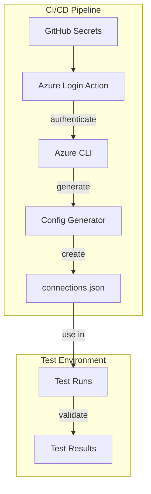
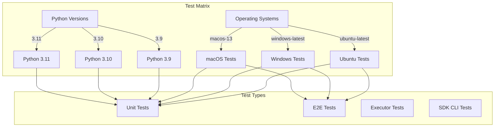
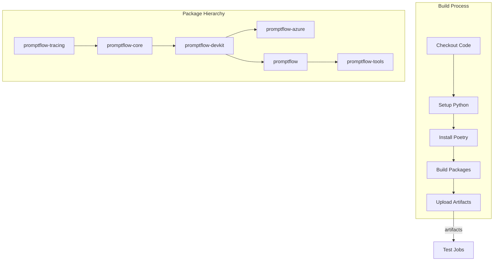
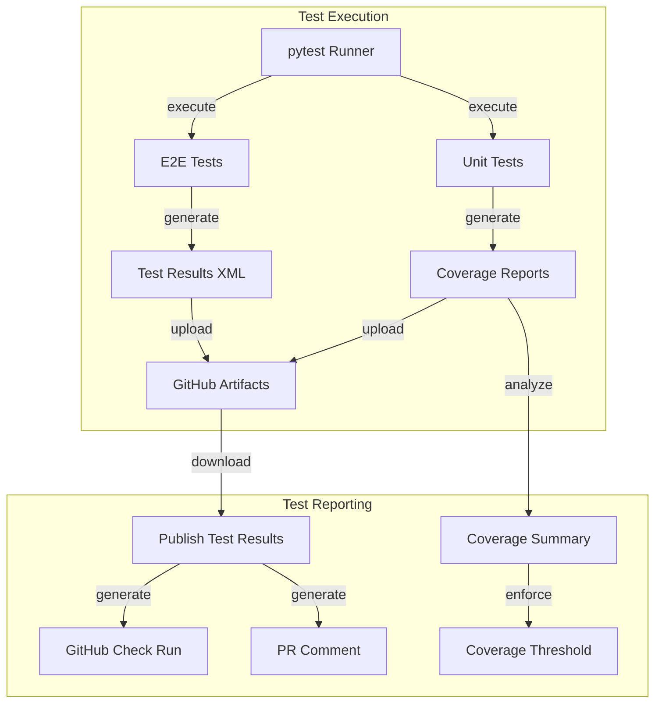
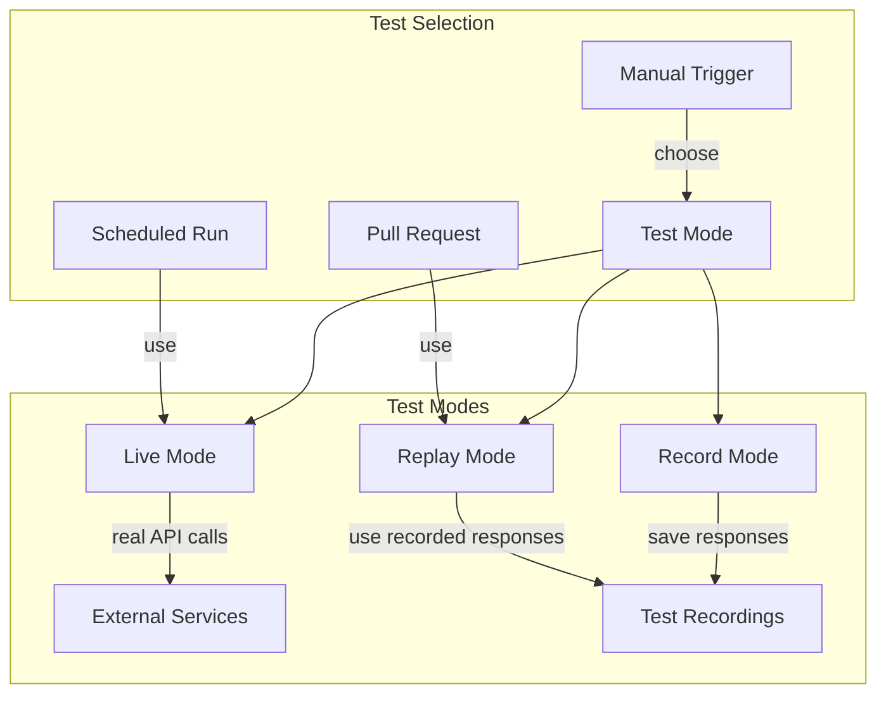

<!-- source: DeepWiki mcp.deepwiki.com · repo microsoft/promptflow · page 8.2 CI/CD Integration · fetched 2026-10-26 -->

# CI/CD Integration

<details>
<summary>Relevant source files</summary>

The following files were used as context for generating this wiki page:

- [.github/actions/step_generate_configs/action.yml](.github/actions/step_generate_configs/action.yml)
- [.github/actions/step_publish_test_results/action.yml](.github/actions/step_publish_test_results/action.yml)
- [.github/actions/step_sdk_setup/action.yml](.github/actions/step_sdk_setup/action.yml)
- [.github/workflows/promptflow-core-test.yml](.github/workflows/promptflow-core-test.yml)
- [.github/workflows/promptflow-executor-e2e-test.yml](.github/workflows/promptflow-executor-e2e-test.yml)
- [.github/workflows/promptflow-executor-unit-test.yml](.github/workflows/promptflow-executor-unit-test.yml)
- [.github/workflows/promptflow-global-config-test.yml](.github/workflows/promptflow-global-config-test.yml)
- [.github/workflows/promptflow-import-linter.yml](.github/workflows/promptflow-import-linter.yml)
- [.github/workflows/promptflow-release-testing-matrix.yml](.github/workflows/promptflow-release-testing-matrix.yml)
- [.github/workflows/promptflow-sdk-cli-test.yml](.github/workflows/promptflow-sdk-cli-test.yml)
- [.github/workflows/promptflow-tracing-e2e-test.yml](.github/workflows/promptflow-tracing-e2e-test.yml)
- [.github/workflows/promptflow-tracing-unit-test.yml](.github/workflows/promptflow-tracing-unit-test.yml)
- [.github/workflows/sdk-cli-azure-test-production.yml](.github/workflows/sdk-cli-azure-test-production.yml)
- [.github/workflows/sdk-cli-azure-test-pull-request.yml](.github/workflows/sdk-cli-azure-test-pull-request.yml)
- [.github/workflows/sdk-cli-perf-monitor-test.yml](.github/workflows/sdk-cli-perf-monitor-test.yml)
- [.pre-commit-config.yaml](.pre-commit-config.yaml)
- [scripts/import_linter/import_linter.py](scripts/import_linter/import_linter.py)
- [src/promptflow-devkit/tests/sdk_cli_global_config_test/e2etests/test_global_config.py](src/promptflow-devkit/tests/sdk_cli_global_config_test/e2etests/test_global_config.py)
- [src/promptflow-tracing/promptflow/tracing/_utils.py](src/promptflow-tracing/promptflow/tracing/_utils.py)
- [src/promptflow/tests/executor/conftest.py](src/promptflow/tests/executor/conftest.py)

</details>


This document outlines how to integrate Prompt Flow into Continuous Integration and Continuous Deployment (CI/CD) pipelines. It covers testing, building, deploying, and monitoring Prompt Flow flows in automated pipeline environments, with a focus on the CI/CD practices used in the Prompt Flow project itself.

For information about testing flows outside of CI/CD pipelines, see [Testing Flows](#8.1).

## Overview

Integrating Prompt Flow into CI/CD pipelines enables teams to automate the development, testing, and deployment of AI flows. This approach provides several benefits:

- Automated validation and testing of flows before deployment
- Consistent packaging and deployment across environments
- Reproducible builds and environments
- Streamlined deployment to production
- Monitoring of deployed flows

The diagram below shows a typical CI/CD pipeline for Prompt Flow:

```mermaid
flowchart LR
    subgraph "Development"
        Dev["Developer Environment"] --> |"commit"| Git["Git Repository"]
    end
    
    subgraph "CI Pipeline"
        Git --> |"trigger"| Build["Build & Install"]
        Build --> FlowValidate["pf flow validate"]
        FlowValidate --> FlowTest["pf flow test"]
        FlowTest --> BatchRun["pf run create"]
    end
    
    subgraph "CD Pipeline"
        BatchRun --> |"passed"| FlowBuild["pf flow build"]
        FlowBuild --> |"package"| Deploy["Deploy"]
        Deploy --> |"pf flow serve"| Production["Production"]
    end
    
    subgraph "Monitoring"
        Production --> Telemetry["Tracing & Telemetry"]
        Telemetry --> Evaluation["Evaluation"]
    end
```



Sources:
- [.github/workflows/promptflow-sdk-cli-test.yml:1-125]()
- [.github/workflows/promptflow-executor-e2e-test.yml:1-197]()

## Setting Up CI/CD Environment

To run Prompt Flow in CI/CD environments, you need to configure several components:

### Environment Variables

Prompt Flow provides several environment variables to control its behavior in CI/CD:

| Environment Variable | Description | Default Value |
|----------------------|-------------|---------------|
| `PF_LOGGING_LEVEL` | Controls log verbosity (CRITICAL, ERROR, WARNING, INFO, DEBUG) | INFO |
| `PF_NO_INTERACTIVE_LOGIN` | Disables interactive login prompts | true |
| `PF_HOME_DIRECTORY` | Sets the promptflow home directory | ~/.promptflow |
| `PF_DISABLE_TRACING` | Disables tracing functionality | true |
| `IS_IN_CI_PIPELINE` | Indicates the code is running in a CI pipeline | - |
| `PROMPT_FLOW_TEST_MODE` | Sets test mode (live, replay) | - |

Example CI environment setup from the Prompt Flow project:

```bash
# Set environment variables for CI
export IS_IN_CI_PIPELINE="true"
export PF_DISABLE_TRACING="false"  # Enable tracing for tests
export PROMPT_FLOW_TEST_MODE="replay"  # Use replay mode for tests
```

Sources:
- [.github/workflows/promptflow-sdk-cli-test.yml:24-26]()
- [.github/workflows/promptflow-executor-e2e-test.yml:29-35]()
- [.github/workflows/promptflow-executor-unit-test.yml:30-38]()

### Connection Management

Securely manage connections in CI/CD environments using GitHub Secrets and Azure authentication:



Example connection setup in the Prompt Flow CI pipeline:

```yaml
- name: Azure Login
  uses: azure/login@v1
  with:
    subscription-id: ${{secrets.AZURE_SUBSCRIPTION_ID}}
    tenant-id: ${{secrets.AZURE_TENANT_ID}}
    client-id: ${{secrets.AZURE_CLIENT_ID}}
- name: Generate Configs
  uses: "./.github/actions/step_generate_configs"
  with:
    targetFolder: ${{ env.PROMPTFLOW_DIRECTORY }}
```

Sources:
- [.github/workflows/promptflow-sdk-cli-test.yml:63-74]()
- [.github/workflows/promptflow-executor-e2e-test.yml:132-142]()
- [.github/actions/step_generate_configs/action.yml:1-21]()

## Continuous Integration in Prompt Flow

The Prompt Flow project uses a comprehensive CI system with multiple test workflows. Let's examine how these are structured and how you can apply similar patterns to your own projects.

### Test Matrix Strategy

Prompt Flow tests run across multiple operating systems and Python versions using GitHub Actions matrix strategy:



Example matrix configuration:

```yaml
strategy:
  fail-fast: false
  matrix:
    os: [ubuntu-latest, windows-latest, macos-13]
    pythonVersion: ['3.9', '3.10', '3.11']
```

Sources:
- [.github/workflows/promptflow-release-testing-matrix.yml:31-447]()
- [.github/workflows/promptflow-sdk-cli-test.yml:34-42]()
- [.github/workflows/promptflow-executor-e2e-test.yml:86-94]()

### Test Workflows

The Prompt Flow project uses several specialized test workflows:

| Workflow | Purpose |
|----------|---------|
| `promptflow-sdk-cli-test` | Tests the SDK and CLI functionality |
| `promptflow-executor-e2e-test` | End-to-end tests for the executor |
| `promptflow-executor-unit-test` | Unit tests for the executor |
| `promptflow-core-test` | Tests for the core package |
| `promptflow-tracing-unit-test` | Unit tests for the tracing package |
| `promptflow-tracing-e2e-test` | E2E tests for the tracing package |
| `promptflow-release-testing-matrix` | Comprehensive test matrix for releases |

Example test execution:

```yaml
- name: run devkit tests
  run: |
    poetry run pytest ${{ env.FILE_PATHS }} --cov=promptflow --cov-config=pyproject.toml \
    --cov-report=term --cov-report=html --cov-report=xml -n auto -m "(unittest or e2etest) and not csharp" \
    --ignore-glob ./tests/sdk_cli_test/e2etests/test_executable.py --tb=short
  working-directory: ${{ env.WORKING_DIRECTORY }}
```

Sources:
- [.github/workflows/promptflow-sdk-cli-test.yml:80-85]()
- [.github/workflows/promptflow-executor-e2e-test.yml:145-161]()
- [.github/workflows/promptflow-executor-unit-test.yml:148-162]()

## Build and Package Process

The Prompt Flow project uses a structured build process to create packages for testing and deployment.

### Build Workflow

The build process in Prompt Flow CI/CD pipelines follows these steps:



Example build steps:

```yaml
- name: build
  run: poetry build -f wheel
  working-directory: ${{ env.WORKING_DIRECTORY }}
- uses: actions/upload-artifact@v4
  with:
    name: promptflow-tracing
    path: ${{ env.WORKING_DIRECTORY }}/dist/promptflow_tracing-*.whl
```

Sources:
- [.github/workflows/promptflow-release-testing-matrix.yml:37-71]()
- [.github/workflows/promptflow-tracing-unit-test.yml:19-31]()
- [.github/workflows/promptflow-executor-e2e-test.yml:50-84]()

### Package Installation in CI

Prompt Flow uses a specific installation order to ensure dependencies are correctly resolved:

```yaml
- name: Install wheel
  shell: pwsh
  working-directory: artifacts
  run: |
    Set-PSDebug -Trace 1
    pip install -r ${{ github.workspace }}/src/promptflow/dev_requirements.txt
    pip install ${{ github.workspace }}/src/promptflow-tracing
    pip install ${{ github.workspace }}/src/promptflow-core[executor-service]
    pip install ${{ github.workspace }}/src/promptflow-devkit
    pip install ${{ github.workspace }}/src/promptflow-azure
    gci ./promptflow -Recurse | % {if ($_.Name.Contains('.whl')) {python -m pip install "$($_.FullName)"}}
    gci ./promptflow-tools -Recurse | % {if ($_.Name.Contains('.whl')) {python -m pip install $_.FullName}}
    pip freeze
```

Sources:
- [.github/workflows/promptflow-executor-e2e-test.yml:114-126]()
- [.github/workflows/promptflow-executor-unit-test.yml:117-129]()
- [.github/actions/step_sdk_setup/action.yml:1-54]()

## Test Execution and Reporting

The Prompt Flow project uses a structured approach to test execution and reporting.

### Test Execution Architecture



Example test execution with coverage:

```yaml
- name: Run Coverage Test
  shell: pwsh
  working-directory: ${{ github.workspace }}
  run: |
    gci env:* | sort-object name
    az account show
    pip install langchain-community tenacity<8.4.0
    # numexpr is required by langchain in e2e tests.
    pip install numexpr
    python scripts/building/run_coverage_tests.py `
      -p ${{ env.testWorkingDirectory }}/promptflow `
      -t ${{ env.testWorkingDirectory }}/tests/executor/e2etests `
      -l eastus `
      -m "all" `
      -n ${{ steps.cpu-cores.outputs.count }}`
      --coverage-config ${{ env.testWorkingDirectory }}/tests/executor/.coveragerc `
      --disable-cov-branch
```

Sources:
- [.github/workflows/promptflow-executor-e2e-test.yml:145-161]()
- [.github/workflows/promptflow-executor-unit-test.yml:148-162]()
- [.github/workflows/promptflow-release-testing-matrix.yml:417-446]()

### Test Result Publishing

Prompt Flow uses custom actions to publish test results and coverage reports:

```yaml
- name: Publish Test Results
  uses: "./.github/actions/step_publish_test_results"
  with:
    testActionFileName: promptflow-executor-e2e-test.yml
    testResultTitle: Executor E2E Test Result
    osVersion: ubuntu-latest
    pythonVersion: 3.9
    coverageThreshold: 70
    context: test/executor_e2e
```

The `step_publish_test_results` action:

```yaml
- name: Publish Test Results
  uses: EnricoMi/publish-unit-test-result-action@v2
  with:
    check_name: "${{ inputs.testResultTitle }} [${{ steps.display_env.outputs.GITHUB_HEAD_REF }}]"
    comment_title: "${{ inputs.testResultTitle }} [${{ steps.display_env.outputs.GITHUB_HEAD_REF }}]"
    files: "artifacts/**/test-*.xml"
- name: Code Coverage Summary
  if: ${{ inputs.coverageThreshold != 0 }}
  uses: irongut/CodeCoverageSummary@v1.3.0
  with:
    filename: "artifacts/Test Results (Python ${{ inputs.pythonVersion }}) (OS ${{ inputs.osVersion }})/coverage.xml"
    badge: true
    fail_below_min: true
    format: markdown
    hide_branch_rate: false
    hide_complexity: true
    indicators: true
    output: both
    thresholds: '${{ inputs.coverageThreshold }} 80'
```

Sources:
- [.github/workflows/promptflow-executor-e2e-test.yml:170-196]()
- [.github/actions/step_publish_test_results/action.yml:1-56]()
- [.github/workflows/promptflow-tracing-unit-test.yml:75-100]()

## CI/CD Best Practices from Prompt Flow

The Prompt Flow project demonstrates several CI/CD best practices that you can apply to your own projects.

### Test Mode Management

Prompt Flow uses different test modes to handle external dependencies:



Example test mode configuration:

```yaml
- name: set test mode
  run: |
    echo "PROMPT_FLOW_TEST_MODE=$(if [[ "${{ github.event_name }}" == "pull_request" ]]; then echo replay; else echo live; fi)" >> $GITHUB_ENV
```

Sources:
- [.github/workflows/promptflow-sdk-cli-test.yml:44-47]()
- [.github/workflows/promptflow-executor-e2e-test.yml:97]()
- [src/promptflow/tests/executor/conftest.py:20-116]()

### Code Quality Checks

Prompt Flow uses pre-commit hooks and linters to maintain code quality:

```yaml
repos:
    - repo: https://github.com/pre-commit/pre-commit-hooks
      rev: v3.2.0
      hooks:
          - id: trailing-whitespace
          - id: end-of-file-fixer
          - id: check-yaml
          - id: check-json
          - id: check-merge-conflict
    - repo: https://github.com/psf/black
      rev: 22.3.0
      hooks:
          - id: black
            language_version: python3
            args:
                - "--line-length=120"
```

The project also has a dedicated import linter workflow:

```yaml
- name: import lint
  run: |
    echo "=== Running import lint in promptflow-tracing ==="
    poetry -C ${{ env.WORKING_DIRECTORY }}/src/promptflow-tracing run lint-imports
    echo "=== Running import lint in promptflow-core ==="
    poetry -C ${{ env.WORKING_DIRECTORY }}/src/promptflow-core run lint-imports
```

Sources:
- [.pre-commit-config.yaml:1-54]()
- [.github/workflows/promptflow-import-linter.yml:1-67]()
- [scripts/import_linter/import_linter.py:1-57]()

### Performance Monitoring

Prompt Flow includes performance monitoring tests to track performance over time:

```yaml
name: sdk-cli-perf-monitor-test

on:
  pull_request:
    paths:
      - src/promptflow/**
      - src/promptflow-core/**
  schedule:
    - cron: "0 */6 * * *"  # Run every 6 hours
```

Example performance test:

```yaml
- name: Run Test
  working-directory: ${{ env.WORKING_DIRECTORY }}
  run: |
    poetry run pytest ./tests/sdk_cli_azure_test ../promptflow-azure/tests/sdk_cli_azure_test -m "perf_monitor_test"
```

Sources:
- [.github/workflows/sdk-cli-perf-monitor-test.yml:1-109]()
- [src/promptflow-devkit/tests/sdk_cli_global_config_test/e2etests/test_global_config.py:1-72]()

## Security Considerations

### Managing Secrets

- Never store secrets in your flow code or configuration files
- Use environment variables or secret management services
- In Azure DevOps or GitHub Actions, use the built-in secrets management
- For local testing, use `.env` files (and add them to `.gitignore`)

### Authentication in CI/CD

For non-interactive authentication in CI/CD pipelines:

```bash
# Disable interactive login
export PF_NO_INTERACTIVE_LOGIN=true

# For Azure, use service principals
export AZURE_CLIENT_ID=<service-principal-id>
export AZURE_CLIENT_SECRET=<service-principal-secret>
export AZURE_TENANT_ID=<tenant-id>
```

Sources:
- [src/promptflow-devkit/CHANGELOG.md:49-51]()
- [src/promptflow/CHANGELOG.md:308-310]()

## Conclusion

Integrating promptflow into CI/CD pipelines enables automated testing, building, and deployment of AI flows. This approach improves development velocity, code quality, and reliability while providing consistent environments across development, testing, and production.

By following the guidelines in this document, you can establish a robust CI/CD pipeline for your promptflow projects, ensuring that your flows are thoroughly tested before deployment and properly monitored in production.

Sources:
- [src/promptflow/CHANGELOG.md]()
- [src/promptflow-devkit/CHANGELOG.md]()
- [src/promptflow-core/CHANGELOG.md]()
- [src/promptflow-azure/CHANGELOG.md]()
- [src/promptflow-tracing/CHANGELOG.md]()