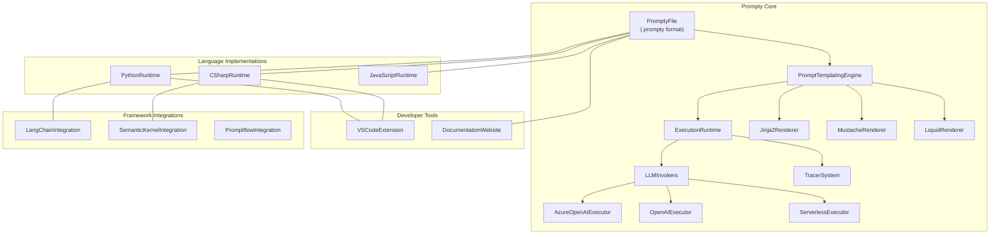
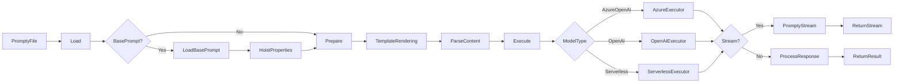
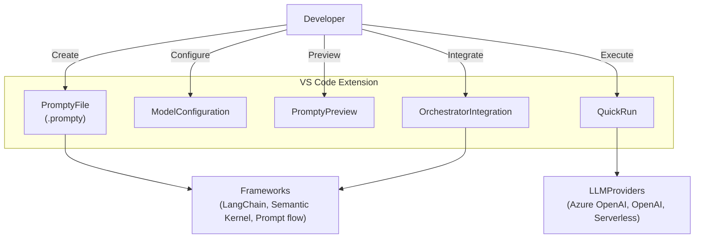
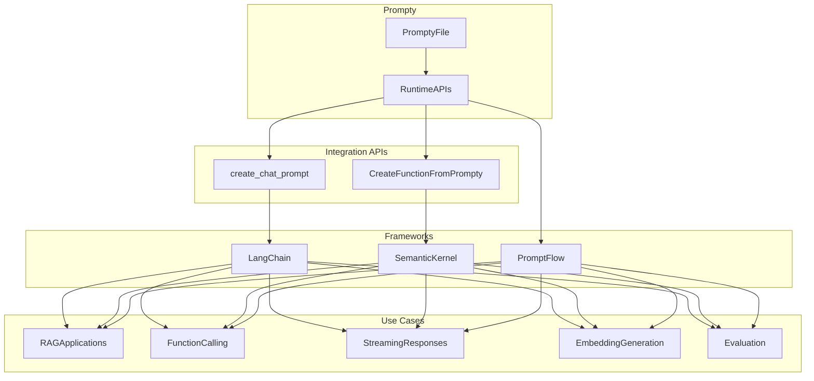

<!-- source: DeepWiki mcp.deepwiki.com · repo microsoft/prompty · page 1 Overview · fetched 2026-10-26 -->

# Overview

Relevant source files

The following files were used as context for generating this wiki page:

- [LICENSE](LICENSE)
- [README.md](README.md)
- [web/docs/page.mdx](web/docs/page.mdx)

Prompty is an asset class and format for Large Language Model (LLM) prompts designed to enhance observability, understandability, and portability for developers. This document provides an introduction to the Prompty system, its architecture, and its key components. For detailed information on specific aspects of Prompty, please refer to the respective wiki pages linked throughout this document.

## Purpose and Scope

Prompty aims to accelerate the developer inner loop for prompt engineering and prompt source management by providing:

1. A standardized file format (`.prompty`) for defining prompts
2. Cross-language and cross-platform implementations (Python, C#, JavaScript)
3. Integration with popular AI orchestration frameworks (LangChain, Semantic Kernel, Prompt flow)
4. Enhanced observability and tracing capabilities
5. Developer tooling for rapid prototyping and testing

For more detailed information on the architecture, see [Architecture](#1.1).

Sources: [README.md:3-9](), [web/docs/page.mdx:16-21]()

## System Architecture

The following diagram illustrates the high-level architecture of the Prompty system:

**Prompty Core Architecture**

The architecture centers around the `.prompty` file format, which is processed by templating engines before being executed by runtimes in different languages. The execution runtime connects to LLM providers through invokers and provides observability through the tracer system.

Sources: [README.md:3-9](), [README.md:13-17]()

## Key Components

### Prompty File Format

The Prompty file format (`.prompty`) standardizes prompts and their execution into a single asset. It consists of:

1. **YAML Frontmatter**: Contains metadata, model configuration, and input/output specifications
2. **Prompt Content**: The actual prompt text, which can include templates

For more details on the file format, see [Prompty File Format](#2).

Sources: [README.md:14-17]()

### Runtime Implementations

Prompty provides implementations in multiple programming languages to support various development environments:

| Runtime | Description | Documentation |
|---------|-------------|---------------|
| Python | Python implementation of the Prompty runtime | [Python Runtime](#3) |
| C# | C# implementation of the Prompty runtime | [C# Runtime](#4) |
| JavaScript | JavaScript implementation of the Prompty runtime | [JavaScript Runtime](#5) |

Sources: [web/docs/page.mdx:18-21]()

**Execution Flow Across Runtimes**

This diagram illustrates the common execution flow across all runtime implementations when processing a Prompty file.

Sources: [README.md:58-62]()

### LLM Integration

Prompty supports integration with multiple LLM providers:

| Provider | Description | Documentation |
|----------|-------------|---------------|
| Azure OpenAI | Integration with Azure OpenAI Service | [Azure OpenAI Integration](#6.1) |
| OpenAI | Integration with OpenAI API | [OpenAI Integration](#6.2) |
| Serverless | Support for serverless deployment options | [Serverless Integration](#6.3) |

Sources: [README.md:30-46]()

### Tracing and Observability

Prompty includes a built-in tracing system that enables developers to monitor and debug prompt execution. This provides visibility into:

- The rendered prompt sent to the LLM
- The response received from the LLM
- Performance metrics and token usage

For more information on tracing capabilities, see [Tracing and Observability](#7).

Sources: [README.md:52-56]()

## Developer Workflow

**Prompty in the Developer Inner Loop**

Prompty enhances the developer workflow with:

1. **Quick Creation**: Create Prompty files directly in VS Code
2. **Preview**: See rendered prompts with dynamic template rendering while typing
3. **Model Configuration**: Define and switch between different model configurations
4. **Quick Run**: Execute prompts with F5 or the Run button
5. **Framework Integration**: Generate code snippets for popular orchestration frameworks

Sources: [README.md:19-66]()

## Ecosystem Integration

Prompty integrates with popular AI orchestration frameworks:

**Framework Integration**

These integrations enable various AI application use cases such as Retrieval-Augmented Generation (RAG), function calling, streaming responses, embedding generation, and evaluation.

Sources: [README.md:58-66](), [web/docs/page.mdx:27-49]()

## Getting Started

To get started with Prompty:

1. Install the [VS Code Extension](https://marketplace.visualstudio.com/items?itemName=ms-toolsai.prompty)
2. Create your first Prompty file
3. Configure your model settings
4. Run and iterate on your prompts

For detailed getting started guidance, refer to the official documentation at [prompty.ai](https://prompty.ai).

Sources: [README.md:11-12](), [web/docs/page.mdx:51-53]()

## License

Prompty is available under the MIT License.

Sources: [LICENSE:1-21]()

---

