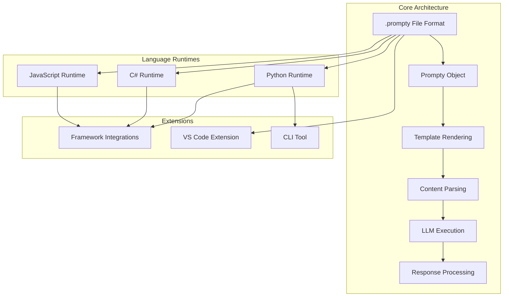
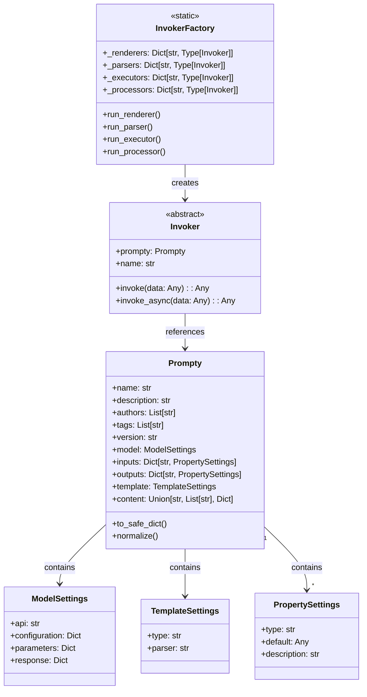
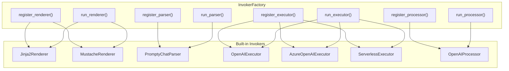
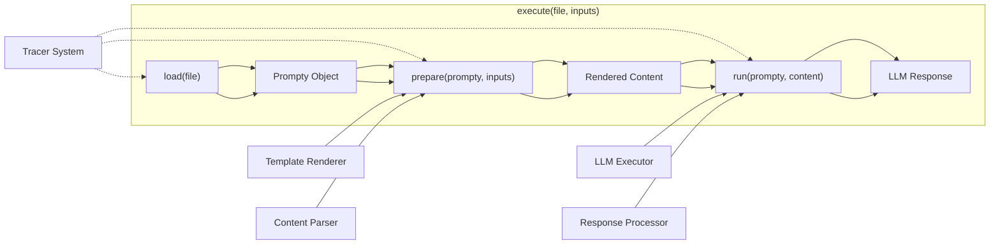
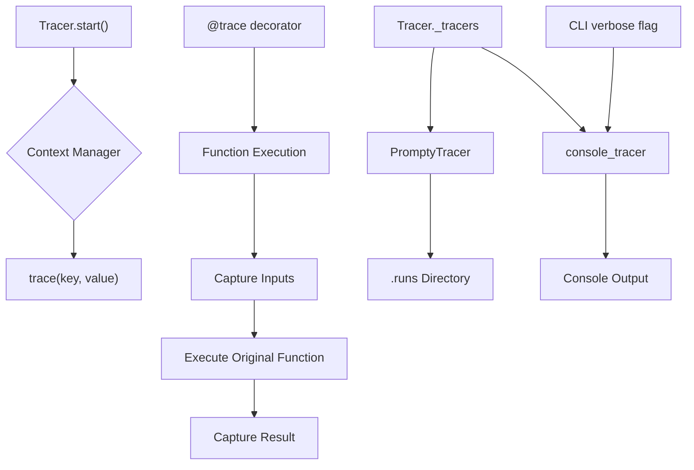
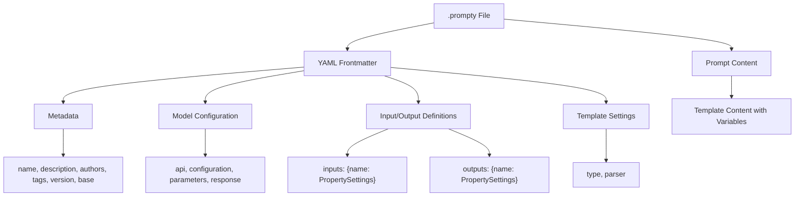
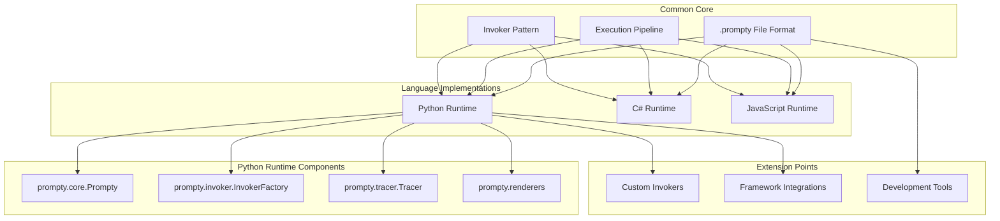

<!-- source: DeepWiki mcp.deepwiki.com · repo microsoft/prompty · page 1.1 Architecture · fetched 2026-10-26 -->

# Architecture

Relevant source files

The following files were used as context for generating this wiki page:

- [LICENSE](LICENSE)
- [README.md](README.md)
- [runtime/prompty/prompty/__init__.py](runtime/prompty/prompty/__init__.py)
- [runtime/prompty/prompty/cli.py](runtime/prompty/prompty/cli.py)
- [runtime/prompty/prompty/core.py](runtime/prompty/prompty/core.py)
- [runtime/prompty/prompty/invoker.py](runtime/prompty/prompty/invoker.py)
- [runtime/prompty/prompty/mustache.py](runtime/prompty/prompty/mustache.py)
- [runtime/prompty/prompty/openai/processor.py](runtime/prompty/prompty/openai/processor.py)
- [runtime/prompty/prompty/renderers.py](runtime/prompty/prompty/renderers.py)
- [runtime/prompty/prompty/tracer.py](runtime/prompty/prompty/tracer.py)
- [runtime/prompty/prompty/utils.py](runtime/prompty/prompty/utils.py)
- [runtime/prompty/tests/prompts/chat.prompty](runtime/prompty/tests/prompts/chat.prompty)
- [runtime/prompty/tests/test_core.py](runtime/prompty/tests/test_core.py)

This document describes the overall architecture of the Prompty system, which provides a standardized format and runtime for working with Large Language Model (LLM) prompts. For detailed information about specific components, see [Core Concepts](#1.2).

## System Overview

Prompty is designed as a cross-platform solution for defining, managing, and executing prompts for LLMs. The system centers around the `.prompty` file format and provides runtimes in multiple programming languages.

Sources: [runtime/prompty/prompty/__init__.py](). [runtime/prompty/prompty/core.py](). [README.md]().

## Core Components

The Prompty system consists of several key components that work together:

Sources: [runtime/prompty/prompty/core.py:12-142](). [runtime/prompty/prompty/invoker.py:9-56]().

### Prompty Class

The `Prompty` class is the central data structure in the system. It represents a complete prompt definition with its configuration and content.

| Field | Type | Description |
|-------|------|-------------|
| `name` | `str` | Name of the prompt |
| `description` | `str` | Description of the prompt |
| `authors` | `List[str]` | List of authors |
| `tags` | `List[str]` | List of tags for categorization |
| `version` | `str` | Version of the prompt |
| `base` | `str` | Path to base prompt (for inheritance) |
| `basePrompty` | `Prompty` | Reference to base prompt object |
| `model` | `ModelSettings` | Configuration for LLM model |
| `inputs` | `Dict[str, PropertySettings]` | Input definitions |
| `outputs` | `Dict[str, PropertySettings]` | Output definitions |
| `template` | `TemplateSettings` | Template configuration |
| `file` | `Union[str, Path]` | Path to the source file |
| `content` | `Union[str, list[str], dict]` | Prompt content |

Sources: [runtime/prompty/prompty/core.py:77-135]().

### Invoker System

The Invoker system follows a plugin architecture that enables extension and customization:

Sources: [runtime/prompty/prompty/invoker.py:90-286](). [runtime/prompty/prompty/renderers.py:11-84]().

## Execution Flow

The execution of a prompt follows a clear pipeline with these phases:

The execution process consists of three main phases:

1. **Load**: Parses a `.prompty` file into a `Prompty` object, resolving base prompts and configuration.
2. **Prepare**: Renders the template with the provided inputs and parses the content into the format required by the LLM.
3. **Run**: Executes the prepared content against the LLM and processes the response.

The `execute()` function combines all three phases into a single operation.

Sources: [runtime/prompty/prompty/__init__.py:209-261](). [runtime/prompty/prompty/__init__.py:316-382](). [runtime/prompty/prompty/__init__.py:384-593]().

### Detailed Execution Steps

For a more detailed view of the execution process:

1. **Loading**:
   - Parse the `.prompty` file (YAML frontmatter and content body)
   - Normalize attributes and resolve references
   - Load any base prompts and inherit properties
   - Apply global configuration

2. **Preparation**:
   - Merge input data with sample data
   - Apply template rendering with merged inputs
   - Parse rendered content into LLM-specific format

3. **Execution**:
   - Configure LLM client with model settings
   - Send prepared content to LLM
   - Process and return response

Sources: [runtime/prompty/prompty/__init__.py:144-206](). [runtime/prompty/prompty/utils.py:97-121]().

## Tracing System

Prompty includes a robust tracing system for observability and debugging:

The tracing system has these key components:

1. **Tracer**: Static class that manages tracers and provides a context manager API
2. **trace decorator**: Function decorator that automatically traces function calls
3. **PromptyTracer**: Implementation that writes trace data to files
4. **console_tracer**: Implementation that outputs trace data to the console

All core functions in Prompty use the `@trace` decorator to provide detailed information about their execution.

Sources: [runtime/prompty/prompty/tracer.py:28-53](). [runtime/prompty/prompty/tracer.py:143-250](). [runtime/prompty/prompty/tracer.py:253-376]().

## Prompty File Format

The `.prompty` file format is the standard way to define prompts:

The format consists of two main sections:

1. **YAML Frontmatter**: Contains configuration and metadata
2. **Prompt Content**: Contains the actual prompt template

Sources: [runtime/prompty/prompty/utils.py:97-121](). [runtime/prompty/tests/prompts/chat.prompty]().

## Cross-Platform Implementation

Prompty is designed for cross-platform use with implementations in multiple languages:

Each language implementation follows the same architectural patterns:

1. **Common File Format**: All implementations use the same `.prompty` file format
2. **Pipeline Architecture**: All follow the load → prepare → run pattern
3. **Invoker Pattern**: All use a plugin architecture for extensibility

Sources: [runtime/prompty/prompty/__init__.py:1-22](). [README.md:15-17]().

## Framework Integrations

Prompty integrates with popular orchestration frameworks:

| Framework | Integration Method | Purpose |
|-----------|-------------------|---------|
| LangChain | `create_chat_prompt` | Allows using Prompty files with LangChain's orchestration |
| Semantic Kernel | `CreateFunctionFromPrompty` | Enables Prompty files as Semantic Kernel plugins |
| Prompt flow | Direct import | Supports Prompty files in Prompt flow workflows |

Sources: [README.md:58-62]().

## Tools and Extensions

Prompty provides several tools for developers:

1. **VS Code Extension**: Provides a prompt playground, syntax highlighting, and preview
2. **Command Line Interface**: Allows execution of prompts from the command line
3. **Documentation Website**: Comprehensive documentation at prompty.ai

Sources: [runtime/prompty/prompty/cli.py:134-166](). [README.md:19-66]().

## Conclusion

The Prompty architecture provides a comprehensive, extensible system for working with LLM prompts across multiple programming languages. Its core strengths include:

1. **Standardized Format**: The `.prompty` file format provides a clear, shareable way to define prompts
2. **Extensible Architecture**: The invoker pattern allows easy extension for new template engines and LLM providers
3. **Cross-Platform Support**: Multiple language implementations enable integration in diverse environments
4. **Robust Tracing**: The tracing system provides detailed observability for debugging
5. **Framework Integration**: Integration with popular orchestration frameworks enables seamless adoption

---

