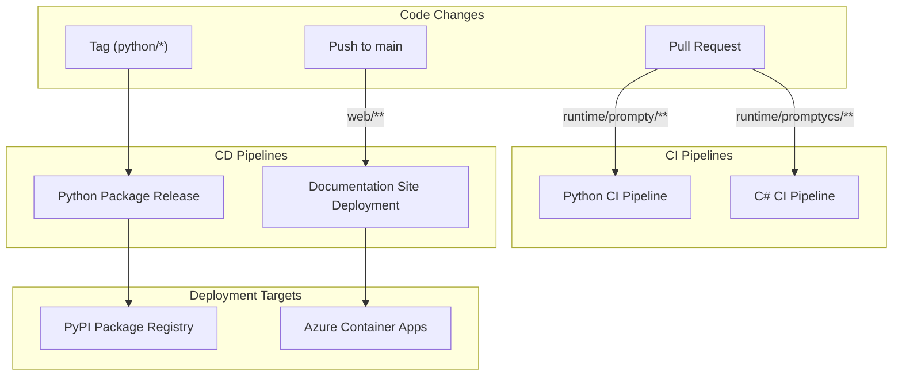
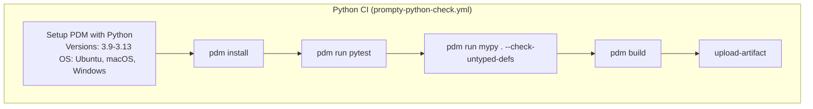
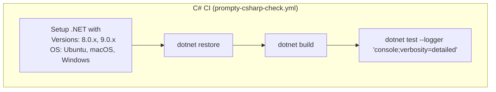
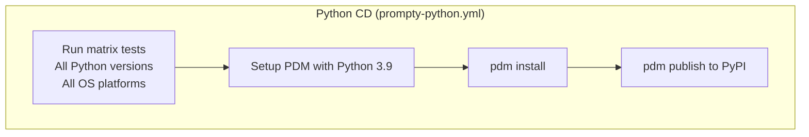
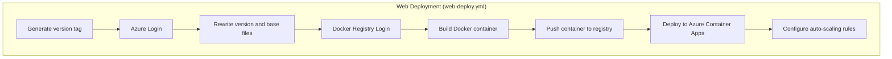

<!-- source: DeepWiki mcp.deepwiki.com · repo microsoft/prompty · page 10.1 CI/CD and Testing · fetched 2026-10-26 -->

# CI/CD and Testing

<details>
<summary>Relevant source files</summary>

The following files were used as context for generating this wiki page:

- [.github/workflows/prompty-csharp-check.yml](.github/workflows/prompty-csharp-check.yml)
- [.github/workflows/prompty-python-check.yml](.github/workflows/prompty-python-check.yml)
- [.github/workflows/prompty-python.yml](.github/workflows/prompty-python.yml)
- [.github/workflows/web-deploy.yml](.github/workflows/web-deploy.yml)
- [runtime/prompty/.gitignore](runtime/prompty/.gitignore)
- [runtime/prompty/LICENSE](runtime/prompty/LICENSE)
- [runtime/prompty/pyproject.toml](runtime/prompty/pyproject.toml)
- [runtime/promptycs/.gitignore](runtime/promptycs/.gitignore)
- [web/public/assets/prompty_p.png](web/public/assets/prompty_p.png)

</details>


This document details the Continuous Integration (CI), Continuous Deployment (CD), and testing infrastructure used in the Prompty project. It explains how automated tests are run, code quality is maintained, and how releases are deployed to different platforms.

## CI/CD Architecture Overview

Prompty uses GitHub Actions for all CI/CD automation, with different workflows for each runtime environment. The system is designed to ensure cross-platform compatibility by testing across multiple operating systems and language versions.



Sources: [.github/workflows/prompty-python.yml:3-10](), [.github/workflows/prompty-csharp-check.yml:3-9](), [.github/workflows/web-deploy.yml:3-10]()

## CI Workflows

### Python Runtime CI

The Python runtime CI process runs on every pull request that modifies files in the Python runtime directory. It verifies code quality and test coverage using multiple Python versions and operating systems.



Sources: [.github/workflows/prompty-python-check.yml:14-68]()

Key aspects of the Python CI workflow:

- **Matrix Testing**: Tests are run on Python versions 3.9, 3.10, 3.11, 3.12, and 3.13
- **Cross-Platform**: Tests run on Ubuntu, macOS, and Windows
- **Package Management**: Uses PDM for dependency management
- **Testing Tools**: Uses pytest for unit tests and mypy for static type checking
- **Artifact Generation**: Successfully built packages are saved as artifacts

### C# Runtime CI

The C# runtime CI process runs on every pull request that modifies files in the C# runtime directory. It verifies builds and test execution across multiple .NET versions and operating systems.



Sources: [.github/workflows/prompty-csharp-check.yml:12-42]()

Key aspects of the C# CI workflow:

- **Matrix Testing**: Tests are run on .NET versions 8.0.x and 9.0.x
- **Cross-Platform**: Tests run on Ubuntu, macOS, and Windows
- **Test Verbosity**: Tests run with detailed console logging

## CD Workflows

### Python Package Release

When a tag with the format `python/*` is pushed, the Python CD workflow automatically builds, tests, and publishes the package to PyPI.



Sources: [.github/workflows/prompty-python.yml:16-71]()

The workflow features:

- **Prerequisite Testing**: Full test matrix must succeed before publishing
- **Trusted Publishing**: Uses OpenID Connect for secure publishing to PyPI
- **Version Management**: Versions are extracted from tags using the pattern defined in pyproject.toml

### Documentation Website Deployment

The documentation website is automatically deployed when changes are pushed to the `web/` directory on the main branch or when manually triggered.



Sources: [.github/workflows/web-deploy.yml:14-78]()

The workflow features:

- **Versioning**: Creates date/time-based version tags
- **Container-Based**: Builds and deploys using Docker containers
- **Auto-Scaling**: Configures HTTP concurrency-based scaling rules
- **Zero-Downtime Deployment**: Uses Azure Container Apps for smooth deployments

## Testing Infrastructure

### Python Testing Configuration

The Python runtime uses pytest for testing, with configuration defined in pyproject.toml.

| Tool | Purpose | Configuration |
|------|---------|---------------|
| pytest | Unit testing | Configured in pyproject.toml [tool.pytest.ini_options] |
| mypy | Static type checking | Validates code typing across the codebase |
| ruff | Linting | Set to enforce PEP8 style with customizations |
| PDM | Dependency management | Manages dev dependencies and test scripts |

Sources: [runtime/prompty/pyproject.toml:33-56]()

Key test dependencies include:

```
pytest>=8.2.2
pytest-asyncio>=0.24.0
mypy>=1.15.0
types-aiofiles>=21.1.0
types-PyYAML>=6.0.12
```

Source: [runtime/prompty/pyproject.toml:33-44]()

### C# Testing Infrastructure

The C# runtime uses the standard .NET testing framework, with tests discovered and run using the dotnet CLI.

The testing process includes:

1. Restoring dependencies with `dotnet restore`
2. Building the project with `dotnet build`
3. Running tests with `dotnet test --logger "console;verbosity=detailed"`

Sources: [.github/workflows/prompty-csharp-check.yml:31-41]()

## Local Development Testing

### Running Python Tests

To run tests locally for the Python runtime:

1. Navigate to `runtime/prompty/`
2. Install PDM if not already installed
3. Run `pdm install` to install dependencies
4. Run `pdm run pytest` to execute tests
5. Run `pdm run mypy . --check-untyped-defs` for type checking

### Running C# Tests

To run tests locally for the C# runtime:

1. Navigate to `runtime/promptycs/`
2. Run `dotnet restore` to install dependencies
3. Run `dotnet build` to build the project
4. Run `dotnet test` to execute tests

## Release Process

### Python Package Release

Python packages are released using the following process:

1. Create a tag with the format `python/x.y.z`
2. Push the tag to GitHub
3. The workflow automatically:
   - Runs all tests across the matrix
   - Builds the package
   - Publishes to PyPI

The version number is extracted from the tag according to the pattern configured in the `pyproject.toml` file:

```
[tool.pdm.version]
source = "scm"
tag_filter = "python/*"
tag_regex = '^python/(?:\D*)?(?P<version>([1-9][0-9]*!)?(0|[1-9][0-9]*)(\.(0|[1-9][0-9]*))*((a|b|c|rc)(0|[1-9][0-9]*))?(\.post(0|[1-9][0-9]*))?(\.dev(0|[1-9][0-9]*))?$)$'
```

Sources: [runtime/prompty/pyproject.toml:59-62]()

### Documentation Website Release

The documentation website is automatically deployed when changes are pushed to the `web/` directory on the main branch.

The deployment process:

1. Creates a tag in the format `v[YYYYMMDD.HHMMSS]`
2. Builds a Docker container with the documentation site
3. Pushes the container to a private registry
4. Deploys to Azure Container Apps with auto-scaling configuration

Sources: [.github/workflows/web-deploy.yml:19-74]()

## Testing Artifacts and Outputs

The CI/CD system generates various artifacts:

1. **Python Package Artifacts**: Generated by `pdm build` and uploaded as artifacts in PR checks
2. **Docker Container Images**: Tagged with version information and pushed to a private registry
3. **Test Results**: Output as detailed logs in GitHub Actions

## Best Practices for Contributors

When contributing to Prompty, follow these testing best practices:

1. **Run Tests Locally**: Always run the appropriate tests before submitting PRs
2. **Add Tests for New Features**: New functionality should include test coverage
3. **Maintain Cross-Platform Compatibility**: Ensure code works across all supported platforms and versions
4. **Check CI Results**: Review all CI results on pull requests before requesting reviews

---

