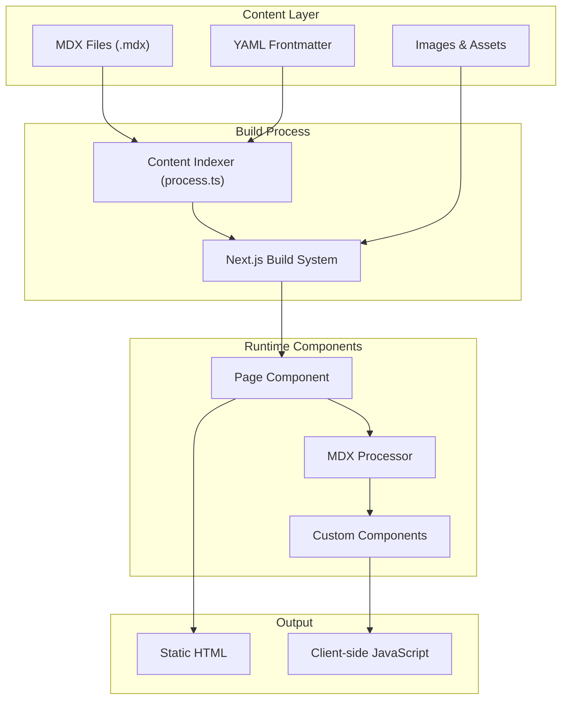
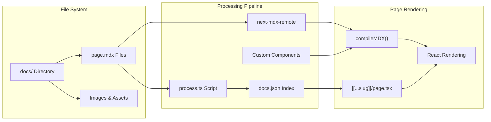
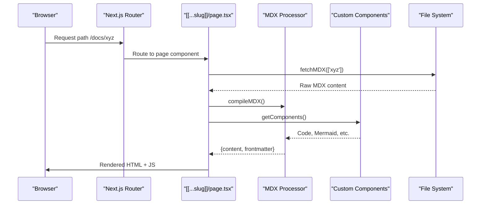
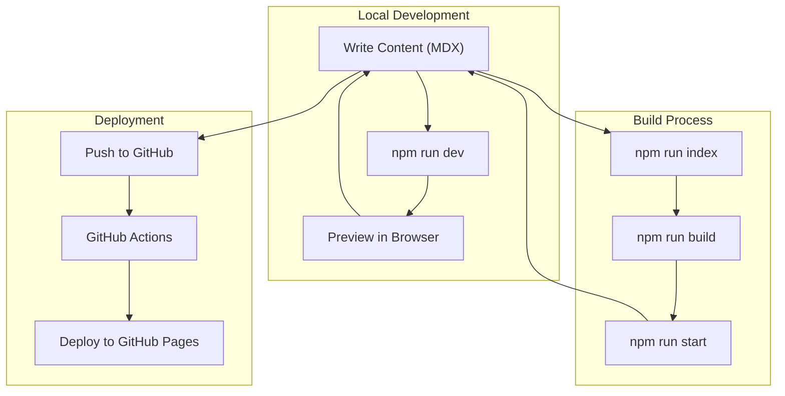
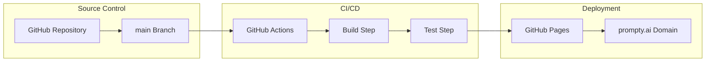

<!-- source: DeepWiki mcp.deepwiki.com · repo microsoft/prompty · page 10.2 Documentation Website · fetched 2026-10-26 -->

# Documentation Website

<details>
<summary>Relevant source files</summary>

The following files were used as context for generating this wiki page:

- [web/.dockerignore](web/.dockerignore)
- [web/.gitignore](web/.gitignore)
- [web/README.md](web/README.md)
- [web/docs/_example/page.mdx](web/docs/_example/page.mdx)
- [web/docs/getting-started/page.mdx](web/docs/getting-started/page.mdx)
- [web/package-lock.json](web/package-lock.json)
- [web/package.json](web/package.json)
- [web/src/app/docs/[[...slug]]/page.tsx](web/src/app/docs/[[...slug]]/page.tsx)
- [web/src/app/page.tsx](web/src/app/page.tsx)
- [web/src/components/code.tsx](web/src/components/code.tsx)
- [web/src/components/mermaid.tsx](web/src/components/mermaid.tsx)

</details>


## Purpose and Scope

This document details the architecture, implementation, and development workflow of the Prompty documentation website. The website serves as the central hub for all Prompty documentation, providing developers with comprehensive information about the Prompty file format, runtimes, and tooling.

The documentation website is built with Next.js and uses MDX for content authoring, allowing technical writers to create rich, interactive documentation with code samples, diagrams, and other interactive elements.

This page focuses on the technical aspects of the documentation website itself. For information about contributing documentation content, see the Development and Contribution section.

## Architecture Overview

The Prompty documentation website is built as a modern web application using Next.js and React. Content is authored in MDX (Markdown with JSX) format, which is processed and rendered as interactive HTML pages.



Sources: [web/package.json:4-12](), [web/README.md:1-4](), [web/src/app/docs/[[...slug]]/page.tsx:1-11]()

## Technology Stack

The documentation website leverages several modern web technologies:

| Component | Technology | Purpose |
|-----------|------------|---------|
| Framework | Next.js | Server-side rendering, routing, and static site generation |
| UI | React | Component-based user interface |
| Content | MDX | Markdown with JSX for rich content |
| Styling | SCSS Modules | Component-scoped styling |
| Diagrams | Mermaid | Diagram rendering from text descriptions |
| Syntax Highlighting | react-syntax-highlighter | Code block formatting |
| Theming | next-themes | Light/dark mode support |

Sources: [web/package.json:13-31](), [web/src/components/code.tsx:1-9](), [web/src/components/mermaid.tsx:1-7]()

## Content Structure and Processing

The documentation content is organized in a hierarchical structure, with each page defined by an MDX file with YAML frontmatter.



Sources: [web/src/app/docs/[[...slug]]/page.tsx:54-78](), [web/package.json:9-10]()

### MDX File Format

Documentation pages are written in MDX files that include:

1. **YAML Frontmatter**: Metadata about the page, including:
   - `title`: Page title
   - `description`: Brief description
   - `authors`: GitHub usernames of contributors
   - `date`: Publication date
   - `tags`: Related topics
   - `index`: Position in navigation (optional)

2. **Markdown Content**: The main body of the documentation, with support for:
   - Standard Markdown syntax
   - Code blocks with syntax highlighting
   - Mermaid diagrams
   - Embedded JSX components
   - Images and links

Sources: [web/docs/getting-started/page.mdx:1-12](), [web/docs/_example/page.mdx:1-12]()

## Content Rendering Pipeline

The documentation website uses a sophisticated pipeline to convert MDX files into interactive HTML pages.



Sources: [web/src/app/docs/[[...slug]]/page.tsx:54-78](), [web/src/app/docs/[[...slug]]/page.tsx:146-216]()

## Key Components

The documentation website is composed of several key React components that work together to render documentation pages:

### Page Component

The main page component (`[[...slug]]/page.tsx`) handles:
- Dynamic route parameters
- MDX content loading and compilation
- Metadata generation for SEO
- Rendering the page layout with navigation

Sources: [web/src/app/docs/[[...slug]]/page.tsx:146-216]()

### Custom MDX Components

The website extends MDX with custom components:

1. **Code Component**: Renders syntax-highlighted code blocks with copy functionality
   - Supports light/dark theme switching
   - Provides line numbers
   - Offers copy-to-clipboard functionality

2. **Mermaid Component**: Renders diagrams from text descriptions
   - Client-side rendering of diagrams
   - Theme-aware rendering

Sources: [web/src/components/code.tsx:1-88](), [web/src/components/mermaid.tsx:1-34]()

## Component Hierarchy

The document rendering system follows this component hierarchy:

```mermaid
classDiagram
    class PageComponent {
        +params: {slug: string[]}
        +getContent(slug)
        +getCachedIndex()
        +render()
    }
    
    class Block {
        +innerClassName: string
        +outerClassName: string
        +render()
    }
    
    class Toc {
        +index: Index
        +visible: boolean
        +render()
    }
    
    class MDXContent {
        +components: CustomComponents
        +render()
    }
    
    class Code {
        +language: string
        +code: string
        +copyToClipboard()
        +render()
    }
    
    class Mermaid {
        +code: string
        +render()
    }
    
    PageComponent --> Block: uses
    PageComponent --> Toc: uses
    PageComponent --> MDXContent: renders
    MDXContent --> Code: may use
    MDXContent --> Mermaid: may use
```

Sources: [web/src/app/docs/[[...slug]]/page.tsx:146-216](), [web/src/components/code.tsx:13-88](), [web/src/components/mermaid.tsx:8-34]()

## Development Workflow

The documentation website development workflow involves several stages from content creation to deployment.



Sources: [web/package.json:5-11](), [web/README.md:43-83]()

### Local Development Process

1. **Content Creation**: Authors write documentation in MDX format
2. **Indexing**: The `process.ts` script creates an index of all documentation pages
3. **Local Preview**: The `npm run dev` command starts a development server
4. **Building**: The `npm run build` command creates production-ready files
5. **Production Preview**: The `npm run start` command serves the production build

Sources: [web/README.md:43-83](), [web/package.json:5-11]()

## Installation and Setup

To set up a local development environment for the documentation website:

1. Install Node.js (version 18.0 or higher) and npm
2. Clone the Prompty repository
3. Navigate to the `web/` directory
4. Run `npm install` to install dependencies
5. Run `npm run dev` to start the development server

For a production build:
1. Run `npm run build` to create optimized files
2. Run `npm run start` to serve the production build

Sources: [web/README.md:6-40](), [web/README.md:43-83]()

## Deployment Architecture

The documentation website is deployed through GitHub Actions to GitHub Pages.



Sources: [web/README.md:1-4]()

## Conclusion

The Prompty documentation website is a modern, content-focused web application that provides comprehensive documentation for the Prompty project. Built with Next.js and MDX, it offers an excellent developer and user experience with interactive features like syntax highlighting and diagrams.

The modular architecture allows for easy content authoring, efficient builds, and seamless deployment, making it an integral part of the Prompty project's developer experience.