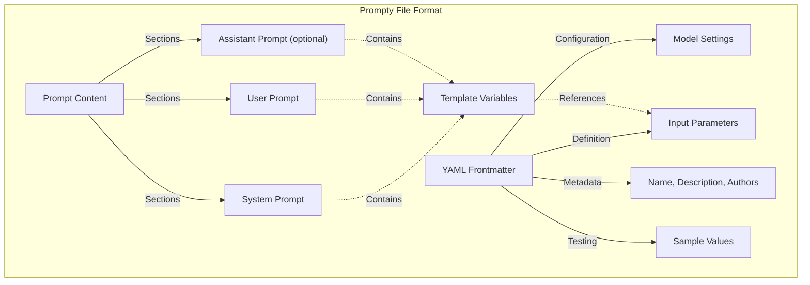
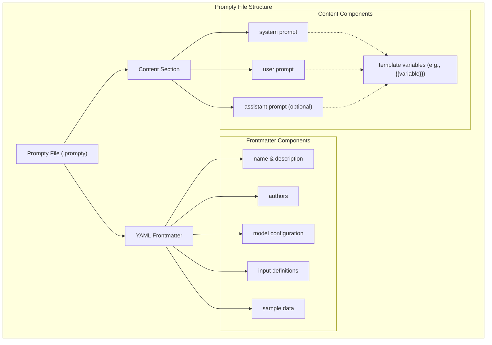
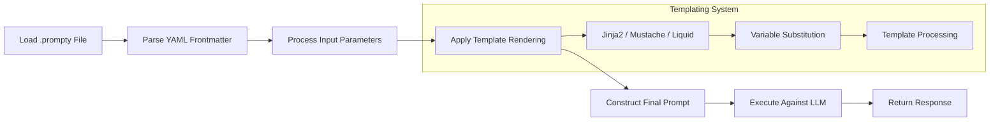
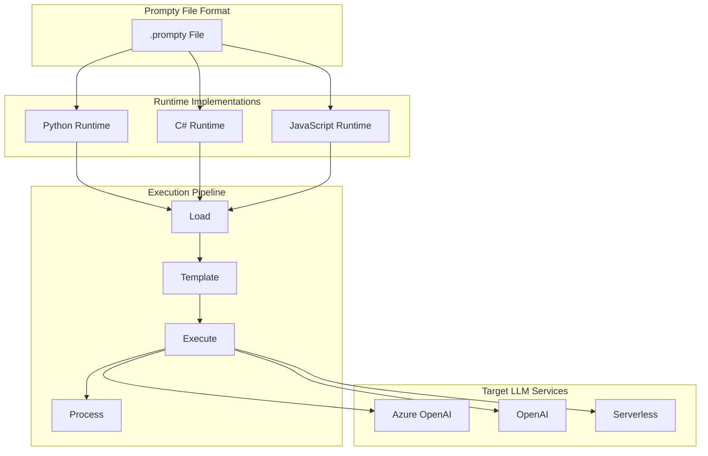

<!-- source: DeepWiki mcp.deepwiki.com · repo microsoft/prompty · page 2 Prompty File Format · fetched 2026-10-26 -->

# Prompty File Format

<details>
<summary>Relevant source files</summary>

The following files were used as context for generating this wiki page:

- [runtime/prompty/.vscode/settings.json](runtime/prompty/.vscode/settings.json)
- [runtime/prompty/tests/prompts/basic.prompty](runtime/prompty/tests/prompts/basic.prompty)
- [runtime/promptycs/.vscode/settings.json](runtime/promptycs/.vscode/settings.json)
- [runtime/promptyjs/jsconfig.json](runtime/promptyjs/jsconfig.json)
- [runtime/promptyjs/tests/tracer.test.ts](runtime/promptyjs/tests/tracer.test.ts)
- [web/.vscode/settings.json](web/.vscode/settings.json)

</details>


This document details the standardized `.prompty` file format used throughout the Prompty system to define, configure, and manage prompts for Large Language Models (LLMs). The Prompty file format serves as the foundation for cross-language prompt engineering, providing a consistent definition layer that can be executed by any of the Prompty runtimes.

For information about the YAML frontmatter details, see [YAML Frontmatter](#2.1). For information about templating and variable rendering, see [Templates and Rendering](#2.2).

## Overview

The Prompty file format consists of two main sections:

1. **YAML Frontmatter**: Contains metadata, model configuration, and input/output specifications
2. **Prompt Content**: Contains the actual prompt text with templating capabilities

These sections together define a complete, executable prompt that can be processed by the Prompty runtime libraries.



Sources: [runtime/prompty/tests/prompts/basic.prompty:1-42]()

## File Structure

A `.prompty` file has the following structure:

```
---
[YAML Frontmatter]
---
[Prompt Content with Template Variables]
```

The frontmatter is enclosed by triple dashes (`---`) and contains YAML-formatted configuration. The content section follows immediately after the closing frontmatter delimiter and contains the actual prompt text, which can include templating markup.



Sources: [runtime/prompty/tests/prompts/basic.prompty:1-42]()

## YAML Frontmatter

The YAML frontmatter provides crucial configuration for the prompt execution. It includes the following key components:

### Metadata

Basic information about the prompt:

- `name`: The name of the prompt
- `description`: A brief description of the prompt's purpose
- `authors`: List of contributors/authors

### Model Configuration

Defines the LLM model to be used:

- `model.api`: Specifies the API type (e.g., "chat")
- `model.configuration`: Contains model-specific settings
  - Example: `azure_deployment: gpt-35-turbo`

### Input Parameters

Defines input variables that can be used in the prompt content:

- Each input has:
  - `type`: Data type (string, number, etc.)
  - `description`: Purpose of the input
  - `default` (optional): Default value if not provided

### Sample Data

Contains example values for testing the prompt:

- Key-value pairs of input variables and their sample values
- Used for development and testing purposes

Here is an example of the YAML frontmatter section:

```yaml
---
name: Basic Prompt
description: A basic prompt that uses the GPT-3 chat API to answer questions
authors:
  - sethjuarez
  - jietong
model:
  api: chat
  configuration:
    azure_deployment: gpt-35-turbo
inputs:
  table:
    type: string
    default: sample
    description: The name of the sample
  firstName:
    type: string
    description: The first name of the customer
  lastName:
    type: string
    default: Doe
    description: The last name of the customer

sample:
  firstName: Jane
  lastName: Doe
  question: What is the meaning of life?
  top_n: 5
  table: customers
---
```

Sources: [runtime/prompty/tests/prompts/basic.prompty:1-30]()

## Prompt Content

The content section contains the actual prompt text that will be sent to the LLM. For chat-based models, the content is typically divided into different roles or sections.

### Content Sections

Typical sections include:

- `system`: Instructions for the LLM that define its behavior
- `user`: The user's query or input
- `assistant` (optional): Pre-defined assistant responses

### Templating

Prompty uses template variables in the format `{{variable_name}}` that are replaced with actual values during prompt execution. These variables reference inputs defined in the frontmatter.

Example prompt content:

```
system:
You are an AI assistant who helps people find information.
As the assistant, you answer questions briefly, succinctly, 
and in a personable manner using markdown and even add some personal flair with appropriate emojis.
{{ query }}

# Customer
You are helping {{firstName}} {{lastName}} to find answers to their questions.
Use their name to address them in your responses.

user:
{{question}}
```

Sources: [runtime/prompty/tests/prompts/basic.prompty:31-42]()

## Prompty File Processing

When a `.prompty` file is processed by one of the Prompty runtimes, it goes through the following stages:



Sources: System architecture diagrams

## Integration with Prompty Runtime

The Prompty file format is designed to be language-agnostic, allowing the same prompt definition to be used across different programming languages and frameworks.



Sources: System architecture diagrams

## Example of a Complete Prompty File

Here is an example of a complete `.prompty` file:

| Component | Content |
|-----------|---------|
| **Filename** | `basic.prompty` |
| **Frontmatter** | Contains name, description, authors, model configuration, input definitions, and sample data |
| **System prompt** | Instructions for the LLM behavior |
| **User prompt** | The query to be answered, typically templated |
| **Variables** | `{{firstName}}`, `{{lastName}}`, `{{question}}`, `{{query}}` |

This example defines a prompt that helps answer questions from a customer, personalizing the response with the customer's name.

Sources: [runtime/prompty/tests/prompts/basic.prompty:1-42]()

## Summary

The Prompty file format provides a standardized way to define LLM prompts that can be executed across different programming languages. Key features include:

1. YAML frontmatter for configuration
2. Templating capabilities for dynamic content
3. Support for different chat roles (system, user, assistant)
4. Cross-language compatibility
5. Input parameter definitions with typing and defaults
6. Sample data for testing

This format enables consistent prompt engineering workflows regardless of the implementation language or target LLM service.

---

