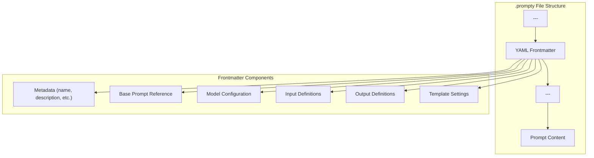
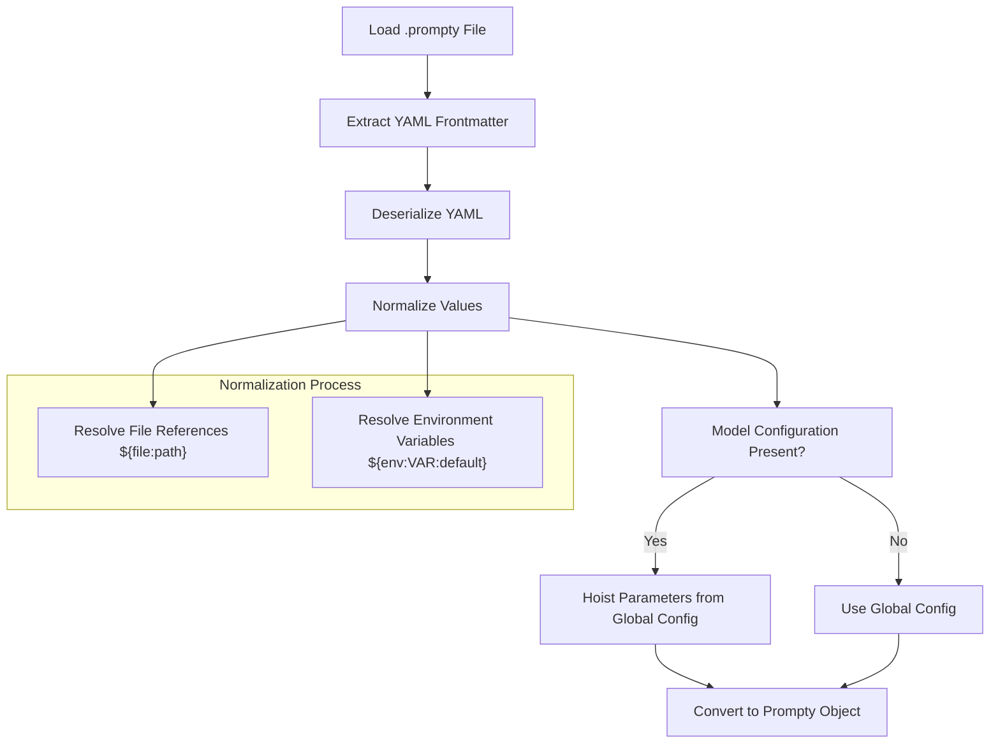
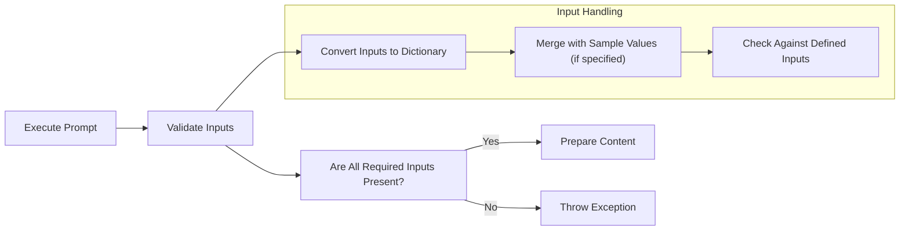

<!-- source: DeepWiki mcp.deepwiki.com · repo microsoft/prompty · page 2.1 YAML Frontmatter · fetched 2026-10-26 -->

# YAML Frontmatter

<details>
<summary>Relevant source files</summary>

The following files were used as context for generating this wiki page:

- [runtime/promptycs/Prompty.Core.Tests/LoadTests.cs](runtime/promptycs/Prompty.Core.Tests/LoadTests.cs)
- [runtime/promptycs/Prompty.Core.Tests/ParserTests.cs](runtime/promptycs/Prompty.Core.Tests/ParserTests.cs)
- [runtime/promptycs/Prompty.Core/Model/Prompty.cs](runtime/promptycs/Prompty.Core/Model/Prompty.cs)
- [runtime/promptycs/Prompty.Core/Model/Template.cs](runtime/promptycs/Prompty.Core/Model/Template.cs)
- [runtime/promptycs/Prompty.Core/Normalizer.cs](runtime/promptycs/Prompty.Core/Normalizer.cs)
- [runtime/promptycs/Prompty.Core/Parsers/PromptyChatParser.cs](runtime/promptycs/Prompty.Core/Parsers/PromptyChatParser.cs)
- [runtime/promptycs/Prompty.Core/Prompty.cs](runtime/promptycs/Prompty.Core/Prompty.cs)

</details>


The YAML Frontmatter is a fundamental component of the Prompty file format (.prompty) that defines the metadata, configuration, and specifications for a prompt. It is enclosed by triple dashes (`---`) at the beginning of a .prompty file and contains configuration that determines how the prompt is processed, rendered, and executed against Language Model providers.

This document details the structure and components of the YAML Frontmatter section, how it is parsed, and how values within it are processed. For information about how templates are rendered using the variables defined in the frontmatter, see [Templates and Rendering](#2.2).

## Structure and Format



Sources: [runtime/promptycs/Prompty.Core/Model/Prompty.cs:7-12]()

The YAML Frontmatter is enclosed by triple dashes (`---`) at the beginning and end. The prompt content follows after the second triple dash. The Prompty system uses a regex pattern to extract the frontmatter and content sections of a .prompty file:

```regex
^---\s*$\n      # Start of YAML front matter
(?<header>.*?)  # Capture the YAML front matter
^---\s*$\n      # End of YAML front matter
(?<content>.*)  # Capture the content after
```

## Frontmatter Components

A complete frontmatter can include the following components:

| Component | Description | Required |
|-----------|-------------|----------|
| Metadata | General information about the prompt (name, description, etc.) | No |
| Base | Reference to another .prompty file to extend | No |
| Model | Configuration for the LLM to use | Yes |
| Inputs | Definitions of input variables | No |
| Outputs | Definitions of output formats | No |
| Template | Settings for template rendering | No |

### Metadata Section

The metadata section includes general information about the prompt:

```yaml
name: Example Prompt
description: This is an example prompt
authors:
  - John Doe
tags:
  - example
  - documentation
version: 1.0.0
```

These fields are mapped to properties in the `Prompty` class:

Sources: [runtime/promptycs/Prompty.Core/Model/Prompty.cs:23-28]()

### Base Section

The `base` field allows you to extend another .prompty file:

```yaml
base: path/to/base/prompt.prompty
```

When a base prompt is specified, Prompty loads the base prompt first and then applies the current prompt's properties, overriding any conflicting values.

Sources: [runtime/promptycs/Prompty.Core/Model/Prompty.cs:31-32]()

### Model Configuration Section

The `model` section specifies how the prompt should be executed by an LLM:

```yaml
model:
  api: chat
  configuration:
    type: azure_openai
    endpoint: ${env:AZURE_OPENAI_ENDPOINT}
    model: gpt-4
    temperature: 0.7
```

Key fields:
- `api`: Specifies the API type (e.g., "chat", "completion")
- `configuration`: Contains model-specific settings:
  - `type`: The executor type (e.g., "azure_openai", "openai", "serverless")
  - Other configuration values specific to the chosen executor

Sources: [runtime/promptycs/Prompty.Core/Model/Prompty.cs:35](), [runtime/promptycs/Prompty.Core/Prompty.cs:95-108]()

## Processing Model Configuration



Sources: [runtime/promptycs/Prompty.Core/Prompty.cs:62-112](), [runtime/promptycs/Prompty.Core/Normalizer.cs:7-67]()

### Inputs and Outputs Sections

The `inputs` and `outputs` sections define variables that can be passed to or returned from the prompt:

```yaml
inputs:
  firstName:
    type: string
    description: The user's first name
    sample: Jane
    default: User
  age:
    type: number
    description: The user's age
    sample: 45
    default: 18
  valid:
    type: boolean
    description: Whether the data is valid
    sample: true
    default: false
  items:
    type: array
    description: A list of items
    sample:
      - one
      - two
      - three
```

Each property must have:
- `type`: Data type ("string", "number", "boolean", or "array")
- `description`: Description of the property

And may optionally include:
- `sample`: Example value (used for testing)
- `default`: Default value (used if no value is provided)

Sources: [runtime/promptycs/Prompty.Core/Model/Prompty.cs:41-42](), [runtime/promptycs/Prompty.Core/Prompty.cs:136-137](), [runtime/promptycs/Prompty.Core.Tests/LoadTests.cs:56-95]()

### Template Section

The `template` section configures how variables are substituted in the prompt content:

```yaml
template:
  format: liquid
  parser: prompty
  strict: true
```

Key fields:
- `format`: The template engine to use ("liquid", "jinja2", "mustache")
- `parser`: The parser to use for content ("prompty", "prompty.chat", etc.)
- `strict`: Whether to enforce strict validation

Sources: [runtime/promptycs/Prompty.Core/Model/Prompty.cs:44](), [runtime/promptycs/Prompty.Core/Model/Template.cs:5-7]()

## Special Syntax in Values

The YAML frontmatter supports special syntax for dynamic values that are resolved during normalization:

### File Inclusion

```yaml
configuration:
  functionDefinitions: ${file:path/to/functions.json}
```

This includes the contents of the specified file, which is then normalized.

### Environment Variable References

```yaml
configuration:
  endpoint: ${env:AZURE_OPENAI_ENDPOINT}
  apiKey: ${env:AZURE_OPENAI_KEY:default_value}
```

This substitutes environment variable values. An optional default value can be provided.

Sources: [runtime/promptycs/Prompty.Core/Normalizer.cs:39-67]()

## Input Validation

When executing a prompt, the inputs defined in the frontmatter are validated:



Sources: [runtime/promptycs/Prompty.Core/Prompty.cs:215-231](), [runtime/promptycs/Prompty.Core/Prompty.cs:289-297]()

## Loading and Processing Flow

The complete process of loading and processing a .prompty file involves several steps:

1. Read the file content
2. Extract the YAML frontmatter and prompt content
3. Deserialize the YAML to a dictionary
4. Normalize values (resolving file inclusions and environment variables)
5. Load and merge with global configuration
6. Convert the frontmatter dictionary to a `Prompty` object
7. Process any base prompt (if specified)

Sources: [runtime/promptycs/Prompty.Core/Prompty.cs:155-164](), [runtime/promptycs/Prompty.Core/Prompty.cs:114-146]()

## References to Frontmatter During Execution

During prompt execution, various components of the frontmatter are referenced:

- `template.format` determines which renderer to use
- `template.parser` and `model.api` determine which parser to use
- `model.configuration.type` determines which executor and processor to use

Sources: [runtime/promptycs/Prompty.Core/Prompty.cs:11-21]()

The frontmatter establishes the entire configuration for how a prompt will be processed, including the template engine, the parsing method, the execution model, and the input/output specifications.

---

