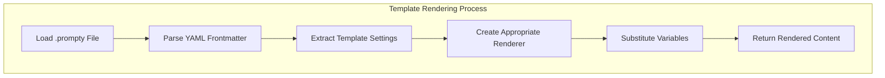
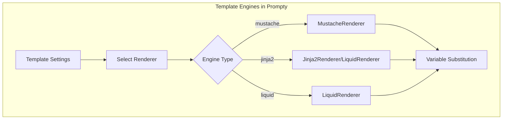
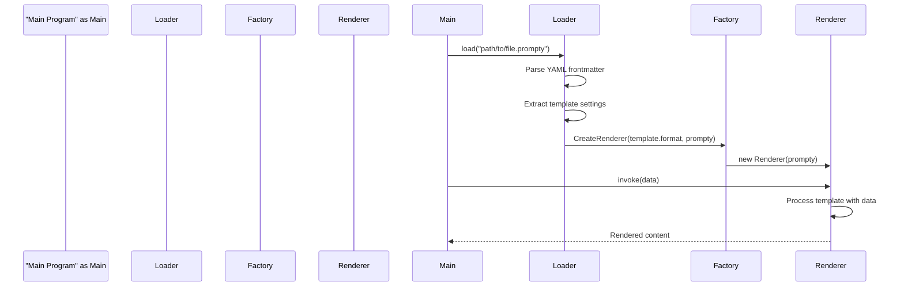
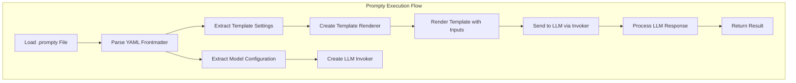
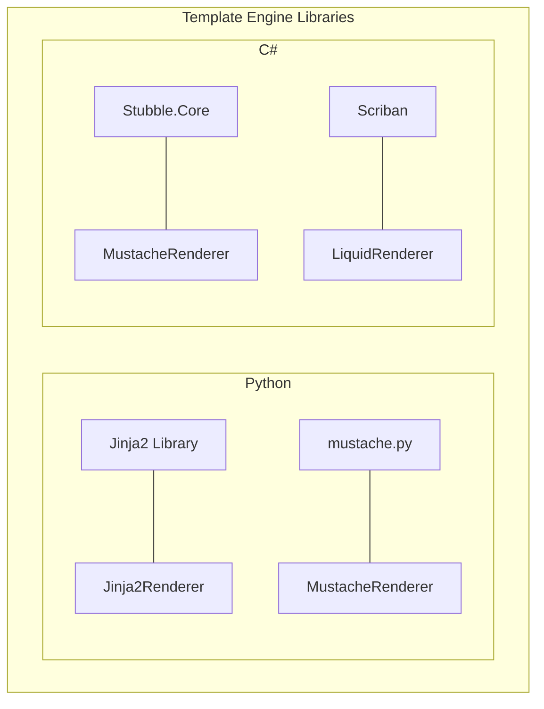
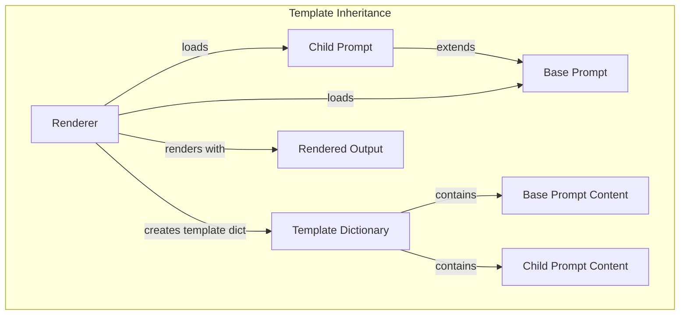

<!-- source: DeepWiki mcp.deepwiki.com · repo microsoft/prompty · page 2.2 Templates and Rendering · fetched 2026-10-26 -->

# Templates and Rendering

<details>
<summary>Relevant source files</summary>

The following files were used as context for generating this wiki page:

- [runtime/prompty/prompty/cli.py](runtime/prompty/prompty/cli.py)
- [runtime/prompty/prompty/core.py](runtime/prompty/prompty/core.py)
- [runtime/prompty/prompty/mustache.py](runtime/prompty/prompty/mustache.py)
- [runtime/prompty/prompty/renderers.py](runtime/prompty/prompty/renderers.py)
- [runtime/prompty/prompty/tracer.py](runtime/prompty/prompty/tracer.py)
- [runtime/prompty/tests/prompts/chat.prompty](runtime/prompty/tests/prompts/chat.prompty)
- [runtime/promptycs/Directory.Packages.props](runtime/promptycs/Directory.Packages.props)
- [runtime/promptycs/Prompty.Core.Tests/RenderererTests.cs](runtime/promptycs/Prompty.Core.Tests/RenderererTests.cs)
- [runtime/promptycs/Prompty.Core.Tests/packages.lock.json](runtime/promptycs/Prompty.Core.Tests/packages.lock.json)
- [runtime/promptycs/Prompty.Core.Tests/prompty/basic_mustache.prompty](runtime/promptycs/Prompty.Core.Tests/prompty/basic_mustache.prompty)
- [runtime/promptycs/Prompty.Core/Renderers/LiquidRenderer.cs](runtime/promptycs/Prompty.Core/Renderers/LiquidRenderer.cs)
- [runtime/promptycs/Prompty.Core/Renderers/MustacheRenderer.cs](runtime/promptycs/Prompty.Core/Renderers/MustacheRenderer.cs)
- [runtime/promptycs/Prompty.Core/packages.lock.json](runtime/promptycs/Prompty.Core/packages.lock.json)

</details>


This document covers the template engine support and rendering process in Prompty. It details how Prompty processes variables in prompt templates and the different template formats available. For information about the overall Prompty file format structure, see [Prompty File Format](#2).

## Overview

Prompty supports multiple template engines for rendering variables within prompt templates. This allows for dynamic prompt generation by substituting placeholders with actual values at runtime. The template system is a core component of Prompty's flexibility, enabling reusable prompt patterns that can be populated with different data for each execution.



Sources: [runtime/prompty/prompty/core.py:61-74](runtime/prompty/prompty/core.py:61-74), [runtime/prompty/prompty/renderers.py:10-84](runtime/prompty/prompty/renderers.py:10-84)

## Supported Template Engines

Prompty currently supports three template engines across its language implementations:

1. **Mustache** - A logic-less template syntax
2. **Jinja2** - A full-featured template engine with Python-like expressions
3. **Liquid** - A template language originally created for Shopify

Each template engine has different capabilities and syntax, allowing you to choose the one that best fits your needs.



Sources: [runtime/prompty/prompty/renderers.py:11-84](runtime/prompty/prompty/renderers.py:11-84), [runtime/promptycs/Prompty.Core/Renderers/MustacheRenderer.cs:5-20](runtime/promptycs/Prompty.Core/Renderers/MustacheRenderer.cs:5-20), [runtime/promptycs/Prompty.Core/Renderers/LiquidRenderer.cs:5-23](runtime/promptycs/Prompty.Core/Renderers/LiquidRenderer.cs:5-23)

## Template Configuration

The template engine to use is specified in the YAML frontmatter of the `.prompty` file under the `template` section. This allows you to specify both the format (engine) and optional parser settings.

### Configuration Fields

| Field  | Description | Default Value |
|--------|-------------|---------------|
| format | The template engine to use (mustache, jinja2, liquid) | mustache |
| parser | Parser-specific configuration | "" |

Example YAML configuration:

```yaml
template:
  format: mustache
  parser: prompty
```

Sources: [runtime/prompty/prompty/core.py:61-74](runtime/prompty/prompty/core.py:61-74), [runtime/promptycs/Prompty.Core.Tests/prompty/basic_mustache.prompty:17-19](runtime/promptycs/Prompty.Core.Tests/prompty/basic_mustache.prompty:17-19)

## Renderer Implementation

Each template engine is implemented as a renderer class that inherits from the `Invoker` base class. The renderer is responsible for processing the template with the given data and returning the rendered output.

```mermaid
classDiagram
    class "Invoker" {
        +invoke(data)
        +invoke_async(data)
    }
    
    class "MustacheRenderer" {
        -prompty: Prompty
        -templates: dict
        -name: str
        +invoke(data)
        +invoke_async(data)
    }
    
    class "Jinja2Renderer" {
        -prompty: Prompty
        -templates: dict
        -name: str
        +invoke(data)
        +invoke_async(data)
    }
    
    class "LiquidRenderer" {
        -prompty: Prompty
        +invoke(data)
        +invoke_async(data)
    }
    
    "Invoker" <|-- "MustacheRenderer"
    "Invoker" <|-- "Jinja2Renderer"
    "Invoker" <|-- "LiquidRenderer"
```

Sources: [runtime/prompty/prompty/renderers.py:11-84](runtime/prompty/prompty/renderers.py:11-84), [runtime/promptycs/Prompty.Core/Renderers/MustacheRenderer.cs:5-20](runtime/promptycs/Prompty.Core/Renderers/MustacheRenderer.cs:5-20), [runtime/promptycs/Prompty.Core/Renderers/LiquidRenderer.cs:5-23](runtime/promptycs/Prompty.Core/Renderers/LiquidRenderer.cs:5-23)

## Template Rendering Process

The template rendering process follows these steps:

1. The `.prompty` file is loaded and parsed
2. The template settings are extracted from the YAML frontmatter
3. An appropriate renderer is created based on the template format
4. The renderer substitutes variables in the template with values from the input data
5. The rendered template is returned as a string



Sources: [runtime/prompty/prompty/renderers.py:33-52](runtime/prompty/prompty/renderers.py:33-52), [runtime/promptycs/Prompty.Core.Tests/RenderererTests.cs:12-42](runtime/promptycs/Prompty.Core.Tests/RenderererTests.cs:12-42)

## Template Syntax and Examples

### Mustache Syntax

Mustache uses double curly braces `{{}}` for variable substitution. It's a "logic-less" template system, focusing on simple variable substitutions.

```
# Customer
You are helping {{firstName}} {{lastName}} to find answers to their questions.
Use their name to address them in your responses.

user:
{{question}}
```

Mustache also supports comments with `{{! comment }}` which are removed from the output.

Sources: [runtime/promptycs/Prompty.Core.Tests/prompty/basic_mustache.prompty:20-34](runtime/promptycs/Prompty.Core.Tests/prompty/basic_mustache.prompty:20-34), [runtime/prompty/prompty/mustache.py:129-137](runtime/prompty/prompty/mustache.py:129-137)

### Jinja2/Liquid Syntax

Jinja2 and Liquid provide more advanced templating with support for conditionals, loops, and other control structures.

Example with loops:

```

{{item.role}}:
{{item.content}}

```

This iterates through a `chat_history` array, outputting each item's role and content.

Sources: [runtime/prompty/tests/prompts/chat.prompty:30-33](runtime/prompty/tests/prompts/chat.prompty:30-33)

## Integration with Prompty Execution Flow

Template rendering is a key step in the Prompty execution pipeline. When a prompt is executed, the variables from the input data are passed to the template renderer before the content is sent to the LLM.



Sources: [runtime/prompty/prompty/core.py:77-135](runtime/prompty/prompty/core.py:77-135), [runtime/prompty/prompty/cli.py:83-103](runtime/prompty/prompty/cli.py:83-103)

## Implementation Across Languages

Prompty provides template rendering implementations across its supported languages:

### Python Implementation

In Python, Prompty uses:
- Native `Jinja2` library for Jinja2 templates
- Custom `mustache.py` implementation for Mustache templates

### C# Implementation

In C#, Prompty uses:
- `Stubble.Core` for Mustache templates
- `Scriban` for Jinja2 and Liquid templates



Sources: [runtime/prompty/prompty/renderers.py:4-5](runtime/prompty/prompty/renderers.py:4-5), [runtime/promptycs/Directory.Packages.props:10-13](runtime/promptycs/Directory.Packages.props:10-13), [runtime/promptycs/Prompty.Core/packages.lock.json:46-65](runtime/promptycs/Prompty.Core/packages.lock.json:46-65)

## Variable Substitution Examples

The following table shows examples of variable substitution with different template engines:

| Template Engine | Variable Syntax | Example |
|-----------------|-----------------|---------|
| Mustache | `{{variableName}}` | `Hello {{name}}!` |
| Mustache (no HTML escape) | `{{{variableName}}}` | `{{{htmlContent}}}` |
| Mustache (comments) | `{{! comment }}` | `{{! This is ignored }}` |
| Jinja2/Liquid | `{{ variableName }}` | `Hello {{ name }}!` |
| Jinja2/Liquid (if statement) | `...` | `Hello!` |
| Jinja2/Liquid (for loop) | `...` | `{{ item }}` |

Sources: [runtime/prompty/prompty/mustache.py:127-140](runtime/prompty/prompty/mustache.py:127-140), [runtime/prompty/tests/prompts/chat.prompty:30-33](runtime/prompty/tests/prompts/chat.prompty:30-33)

## Inheritance and Base Prompts

When a `.prompty` file extends another prompt using the `base` property, the template rendering system automatically handles inheritance by making the base prompt's content available to the template engine.



This is handled by building a templates dictionary in the renderer that includes both the child and base prompt content.

Sources: [runtime/prompty/prompty/renderers.py:16-27](runtime/prompty/prompty/renderers.py:16-27), [runtime/prompty/prompty/renderers.py:59-65](runtime/prompty/prompty/renderers.py:59-65)

## Conclusion

The template and rendering system in Prompty provides flexible options for creating dynamic prompts. By supporting multiple template engines, Prompty accommodates different levels of complexity in prompt design, from simple variable substitution to complex conditional logic and loops.

The choice of template engine depends on your needs:
- Mustache for simple, logic-less templates
- Jinja2/Liquid for more complex templates with conditionals and loops

Template rendering is a core part of the Prompty execution process, enabling dynamic prompt generation based on input data before sending to the LLM.

---

