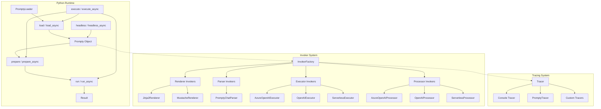
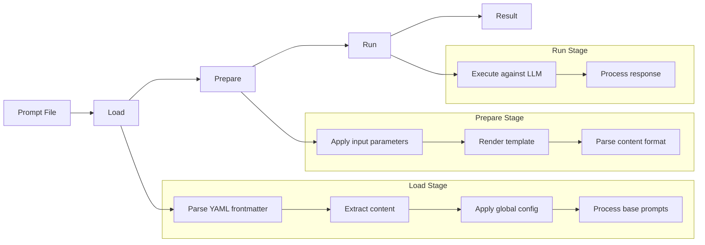
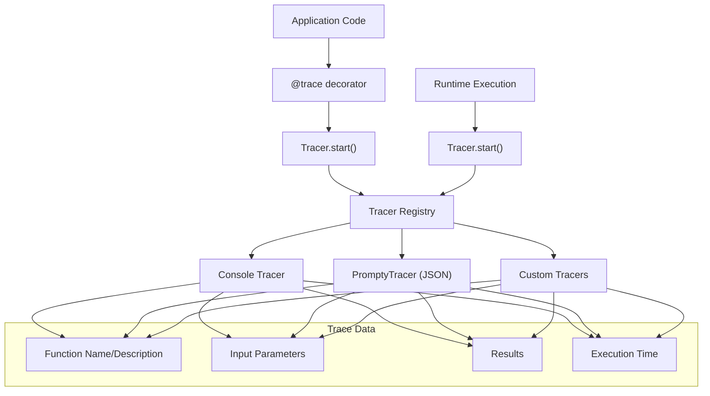

<!-- source: DeepWiki mcp.deepwiki.com · repo microsoft/prompty · page 3 Python Runtime · fetched 2026-10-26 -->

# Python Runtime

<details>
<summary>Relevant source files</summary>

The following files were used as context for generating this wiki page:

- [.github/workflows/prompty-python.yml](.github/workflows/prompty-python.yml)
- [.vscode/project.code-workspace](.vscode/project.code-workspace)
- [runtime/prompty/.gitignore](runtime/prompty/.gitignore)
- [runtime/prompty/LICENSE](runtime/prompty/LICENSE)
- [runtime/prompty/README.md](runtime/prompty/README.md)
- [runtime/prompty/doc.py](runtime/prompty/doc.py)
- [runtime/prompty/prompty/__init__.py](runtime/prompty/prompty/__init__.py)
- [runtime/prompty/prompty/invoker.py](runtime/prompty/prompty/invoker.py)
- [runtime/prompty/prompty/openai/processor.py](runtime/prompty/prompty/openai/processor.py)
- [runtime/prompty/prompty/utils.py](runtime/prompty/prompty/utils.py)
- [runtime/prompty/pyproject.toml](runtime/prompty/pyproject.toml)
- [runtime/prompty/tests/test_common.py](runtime/prompty/tests/test_common.py)
- [runtime/prompty/tests/test_core.py](runtime/prompty/tests/test_core.py)
- [runtime/prompty/tests/test_tracing.py](runtime/prompty/tests/test_tracing.py)

</details>


The Python Runtime is the Python implementation of the Prompty system, providing a programmatic way to work with `.prompty` files in Python applications. This runtime enables developers to load, prepare, and execute prompts against various Large Language Models (LLMs), supporting both synchronous and asynchronous operation patterns.

For information about other language implementations, see [C# Runtime](#4) and [JavaScript Runtime](#5).

## Installation and Dependencies

The Python Runtime is available as a PyPI package and can be installed using pip:

```bash
pip install prompty
```

The runtime supports different LLM providers through optional dependencies:

| Provider   | Installation Command        | Description                                |
|------------|-----------------------------|--------------------------------------------|
| Azure      | `pip install "prompty[azure]"` | Adds support for Azure OpenAI services    |
| OpenAI     | `pip install "prompty[openai]"` | Adds support for OpenAI API               |
| Serverless | `pip install "prompty[serverless]"` | Adds support for serverless models       |

For most production scenarios, you'll want to install with at least one provider:

```bash
pip install "prompty[azure,openai]"
```

Sources: [runtime/prompty/pyproject.toml:10-26](), [runtime/prompty/README.md:52-56]()

## Architecture Overview

The Python Runtime follows a modular pipeline architecture that processes prompts through several stages, from loading to execution and result processing.

### Python Runtime Architecture



Sources: [runtime/prompty/prompty/__init__.py:5-16](), [runtime/prompty/prompty/invoker.py:8-89]()

## Core Components

### Prompty Object

The `Prompty` class is the central data structure representing a loaded prompt with all its configuration. It contains:

- Model settings (API, configuration, parameters)
- Template settings (renderer type, parser)
- Content (the actual prompt text)
- Inputs and outputs definitions
- Additional metadata (name, description, etc.)

When a `.prompty` file is loaded, it's parsed into a `Prompty` object that can then be prepared and executed.

### Execution Pipeline

The Prompty execution pipeline consists of four main stages:



Sources: [runtime/prompty/prompty/__init__.py:209-340](), [runtime/prompty/prompty/__init__.py:384-485]()

### InvokerFactory System

The `InvokerFactory` manages the various components that process prompts at each stage of the pipeline. It maintains registries of:

1. **Renderers**: Responsible for applying template engines (Jinja2, Mustache) to the prompt content
2. **Parsers**: Convert rendered templates into formats expected by LLMs
3. **Executors**: Interface with LLM providers (Azure, OpenAI, Serverless)
4. **Processors**: Transform LLM responses into standardized formats

The factory pattern allows for easy extension with custom implementations.

Sources: [runtime/prompty/prompty/invoker.py:90-312]()

## Core API Functions

The Python Runtime exposes several key functions for working with prompts:

### Loading Prompts

```python
# Synchronous loading
prompt = prompty.load("path/to/prompt.prompty")

# Asynchronous loading
prompt = await prompty.load_async("path/to/prompt.prompty")

# Headless (programmatic) prompts
prompt = prompty.headless(
    api="chat",
    content="You are a helpful assistant. {{question}}",
    configuration={"type": "azure", "azure_deployment": "gpt-35-turbo"}
)
```

The `load` function parses a `.prompty` file into a `Prompty` object. It handles:
- Parsing YAML frontmatter and prompt content
- Normalizing configuration values
- Loading global configurations
- Processing base prompts for inheritance

Sources: [runtime/prompty/prompty/__init__.py:209-313](), [runtime/prompty/prompty/__init__.py:29-141]()

### Preparing Prompts

```python
# Synchronous preparation
prepared_content = prompty.prepare(prompt, inputs={"question": "What is Prompty?"})

# Asynchronous preparation
prepared_content = await prompty.prepare_async(prompt, inputs={"question": "What is Prompty?"})
```

The `prepare` function:
- Applies input parameters to the prompt template
- Renders the template using the configured renderer
- Parses the rendered content into the format expected by the LLM

Sources: [runtime/prompty/prompty/__init__.py:316-381]()

### Running Prompts

```python
# Synchronous execution
result = prompty.run(prompt, prepared_content)

# Asynchronous execution
result = await prompty.run_async(prompt, prepared_content)
```

The `run` function:
- Executes the prepared content against the configured LLM
- Processes the response into a standardized format
- Returns the result (text, embeddings, etc.)

Sources: [runtime/prompty/prompty/__init__.py:384-485]()

### End-to-End Execution

```python
# Synchronous execution
result = prompty.execute(
    "path/to/prompt.prompty",
    inputs={"question": "What is Prompty?"}
)

# Asynchronous execution
result = await prompty.execute_async(
    "path/to/prompt.prompty",
    inputs={"question": "What is Prompty?"}
)
```

The `execute` function combines loading, preparing, and running into a single operation for convenience.

Sources: [runtime/prompty/prompty/__init__.py:488-593]()

## LLM Integration

The Python Runtime supports multiple LLM providers through the invoker system:

### Supported LLM Providers

| Provider   | Configuration Type | Description                                       |
|------------|-------------------|---------------------------------------------------|
| Azure OpenAI | `"azure"`, `"azure_openai"` | Uses Azure OpenAI services via the OpenAI SDK |
| OpenAI     | `"openai"`       | Uses the OpenAI API directly                      |
| Serverless | `"serverless"`   | Uses the Azure AI Inference client for serverless models |

To use a specific provider, set the appropriate `type` in the model configuration:

```yaml
model:
  api: chat
  configuration:
    type: azure
    azure_endpoint: ${env:AZURE_OPENAI_ENDPOINT}
    azure_deployment: ${env:AZURE_OPENAI_DEPLOYMENT}
```

Sources: [runtime/prompty/README.md:72-77]()

## Tracing and Observability

The Python Runtime includes a comprehensive tracing system for debugging and monitoring prompt execution.

### Tracing Architecture



### Adding Custom Tracers

Tracers can be added to the system to capture execution details:

```python
from prompty.tracer import Tracer, console_tracer, PromptyTracer

# Add the console tracer
Tracer.add("console", console_tracer)

# Add a JSON file tracer
json_tracer = PromptyTracer(output_dir="path/to/output")
Tracer.add("json", json_tracer.tracer)

# Add OpenTelemetry tracing
from opentelemetry import trace as oteltrace
import contextlib
import json

@contextlib.contextmanager
def trace_span(name: str):
    tracer = oteltrace.get_tracer("prompty")
    with tracer.start_as_current_span(name) as span:
        yield lambda key, value: span.set_attribute(
            key, json.dumps(value).replace("\n", "")
        )

Tracer.add("OpenTelemetry", trace_span)
```

Sources: [runtime/prompty/README.md:79-185](), [runtime/prompty/tests/test_tracing.py:1-320]()

## Command Line Interface

The Python Runtime includes a command-line interface for executing prompts directly:

```bash
prompty -s path/to/prompt.prompty -e .env
```

This executes the prompt and prints the response to the console, with automatic tracing enabled. The `-e` flag can be used to specify an environment file for configuration.

Sources: [runtime/prompty/README.md:187-194](), [runtime/prompty/pyproject.toml:72-73]()

## Complete Usage Example

Here's a complete example of using the Python Runtime:

```python
import prompty
# Import the specific invoker modules you need
import prompty.azure

# Load a prompt
p = prompty.load("prompts/chat.prompty")

# Prepare inputs
inputs = {
    "question": "What is Prompty?",
    "firstName": "John",
    "lastName": "Doe"
}

# Execute the prompt
result = prompty.execute(p, inputs=inputs)

# Or do it step by step
prepared = prompty.prepare(p, inputs)
result = prompty.run(p, prepared)

print(result)
```

For asynchronous usage:

```python
import asyncio
import prompty
import prompty.azure

async def main():
    # Load a prompt asynchronously
    p = await prompty.load_async("prompts/chat.prompty")
    
    # Execute asynchronously
    result = await prompty.execute_async(
        p, 
        inputs={
            "question": "What is Prompty?",
            "firstName": "John",
            "lastName": "Doe"
        }
    )
    
    print(result)

asyncio.run(main())
```

Sources: [runtime/prompty/README.md:58-69](), [runtime/prompty/tests/test_tracing.py:97-118]()

## Python Version Support

The Python Runtime supports Python 3.9 and higher, with continuous integration testing against Python 3.9, 3.10, 3.11, 3.12, and 3.13 on Ubuntu, macOS, and Windows.

Sources: [.github/workflows/prompty-python.yml:21-23](), [runtime/prompty/pyproject.toml:7]()

---

