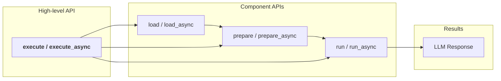
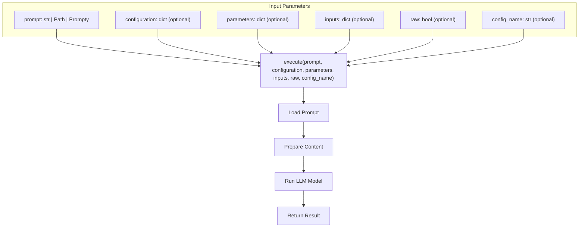
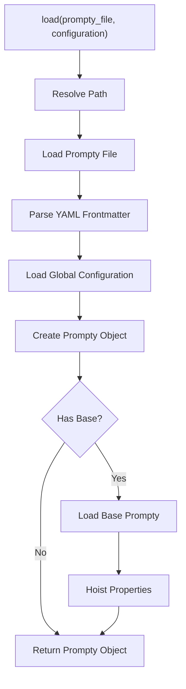
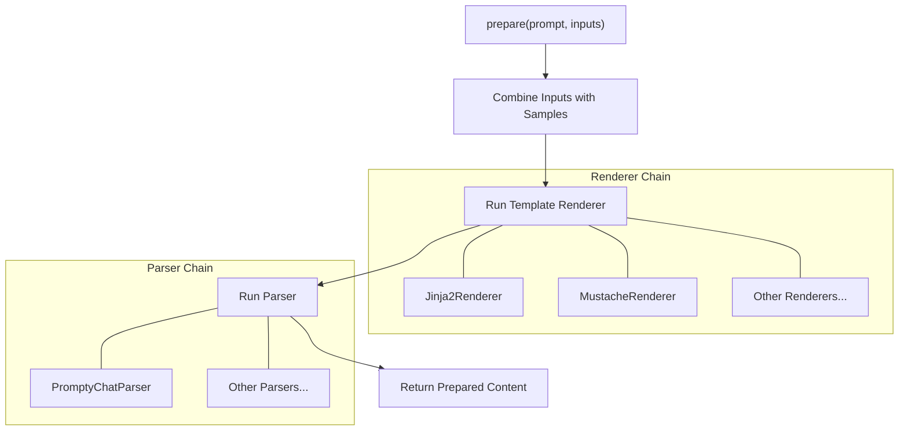
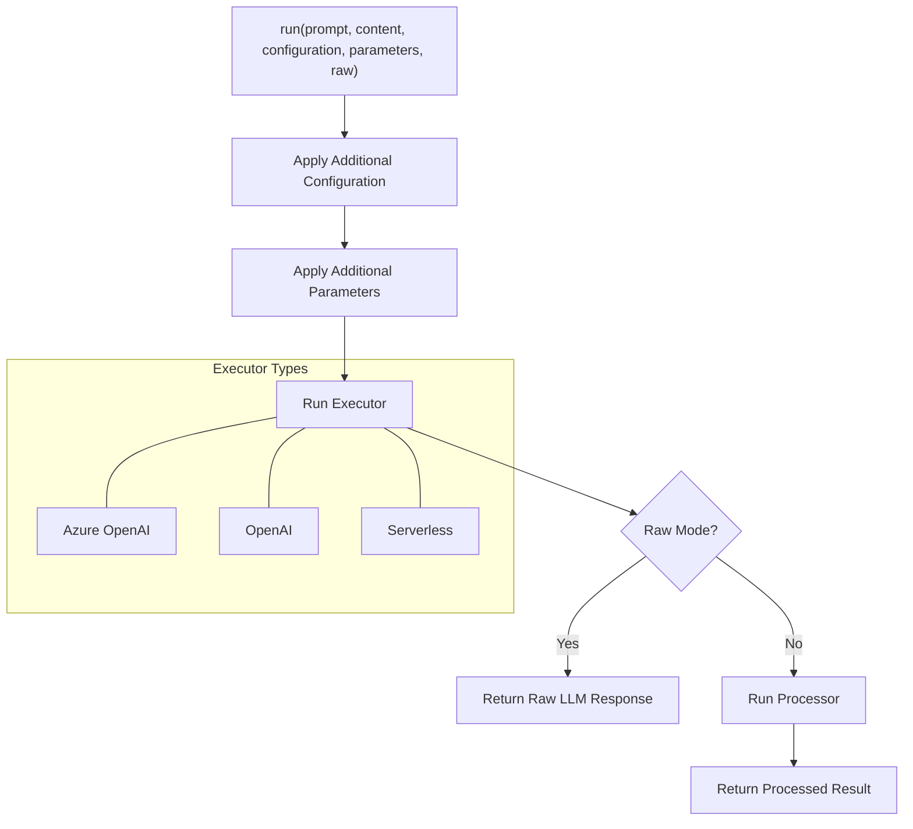
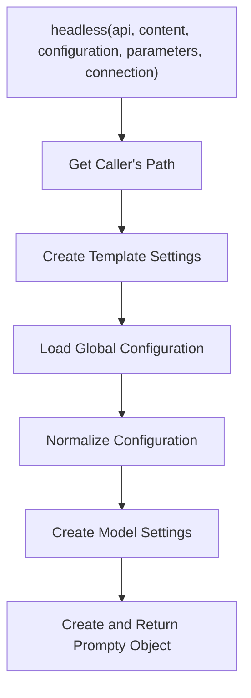
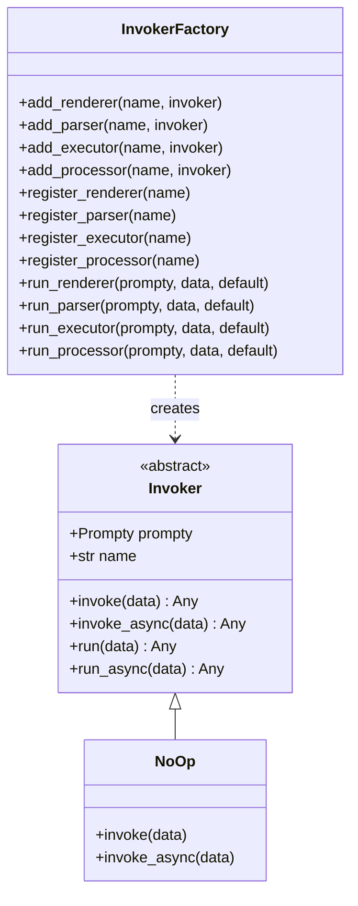
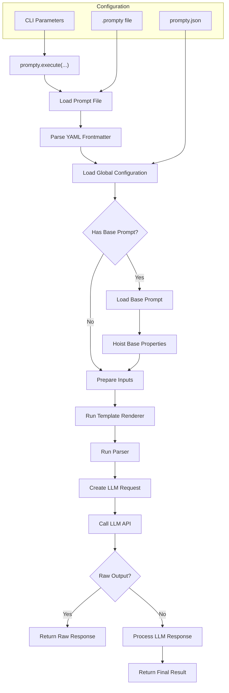

<!-- source: DeepWiki mcp.deepwiki.com · repo microsoft/prompty · page 3.1 Python API Reference · fetched 2026-10-26 -->

# Python API Reference

<details>
<summary>Relevant source files</summary>

The following files were used as context for generating this wiki page:

- [runtime/prompty/prompty/__init__.py](runtime/prompty/prompty/__init__.py)
- [runtime/prompty/prompty/invoker.py](runtime/prompty/prompty/invoker.py)
- [runtime/prompty/prompty/openai/processor.py](runtime/prompty/prompty/openai/processor.py)
- [runtime/prompty/prompty/parsers.py](runtime/prompty/prompty/parsers.py)
- [runtime/prompty/prompty/utils.py](runtime/prompty/prompty/utils.py)
- [runtime/prompty/tests/__init__.py](runtime/prompty/tests/__init__.py)
- [runtime/prompty/tests/test_core.py](runtime/prompty/tests/test_core.py)
- [runtime/prompty/tests/test_execute.py](runtime/prompty/tests/test_execute.py)

</details>


This document provides a comprehensive reference for the Python implementation of the Prompty runtime. It covers the core API functions available in the Python module for loading `.prompty` files, preparing prompts, and executing them against Large Language Models (LLMs).

For information about the Prompty file format itself, see [Prompty File Format](#2). For details on extending the Python runtime with custom invokers, see [Python Invoker System](#3.2).

## Execution Flow Overview

The Prompty Python API follows a consistent execution flow, with each stage having dedicated functions in both synchronous and asynchronous variants.



Sources: [runtime/prompty/prompty/__init__.py:488-593]()

## Core API Functions

### execute / execute_async

The `execute` function is the main entry point for using Prompty. It combines loading a prompt file, preparing it with inputs, and running it against an LLM in a single operation.



#### Parameters

| Parameter | Type | Description | Default |
|-----------|------|-------------|---------|
| prompt | `str` or `Path` or `Prompty` | Path to the prompty file or a Prompty object | - |
| configuration | `Dict[str, any]` | Configuration for the LLM | `{}` |
| parameters | `Dict[str, any]` | Parameters for the prompt | `{}` |
| inputs | `Dict[str, any]` | Input values for template variables | `{}` |
| raw | `bool` | Whether to skip response processing | `False` |
| config_name | `str` | Connection configuration name | `"default"` |

#### Returns

The response from the LLM, processed according to the prompt specifications unless `raw=True`.

#### Example

```python
import prompty

inputs = {"name": "John Doe"}
result = prompty.execute("prompts/basic.prompty", inputs=inputs)
```

The `execute_async` function provides the asynchronous equivalent with the same parameters and functionality.

```python
import prompty

inputs = {"name": "John Doe"}
result = await prompty.execute_async("prompts/basic.prompty", inputs=inputs)
```

Sources: [runtime/prompty/prompty/__init__.py:488-593](), [runtime/prompty/tests/test_execute.py:48-71]()

### load / load_async

The `load` function parses a `.prompty` file and creates a `Prompty` object that represents its contents.



#### Parameters

| Parameter | Type | Description | Default |
|-----------|------|-------------|---------|
| prompty_file | `str` | Path to the prompty file | - |
| configuration | `str` | Configuration name to use | `"default"` |

#### Returns

A `Prompty` object representing the loaded prompt.

#### Example

```python
import prompty

prompt = prompty.load("prompts/basic.prompty")
print(prompt)
```

The `load_async` function provides the asynchronous equivalent with the same parameters and functionality.

```python
import prompty

prompt = await prompty.load_async("prompts/basic.prompty")
print(prompt)
```

Sources: [runtime/prompty/prompty/__init__.py:209-313](), [runtime/prompty/prompty/utils.py:96-104]()

### prepare / prepare_async

The `prepare` function processes a `Prompty` object with the provided inputs, applying template rendering and parsing to produce content ready for the LLM.



#### Parameters

| Parameter | Type | Description | Default |
|-----------|------|-------------|---------|
| prompt | `Prompty` | The Prompty object | - |
| inputs | `Dict[str, any]` | Input values for template variables | `{}` |

#### Returns

Processed content ready to be sent to an LLM.

#### Example

```python
import prompty

prompt = prompty.load("prompts/basic.prompty")
inputs = {"name": "John Doe"}
content = prompty.prepare(prompt, inputs)
```

The `prepare_async` function provides the asynchronous equivalent with the same parameters and functionality.

```python
import prompty

prompt = await prompty.load_async("prompts/basic.prompty")
inputs = {"name": "John Doe"}
content = await prompty.prepare_async(prompt, inputs)
```

Sources: [runtime/prompty/prompty/__init__.py:316-381](), [runtime/prompty/prompty/parsers.py:9-161]()

### run / run_async

The `run` function takes a prepared prompty object and content, executes it against the configured LLM, and processes the response.



#### Parameters

| Parameter | Type | Description | Default |
|-----------|------|-------------|---------|
| prompt | `Prompty` | The Prompty object | - |
| content | `dict` or `list` or `str` | The prepared content to process | - |
| configuration | `Dict[str, any]` | Configuration for the LLM | `{}` |
| parameters | `Dict[str, any]` | Parameters for the prompt | `{}` |
| raw | `bool` | Whether to skip response processing | `False` |

#### Returns

The result from the LLM, processed according to the prompt specifications unless `raw=True`.

#### Example

```python
import prompty

prompt = prompty.load("prompts/basic.prompty")
inputs = {"name": "John Doe"}
content = prompty.prepare(prompt, inputs)
result = prompty.run(prompt, content)
```

The `run_async` function provides the asynchronous equivalent with the same parameters and functionality.

```python
import prompty

prompt = await prompty.load_async("prompts/basic.prompty")
inputs = {"name": "John Doe"}
content = await prompty.prepare_async(prompt, inputs)
result = await prompty.run_async(prompt, content)
```

Sources: [runtime/prompty/prompty/__init__.py:384-485](), [runtime/prompty/prompty/invoker.py:151-286]()

### headless / headless_async

The `headless` function creates a Prompty object programmatically without requiring a `.prompty` file, useful for dynamic scenarios or embedding generation.



#### Parameters

| Parameter | Type | Description | Default |
|-----------|------|-------------|---------|
| api | `str` | The API to use (e.g., "chat", "embedding") | - |
| content | `str` or `List[str]` or `dict` | The content to process | - |
| configuration | `Dict[str, any]` | Configuration for the LLM | `{}` |
| parameters | `Dict[str, any]` | Parameters for the prompt | `{}` |
| connection | `str` | Connection name in global config | `"default"` |

#### Returns

A `Prompty` object that can be executed.

#### Example

```python
import prompty

p = prompty.headless(
    api="embedding",
    configuration={"type": "azure", "azure_deployment": "text-embedding-ada-002"},
    content="hello world",
)
embedding = prompty.execute(p)
```

The `headless_async` function provides the asynchronous equivalent with the same parameters and functionality.

```python
import prompty

p = await prompty.headless_async(
    api="embedding",
    configuration={"type": "azure", "azure_deployment": "text-embedding-ada-002"},
    content="hello world",
)
embedding = await prompty.execute_async(p)
```

Sources: [runtime/prompty/prompty/__init__.py:29-141](), [runtime/prompty/tests/test_execute.py:189-228]()

## Invoker System

The Prompty Python runtime uses an invoker system to process different stages of prompt execution. This system is extensible, allowing custom implementations for renderers, parsers, executors, and processors.



The invoker system follows a pipeline pattern:

1. **Renderers**: Process templates and substitute variables (e.g., Jinja2, Mustache)
2. **Parsers**: Convert rendered text into LLM-compatible formats (e.g., chat messages)
3. **Executors**: Send content to LLM services and get responses
4. **Processors**: Post-process LLM responses into the desired format

Each stage has both synchronous and asynchronous implementations.

Sources: [runtime/prompty/prompty/invoker.py:1-312](), [runtime/prompty/prompty/__init__.py:23-26]()

## Utility Functions

The Prompty Python runtime includes several utility functions for loading and parsing files:

### File Loading

| Function | Description |
|----------|-------------|
| `load_text(file_path, encoding)` | Load a text file with the given encoding |
| `load_text_async(file_path, encoding)` | Asynchronously load a text file |
| `load_json(file_path, encoding)` | Load and parse a JSON file |
| `load_json_async(file_path, encoding)` | Asynchronously load and parse a JSON file |
| `load_prompty(file_path, encoding)` | Load and parse a .prompty file |
| `load_prompty_async(file_path, encoding)` | Asynchronously load and parse a .prompty file |

### Configuration Loading

| Function | Description |
|----------|-------------|
| `load_global_config(prompty_path, configuration)` | Find and load the global configuration from prompty.json |
| `load_global_config_async(prompty_path, configuration)` | Asynchronously find and load the global configuration |

### Parsing

| Function | Description |
|----------|-------------|
| `parse(contents)` | Parse the frontmatter and body from a .prompty file content |

Sources: [runtime/prompty/prompty/utils.py:1-122]()

## Common Usage Patterns

### Basic Prompt Execution

The most common pattern is to load and execute a prompt file with inputs:

```python
import prompty

result = prompty.execute(
    "path/to/prompt.prompty",
    inputs={"variable1": "value1", "variable2": "value2"}
)
```

### Generating Embeddings

For embedding generation without a prompt file:

```python
import prompty

p = prompty.headless(
    api="embedding",
    configuration={"type": "azure", "azure_deployment": "text-embedding-ada-002"},
    content="text to embed"
)
embedding = prompty.execute(p)
```

### Working with Streaming Responses

To handle streaming responses from the LLM:

```python
import prompty

result = prompty.execute("prompts/streaming.prompty")
for chunk in result:
    print(chunk)  # Process each chunk as it arrives
```

For asynchronous streaming:

```python
import prompty

result = await prompty.execute_async("prompts/streaming.prompty")
async for chunk in result:
    print(chunk)  # Process each chunk as it arrives
```

### Multi-step Processing with RAG

For retrieval-augmented generation (RAG) applications:

```python
import prompty

def get_response(customer_id, question, prompt_path):
    # Get customer information
    customer = get_customer(customer_id)
    
    # Retrieve relevant context
    context = get_context(question)
    
    # Execute the prompt with all inputs
    result = prompty.execute(
        prompt_path,
        inputs={
            "question": question,
            "customer": customer,
            "documentation": context
        }
    )
    
    return {"question": question, "answer": result, "context": context}
```

Sources: [runtime/prompty/tests/test_execute.py:72-145](), [runtime/prompty/tests/test_execute.py:254-268]()

## Complete Execution Workflow

The following diagram illustrates the complete workflow of the Prompty Python runtime from loading a file to getting the final response:



Sources: [runtime/prompty/prompty/__init__.py:488-593](), [runtime/prompty/prompty/__init__.py:209-313](), [runtime/prompty/prompty/__init__.py:316-485]()

---

