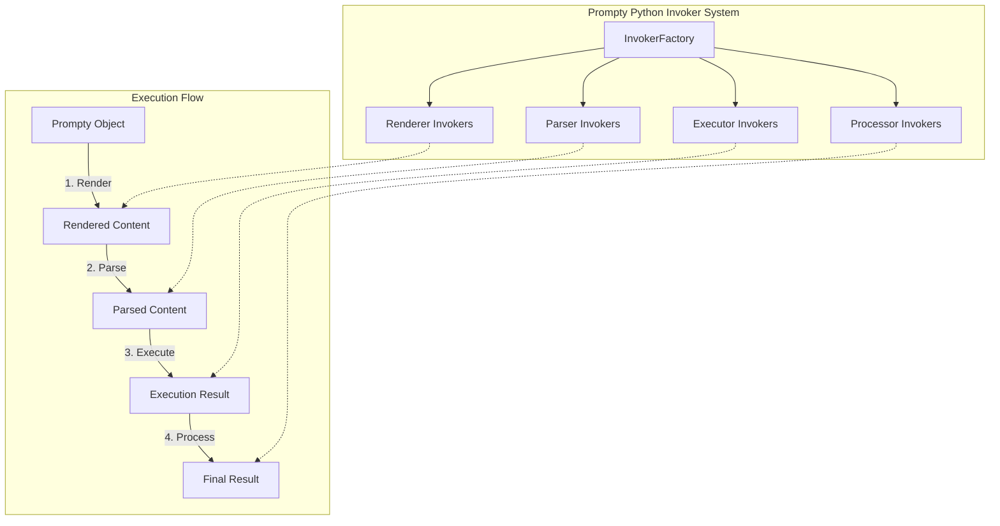
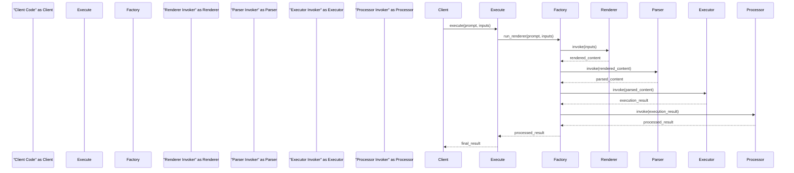
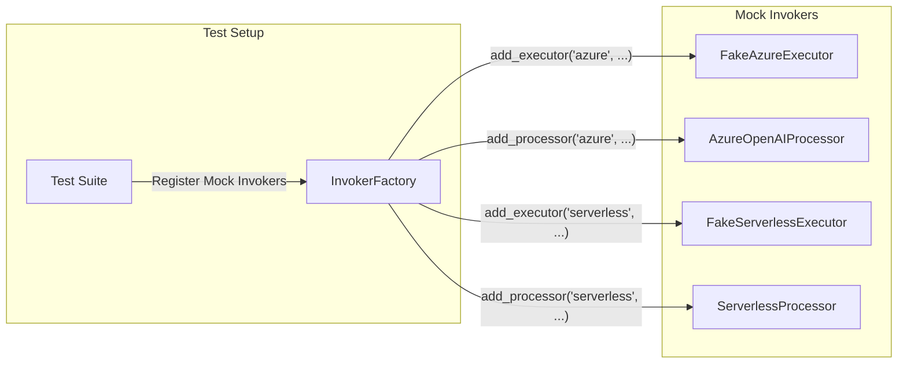

<!-- source: DeepWiki mcp.deepwiki.com · repo microsoft/prompty · page 3.2 Python Invoker System · fetched 2026-10-26 -->

# Python Invoker System

<details>
<summary>Relevant source files</summary>

The following files were used as context for generating this wiki page:

- [runtime/prompty/prompty/parsers.py](runtime/prompty/prompty/parsers.py)
- [runtime/prompty/tests/__init__.py](runtime/prompty/tests/__init__.py)
- [runtime/prompty/tests/prompts/basic_mustache.prompty](runtime/prompty/tests/prompts/basic_mustache.prompty)
- [runtime/prompty/tests/test_execute.py](runtime/prompty/tests/test_execute.py)
- [runtime/prompty/tests/test_factory_invoker.py](runtime/prompty/tests/test_factory_invoker.py)
- [runtime/prompty/tests/test_path_exec.py](runtime/prompty/tests/test_path_exec.py)

</details>


The Python Invoker System is a core component of the Prompty runtime that provides a flexible, extensible framework for executing different stages of prompt processing. This page documents how the invoker system works, how to customize it with your own invokers, and the patterns for extending the system for new LLM backends or processing methods.

For information about the general Python API, see [Python API Reference](#3.1).

## Overview

The invoker system implements a pipeline architecture where each phase of prompt processing is handled by a specialized invoker component. The system is designed to be modular and extensible, allowing custom implementations of different pipeline stages.



Sources: [runtime/prompty/tests/test_factory_invoker.py:71-74]()

## Core Components

### Invoker Base Class

All invokers inherit from a common `Invoker` base class that defines the interface for all invoker types. This class provides both synchronous and asynchronous implementation methods.

```mermaid
classDiagram
    class "Invoker" {
        +prompty: Prompty
        +__init__(prompty: Prompty)
        +invoke(data)
        +invoke_async(data)
    }
    
    class "PromptyChatParser" {
        +roles: list[str]
        +path: Path
        +invoke(data: str): list[dict[str, str]]
        +invoke_async(data: str): list[dict[str, str]]
        +parse_content(content: str)
        +inline_image(image_item: str): str
    }
    
    "Invoker" <|-- "PromptyChatParser"
```

Sources: [runtime/prompty/prompty/parsers.py:9-160]()

### InvokerFactory

The `InvokerFactory` is a central component that manages the registration and creation of invokers. It provides methods to register custom invokers and to execute each stage of the pipeline.

```mermaid
classDiagram
    class "InvokerFactory" {
        +add_executor(type: str, executor_class)
        +add_processor(type: str, processor_class)
        +run_renderer(prompt, data)
        +run_parser(prompt, content)
        +run_executor(prompt, parsed_content)
        +run_processor(prompt, executed_content)
        +run(invoker_type, prompt, data)
    }
```

Sources: [runtime/prompty/tests/test_factory_invoker.py:13-30](), [runtime/prompty/tests/test_execute.py:19-30]()

## Invoker Types

The invoker system defines four primary types of invokers, each responsible for a different stage of the prompt execution pipeline:

### Renderer Invokers

Renderer invokers are responsible for applying templates to prompts. They accept a template and input data and produce a rendered string.

### Parser Invokers

Parser invokers transform the rendered content into a format that can be sent to the LLM. They handle tasks like parsing chat formats and processing inline images.

### Executor Invokers

Executor invokers send the parsed content to LLM services and retrieve the raw response. They handle the actual communication with services like Azure OpenAI, OpenAI, etc.

### Processor Invokers

Processor invokers transform the raw response from the LLM into the expected output format. They handle tasks like parsing JSON, streaming responses, etc.

Sources: [runtime/prompty/tests/test_factory_invoker.py:22-92]()

## Execution Flow

A typical prompt execution in Prompty follows this sequence through the invoker system:



Sources: [runtime/prompty/tests/test_factory_invoker.py:68-92]()

## Extending the Invoker System

One of the key features of the Python Invoker System is its extensibility. You can create custom invokers and register them with the `InvokerFactory` to extend Prompty's capabilities.

### Registering Custom Executors and Processors

Here's how you can register custom executors and processors with the `InvokerFactory`:

```python
from prompty.invoker import InvokerFactory
from my_custom_module import MyCustomExecutor, MyCustomProcessor

# Register a custom executor for a new LLM provider
InvokerFactory.add_executor("my_llm_provider", MyCustomExecutor)

# Register a custom processor for handling responses from the custom executor
InvokerFactory.add_processor("my_llm_provider", MyCustomProcessor)
```

Sources: [runtime/prompty/tests/test_execute.py:19-30]()

### Creating Custom Invokers

To create a custom invoker, you need to:

1. Inherit from the `Invoker` base class
2. Implement the `invoke` and `invoke_async` methods
3. Register your invoker with the `InvokerFactory`

Here's a simplified example of a custom invoker implementation based on the `PromptyChatParser`:

```python
from prompty.invoker import Invoker
from prompty.core import Prompty

class MyCustomInvoker(Invoker):
    def __init__(self, prompty: Prompty) -> None:
        super().__init__(prompty)
        # Initialize any required attributes
        
    def invoke(self, data):
        # Implement your custom logic here
        return processed_data
        
    async def invoke_async(self, data):
        # Implement your async custom logic here
        # Or simply call the sync version for simplicity
        return self.invoke(data)
```

Sources: [runtime/prompty/prompty/parsers.py:9-160]()

## Built-in Invoker Implementations

Prompty includes several built-in invoker implementations for common LLM providers:

| Invoker Type | Provider | Class Name |
|--------------|----------|------------|
| Executor | Azure OpenAI | AzureOpenAIExecutor |
| Processor | Azure OpenAI | AzureOpenAIProcessor |
| Executor | OpenAI | OpenAIExecutor |
| Processor | OpenAI | OpenAIProcessor |
| Executor | Serverless | ServerlessExecutor |
| Processor | Serverless | ServerlessProcessor |

Sources: [runtime/prompty/tests/test_execute.py:19-30]()

## Invoker Registration in Tests

For testing purposes, Prompty provides a mechanism to register mock executors and processors. This is particularly useful for unit testing without making actual API calls to LLM providers.



Sources: [runtime/prompty/tests/test_execute.py:19-30](), [runtime/prompty/tests/test_factory_invoker.py:11-16]()

## Conclusion

The Python Invoker System is a powerful, extensible component of the Prompty runtime that provides a clean separation of concerns between different stages of prompt processing. By understanding and leveraging this system, you can extend Prompty to work with new LLM providers, implement custom rendering logic, or add specialized response processing.

The system's modular design makes it easy to customize while maintaining compatibility with the core Prompty functionality. Whether you're using Prompty as-is or extending it for specialized use cases, the invoker system provides the flexibility you need.

---

