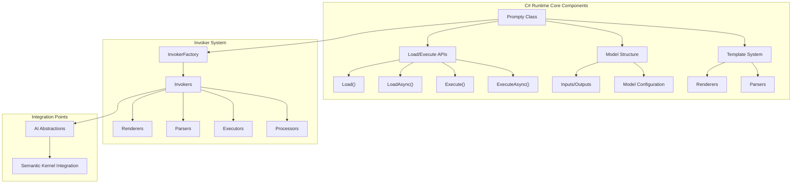
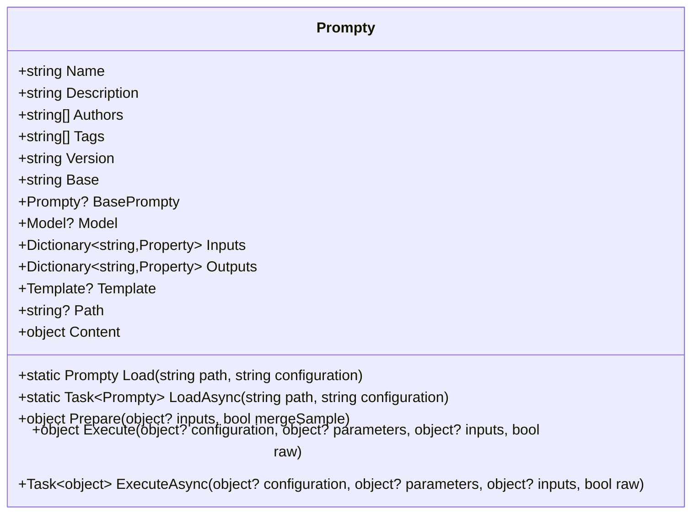
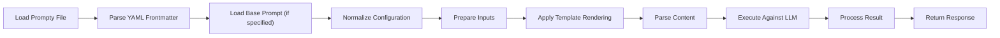
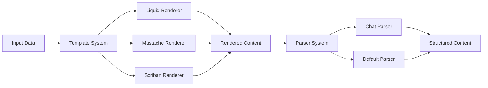
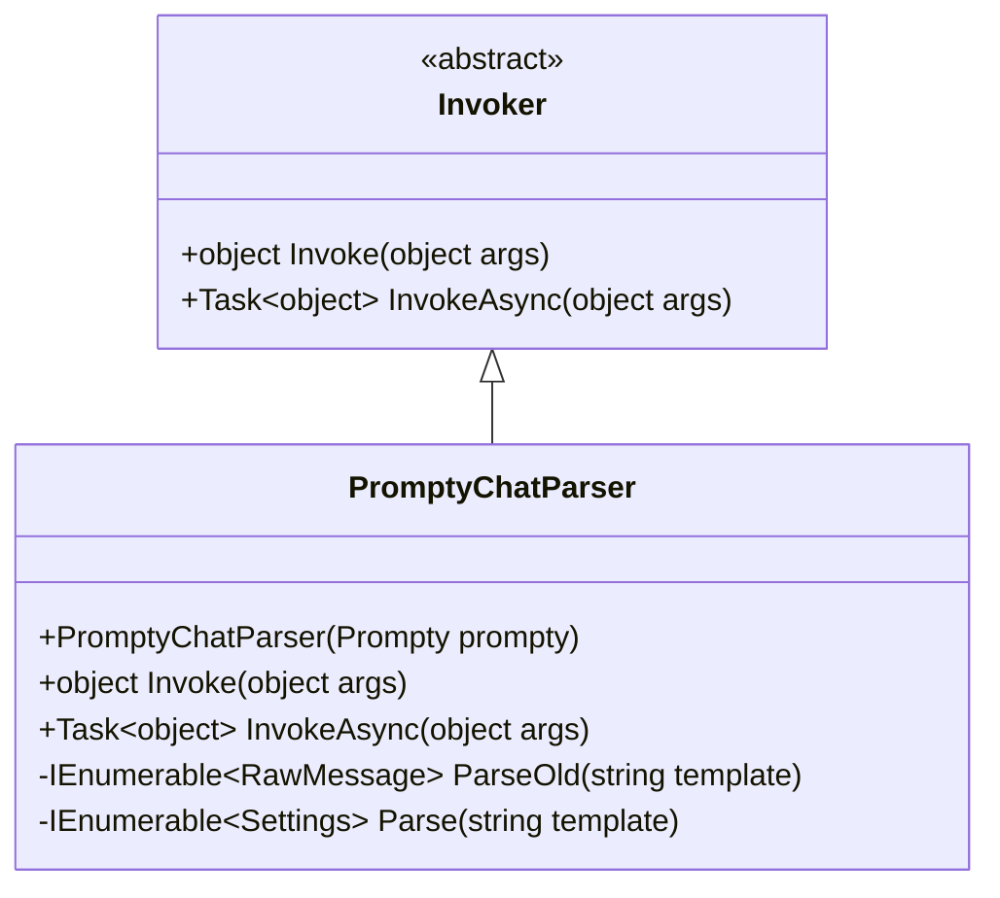
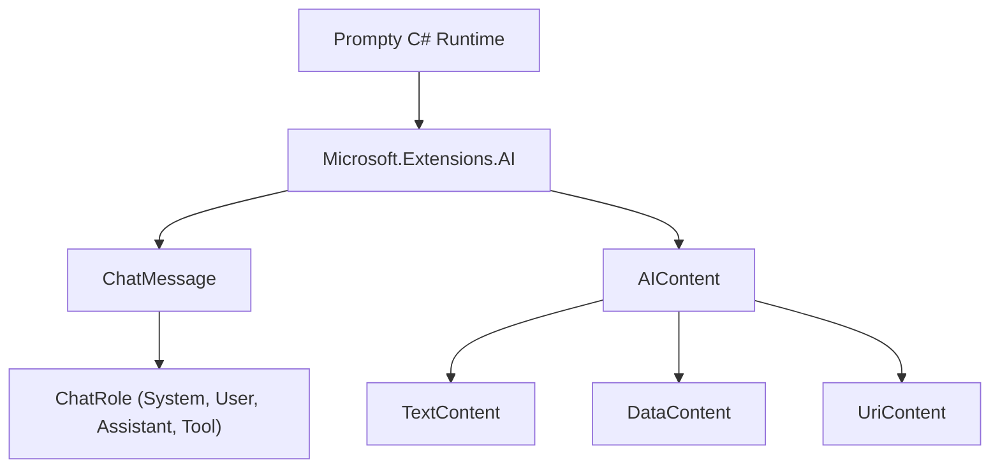

<!-- source: DeepWiki mcp.deepwiki.com · repo microsoft/prompty · page 4 C# Runtime · fetched 2026-10-26 -->

# C# Runtime

<details>
<summary>Relevant source files</summary>

The following files were used as context for generating this wiki page:

- [runtime/promptycs/Prompty.Core.Tests/LoadTests.cs](runtime/promptycs/Prompty.Core.Tests/LoadTests.cs)
- [runtime/promptycs/Prompty.Core.Tests/ParserTests.cs](runtime/promptycs/Prompty.Core.Tests/ParserTests.cs)
- [runtime/promptycs/Prompty.Core.Tests/Prompty.Core.Tests.csproj](runtime/promptycs/Prompty.Core.Tests/Prompty.Core.Tests.csproj)
- [runtime/promptycs/Prompty.Core/Model/Prompty.cs](runtime/promptycs/Prompty.Core/Model/Prompty.cs)
- [runtime/promptycs/Prompty.Core/Model/Template.cs](runtime/promptycs/Prompty.Core/Model/Template.cs)
- [runtime/promptycs/Prompty.Core/Normalizer.cs](runtime/promptycs/Prompty.Core/Normalizer.cs)
- [runtime/promptycs/Prompty.Core/Parsers/PromptyChatParser.cs](runtime/promptycs/Prompty.Core/Parsers/PromptyChatParser.cs)
- [runtime/promptycs/Prompty.Core/Prompty.Core.csproj](runtime/promptycs/Prompty.Core/Prompty.Core.csproj)
- [runtime/promptycs/Prompty.Core/Prompty.cs](runtime/promptycs/Prompty.Core/Prompty.cs)

</details>


The C# Runtime is a complete implementation of the Prompty system for .NET applications. It provides a type-safe, object-oriented approach to working with Prompty files and executing them against Large Language Models (LLMs). This runtime targets both .NET 8.0 and .NET Standard 2.0, making it compatible with a wide range of .NET applications.

For information about other language implementations, see the [Python Runtime](#3) or [JavaScript Runtime](#5).

## Overview



Sources: [runtime/promptycs/Prompty.Core/Prompty.cs:8-149](), [runtime/promptycs/Prompty.Core/Model/Prompty.cs:5-50]()

## Installation

The C# Runtime is available as a NuGet package. It supports both .NET 8.0 and .NET Standard 2.0:

```
dotnet add package Prompty.Core
```

Sources: [runtime/promptycs/Prompty.Core/Prompty.Core.csproj:3-9]()

## Core Concepts

### The Prompty Class

The `Prompty` class is the central component of the C# Runtime, representing a loaded prompty file with all its metadata, configuration, and content.



Sources: [runtime/promptycs/Prompty.Core/Model/Prompty.cs:5-50](), [runtime/promptycs/Prompty.Core/Prompty.cs:8-335]()

### Execution Pipeline

The execution pipeline in the C# Runtime follows a series of steps to process a prompt:



Sources: [runtime/promptycs/Prompty.Core/Prompty.cs:233-309]()

## API Reference

### Loading Prompty Files

The C# Runtime provides methods to load prompty files from disk or from string content:

```csharp
// Load from file path with default configuration
Prompty prompt = Prompty.Load("path/to/prompt.prompty");

// Load from file path with specific configuration
Prompty prompt = Prompty.Load("path/to/prompt.prompty", "azure");

// Load asynchronously
Prompty prompt = await Prompty.LoadAsync("path/to/prompt.prompty");
```

Sources: [runtime/promptycs/Prompty.Core/Prompty.cs:150-197]()

### Executing Prompts

The `Execute` method prepares the inputs and runs the prompt against the configured LLM:

```csharp
// Execute with default settings
object result = prompt.Execute();

// Execute with custom inputs
object result = prompt.Execute(
    inputs: new { firstName = "Jane", lastName = "Doe" }
);

// Execute with configuration overrides
object result = prompt.Execute(
    configuration: new { apiKey = "your-api-key" },
    parameters: new { temperature = 0.7 }
);

// Get raw result without post-processing
object rawResult = prompt.Execute(raw: true);

// Execute asynchronously
object result = await prompt.ExecuteAsync(inputs: new { query = "What is Prompty?" });
```

Sources: [runtime/promptycs/Prompty.Core/Prompty.cs:289-334]()

### Advanced Pipeline Control

For more control over the execution pipeline, the C# Runtime provides separate methods for preparation and execution:

```csharp
// Prepare inputs (applies template rendering and parsing)
object prepared = prompt.Prepare(new { query = "What is the meaning of life?" });

// Run prepared content against the LLM
object result = prompt.Run(prepared);

// Asynchronous versions
object prepared = await prompt.PrepareAsync(inputs);
object result = await prompt.RunAsync(prepared);
```

Sources: [runtime/promptycs/Prompty.Core/Prompty.cs:233-287]()

## Template System

The C# Runtime supports multiple template engines through its template system:



Sources: [runtime/promptycs/Prompty.Core/Model/Template.cs:1-24](), [runtime/promptycs/Prompty.Core/Parsers/PromptyChatParser.cs:27-44]()

### Template Configuration

Templates are configured in the YAML frontmatter of the prompty file:

```yaml
template:
  format: liquid    # liquid, mustache, or scriban
  parser: prompty   # prompty, prompty.chat
  strict: true      # error on missing variables
```

Sources: [runtime/promptycs/Prompty.Core/Model/Template.cs:15-21]()

## Parsers

Parsers transform the rendered template content into a structured format for the executor. The most important parser is the `PromptyChatParser`:



The chat parser supports:
- Role-based messages (system, user, assistant, tool)
- Multi-modal content (text, local images, remote images)
- Message attribute parsing

Sources: [runtime/promptycs/Prompty.Core/Parsers/PromptyChatParser.cs:27-286](), [runtime/promptycs/Prompty.Core.Tests/ParserTests.cs:7-54]()

## Configuration and Environment

The C# Runtime supports configuration through multiple mechanisms:

1. **YAML Frontmatter**: Primary configuration in the prompty file
2. **Global Configuration**: Settings in prompty.json files
3. **Environment Variables**: Access to environment-based configuration
4. **File References**: Loading configuration from external files

Configuration normalization handles special directives:
- `${env:VARIABLE_NAME}`: Load from environment variable
- `${file:path/to/file.json}`: Load from JSON file

Sources: [runtime/promptycs/Prompty.Core/Normalizer.cs:5-68]()

## Working with Inputs and Outputs

The C# Runtime provides a strongly-typed property system for inputs and outputs:

| Property Type | Description | Example Value |
|---------------|-------------|--------------|
| String | Text values | `"Hello world"` |
| Number | Numeric values | `42` or `3.14` |
| Boolean | True/false values | `true` |
| Array | Lists of values | `["one", "two", "three"]` |

Inputs can have sample values and default values:

```yaml
inputs:
  firstName:
    type: string
    sample: "Jane"
    default: "User"
    description: "The firstName description"
```

Sources: [runtime/promptycs/Prompty.Core.Tests/LoadTests.cs:40-95]()

## Integration with Microsoft.Extensions.AI

The C# Runtime integrates with Microsoft's AI abstractions through the `Microsoft.Extensions.AI.Abstractions` package:



This integration enables compatibility with other AI tools in the .NET ecosystem, including Semantic Kernel.

Sources: [runtime/promptycs/Prompty.Core/Parsers/PromptyChatParser.cs:1-44](), [runtime/promptycs/Prompty.Core/Prompty.Core.csproj:36-41]()

## Example Usage

Here's a complete example of using the C# Runtime:

```csharp
// Load a prompty file
var prompt = Prompty.Load("my-prompt.prompty");

// Execute with inputs
var result = prompt.Execute(
    inputs: new { 
        firstName = "Jane", 
        lastName = "Doe",
        question = "What is the meaning of life?"
    }
);

// Process the result
Console.WriteLine(result);

// Streaming example (async)
var streamingResult = await prompt.ExecuteAsync(
    inputs: new { query = "Tell me a story" },
    parameters: new { stream = true }
);
```

Sources: [runtime/promptycs/Prompty.Core.Tests/LoadTests.cs:14-53]()

## Working with Base Prompts

The C# Runtime supports base prompts, allowing prompts to inherit from and extend other prompts:

```yaml
base: path/to/base-prompt.prompty
```

When a prompt has a base, the runtime:
1. Loads the base prompt first
2. Hoists properties from the base prompt
3. Overrides with the extending prompt's properties

Sources: [runtime/promptycs/Prompty.Core/Model/Prompty.cs:30-32](), [runtime/promptycs/Prompty.Core/Prompty.cs:62-147]()

## Conclusion

The C# Runtime provides a comprehensive implementation of the Prompty system for .NET applications. It follows the same core concepts as the other language implementations while taking advantage of C#'s type system and async features. The runtime is designed to be extensible through the invoker pattern, allowing for custom renderers, parsers, executors, and processors.

For more details on how to integrate the C# Runtime with Semantic Kernel, see the [Semantic Kernel Integration](#8.2) page.

---

