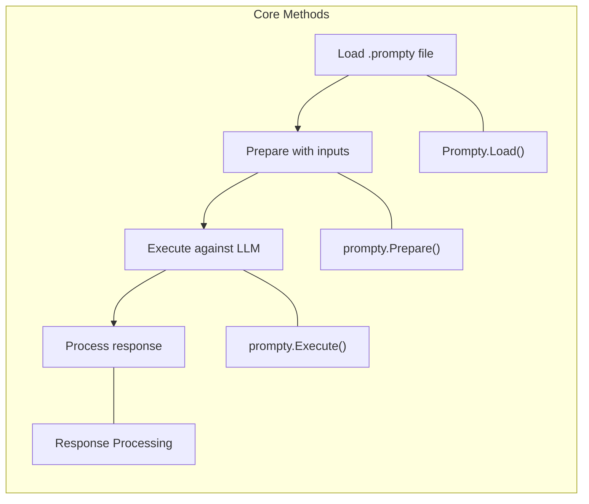
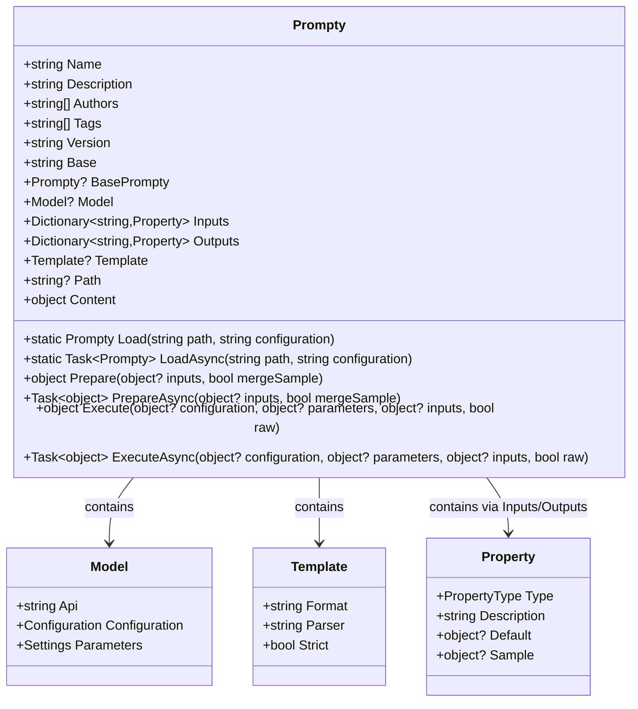
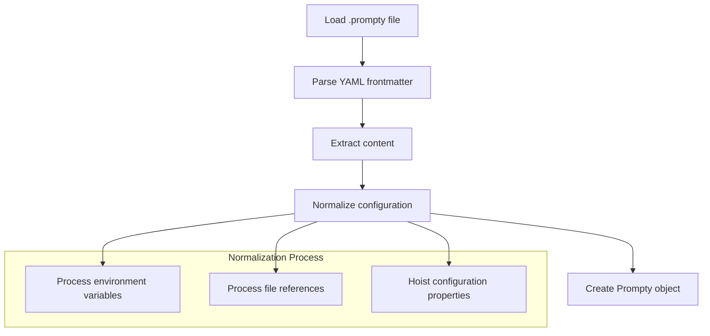
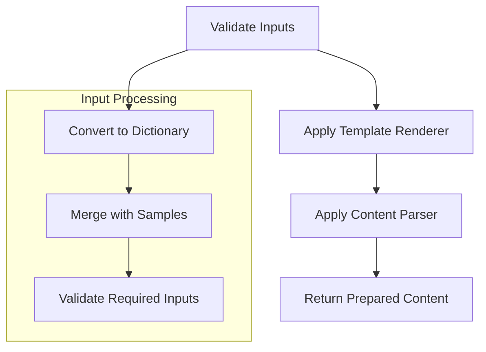
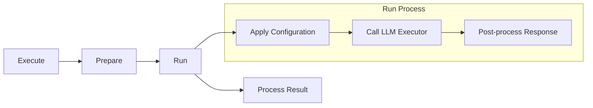
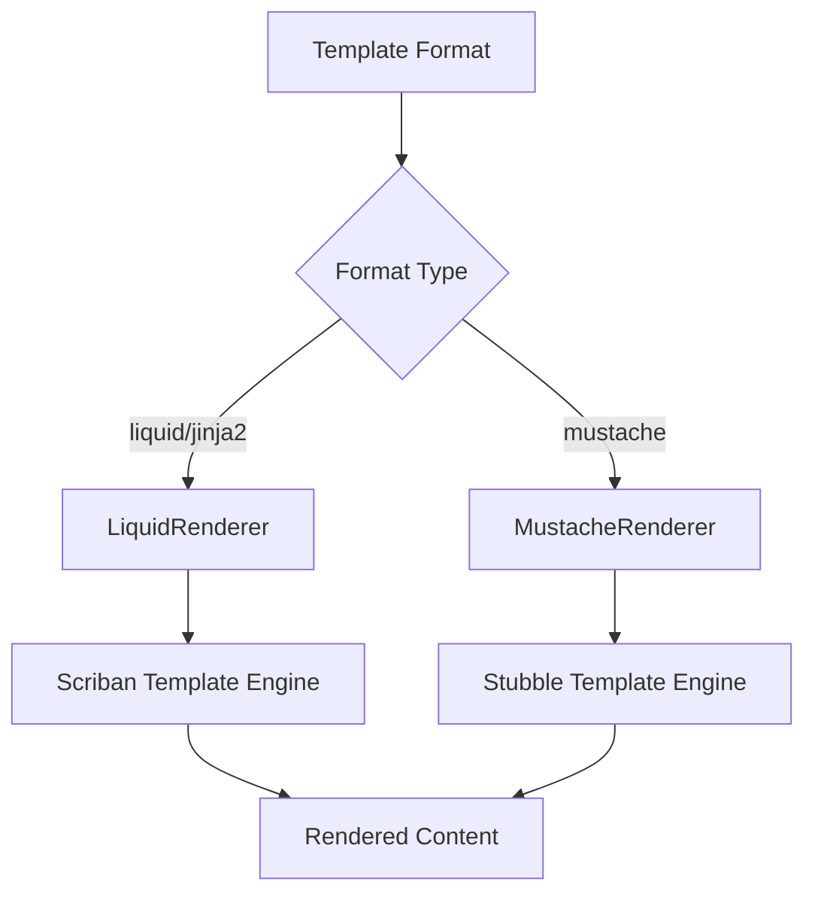
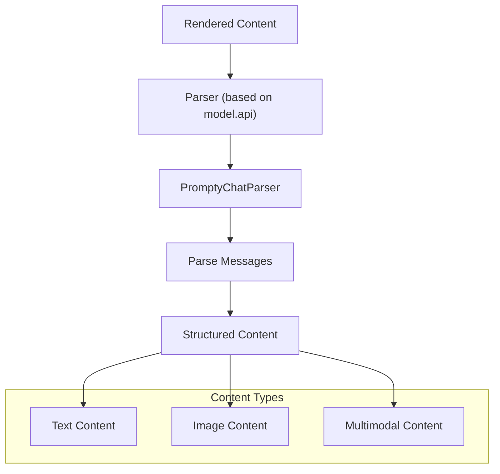
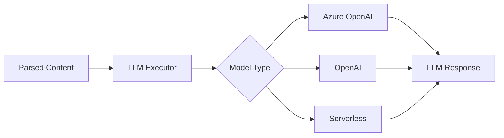

<!-- source: DeepWiki mcp.deepwiki.com · repo microsoft/prompty · page 4.1 C# API Reference · fetched 2026-10-26 -->

# C# API Reference

<details>
<summary>Relevant source files</summary>

The following files were used as context for generating this wiki page:

- [runtime/promptycs/Directory.Packages.props](runtime/promptycs/Directory.Packages.props)
- [runtime/promptycs/Prompty.Core.Tests/LoadTests.cs](runtime/promptycs/Prompty.Core.Tests/LoadTests.cs)
- [runtime/promptycs/Prompty.Core.Tests/ParserTests.cs](runtime/promptycs/Prompty.Core.Tests/ParserTests.cs)
- [runtime/promptycs/Prompty.Core.Tests/RenderererTests.cs](runtime/promptycs/Prompty.Core.Tests/RenderererTests.cs)
- [runtime/promptycs/Prompty.Core.Tests/packages.lock.json](runtime/promptycs/Prompty.Core.Tests/packages.lock.json)
- [runtime/promptycs/Prompty.Core.Tests/prompty/basic_mustache.prompty](runtime/promptycs/Prompty.Core.Tests/prompty/basic_mustache.prompty)
- [runtime/promptycs/Prompty.Core/Model/Prompty.cs](runtime/promptycs/Prompty.Core/Model/Prompty.cs)
- [runtime/promptycs/Prompty.Core/Model/Template.cs](runtime/promptycs/Prompty.Core/Model/Template.cs)
- [runtime/promptycs/Prompty.Core/Normalizer.cs](runtime/promptycs/Prompty.Core/Normalizer.cs)
- [runtime/promptycs/Prompty.Core/Parsers/PromptyChatParser.cs](runtime/promptycs/Prompty.Core/Parsers/PromptyChatParser.cs)
- [runtime/promptycs/Prompty.Core/Prompty.cs](runtime/promptycs/Prompty.Core/Prompty.cs)
- [runtime/promptycs/Prompty.Core/Renderers/LiquidRenderer.cs](runtime/promptycs/Prompty.Core/Renderers/LiquidRenderer.cs)
- [runtime/promptycs/Prompty.Core/Renderers/MustacheRenderer.cs](runtime/promptycs/Prompty.Core/Renderers/MustacheRenderer.cs)
- [runtime/promptycs/Prompty.Core/packages.lock.json](runtime/promptycs/Prompty.Core/packages.lock.json)

</details>


This document provides a comprehensive reference for the C# implementation of the Prompty runtime. It covers the core API methods and classes needed to work with .prompty files in C# applications. For information about the Prompty file format itself, see [Prompty File Format](#2).

## Core Concepts

The C# Prompty runtime allows you to load, prepare, and execute prompts against various LLM providers. The main workflow typically involves:

1. Loading a .prompty file
2. Optionally preparing it with inputs
3. Executing it against an LLM provider
4. Processing the results



Sources: [runtime/promptycs/Prompty.Core/Prompty.cs:150-335]()

## Class Structure

The C# implementation centers around the `Prompty` class which encapsulates all functionality for working with prompts.



Sources: [runtime/promptycs/Prompty.Core/Model/Prompty.cs:1-50](), [runtime/promptycs/Prompty.Core/Prompty.cs:8-335]()

## Loading Prompts

The `Prompty` class provides several static methods to load .prompty files:

| Method | Description |
|--------|-------------|
| `Prompty.Load(string path, string configuration = "default")` | Loads a .prompty file from a given file path using the specified configuration |
| `Prompty.LoadAsync(string path, string configuration = "default")` | Asynchronously loads a .prompty file from a given file path |
| `Prompty.Load(string text, Dictionary<string, object> globalConfig, string? path = null)` | Loads a .prompty file from raw text content with provided configuration |

### Example Usage

```csharp
// Load a prompt file with default configuration
var prompt = Prompty.Load("path/to/file.prompty");

// Load with custom configuration
var prompt = Prompty.Load("path/to/file.prompty", "azure");

// Load asynchronously
var prompt = await Prompty.LoadAsync("path/to/file.prompty");
```

Sources: [runtime/promptycs/Prompty.Core/Prompty.cs:150-197](), [runtime/promptycs/Prompty.Core.Tests/LoadTests.cs:14-53]()

## Loading Process

When loading a .prompty file, the following operations occur:



Sources: [runtime/promptycs/Prompty.Core/Prompty.cs:62-147](), [runtime/promptycs/Prompty.Core/Normalizer.cs:1-69]()

## Preparing Prompts

After loading a prompt, you'll typically need to prepare it with input values:

| Method | Description |
|--------|-------------|
| `Prepare(object? inputs = null, bool mergeSample = false)` | Prepares the prompt by applying input values and rendering the template |
| `PrepareAsync(object? inputs = null, bool mergeSample = false)` | Asynchronously prepares the prompt |

### Preparation Process



Sources: [runtime/promptycs/Prompty.Core/Prompty.cs:233-247](), [runtime/promptycs/Prompty.Core/Prompty.cs:215-231]()

## Executing Prompts

The core functionality revolves around executing prompts against LLM providers:

| Method | Description |
|--------|-------------|
| `Execute(object? configuration = null, object? parameters = null, object? inputs = null, bool raw = false)` | Prepares and executes the prompt with the given inputs and configuration |
| `ExecuteAsync(object? configuration = null, object? parameters = null, object? inputs = null, bool raw = false)` | Asynchronously executes the prompt |
| `static Execute(string prompty, ...)` | Static method to load and execute a prompt in one call |
| `static ExecuteAsync(string prompty, ...)` | Static async method to load and execute a prompt |

### Execution Process

The execution process combines preparation with running against an LLM:



Sources: [runtime/promptycs/Prompty.Core/Prompty.cs:289-334](), [runtime/promptycs/Prompty.Core/Prompty.cs:249-287]()

## Templating System

The Prompty C# runtime supports multiple template formats including:

| Format | Renderer | Description |
|--------|----------|-------------|
| `liquid` | `LiquidRenderer` | Liquid/Jinja2 template syntax |
| `mustache` | `MustacheRenderer` | Mustache template syntax |

### Templating Architecture



Sources: [runtime/promptycs/Prompty.Core/Renderers/LiquidRenderer.cs:1-23](), [runtime/promptycs/Prompty.Core/Renderers/MustacheRenderer.cs:1-20](), [runtime/promptycs/Prompty.Core/Model/Template.cs:1-23]()

## Parsing System

After rendering, the content is parsed into a format suitable for the target LLM API:



Sources: [runtime/promptycs/Prompty.Core/Parsers/PromptyChatParser.cs:1-286]()

## Execution System

The execution system is responsible for calling the LLM provider:



Sources: [runtime/promptycs/Prompty.Core/Prompty.cs:22-60]()

## Complete API Reference

### Prompty Class

The main class that represents a loaded prompt:

| Property | Type | Description |
|----------|------|-------------|
| `Name` | `string` | Name of the prompt |
| `Description` | `string` | Description of the prompt |
| `Authors` | `string[]` | Array of authors |
| `Tags` | `string[]` | Array of tags |
| `Version` | `string` | Version of the prompt |
| `Base` | `string` | Path to base prompt (for inheritance) |
| `BasePrompty` | `Prompty?` | Loaded base prompt (if any) |
| `Model` | `Model?` | Model configuration |
| `Inputs` | `Dictionary<string, Property>` | Input properties |
| `Outputs` | `Dictionary<string, Property>` | Output properties |
| `Template` | `Template?` | Template configuration |
| `Path` | `string?` | File path of the prompt |
| `Content` | `object` | Content of the prompt |

#### Static Methods

| Method | Description |
|--------|-------------|
| `Load(string path, string configuration = "default")` | Load a prompt from a file path |
| `LoadAsync(string path, string configuration = "default")` | Asynchronously load a prompt |
| `Load(string text, Dictionary<string, object> globalConfig, string? path = null)` | Load a prompt from text |
| `Execute(string prompty, object? configuration = null, object? parameters = null, object? inputs = null, string? config = "default", bool raw = false)` | Load and execute a prompt |
| `ExecuteAsync(string prompty, object? configuration = null, object? parameters = null, object? inputs = null, string? config = "default", bool raw = false)` | Asynchronously load and execute a prompt |

#### Instance Methods

| Method | Description |
|--------|-------------|
| `GetSample()` | Get sample inputs from the prompt |
| `ValidateInputs(object? inputs, bool mergeSample = false)` | Validate input values |
| `Prepare(object? inputs = null, bool mergeSample = false)` | Prepare a prompt with inputs |
| `PrepareAsync(object? inputs = null, bool mergeSample = false)` | Asynchronously prepare a prompt |
| `Run(object content, object? configuration = null, object? parameters = null, bool raw = false)` | Run a prepared prompt |
| `RunAsync(object content, object? configuration = null, object? parameters = null, bool raw = false)` | Asynchronously run a prepared prompt |
| `Execute(object? configuration = null, object? parameters = null, object? inputs = null, bool raw = false)` | Prepare and execute a prompt |
| `ExecuteAsync(object? configuration = null, object? parameters = null, object? inputs = null, bool raw = false)` | Asynchronously prepare and execute a prompt |

Sources: [runtime/promptycs/Prompty.Core/Prompty.cs:8-335](), [runtime/promptycs/Prompty.Core/Model/Prompty.cs:1-50]()

### Model Class

Represents the model configuration for a prompt:

| Property | Type | Description |
|----------|------|-------------|
| `Api` | `string` | API type (e.g., "chat") |
| `Configuration` | `Configuration` | Model configuration settings |
| `Parameters` | `Settings` | Model parameters |

### Template Class

Represents the template configuration:

| Property | Type | Description |
|----------|------|-------------|
| `Format` | `string` | Template format (e.g., "liquid", "mustache") |
| `Parser` | `string` | Parser to use (e.g., "prompty") |
| `Strict` | `bool` | Whether strict mode is enabled |

Sources: [runtime/promptycs/Prompty.Core/Model/Template.cs:1-23]()

### Property Class

Represents an input or output property:

| Property | Type | Description |
|----------|------|-------------|
| `Type` | `PropertyType` | Type of the property (String, Number, Boolean, Array) |
| `Description` | `string` | Description of the property |
| `Default` | `object?` | Default value |
| `Sample` | `object?` | Sample value |

## Dependencies

The C# Prompty runtime has the following key dependencies:

| Package | Purpose |
|---------|---------|
| `Microsoft.Extensions.AI.Abstractions` | For AI content types and chat messages |
| `YamlDotNet` | For parsing YAML frontmatter |
| `Scriban` | For Liquid/Jinja2 templating |
| `Stubble.Core` | For Mustache templating |
| `Microsoft.Extensions.Configuration` | For configuration management |

Sources: [runtime/promptycs/Prompty.Core/packages.lock.json:1-338](), [runtime/promptycs/Directory.Packages.props:1-21]()

## Usage Examples

### Basic Usage

```csharp
// Load a prompt from a file
var prompt = Prompty.Load("path/to/my.prompty");

// Execute with inputs
var result = prompt.Execute(inputs: new {
    firstName = "Jane",
    lastName = "Doe",
    question = "What is the meaning of life?"
});

// Process the result
Console.WriteLine(result.ToString());
```

### Asynchronous Usage

```csharp
// Load a prompt asynchronously 
var prompt = await Prompty.LoadAsync("path/to/my.prompty");

// Execute asynchronously
var result = await prompt.ExecuteAsync(inputs: new {
    firstName = "Jane",
    lastName = "Doe",
    question = "What is the meaning of life?"
});
```

### Custom Configuration

```csharp
// Load with custom configuration
var prompt = Prompty.Load("path/to/my.prompty", "azure");

// Execute with custom configuration
var result = prompt.Execute(
    configuration: new {
        type = "azure",
        api_key = "your-api-key",
        endpoint = "your-endpoint"  
    },
    parameters: new {
        temperature = 0.7,
        max_tokens = 500
    },
    inputs: new {
        question = "What is the weather like today?"
    }
);
```

Sources: [runtime/promptycs/Prompty.Core.Tests/LoadTests.cs:14-95](), [runtime/promptycs/Prompty.Core.Tests/RenderererTests.cs:1-44]()

---

