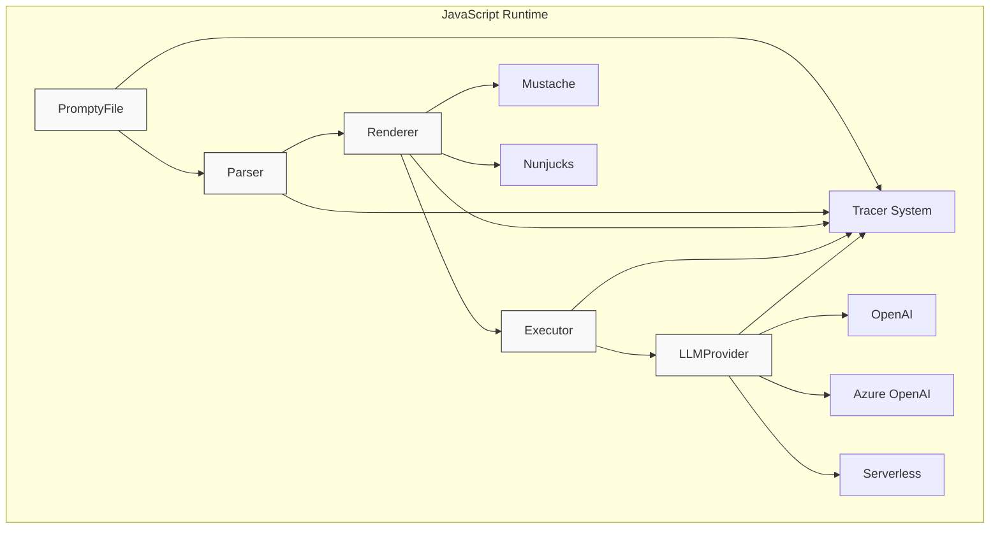
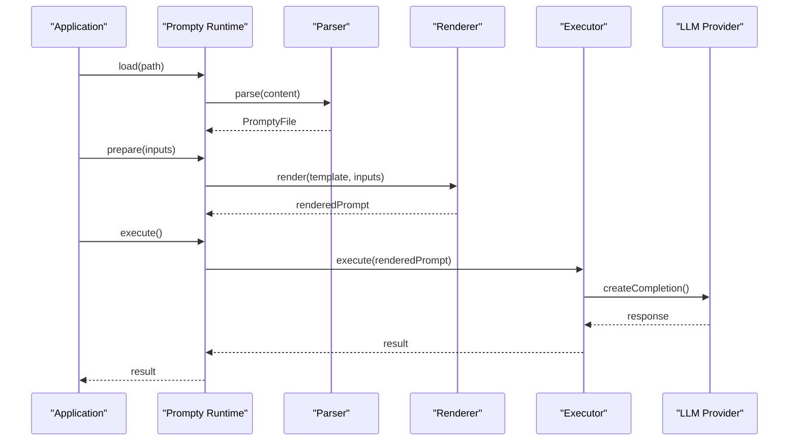
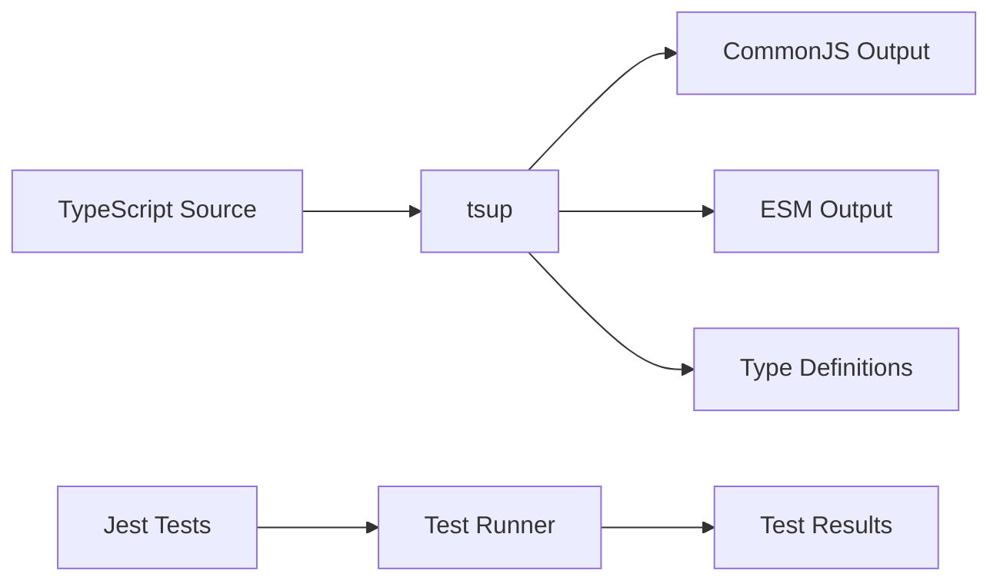

<!-- source: DeepWiki mcp.deepwiki.com · repo microsoft/prompty · page 5 JavaScript Runtime · fetched 2026-10-26 -->

# JavaScript Runtime

<details>
<summary>Relevant source files</summary>

The following files were used as context for generating this wiki page:

- [.github/workflows/prompty-js-check.yml](.github/workflows/prompty-js-check.yml)
- [runtime/promptyjs/package-lock.json](runtime/promptyjs/package-lock.json)
- [runtime/promptyjs/package.json](runtime/promptyjs/package.json)
- [runtime/promptyjs/src/tracer.ts](runtime/promptyjs/src/tracer.ts)

</details>


The JavaScript implementation of the Prompty runtime provides a Node.js-based solution for working with `.prompty` files. This runtime enables JavaScript and TypeScript developers to define, load, and execute prompts against various Large Language Model (LLM) providers using the standardized Prompty format.

For information about other language implementations, see [Python Runtime](#3) and [C# Runtime](#4).

## Architecture Overview

The JavaScript runtime follows the same core architecture as other Prompty language implementations, implementing the standard components and patterns while utilizing JavaScript/TypeScript idioms and ecosystem tools.



Sources: [runtime/promptyjs/package.json]()

## Core Components

The JavaScript runtime implements the standard Prompty architecture with the following key components:

### File Format Handler

The runtime uses `gray-matter` to parse the YAML frontmatter and content sections of `.prompty` files. This allows developers to define prompts with metadata, model configuration, and template settings in a standardized format.

```mermaid
classDiagram
    class "PromptyFile" {
        +string content
        +object metadata
        +ModelConfig modelConfig
        +boolean isChat
        +load(path: string)
        +parse(content: string)
    }
    
    class "ModelConfig" {
        +string provider
        +string model
        +number temperature
        +number maxTokens
        +object parameters
    }
    
    "PromptyFile" --> "ModelConfig"
```

Sources: [runtime/promptyjs/package.json]()

### Template Rendering

The JavaScript runtime supports multiple template engines:

1. **Mustache** - A logic-less template syntax
2. **Nunjucks** - A rich and powerful templating language inspired by Jinja2

These templating engines allow for variable substitution and conditionals within prompts, making them adaptable to different inputs.

### LLM Providers

The runtime integrates with the following LLM providers:

1. **OpenAI** - Direct integration with OpenAI's API
2. **Azure OpenAI** - Integration with Microsoft's Azure-hosted OpenAI services
3. **Serverless** - Support for serverless deployment configurations

The integration uses the official OpenAI Node.js client library (`openai@^4.33.0`).

### Execution Flow



Sources: [runtime/promptyjs/package.json]()

## Tracing and Observability

The JavaScript runtime includes a comprehensive tracing system for observability and debugging of prompt execution. The tracing system allows developers to monitor the entire lifecycle of a prompt, from loading and parsing to rendering and execution.

```mermaid
classDiagram
    class "Tracer" {
        +static _tracers
        +static add(name, tracer)
        +static start(name, attributes)
    }
    
    class "TraceInstance" {
        +trace(key, value)
        +end()
    }
    
    class "trace" {
        <<decorator>>
        +wraps method for tracing
    }
    
    "Tracer" --> "TraceInstance" : creates
```

Sources: [runtime/promptyjs/src/tracer.ts:1-98]()

The tracing system provides a decorator pattern for method tracing, allowing automatic tracing of method inputs and outputs:

```typescript
@trace()
async executePrompt(prompt: string, options: any) {
  // Method implementation
  return result;
}
```

The decorator automatically creates a trace span for the method, captures input parameters, and records the output or error response.

## Dependencies and Requirements

The JavaScript runtime has the following dependencies:

| Dependency | Purpose |
|------------|---------|
| base-64 | Encoding/decoding utilities |
| glob | File pattern matching |
| gray-matter | Front matter parsing |
| js-yaml | YAML parsing |
| mustache | Template rendering |
| nunjucks | Template rendering |
| openai | OpenAI API client |

### Node.js Compatibility

The JavaScript runtime is tested and supported on:

- Node.js 16.x
- Node.js 20.x

It's tested across multiple operating systems:
- Windows
- macOS
- Ubuntu (Linux)

Sources: [runtime/promptyjs/package.json:1-48](), [.github/workflows/prompty-js-check.yml:1-42]()

## Building and Testing

The JavaScript runtime uses TypeScript for type safety and Jest for testing. The project uses `tsup` for bundling and provides both CommonJS and ESM module formats.



### Build Commands

- `npm run build` - Builds the project
- `npm run dev` - Watches for changes and rebuilds
- `npm test` - Runs the test suite
- `npm run test:watch` - Runs tests in watch mode

Sources: [runtime/promptyjs/package.json:11-17]()

## Usage Example

Basic usage of the JavaScript runtime involves loading a `.prompty` file, preparing it with inputs, and executing it:

```javascript
import { Prompty } from 'promptyjs';

// Load a prompt file
const prompt = await Prompty.load('./prompts/my-prompt.prompty');

// Prepare the prompt with input values
const prepared = await prompt.prepare({
  input1: 'value1',
  input2: 'value2'
});

// Execute the prompt against an LLM
const result = await prepared.execute();

console.log(result.content);
```

For streaming responses, the runtime provides a stream interface:

```javascript
const stream = await prepared.executeStream();

for await (const chunk of stream) {
  process.stdout.write(chunk.content);
}
```

Sources: [runtime/promptyjs/package.json]()

## Continuous Integration

The JavaScript runtime includes a CI workflow that:

1. Builds the package
2. Runs tests across multiple Node.js versions and operating systems
3. Ensures cross-platform compatibility

This ensures the runtime works consistently across different environments.

Sources: [.github/workflows/prompty-js-check.yml:1-42]()

---

