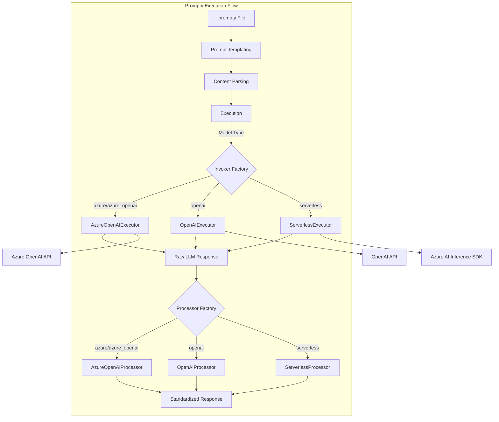
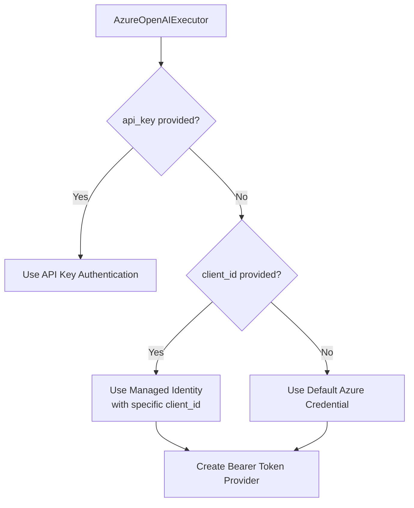
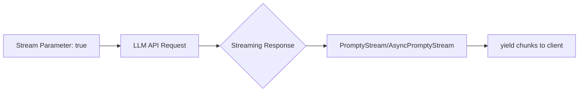
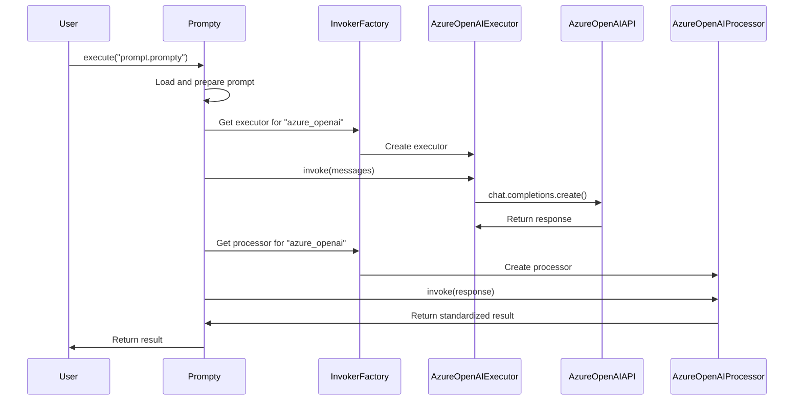

<!-- source: DeepWiki mcp.deepwiki.com · repo microsoft/prompty · page 6 LLM Integration · fetched 2026-10-26 -->

# LLM Integration

<details>
<summary>Relevant source files</summary>

The following files were used as context for generating this wiki page:

- [runtime/prompty/prompty/azure/executor.py](runtime/prompty/prompty/azure/executor.py)
- [runtime/prompty/prompty/azure/processor.py](runtime/prompty/prompty/azure/processor.py)
- [runtime/prompty/prompty/openai/executor.py](runtime/prompty/prompty/openai/executor.py)
- [runtime/prompty/prompty/parsers.py](runtime/prompty/prompty/parsers.py)
- [runtime/prompty/prompty/serverless/executor.py](runtime/prompty/prompty/serverless/executor.py)
- [runtime/prompty/prompty/serverless/processor.py](runtime/prompty/prompty/serverless/processor.py)
- [runtime/prompty/tests/__init__.py](runtime/prompty/tests/__init__.py)
- [runtime/prompty/tests/fake_azure_executor.py](runtime/prompty/tests/fake_azure_executor.py)
- [runtime/prompty/tests/fake_serverless_executor.py](runtime/prompty/tests/fake_serverless_executor.py)
- [runtime/prompty/tests/test_execute.py](runtime/prompty/tests/test_execute.py)

</details>


## Overview

This document provides technical documentation on how Prompty integrates with various Large Language Model (LLM) providers. The integration layer forms a critical part of the Prompty architecture, enabling seamless communication with different LLM services through a consistent interface.

This page focuses specifically on the implementation details of how Prompty connects to LLM providers. For information about the Prompty file format itself, see [Prompty File Format](#2), and for details on the execution runtime, see the language-specific runtime documentation ([Python Runtime](#3), [C# Runtime](#4), [JavaScript Runtime](#5)).

## Supported LLM Providers

Prompty currently integrates with the following LLM providers:

- **Azure OpenAI Service**: Microsoft's managed service for OpenAI models
- **OpenAI API**: Direct integration with OpenAI's API
- **Serverless (Azure AI Inference)**: Integration with Azure's serverless AI inference services

Each provider is implemented through dedicated executor and processor components following the invoker pattern in Prompty's architecture.

## Executor Architecture

The LLM integration in Prompty follows a modular architecture based on the invoker pattern, allowing for consistent interaction with different LLM providers.

### LLM Integration Architecture



Sources: [prompty/azure/executor.py:1-255](), [prompty/openai/executor.py:1-119](), [prompty/serverless/executor.py:1-257](), [prompty/azure/processor.py:1-156](), [prompty/serverless/processor.py:1-118]()

### Invoker Pattern

The integration architecture uses a registration system through `InvokerFactory` to dynamically create the appropriate executor and processor based on the model configuration specified in the `.prompty` file.

```mermaid
classDiagram
    class "Invoker" {
        +__init__(prompty: Prompty)
        +invoke(data: Any) -> Any
        +invoke_async(data: Any) -> Any
    }
    
    class "InvokerFactory" {
        +register_executor(type: str)
        +register_processor(type: str)
        +get_executor(type: str, prompty: Prompty) -> Invoker
        +get_processor(type: str, prompty: Prompty) -> Invoker
    }
    
    class "AzureOpenAIExecutor" {
        +invoke(data: Any) -> Any
        +invoke_async(data: Any) -> Any
    }
    
    class "OpenAIExecutor" {
        +invoke(data: Any) -> Any
        +invoke_async(data: Any) -> Any
    }
    
    class "ServerlessExecutor" {
        +invoke(data: Any) -> Any
        +invoke_async(data: Any) -> Any
    }
    
    Invoker <|-- AzureOpenAIExecutor
    Invoker <|-- OpenAIExecutor
    Invoker <|-- ServerlessExecutor
    
    InvokerFactory --> Invoker : creates
```

Sources: [prompty/azure/executor.py:17-19](), [prompty/openai/executor.py:15-16](), [prompty/serverless/executor.py:29-30]()

## Supported APIs

Each LLM provider supports different API types:

| API Type | Azure OpenAI | OpenAI | Serverless |
|----------|-------------|--------|------------|
| Chat | ✓ | ✓ | ✓ |
| Completion | ✓ | ✓ | ✗ |
| Embedding | ✓ | ✓ | ✓ |
| Image | ✓ | ✗ | ✗ |

Sources: [prompty/azure/executor.py:88-143](), [prompty/openai/executor.py:63-94](), [prompty/serverless/executor.py:96-163]()

## Azure OpenAI Integration

Azure OpenAI integration provides connectivity to Microsoft's managed OpenAI services.

### Configuration

The Azure OpenAI executor is configured with the following properties in the `.prompty` file:

```yaml
model:
  type: azure_openai
  azure_deployment: deployment-name
  api_key: your-api-key  # Optional if using Azure Identity
  api_version: 2023-05-15
  endpoint: https://your-resource.openai.azure.com/
```

Authentication can be configured in multiple ways:
1. Using an API key directly
2. Using Azure Identity with Default Azure Credential
3. Using a specific Managed Identity with client ID

Sources: [prompty/azure/executor.py:22-54]()

### Authentication Options



Sources: [prompty/azure/executor.py:30-50]()

### Implementation Details

The Azure OpenAI executor supports both synchronous and asynchronous operations. It handles:

1. **Chat completions**: Sending messages to the chat API
2. **Completions**: Traditional completion API
3. **Embeddings**: Generating vector embeddings
4. **Image generation**: Creating images from text prompts

The executor uses the official OpenAI Python SDK to communicate with Azure OpenAI endpoints.

Sources: [prompty/azure/executor.py:56-254]()

## OpenAI Integration

OpenAI integration provides direct access to OpenAI's API services.

### Configuration

The OpenAI executor is configured with the following properties:

```yaml
model:
  type: openai
  name: gpt-4
  deployment: gpt-4
  api_key: your-api-key
```

Authentication is limited to API key only.

Sources: [prompty/openai/executor.py:19-31]()

### Implementation Details

The OpenAI executor supports both synchronous and asynchronous operations through the OpenAI Python SDK. Notably, it implements:

1. **Chat completions**: Core chat functionality
2. **Completions**: Traditional completion API
3. **Embeddings**: Generating vector embeddings
4. **Image generation**: Not currently implemented

Sources: [prompty/openai/executor.py:32-118]()

## Serverless Integration

Serverless integration connects to Azure's AI Inference services through a unified inference SDK.

### Configuration

The Serverless executor is configured with:

```yaml
model:
  type: serverless
  endpoint: https://your-endpoint.inference.ai.azure.com/
  model: your-model-name
  key: your-key  # Optional if using Azure Identity
```

Authentication can use either API key or Azure Identity.

Sources: [prompty/serverless/executor.py:31-54]()

### Implementation Details

The Serverless executor uses the Azure AI Inference SDK to communicate with AI inference endpoints. It supports:

1. **Chat completions**: Core chat functionality
2. **Completions**: Not implemented
3. **Embeddings**: Generating vector embeddings
4. **Image generation**: Not implemented

This implementation provides a more modern approach to accessing Azure AI services, especially for chat completions and embeddings.

Sources: [prompty/serverless/executor.py:77-256]()

## Response Processing

Each LLM provider returns responses in different formats. Prompty standardizes these responses through dedicated processors.

### Azure OpenAI Processor

The Azure OpenAI processor handles:
- Chat completions with message responses
- Tool calls responses (for function calling)
- Embedding vectors
- Image generation results
- Streaming responses

Sources: [prompty/azure/processor.py:13-155]()

### Serverless Processor

The Serverless processor standardizes responses from the Azure AI Inference SDK:
- Chat completions
- Embedding vectors
- Streaming responses

Sources: [prompty/serverless/processor.py:10-117]()

## Streaming Support

All three integrations support streaming responses for chat completions, which is critical for real-time applications. Streaming is handled through the `PromptyStream` and `AsyncPromptyStream` classes.



Sources: [prompty/azure/executor.py:97-101](), [prompty/azure/processor.py:79-90](), [prompty/serverless/executor.py:60-75](), [prompty/serverless/processor.py:54-65]()

## Function Calling and Tool Use

Azure OpenAI integration supports function calling through the processing of `tool_calls` in responses. This allows for implementing agents that can decide when to call external functions.

Sources: [prompty/azure/processor.py:45-57](), [prompty/serverless/processor.py:33-45]()

## Testing and Development

For development and testing purposes, Prompty includes fake executors that simulate LLM responses without making actual API calls:

- `FakeAzureExecutor`: Simulates Azure OpenAI responses
- `FakeServerlessExecutor`: Simulates Serverless responses

These fake executors use cached responses saved as JSON files, which makes testing faster and more deterministic.

Sources: [tests/fake_azure_executor.py:1-114](), [tests/fake_serverless_executor.py:1-91](), [tests/test_execute.py:19-30]()

## Execution Example Flow

A typical execution flow for integrating with an LLM provider follows these steps:



Sources: [tests/test_execute.py:48-51](), [tests/test_execute.py:69-71]()

## Conclusion

Prompty's LLM integration architecture provides a flexible, extensible system for connecting to various LLM providers. By abstracting the specifics of each provider behind a consistent interface, Prompty enables developers to focus on prompt engineering rather than integration details.

For more specific details on using each integration in your specific runtime environment, refer to the language-specific documentation ([Python Runtime](#3), [C# Runtime](#4), [JavaScript Runtime](#5)).

---

