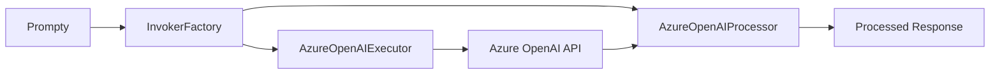
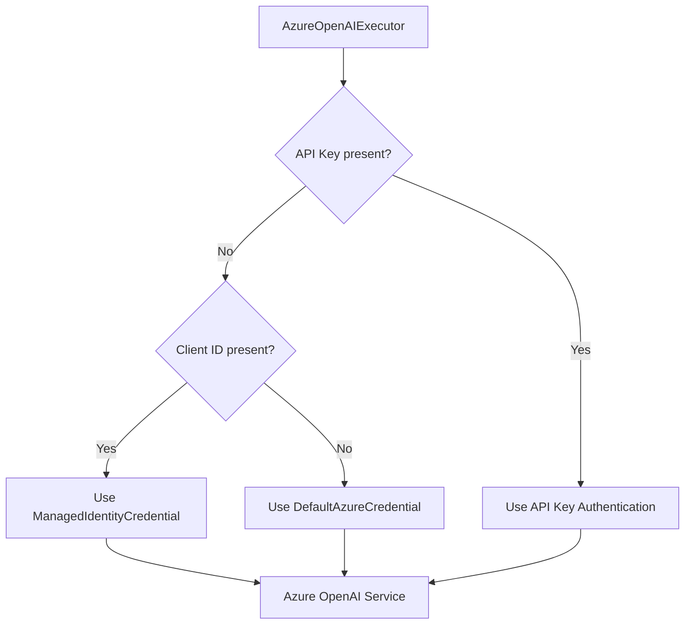
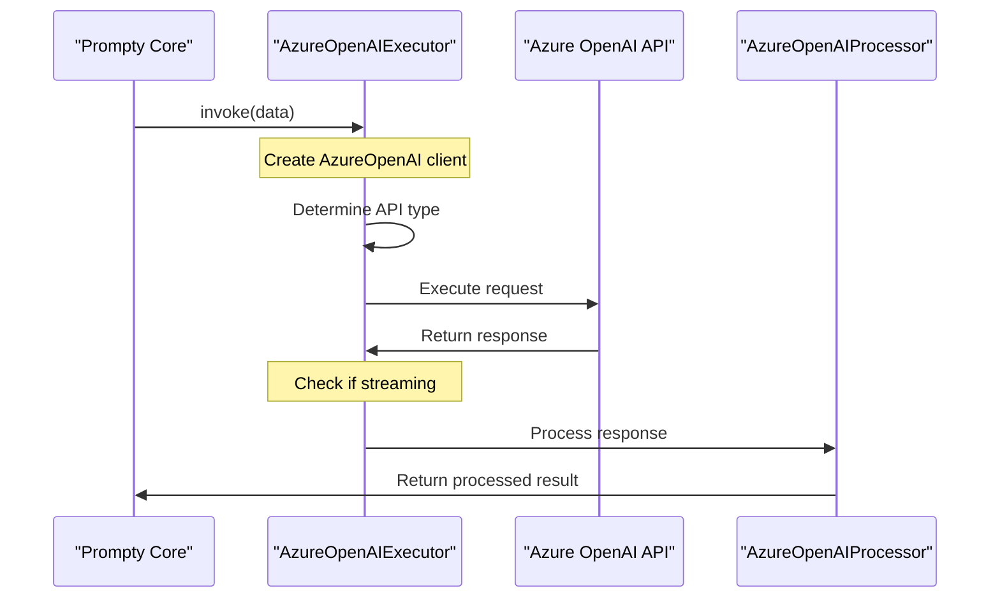
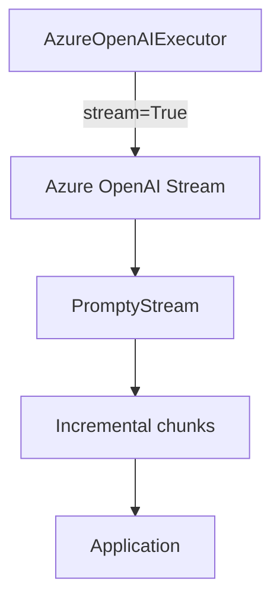

<!-- source: DeepWiki mcp.deepwiki.com · repo microsoft/prompty · page 6.1 Azure OpenAI Integration · fetched 2026-10-26 -->

# Azure OpenAI Integration

<details>
<summary>Relevant source files</summary>

The following files were used as context for generating this wiki page:

- [runtime/prompty/prompty/azure/executor.py](runtime/prompty/prompty/azure/executor.py)
- [runtime/prompty/prompty/azure/processor.py](runtime/prompty/prompty/azure/processor.py)
- [runtime/prompty/prompty/openai/executor.py](runtime/prompty/prompty/openai/executor.py)
- [runtime/prompty/prompty/serverless/executor.py](runtime/prompty/prompty/serverless/executor.py)
- [runtime/prompty/prompty/serverless/processor.py](runtime/prompty/prompty/serverless/processor.py)
- [runtime/prompty/tests/fake_azure_executor.py](runtime/prompty/tests/fake_azure_executor.py)
- [runtime/prompty/tests/fake_serverless_executor.py](runtime/prompty/tests/fake_serverless_executor.py)

</details>


This document details how Prompty integrates with Azure OpenAI, allowing developers to use Azure-hosted language models within the Prompty ecosystem. For information about standard OpenAI integration, see [OpenAI Integration](#6.2), and for serverless options using the Azure AI SDK, see [Serverless Integration](#6.3).

## Architecture

The Azure OpenAI integration in Prompty follows the Invoker pattern, which separates the execution of prompts from the processing of responses. Two main components handle Azure OpenAI integration:



Sources: [runtime/prompty/prompty/azure/executor.py:17-19](), [runtime/prompty/prompty/azure/processor.py:13-16]()

## Authentication Methods

Prompty supports multiple authentication methods for Azure OpenAI:



1. **API Key Authentication**: Provide an `api_key` in the model configuration
2. **Managed Identity Authentication**: Uses `ManagedIdentityCredential` with a specified `client_id`
3. **Default Azure Credentials**: Uses `DefaultAzureCredential` when neither API key nor client ID is provided

Sources: [runtime/prompty/prompty/azure/executor.py:30-50]()

## Supported API Types

The Azure OpenAI executor supports multiple API types:

| API Type | Description | Method |
|----------|-------------|--------|
| `chat` | Chat completions API | `client.chat.completions.create()` |
| `completion` | Text completions API | `client.completions.create()` |
| `embedding` | Text embeddings API | `client.embeddings.create()` |
| `image` | Image generation API | `client.images.generate()` |

Sources: [runtime/prompty/prompty/azure/executor.py:88-143]()

## Execution Flow

When a prompt is executed with the Azure OpenAI executor, it follows this flow:



Sources: [runtime/prompty/prompty/azure/executor.py:56-154](), [runtime/prompty/prompty/azure/processor.py:17-92]()

## Configuration

The Azure OpenAI executor is configured through the model configuration in the Prompty file's YAML frontmatter:

```yaml
model:
  type: azure
  azure_deployment: gpt-4
  endpoint: https://your-resource.openai.azure.com/
  api_key: your-api-key  # Optional if using Azure AD auth
  api_version: 2023-05-15  # Optional
```

Required and optional configuration parameters:

| Parameter | Description | Required |
|-----------|-------------|:--------:|
| `type` | Set to "azure" or "azure_openai" | Yes |
| `azure_deployment` | Azure OpenAI deployment name | Yes |
| `endpoint` | Azure OpenAI endpoint URL | Yes |
| `api_key` | Azure OpenAI API key | No* |
| `client_id` | Managed Identity client ID | No* |
| `api_version` | Azure OpenAI API version | No |

*At least one authentication method must be available.

Sources: [runtime/prompty/prompty/azure/executor.py:22-28](), [runtime/prompty/prompty/azure/executor.py:52-54]()

## Request Processing

The `AzureOpenAIExecutor` prepares and sends requests to the Azure OpenAI API based on the API type:

### Chat API

For chat API requests, the executor:
1. Creates a chat completions request with the deployment name and messages
2. Sets additional parameters from the model configuration
3. Handles both streaming and non-streaming responses

Sources: [runtime/prompty/prompty/azure/executor.py:88-110]()

### Embedding API

For embedding requests, the executor:
1. Formats input data as expected by the embeddings API
2. Creates an embeddings request with the deployment name
3. Returns the embedding vectors

Sources: [runtime/prompty/prompty/azure/executor.py:123-132]()

## Response Processing

The `AzureOpenAIProcessor` handles different response types from Azure OpenAI:

| Response Type | Processing Logic |
|---------------|------------------|
| `ChatCompletion` | Extracts message content or tool calls |
| `Completion` | Extracts the text from the first choice |
| `CreateEmbeddingResponse` | Returns embedding vectors |
| `ImagesResponse` | Returns image URLs or base64 encoded images |
| Streaming Response | Creates a `PromptyStream` for incremental content |

Sources: [runtime/prompty/prompty/azure/processor.py:23-92]()

## Streaming Support

Prompty supports streaming responses from Azure OpenAI through the `PromptyStream` and `AsyncPromptyStream` classes. When streaming is enabled:



For asynchronous execution, the process uses `AsyncPromptyStream` with an async generator.

Sources: [runtime/prompty/prompty/azure/executor.py:97-101](), [runtime/prompty/prompty/azure/executor.py:146-151]()

## Tracing and Observability

The Azure OpenAI integration includes comprehensive tracing using the Prompty `Tracer` system. Each operation is traced with:

1. Request details (inputs, arguments)
2. Response information
3. HTTP headers
4. Request IDs
5. Retry counts

This enables debugging and monitoring of Azure OpenAI interactions.

Sources: [runtime/prompty/prompty/azure/executor.py:70-83](), [runtime/prompty/prompty/azure/executor.py:84-110]()

## Asynchronous Support

Prompty provides full asynchronous support for Azure OpenAI integration through the `invoke_async` method, using `AsyncAzureOpenAI` client and `AsyncPromptyStream`.

Sources: [runtime/prompty/prompty/azure/executor.py:155-254]()

---

