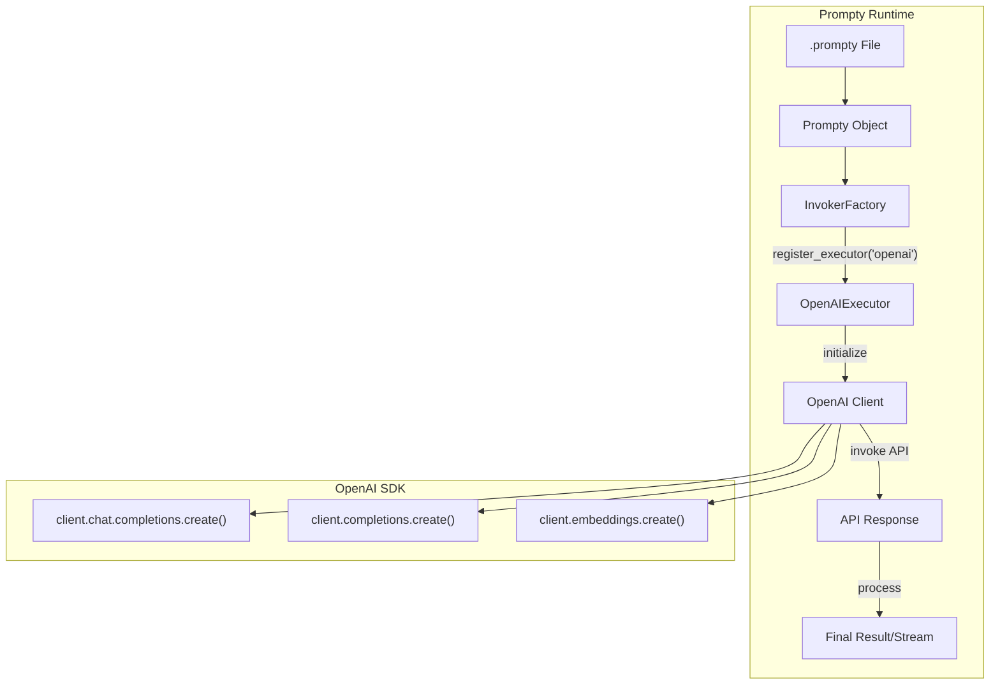
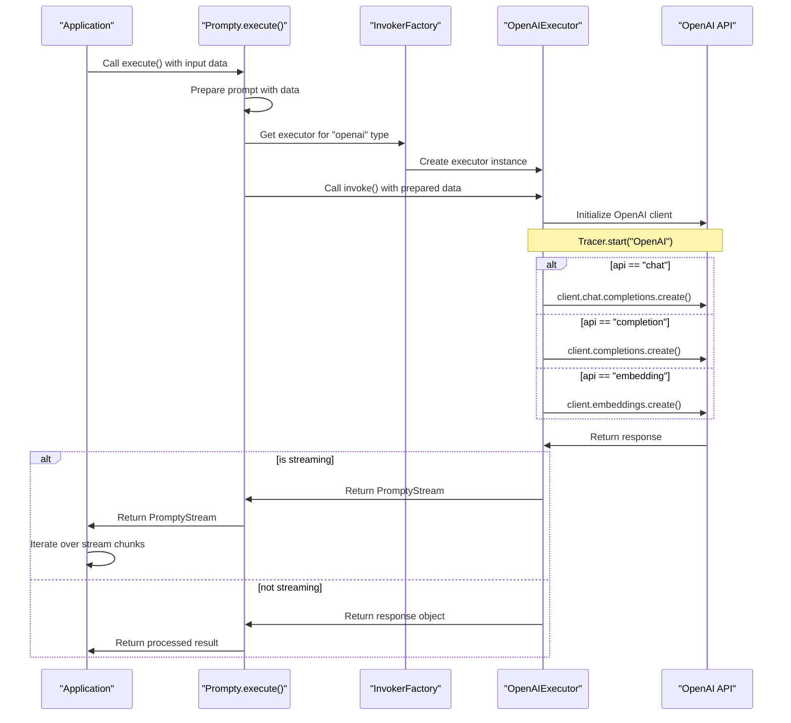
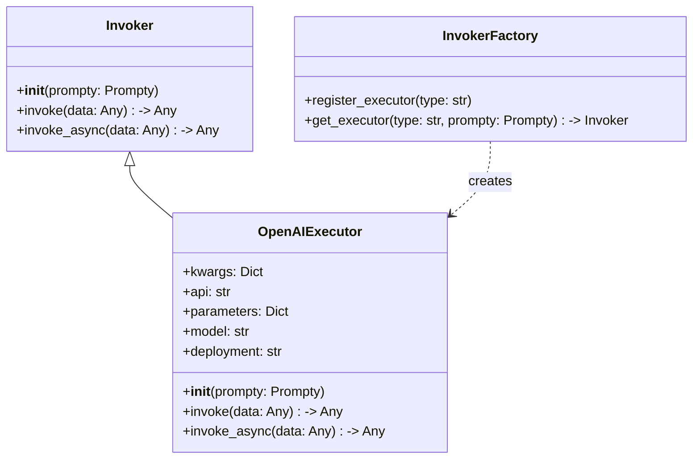

<!-- source: DeepWiki mcp.deepwiki.com · repo microsoft/prompty · page 6.2 OpenAI Integration · fetched 2026-10-26 -->

# OpenAI Integration

<details>
<summary>Relevant source files</summary>

The following files were used as context for generating this wiki page:

- [runtime/prompty/prompty/azure/executor.py](runtime/prompty/prompty/azure/executor.py)
- [runtime/prompty/prompty/azure/processor.py](runtime/prompty/prompty/azure/processor.py)
- [runtime/prompty/prompty/openai/executor.py](runtime/prompty/prompty/openai/executor.py)
- [runtime/prompty/prompty/serverless/executor.py](runtime/prompty/prompty/serverless/executor.py)
- [runtime/prompty/prompty/serverless/processor.py](runtime/prompty/prompty/serverless/processor.py)
- [runtime/prompty/tests/fake_azure_executor.py](runtime/prompty/tests/fake_azure_executor.py)
- [runtime/prompty/tests/fake_serverless_executor.py](runtime/prompty/tests/fake_serverless_executor.py)

</details>


This document explains how to integrate Prompty with OpenAI's API services, allowing you to execute prompts against OpenAI models. The OpenAI integration provides access to chat completions, text completions, and embeddings through a standardized interface.

For Azure OpenAI integration, see [Azure OpenAI Integration](#6.1).
For serverless integration options, see [Serverless Integration](#6.3).

## Architecture

### OpenAI Integration Flow



Sources: [prompty/openai/executor.py:14-16](), [prompty/openai/executor.py:32-44]()

### Execution Process



Sources: [prompty/openai/executor.py:32-103]()

## Configuration

To use OpenAI with Prompty, configure your `.prompty` file with the appropriate model configuration in the YAML frontmatter.

### Basic Configuration Example

```yaml
model:
  type: openai           # Specifies OpenAI integration
  name: gpt-4            # The model name
  api_key: sk-your-key   # Your OpenAI API key
  api: chat              # API type: chat, completion, or embedding
  parameters:            # Optional parameters passed to the API call
    temperature: 0.7
    max_tokens: 1000
```

### Configuration Fields

| Field | Required | Description | 
|-------|----------|-------------|
| `type` | Yes | Must be "openai" to use OpenAI integration |
| `name` | Yes | The OpenAI model name (e.g., "gpt-4", "text-embedding-ada-002") |
| `api_key` | Yes | Your OpenAI API key |
| `api` | Yes | The API type to use: "chat", "completion", or "embedding" |
| `parameters` | No | Additional parameters to pass to the API call |

Sources: [prompty/openai/executor.py:19-30]()

### Common API Parameters

| Parameter | API | Description |
|-----------|-----|-------------|
| `temperature` | chat, completion | Controls randomness (0.0-2.0) |
| `max_tokens` | chat, completion | Maximum tokens to generate |
| `stream` | chat, completion | Enable streaming responses |
| `tools` | chat | Tool definitions for function calling |
| `dimensions` | embedding | Vector dimensions for embeddings |

## Implementation Details

### OpenAIExecutor

The OpenAI integration is implemented through the `OpenAIExecutor` class in `prompty/openai/executor.py`. This class:

1. Registers itself with the `InvokerFactory` to handle models with the "openai" type
2. Initializes an OpenAI client with configuration from the Prompty object
3. Handles dispatch to different API endpoints based on the API type
4. Processes streaming responses when requested



Sources: [prompty/openai/executor.py:15-32]()

### API Type Handling

The `OpenAIExecutor` supports different API types:

1. **Chat API**: Used for models like GPT-4, uses `client.chat.completions.create()`
2. **Completion API**: Used for text generation, uses `client.completions.create()`
3. **Embedding API**: Used for creating vector representations, uses `client.embeddings.create()`
4. **Image API**: Currently not implemented

The API type is specified in the `api` field of the model configuration.

Sources: [prompty/openai/executor.py:63-94]()

### Streaming Support

When streaming is enabled via the `stream: true` parameter, the executor returns a `PromptyStream` object that allows consuming the response incrementally:

```python
if isinstance(response, Iterator):
    stream = PromptyStream("AzureOpenAIExecutor", response)
    trace("result", stream)
    return stream
```

Sources: [prompty/openai/executor.py:97-100]()

## Usage Examples

### Chat Completion Example

```yaml
model:
  type: openai
  name: gpt-4
  api: chat
  api_key: ${OPENAI_API_KEY}
  parameters:
    temperature: 0.7
inputs:
  system_prompt: string
  user_message: string
---
[
  {"role": "system", "content": "{{system_prompt}}"},
  {"role": "user", "content": "{{user_message}}"}
]
```

### Embedding Example

```yaml
model:
  type: openai
  name: text-embedding-ada-002
  api: embedding
  api_key: ${OPENAI_API_KEY}
inputs:
  text: string
---
{{text}}
```

## Differences from Azure OpenAI Integration

| Feature | OpenAI | Azure OpenAI |
|---------|--------|--------------|
| Type identifier | `openai` | `azure` or `azure_openai` |
| Model identifier | `name` | `azure_deployment` |
| Authentication | API key only | API key or Azure AD |
| Endpoint configuration | Not required (uses default) | Required |

Sources: [prompty/openai/executor.py:15-31](), [prompty/azure/executor.py:17-54]()

## Tracing and Observability

The OpenAI integration includes built-in tracing for observability:

1. Client initialization is traced using `Tracer.start("OpenAI")`
2. API calls are traced using `Tracer.start("create")`
3. Request parameters and responses are captured in the trace

This enables debugging and monitoring of OpenAI API calls within the Prompty system.

Sources: [prompty/openai/executor.py:45-59](), [prompty/openai/executor.py:59-103]()

## Limitations

- Image generation API is not currently implemented
- Async support is implemented but simply calls the synchronous method

Sources: [prompty/openai/executor.py:94](), [prompty/openai/executor.py:105-118]()

---

