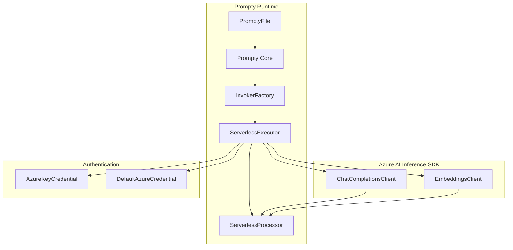
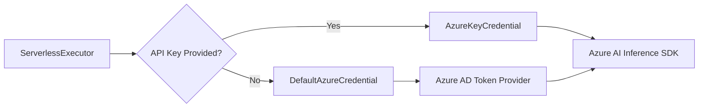
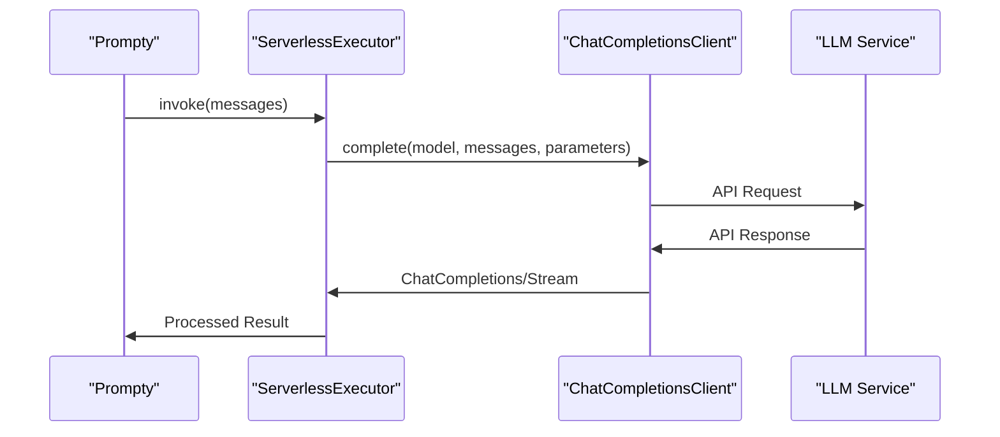
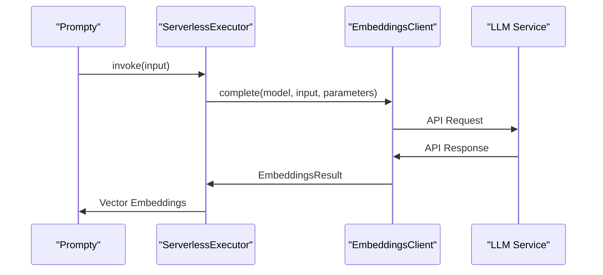
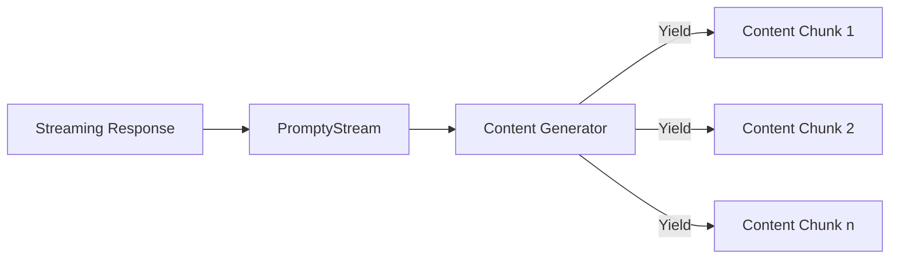
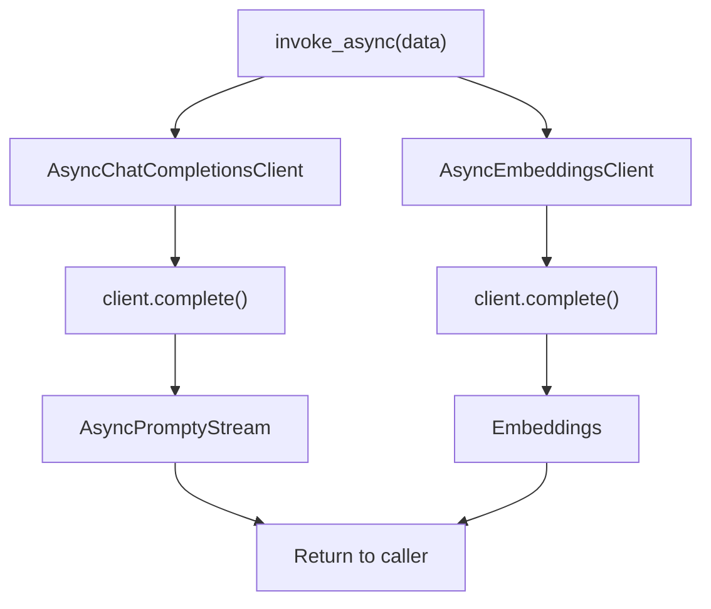

<!-- source: DeepWiki mcp.deepwiki.com · repo microsoft/prompty · page 6.3 Serverless Integration · fetched 2026-10-26 -->

# Serverless Integration

<details>
<summary>Relevant source files</summary>

The following files were used as context for generating this wiki page:

- [runtime/prompty/prompty/azure/executor.py](runtime/prompty/prompty/azure/executor.py)
- [runtime/prompty/prompty/azure/processor.py](runtime/prompty/prompty/azure/processor.py)
- [runtime/prompty/prompty/openai/executor.py](runtime/prompty/prompty/openai/executor.py)
- [runtime/prompty/prompty/serverless/executor.py](runtime/prompty/prompty/serverless/executor.py)
- [runtime/prompty/prompty/serverless/processor.py](runtime/prompty/prompty/serverless/processor.py)
- [runtime/prompty/tests/fake_azure_executor.py](runtime/prompty/tests/fake_azure_executor.py)
- [runtime/prompty/tests/fake_serverless_executor.py](runtime/prompty/tests/fake_serverless_executor.py)

</details>


This document details the serverless integration capabilities in Prompty, which allows you to use the Azure AI Inference SDK to interact with language models. The serverless integration provides a standardized approach to access Azure-hosted AI models without using the OpenAI-specific APIs.

For information about other LLM integrations, see [Azure OpenAI Integration](#6.1) and [OpenAI Integration](#6.2).

## Serverless Executor Architecture

The serverless integration in Prompty follows the same invoker pattern used throughout the system, with specialized executor and processor components for handling the Azure AI Inference SDK.



Sources: [runtime/prompty/prompty/serverless/executor.py:29-38](), [runtime/prompty/prompty/serverless/processor.py:10-16]()

## Configuration

The serverless integration requires specific configuration in the YAML frontmatter of your `.prompty` file to specify the endpoint, model, and authentication details.

### Required Configuration Properties

| Property | Description | Required |
|----------|-------------|----------|
| type     | Must be set to "serverless" | Yes |
| endpoint | The Azure AI service endpoint URL | Yes |
| model    | The model identifier for inference | Yes |
| api      | Type of API to use (e.g., "chat", "embedding") | Yes |
| key      | API key (optional if using Azure AD) | No |

### Example Configuration

```yaml
model:
  type: serverless
  endpoint: "https://your-endpoint.inference.ai.azure.com"
  model: "gpt-4"
  api: "chat"
  parameters:
    temperature: 0.7
    max_tokens: 800
```

Sources: [runtime/prompty/prompty/serverless/executor.py:35-42]()

## Authentication Methods

The Serverless Executor supports two authentication methods:



### API Key Authentication

When using API key authentication, you must include the `key` property in your model configuration:

```yaml
model:
  type: serverless
  endpoint: "https://your-endpoint.inference.ai.azure.com"
  model: "gpt-4"
  key: "your-api-key"
```

### Azure Active Directory Authentication

If no key is provided, the executor automatically uses Azure AD authentication:

```yaml
model:
  type: serverless
  endpoint: "https://your-endpoint.inference.ai.azure.com"
  model: "gpt-4"
  # No key - will use DefaultAzureCredential
```

The `DefaultAzureCredential` will attempt to authenticate using environment variables, managed identity, or other Azure credentials available on the system.

Sources: [runtime/prompty/prompty/serverless/executor.py:44-54]()

## Supported APIs

The Serverless Executor currently supports two API types:

1. **Chat Completions**: For interactive chat-based LLM interactions
2. **Embeddings**: For generating vector embeddings from text

### Chat Completions API

The chat completions API allows you to interact with LLMs using a message-based format:



Chat completions support both standard and streaming responses, controlled by the `stream` parameter.

Sources: [runtime/prompty/prompty/serverless/executor.py:96-115]()

### Embeddings API

The embeddings API allows you to generate vector representations of text:



Sources: [runtime/prompty/prompty/serverless/executor.py:132-157]()

## Response Processing

The `ServerlessProcessor` handles the transformation of Azure AI Inference SDK responses into formats that can be used by the rest of the Prompty system.

| Response Type | Processing |
|---------------|-----------|
| ChatCompletions | Extracts text content or tool calls |
| EmbeddingsResult | Extracts vector embedding(s) |
| Streaming Responses | Yields content chunks as a stream |

### Tool Calls Processing

The processor can extract tool calls from chat completions:

```python
if response.tool_calls:
    return [
        ToolCall(
            id=tool_call.id,
            name=tool_call.function.name,
            arguments=tool_call.function.arguments,
        )
        for tool_call in response.tool_calls
    ]
```

### Streaming Support

For streaming responses, the processor creates a generator that yields content chunks:



Sources: [runtime/prompty/prompty/serverless/processor.py:32-66]()

## Asynchronous Support

The Serverless Executor provides full asynchronous support through the `invoke_async` method, which allows for non-blocking LLM operations. This is particularly useful for web applications and other I/O-bound contexts.



Sources: [runtime/prompty/prompty/serverless/executor.py:166-256]()

## Limitations

The Serverless Executor currently has several limitations:

1. **Completion API**: Not yet implemented (`NotImplementedError` is raised)
2. **Image API**: Not yet implemented (`NotImplementedError` is raised)
3. **Error Handling**: Limited specialized error handling for serverless-specific scenarios

These APIs may be implemented in future releases of Prompty.

Sources: [runtime/prompty/prompty/serverless/executor.py:127-130](), [runtime/prompty/prompty/serverless/executor.py:161-162]()

## Comparison with Other Executors

| Feature | Serverless Executor | Azure OpenAI Executor | OpenAI Executor |
|---------|--------------------|-----------------------|-----------------|
| SDK Used | Azure AI Inference SDK | OpenAI SDK (Azure) | OpenAI SDK |
| Authentication | API Key or Azure AD | API Key or Azure AD | API Key only |
| Chat API | ✓ | ✓ | ✓ |
| Embedding API | ✓ | ✓ | ✓ |
| Completion API | ✗ (Not implemented) | ✓ | ✓ |
| Image API | ✗ (Not implemented) | ✓ | ✗ (Not implemented) |
| Streaming Support | ✓ | ✓ | ✓ |
| Async Support | ✓ | ✓ | Limited |

Sources: [runtime/prompty/prompty/serverless/executor.py](), [runtime/prompty/prompty/azure/executor.py](), [runtime/prompty/prompty/openai/executor.py]()

## Tracing and Observability

The Serverless Executor integrates with Prompty's tracing system to provide detailed logs of execution:

```python
with Tracer.start("ChatCompletionsClient") as trace:
    trace("type", "LLM")
    trace("signature", "azure.ai.inference.ChatCompletionsClient.ctor")
    trace("description", "Azure Unified Inference SDK Chat Completions Client")
    trace("inputs", cargs)
    # ...
```

This allows you to monitor and debug the execution of your prompts, capturing information about:

- SDK client creation
- API requests with parameters
- Responses and error conditions

For more information about tracing in Prompty, see [Tracing and Observability](#7).

Sources: [runtime/prompty/prompty/serverless/executor.py:96-108]()

---

