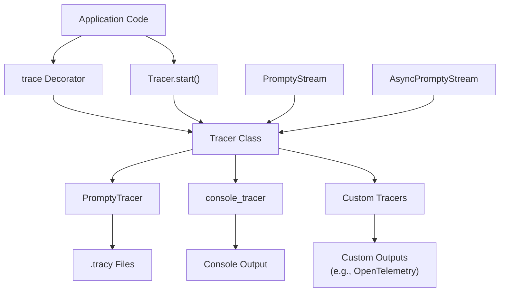
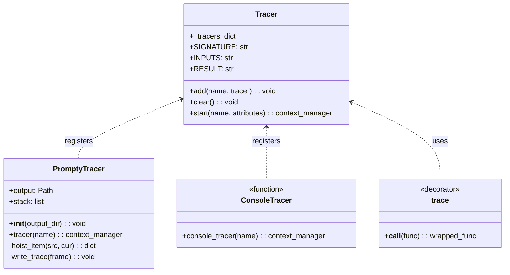
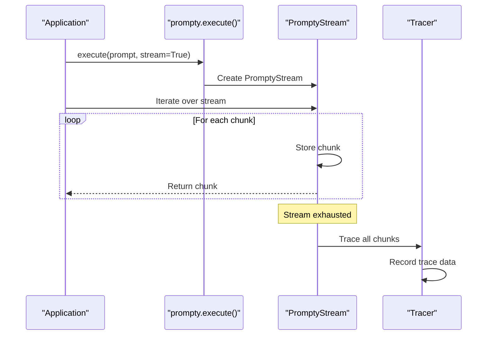
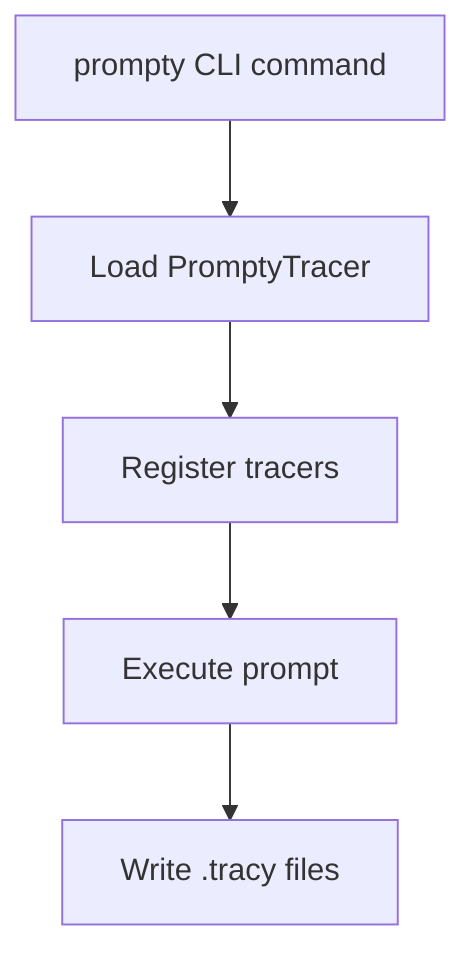

<!-- source: DeepWiki mcp.deepwiki.com · repo microsoft/prompty · page 7 Tracing and Observability · fetched 2026-10-26 -->

# Tracing and Observability

<details>
<summary>Relevant source files</summary>

The following files were used as context for generating this wiki page:

- [.vscode/project.code-workspace](.vscode/project.code-workspace)
- [runtime/prompty/README.md](runtime/prompty/README.md)
- [runtime/prompty/doc.py](runtime/prompty/doc.py)
- [runtime/prompty/prompty/cli.py](runtime/prompty/prompty/cli.py)
- [runtime/prompty/prompty/core.py](runtime/prompty/prompty/core.py)
- [runtime/prompty/prompty/mustache.py](runtime/prompty/prompty/mustache.py)
- [runtime/prompty/prompty/renderers.py](runtime/prompty/prompty/renderers.py)
- [runtime/prompty/prompty/tracer.py](runtime/prompty/prompty/tracer.py)
- [runtime/prompty/tests/prompts/chat.prompty](runtime/prompty/tests/prompts/chat.prompty)
- [runtime/prompty/tests/test_common.py](runtime/prompty/tests/test_common.py)
- [runtime/prompty/tests/test_tracing.py](runtime/prompty/tests/test_tracing.py)

</details>


The Prompty tracing and observability system provides comprehensive monitoring and debugging capabilities for prompt executions. It captures detailed information about function calls, inputs, outputs, and execution flow, enabling developers to understand how their prompts are processed and where issues might occur. This page details the architecture, implementation, and usage of Prompty's tracing system.

## Core Concepts

Tracing in Prompty is built around a flexible, extensible architecture that allows for multiple tracing methods to be used simultaneously. The system uses a central `Tracer` class to manage trace collection and distribution to registered trace handlers.



Sources: [runtime/prompty/prompty/tracer.py:28-73](), [runtime/prompty/prompty/core.py:309-370]()

### Trace Data Model

Prompty traces include standardized information about function execution:

- **Signature**: The fully qualified name of the function being traced
- **Inputs**: The arguments passed to the function
- **Result**: The return value or exception from the function
- **Custom attributes**: Additional context-specific information

Trace data is stored hierarchically, capturing the full call stack of nested function calls.



Sources: [runtime/prompty/prompty/tracer.py:16-141](), [runtime/prompty/prompty/tracer.py:253-366](), [runtime/prompty/prompty/tracer.py:369-376]()

## Built-in Tracers

Prompty includes two built-in tracers out of the box:

### PromptyTracer

The `PromptyTracer` class writes trace data to JSON files with the `.tracy` extension. It maintains a stack of trace frames, capturing the hierarchical structure of function calls.

Key features:
- Creates trace files in a specified directory (defaults to `./.runs`)
- Captures timing information for each trace
- Automatically aggregates usage statistics
- Sanitizes sensitive information (API keys, credentials)

### Console Tracer

The `console_tracer` function outputs trace information directly to the console, useful for immediate debugging and development.

```
Starting function_name
signature:
"module.function_name"
inputs:
{
    "param1": "value1",
    "param2": "value2"
}
result:
"function result"
Ending function_name
```

Sources: [runtime/prompty/prompty/tracer.py:253-366](), [runtime/prompty/prompty/tracer.py:369-376]()

## Using the Tracing System

### The `trace` Decorator

The simplest way to trace a function is to apply the `@trace` decorator:

```python
from prompty.tracer import trace

@trace
def my_function(arg1, arg2):
    # Function implementation
    return result
```

The decorator automatically traces function calls, including inputs and outputs. It works with both synchronous and asynchronous functions and can be customized with additional parameters:

```python
@trace(name="CUSTOM_NAME", custom_attribute="value")
def my_function():
    # ...
```

Sources: [runtime/prompty/prompty/tracer.py:246-250](), [runtime/prompty/tests/test_tracing.py:63-108]()

### Manual Tracing

For more fine-grained control, you can use the `Tracer.start()` context manager:

```python
from prompty.tracer import Tracer

with Tracer.start("operation_name") as trace:
    trace("signature", "my_module.my_function")
    trace("inputs", {"param1": "value1"})
    
    # Your code here
    
    trace("result", "operation result")
```

This approach is useful when you need to add custom trace points or when you want to trace only specific parts of a function.

Sources: [runtime/prompty/prompty/tracer.py:54-73](), [runtime/prompty/tests/test_tracing.py:294-305]()

### Streaming Response Tracing

Prompty includes special handling for tracing streaming responses through the `PromptyStream` and `AsyncPromptyStream` classes, which automatically capture all streamed chunks and provide trace events when streaming completes.



Sources: [runtime/prompty/prompty/core.py:309-370](), [runtime/prompty/tests/test_tracing.py:271-292]()

## Creating Custom Tracers

You can extend Prompty's tracing system by creating custom tracers. A tracer is a context manager function that yields a callback for recording trace data.

### Simple Custom Tracer Example

```python
import contextlib
from typing import Any, Callable
from collections.abc import Iterator

@contextlib.contextmanager
def my_custom_tracer(name: str) -> Iterator[Callable[[str, Any], None]]:
    try:
        print(f"Starting {name}")
        # The yielded function will be called for each trace point
        yield lambda key, value: print(f"{key}: {value}")
    finally:
        print(f"Ending {name}")

# Register the tracer
from prompty.tracer import Tracer
Tracer.add("my_tracer", my_custom_tracer)
```

### Class-based Custom Tracer

For more complex use cases, you can create a class-based tracer:

```python
class DatabaseTracer:
    def __init__(self, connection_string):
        self.connection = create_connection(connection_string)
    
    @contextlib.contextmanager
    def tracer(self, name: str) -> Iterator[Callable[[str, Any], None]]:
        trace_id = generate_unique_id()
        try:
            self.connection.execute(
                "INSERT INTO traces (id, name, start_time) VALUES (?, ?, ?)",
                (trace_id, name, current_time())
            )
            
            def record(key, value):
                self.connection.execute(
                    "INSERT INTO trace_data (trace_id, key, value) VALUES (?, ?, ?)",
                    (trace_id, key, json.dumps(value))
                )
                
            yield record
        finally:
            self.connection.execute(
                "UPDATE traces SET end_time = ? WHERE id = ?",
                (current_time(), trace_id)
            )

# Register the tracer
db_tracer = DatabaseTracer("connection_string")
Tracer.add("database", db_tracer.tracer)
```

Sources: [runtime/prompty/README.md:79-186](), [runtime/prompty/prompty/tracer.py:253-366]()

## OpenTelemetry Integration

The tracing system can be integrated with OpenTelemetry for standardized observability:

```python
from opentelemetry import trace as oteltrace
import contextlib
import json

@contextlib.contextmanager
def opentelemetry_tracer(name: str):
    tracer = oteltrace.get_tracer("prompty")
    with tracer.start_as_current_span(name) as span:
        yield lambda key, value: span.set_attribute(
            key, json.dumps(value)
        )

# Register with Prompty
from prompty.tracer import Tracer
Tracer.add("opentelemetry", opentelemetry_tracer)
```

Sources: [runtime/prompty/README.md:164-186]()

## CLI Integration

The Prompty CLI automatically enables tracing, writing trace files to the `.runs` directory in the current working directory:



Sources: [runtime/prompty/prompty/cli.py:141-161]()

## Trace Data Serialization and Security

The tracing system includes utilities to safely serialize trace data and sanitize sensitive information:

- The `to_dict()` function converts complex objects to serializable dictionaries
- The `sanitize()` function masks sensitive values such as API keys and passwords
- Special handling for Prompty-specific classes ensures proper serialization

```
// Example sanitized API configuration in a trace
"model": {
  "configuration": {
    "api_key": "**********",
    "azure_endpoint": "https://example.openai.azure.com"
  }
}
```

Sources: [runtime/prompty/prompty/tracer.py:16-25](), [runtime/prompty/prompty/tracer.py:76-105]()

## Best Practices

1. **Enable tracing during development**: Use console tracing to see immediate feedback
2. **Capture full execution flow**: Trace all relevant functions to understand the complete call path
3. **Use custom tracers for production**: Consider creating production-ready tracers that integrate with your observability stack
4. **Be mindful of performance**: Tracing adds overhead; use selectively in performance-critical paths
5. **Trace streaming operations**: Use the trace decorator with the streaming parameter for streaming responses

Sources: [runtime/prompty/README.md:79-186](), [runtime/prompty/tests/test_tracing.py:271-292]()

## Related Documentation

For more information about integrating Prompty with specific frameworks, see [Framework Integrations](#8).

---

