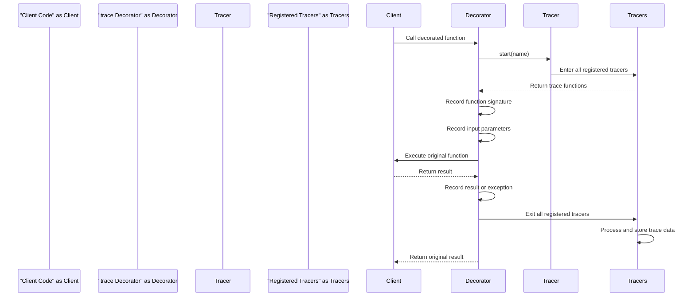
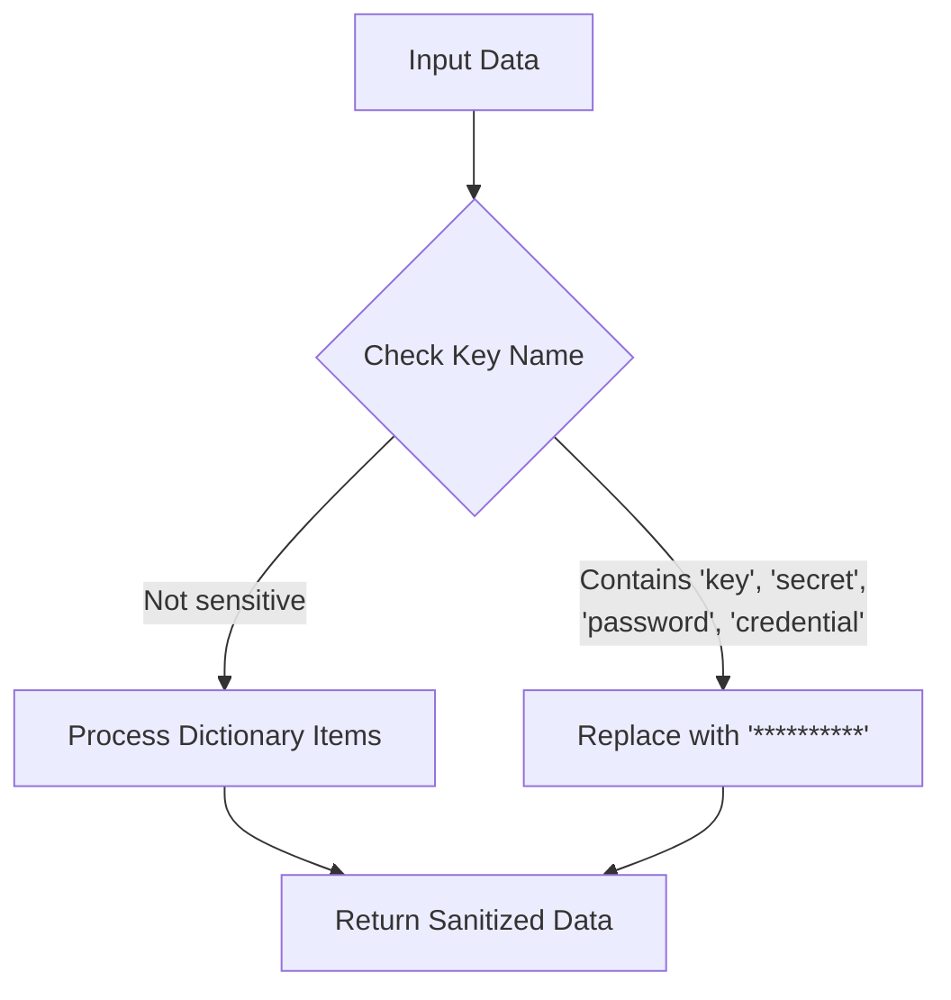
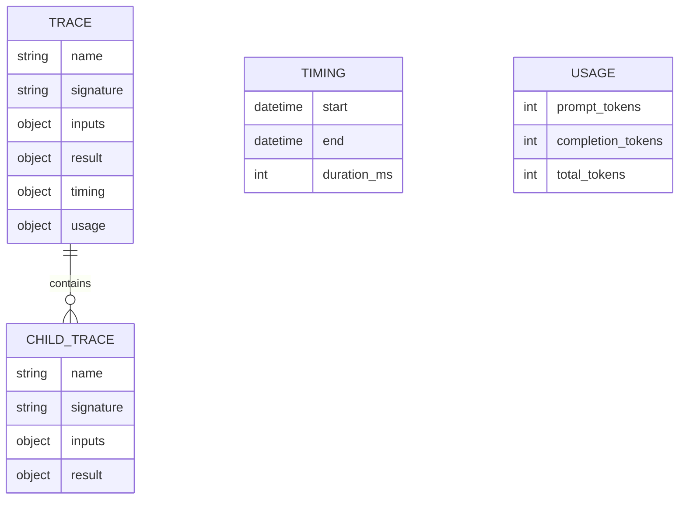
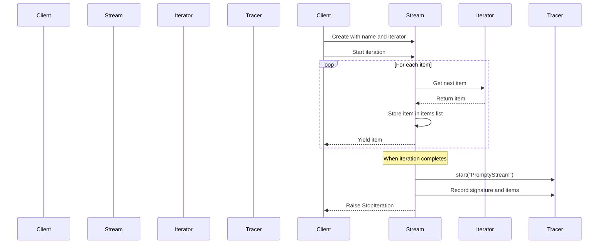

<!-- source: DeepWiki mcp.deepwiki.com · repo microsoft/prompty · page 7.1 Tracer Implementation · fetched 2026-10-26 -->

# Tracer Implementation

<details>
<summary>Relevant source files</summary>

The following files were used as context for generating this wiki page:

- [runtime/prompty/prompty/cli.py](runtime/prompty/prompty/cli.py)
- [runtime/prompty/prompty/core.py](runtime/prompty/prompty/core.py)
- [runtime/prompty/prompty/mustache.py](runtime/prompty/prompty/mustache.py)
- [runtime/prompty/prompty/renderers.py](runtime/prompty/prompty/renderers.py)
- [runtime/prompty/prompty/tracer.py](runtime/prompty/prompty/tracer.py)
- [runtime/prompty/tests/prompts/chat.prompty](runtime/prompty/tests/prompts/chat.prompty)

</details>


The Prompty tracing system provides comprehensive observability capabilities for monitoring and debugging prompt executions. This implementation enables tracking of function calls, inputs, outputs, execution times, and resource usage across the Prompty runtime. This page details how the tracer is implemented and how to use and extend it in your applications.

For information about the general observability concepts, see [Tracing and Observability](#7).

## Core Architecture

The tracing system in Prompty is built around a central registry pattern that allows multiple tracers to be registered and used simultaneously.

```mermaid
classDiagram
    class "Tracer" {
        -dict _tracers
        +add(name, tracer)
        +clear()
        +start(name, attributes)
    }
    
    class "trace" {
        +__call__(func, **kwargs)
    }
    
    class "PromptyTracer" {
        -Path output
        -list stack
        +tracer(name)
        -write_trace(frame)
        -hoist_item(src, cur)
    }
    
    class "console_tracer" {
        +__call__(name)
    }
    
    "trace" --> "Tracer" : uses
    "PromptyTracer" --> "Tracer" : registers with
    "console_tracer" --> "Tracer" : registers with
    
    note for "Tracer" "Central registry for all tracers"
    note for "trace" "Decorator for automatic tracing"
    note for "PromptyTracer" "Writes traces to .tracy files"
    note for "console_tracer" "Outputs traces to console"
```

Sources: [runtime/prompty/prompty/tracer.py:28-73](), [runtime/prompty/prompty/tracer.py:246-250](), [runtime/prompty/prompty/tracer.py:253-366](), [runtime/prompty/prompty/tracer.py:368-376]()

The core components of the tracing system are:

1. **Tracer Class**: A static registry that manages multiple tracer implementations and coordinates their execution.
2. **trace Decorator**: A decorator that automatically wraps functions to capture their execution details.
3. **PromptyTracer**: A file-based tracer that records execution information to `.tracy` files.
4. **console_tracer**: A simple tracer that outputs tracing information to the console.

## Tracing Flow

The flow of data through the tracing system follows a consistent pattern, whether for synchronous or asynchronous code:



Sources: [runtime/prompty/prompty/tracer.py:143-192](), [runtime/prompty/prompty/tracer.py:195-243]()

## Using the Tracer

### The `trace` Decorator

The simplest way to add tracing to your code is by using the `trace` decorator:

```python
from prompty.tracer import trace

@trace
def my_function(arg1, arg2):
    # Function code here
    return result
```

The decorator automatically tracks:
- Function signature
- Input parameters
- Return values or exceptions
- Execution time

For asynchronous functions, the decorator automatically detects and applies the appropriate tracing logic.

Sources: [runtime/prompty/prompty/tracer.py:246-250](), [runtime/prompty/prompty/cli.py:45-46](), [runtime/prompty/prompty/cli.py:83-84]()

### Registering Tracers

To actually capture and store trace information, you need to register one or more tracers:

```python
from prompty.tracer import Tracer, PromptyTracer, console_tracer

# Add the console tracer
Tracer.add("console", console_tracer)

# Add the file tracer with custom output directory
ptrace = PromptyTracer(output_dir="./my_traces")
Tracer.add("file_tracer", ptrace.tracer)
```

Multiple tracers can be active simultaneously, allowing you to output trace information to multiple destinations.

Sources: [runtime/prompty/prompty/cli.py:152-156]()

### Manual Tracing

For more granular control, you can manually start a trace context:

```python
from prompty.tracer import Tracer

with Tracer.start("operation_name") as trace:
    trace("key", value)
    # Perform operations
    trace("result", result)
```

This is useful when you need to trace specific parts of your code or add custom trace information.

Sources: [runtime/prompty/prompty/tracer.py:54-73](), [runtime/prompty/prompty/core.py:333-337](), [runtime/prompty/prompty/core.py:365-369]()

## Built-in Tracers

### PromptyTracer

`PromptyTracer` is a file-based tracer that writes trace information to `.tracy` files. It organizes traces hierarchically and captures detailed timing information.

Key features:
- Creates trace files in a `.runs` directory by default
- Captures timing information for each trace
- Aggregates resource usage information
- Preserves the hierarchical structure of traces
- Sanitizes sensitive information automatically

Sources: [runtime/prompty/prompty/tracer.py:253-366]()

### Console Tracer

The `console_tracer` outputs trace information directly to the console, which is useful for debugging and development.

Sources: [runtime/prompty/prompty/tracer.py:368-376]()

## Data Sanitization

The tracing system automatically sanitizes sensitive information to prevent leaking credentials or other secrets in trace logs.



Sources: [runtime/prompty/prompty/tracer.py:17-25]()

The `sanitize` function checks key names against common patterns indicating sensitive information (like "key", "secret", "password", or "credential") and replaces their values with asterisks.

## Trace Data Structure

The trace data is structured hierarchically, with each trace containing:

1. **Metadata**: Name, signature, function details
2. **Inputs**: Function parameters
3. **Result**: Return value or exception details
4. **Timing**: Start time, end time, duration
5. **Usage**: Aggregated resource usage information
6. **Child Frames**: Nested traces from calls made during the function execution



Sources: [runtime/prompty/prompty/tracer.py:264-366]()

## Streaming Support

The tracing system provides special handling for streaming responses from LLMs through the `PromptyStream` and `AsyncPromptyStream` classes, which wrap stream iterators and capture their contents for tracing.



Sources: [runtime/prompty/prompty/core.py:309-370]()

## Creating Custom Tracers

You can create custom tracers to integrate with specific monitoring systems or to format trace data in custom ways:

1. Create a context manager function that yields a callback function
2. Register your tracer with the `Tracer` class

Example:

```python
@contextlib.contextmanager
def my_custom_tracer(name: str) -> Iterator[Callable[[str, Any], None]]:
    try:
        # Setup code here
        print(f"Starting trace for {name}")
        
        def callback(key: str, value: Any) -> None:
            # Process trace data
            print(f"{key}: {json.dumps(value, indent=2)}")
            
        yield callback
    finally:
        # Cleanup code here
        print(f"Ending trace for {name}")

# Register your tracer
Tracer.add("my_tracer", my_custom_tracer)
```

A custom tracer needs to:
1. Accept a name parameter for the trace
2. Yield a callback function that takes a key and value
3. Handle any setup and cleanup in the context manager

Sources: [runtime/prompty/prompty/tracer.py:253-376]()

## Tracing in CLI Applications

The Prompty CLI automatically sets up both console and file-based tracing:

```python
# In verbose mode, add console tracing
if verbose:
    Tracer.add("console", console_tracer)

# Always add file tracing
ptrace = PromptyTracer()
Tracer.add("prompty", ptrace.tracer)
```

This provides immediate feedback in the console when requested, while always saving detailed trace information to files for later analysis.

Sources: [runtime/prompty/prompty/cli.py:152-156]()

## Best Practices

1. **Apply the `trace` decorator to high-level functions** rather than every function to avoid excessive tracing overhead.

2. **Use meaningful trace names** that help identify the operation being performed.

3. **Add custom trace attributes** for important context information:
   ```python
   @trace(model_name="gpt-4", version="1.0")
   def generate_text(prompt):
       # function code
   ```

4. **Be mindful of data volume** when tracing large objects or high-frequency operations.

5. **Clear tracers when no longer needed** using `Tracer.clear()` to free resources.

Sources: [runtime/prompty/prompty/tracer.py:246-250](), [runtime/prompty/prompty/tracer.py:52-53]()

## Conclusion

The Prompty tracing system provides a flexible and powerful way to monitor and debug prompt executions. It offers built-in tracers for console and file output, supports both synchronous and asynchronous code, and can be extended with custom tracers to meet specific requirements.

By effectively using the tracing system, you can gain valuable insights into prompt execution, improve debugging efficiency, and monitor performance and resource usage across your Prompty applications.

---

