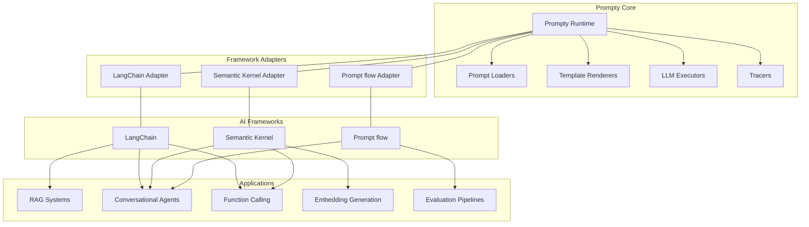
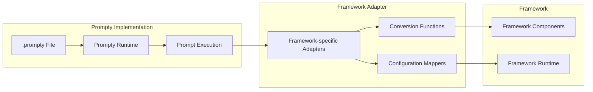
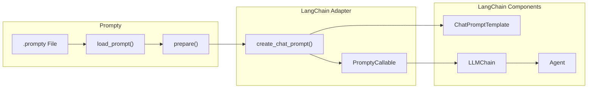
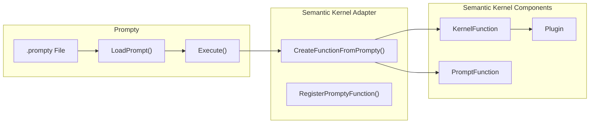
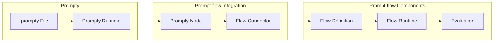
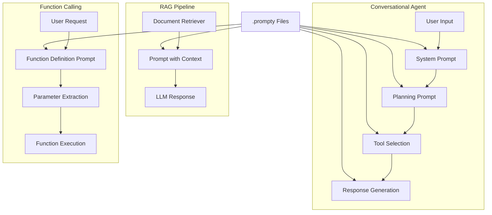

<!-- source: DeepWiki mcp.deepwiki.com · repo microsoft/prompty · page 8 Framework Integrations · fetched 2026-10-26 -->

# Framework Integrations

Relevant source files

The following files were used as context for generating this wiki page:

- [package-lock.json](package-lock.json)
- [web/docs/tutorials/page.mdx](web/docs/tutorials/page.mdx)
- [web/docs/tutorials/prompty32x32.png](web/docs/tutorials/prompty32x32.png)

This page documents how Prompty integrates with popular AI orchestration frameworks, providing a standardized way to use `.prompty` files within existing AI application ecosystems. For details about language-specific runtimes, see [Python Runtime](#3) and [C# Runtime](#4).

## Overview

Prompty's framework integrations enable seamless use of the `.prompty` file format and Prompty capabilities within established AI orchestration frameworks. These integrations allow developers to leverage Prompty's standardized prompt management while taking advantage of the broader capabilities of comprehensive AI frameworks.

Sources: The diagram is based on the system architecture diagrams provided in the context.

## Integration Architecture

The Prompty framework integrations follow a consistent pattern of adapting Prompty's capabilities to the conventions and abstractions of each target framework.

Sources: The diagram is based on the system architecture diagrams provided in the context.

## Supported Frameworks

### LangChain Integration

Prompty integrates with LangChain, enabling the use of `.prompty` files within LangChain chains, agents, and other components. This integration allows developers to leverage Prompty's prompt management capabilities while taking advantage of LangChain's extensive ecosystem.

Key features of the LangChain integration include:
- Conversion of Prompty prompts to LangChain's `ChatPromptTemplate`
- Support for LangChain's `LLMChain` for prompt execution
- Compatibility with LangChain's agent frameworks
- Seamless use within RAG applications

For detailed information about using Prompty with LangChain, see [LangChain Integration](#8.1).

Sources: web/docs/tutorials/page.mdx

### Semantic Kernel Integration

Prompty integrates with Microsoft's Semantic Kernel framework, enabling the use of `.prompty` files as Semantic Kernel functions and plugins.

Key features of the Semantic Kernel integration include:
- Creation of Semantic Kernel functions from Prompty prompts
- Registration of Prompty-based functions within Semantic Kernel plugins
- Support for function calling and tool use
- Integration with Semantic Kernel's planning capabilities

For detailed information about using Prompty with Semantic Kernel, see [Semantic Kernel Integration](#8.2).

Sources: web/docs/tutorials/page.mdx

### Prompt flow Integration

Prompty can also be integrated with Microsoft's Prompt flow framework, allowing `.prompty` files to be used within flow-based prompt engineering workflows.

Key capabilities of the Prompt flow integration include:
- Using Prompty prompts as nodes in a Prompt flow
- Standardized input/output mappings between Prompty and other flow components
- Compatibility with Prompt flow's evaluation frameworks

## Common Integration Patterns

When integrating Prompty with orchestration frameworks, several common patterns emerge:

1. **Framework-specific Adapters**: Each integration provides adapter functions that convert Prompty objects to framework-specific constructs.

2. **Configuration Mapping**: Prompty's configuration options are mapped to equivalent settings in the target framework.

3. **Execution Model Alignment**: Prompty's execution model (synchronous, streaming, async) is aligned with the target framework's execution patterns.

4. **Tracing Integration**: Prompty's tracing capabilities are integrated with the target framework's observability systems.

| Framework | Adapter Pattern | Primary Use Cases |
|-----------|----------------|-------------------|
| LangChain | Convert to `ChatPromptTemplate` | RAG, Chains, Agents |
| Semantic Kernel | Convert to `KernelFunction` | Plugins, Function Calling, Planning |
| Prompt flow | Node-based integration | Flow-based Prompt Engineering, Evaluation |

## Using Framework Integrations

To use Prompty with a supported framework, you typically follow these steps:

1. Define your prompt in a `.prompty` file
2. Load the prompt using Prompty's runtime
3. Convert the prompt to a framework-specific construct using the appropriate adapter
4. Use the converted object within the framework's components and workflows

The specific details for each framework are covered in the dedicated integration pages:
- [LangChain Integration](#8.1)
- [Semantic Kernel Integration](#8.2)

## Common Use Cases

The framework integrations enable several common use cases:

1. **Retrieval-Augmented Generation (RAG)**: Using Prompty prompts within LangChain or Semantic Kernel RAG pipelines.

2. **Conversational Agents**: Building agents that use standardized Prompty files for different conversation stages.

3. **Function Calling**: Leveraging Prompty's standardized format for function definitions in frameworks that support function calling.

4. **Multi-step Workflows**: Using Prompty prompts as individual steps in complex AI workflows.

## Best Practices

When using Prompty with orchestration frameworks, consider these best practices:

1. **Standardize Prompt Interfaces**: Design your `.prompty` files with consistent input and output interfaces for easier integration.

2. **Leverage Framework-specific Features**: Take advantage of unique capabilities in each framework while maintaining a consistent prompt management approach.

3. **Enable Tracing**: Configure Prompty's tracing system to work with the framework's monitoring capabilities for better observability.

4. **Version Control**: Manage your `.prompty` files in version control alongside framework code to ensure consistency.

5. **Template Consistency**: When using template variables, maintain consistent naming conventions that work well with the target framework.

## Further Reading

- [Prompty File Format](#2) for details on creating `.prompty` files
- [LangChain Integration](#8.1) for specific LangChain integration documentation
- [Semantic Kernel Integration](#8.2) for specific Semantic Kernel integration documentation
- [Tracing and Observability](#7) for information on monitoring prompt execution across frameworks

---

