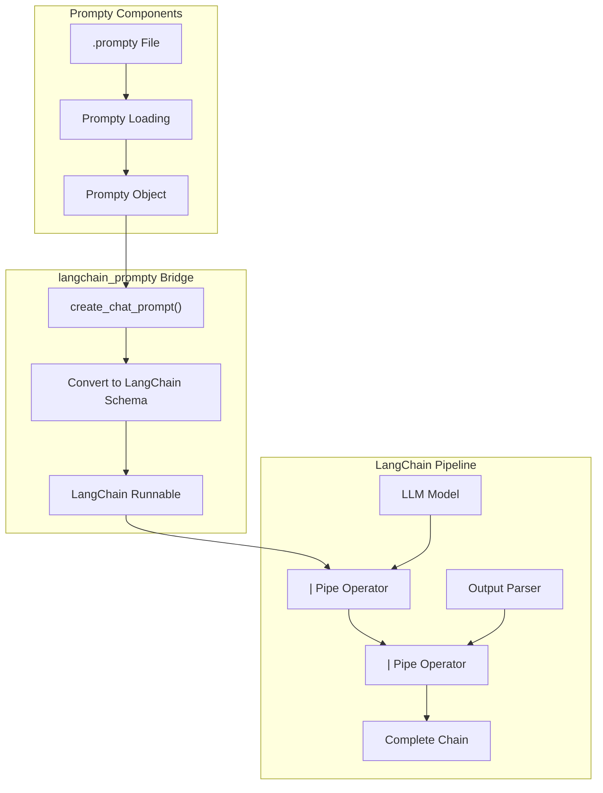
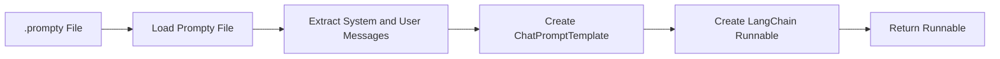
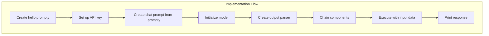
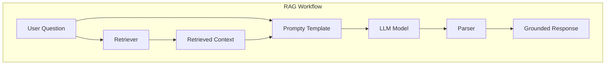
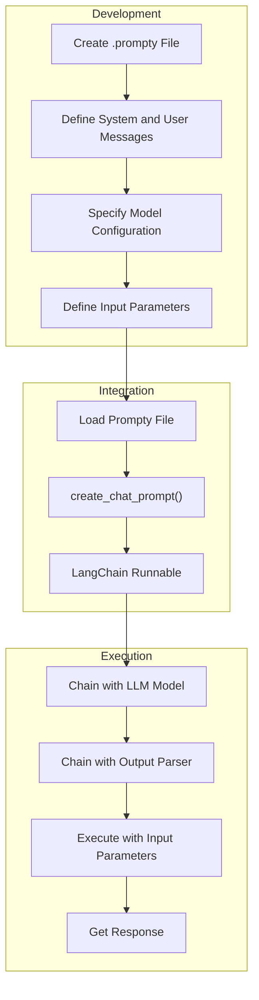

<!-- source: DeepWiki mcp.deepwiki.com · repo microsoft/prompty · page 8.1 LangChain Integration · fetched 2026-10-26 -->

# LangChain Integration

<details>
<summary>Relevant source files</summary>

The following files were used as context for generating this wiki page:

- [.github/ISSUE_TEMPLATE/bug_report.yaml](.github/ISSUE_TEMPLATE/bug_report.yaml)
- [.github/ISSUE_TEMPLATE/documentation.yaml](.github/ISSUE_TEMPLATE/documentation.yaml)
- [.github/ISSUE_TEMPLATE/feature_request.yaml](.github/ISSUE_TEMPLATE/feature_request.yaml)
- [web/docs/assets/code/basic.prompty](web/docs/assets/code/basic.prompty)
- [web/docs/assets/code/basic_langchain.py](web/docs/assets/code/basic_langchain.py)
- [web/docs/assets/code/hello.prompty](web/docs/assets/code/hello.prompty)
- [web/docs/assets/code/hello_langchain.py](web/docs/assets/code/hello_langchain.py)
- [web/docs/assets/code/hello_prompty.py](web/docs/assets/code/hello_prompty.py)
- [web/docs/assets/img/tutorials-add-langchain-code.png](web/docs/assets/img/tutorials-add-langchain-code.png)
- [web/docs/tutorials/using-langchain/page.mdx](web/docs/tutorials/using-langchain/page.mdx)

</details>


This document explains how to use Prompty templates with the LangChain framework. It covers the technical implementation of the integration, core components, usage patterns, and advanced scenarios for building generative AI applications with Prompty and LangChain.

For information about other framework integrations, see [Semantic Kernel Integration](#8.2).

## Overview

The LangChain integration allows Prompty templates (`.prompty` files) to be used within LangChain's orchestration framework through the `langchain-prompty` package. This integration converts Prompty templates into LangChain `Runnable` objects that can be incorporated into LangChain pipelines.

## Integration Architecture



The diagram illustrates how a `.prompty` file is loaded and converted into a LangChain pipeline component through the `create_chat_prompt` function, which serves as the bridge between Prompty and LangChain ecosystems.

Sources: [web/docs/tutorials/using-langchain/page.mdx:102-112]()

## Prerequisites and Installation

To use the LangChain-Prompty integration, you need:

1. Python 3.11+ (recommended)
2. A Visual Studio Code editor with the Prompty extension (optional but helpful)
3. An OpenAI API key or other supported LLM provider credentials
4. Required packages:

```bash
pip install -qU "langchain[openai]"  # For OpenAI integration
pip install -U langchain-prompty     # For Prompty-LangChain bridge
```

Sources: [web/docs/tutorials/using-langchain/page.mdx:28-40]()

## Core Components

The primary component of this integration is the `create_chat_prompt` function from the `langchain_prompty` module, which converts a `.prompty` file into a LangChain `Runnable` object.



This function enables Prompty templates to be used in LangChain's composable pipeline architecture, where components can be chained together using the pipe (`|`) operator.

Sources: [web/docs/tutorials/using-langchain/page.mdx:112-114](), [web/docs/assets/code/hello_prompty.py:13-14]()

## Basic Usage Pattern

The standard pattern for using Prompty with LangChain follows these steps:

1. Create a `.prompty` file with your prompt template
2. Load it using `create_chat_prompt()`
3. Initialize an LLM model
4. Create an output parser
5. Chain the components with the pipe operator
6. Execute the chain with input parameters

Here's a typical implementation:

```python
from langchain_prompty import create_chat_prompt
from langchain.chat_models import init_chat_model
from langchain_core.output_parsers import StrOutputParser

# Load the prompt
prompt = create_chat_prompt("/path/to/prompt.prompty")

# Initialize the model
model = init_chat_model("gpt-4o-mini", model_provider="openai")

# Create an output parser
parser = StrOutputParser()

# Chain the components
chain = prompt | model | parser

# Execute the chain
response = chain.invoke({"firstName": "Jane", "question": "Tell me about your tents"})
print(response)
```

Sources: [web/docs/assets/code/hello_prompty.py:1-21](), [web/docs/tutorials/using-langchain/page.mdx:158-181]()

## Input Handling

There are two ways to provide inputs to a LangChain-Prompty chain:

1. **Direct Object Method**: Pass a Python dictionary to the `invoke` method:
   ```python
   response = chain.invoke({"firstName": "Jane", "question": "Tell me about your tents"})
   ```

2. **JSON String Method**: Pass a JSON string through the `input` parameter:
   ```python
   response = chain.invoke({"input": '{"firstName": "Jane", "question": "Tell me about your tents"}'})
   ```

The input values correspond to the template variables in your `.prompty` file (accessed with `{{variableName}}` syntax).

Sources: [web/docs/assets/code/hello_prompty.py:20](), [web/docs/tutorials/using-langchain/page.mdx:180]()

## Complete Example

Here's a complete example using a basic prompt template:



This workflow is implemented in the following code:

```python
import os
from langchain_prompty import create_chat_prompt
from langchain.chat_models import init_chat_model
from langchain_core.output_parsers import StrOutputParser
from pathlib import Path

# Set up API key
if not os.environ.get("OPENAI_API_KEY"):
    os.environ["OPENAI_API_KEY"] = getpass.getpass("Enter API key for OpenAI: ")

# Get path to .prompty file
folder = Path(__file__).parent.absolute().as_posix()
prompt_path = folder + "/hello.prompty"

# Create prompt, model, and parser
prompt = create_chat_prompt(prompt_path)
model = init_chat_model("gpt-4o-mini", model_provider="openai")
parser = StrOutputParser()

# Chain and execute
chain = prompt | model | parser
response = chain.invoke({"firstName": "Jane", "lastName": "Doe", "question": "Tell me about your tents"})
print(response)
```

The `.prompty` file referenced above might look like this:

```yaml
---
name: Basic Prompt
description: A basic prompt for chat interactions
model:
  api: chat
sample:
  firstName: Jane
  lastName: Doe
  question: Tell me about your tents
---
system:
You are a helpful assistant who addresses users by name.

user:
{{firstName}} asks: {{question}}
```

Sources: [web/docs/assets/code/hello_prompty.py:1-21](), [web/docs/assets/code/hello.prompty:1-30]()

## Using VS Code Extension

The Prompty VS Code extension streamlines development by generating LangChain code from a `.prompty` file:

1. Create a `.prompty` file in VS Code
2. Select the file in the Explorer pane
3. Open the context menu and select "Add Langchain Code"
4. A new Python file will be generated with complete LangChain integration code

This generated code typically includes all necessary imports, setup for the model, parser, chain construction, and execution with sample inputs.

Sources: [web/docs/tutorials/using-langchain/page.mdx:202-324]()

## Advanced Usage: RAG Applications

One powerful use case is retrieval-augmented generation (RAG), where Prompty templates can incorporate external context:



In this pattern, the Prompty template includes a `context` parameter that is populated with retrieved information:

```yaml
---
name: RAGPrompt
description: A prompt that uses context to ground an incoming question
sample:
  firstName: User
  context: Information about Alpine Explorer Tent...
  question: What can you tell me about your tents?
---
system:
You are an AI assistant who helps people find information.

# Context
Use the following context to ground your response:
{{context}}

user:
{{firstName}} asks: {{question}}
```

This template can be used in a RAG pipeline where the context is dynamically retrieved based on the user's question.

Sources: [web/docs/tutorials/using-langchain/page.mdx:327-325](), [web/docs/assets/code/basic.prompty:1-41]()

## Technical Considerations

When using the LangChain-Prompty integration, note these important technical details:

1. **Template Compatibility**: LangChain works best with Mustache templating. If using other template engines in Prompty, you may need to add `template: mustache` to your YAML frontmatter.

2. **Model Configuration**: The model configuration in your `.prompty` file is not automatically used by LangChain. You must configure the LangChain model separately.

3. **Input Validation**: Ensure input JSON strings are properly formatted when using the `input` parameter method.

4. **Error Handling**: Implement error handling for both Prompty template loading and LangChain pipeline execution.

Sources: [web/docs/tutorials/using-langchain/page.mdx:113-115](), [web/docs/assets/code/basic_langchain.py:13-16]()

## Integration Workflow

The complete workflow from development to execution:



This diagram illustrates the complete journey from creating a Prompty template to getting a response through LangChain.

Sources: [web/docs/tutorials/using-langchain/page.mdx:45-46](), [web/docs/tutorials/using-langchain/page.mdx:158-198]()

## Conclusion

The LangChain-Prompty integration provides a powerful way to leverage structured prompt templates within LangChain's orchestration framework. By converting `.prompty` files to LangChain `Runnable` objects, developers can create sophisticated prompt-engineering workflows that benefit from both Prompty's templating capabilities and LangChain's composable pipeline architecture.

For next steps, consider exploring:
- Different model providers within LangChain
- More complex prompt chaining workflows
- Integration with other LangChain components like memory and tools

Sources: [web/docs/tutorials/using-langchain/page.mdx:336-344]()

---

