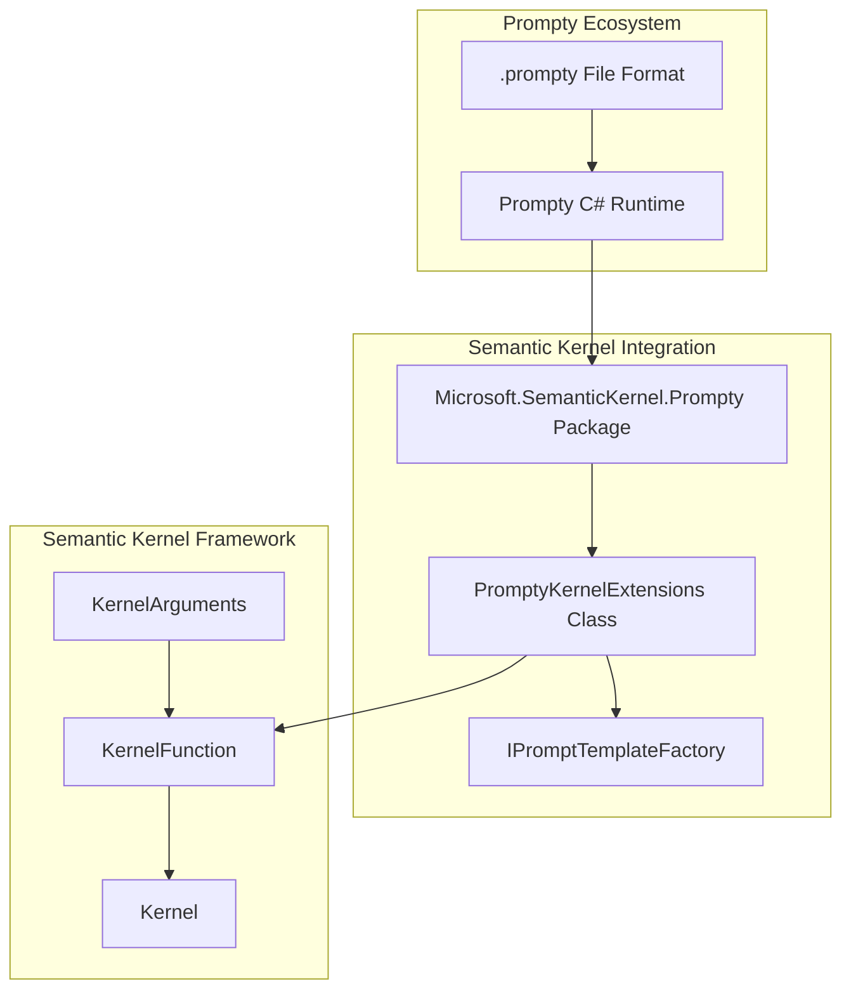
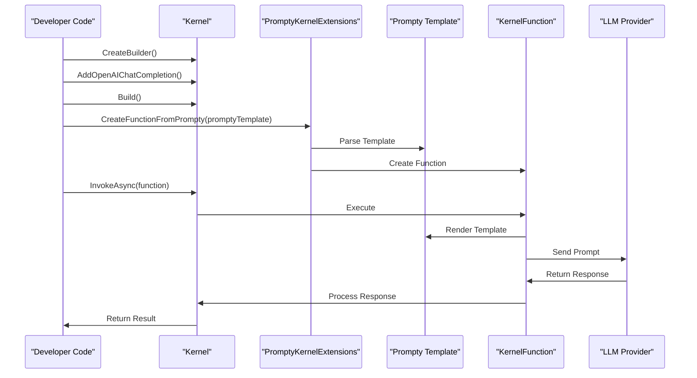
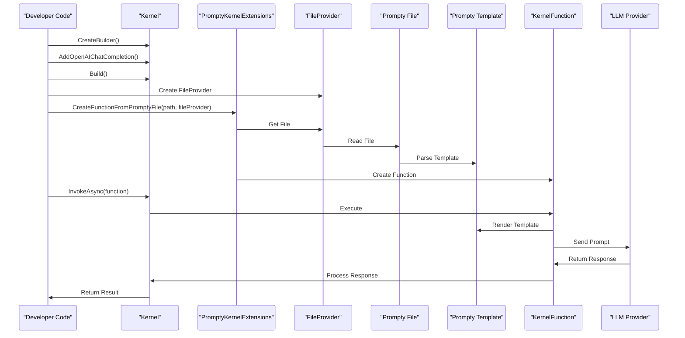
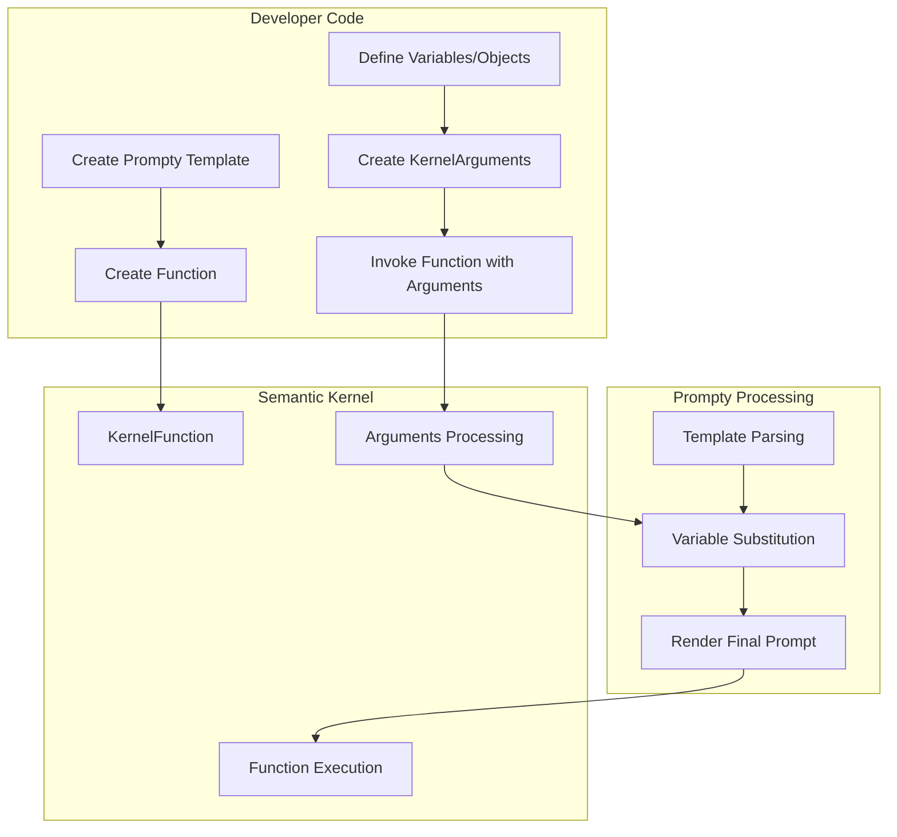
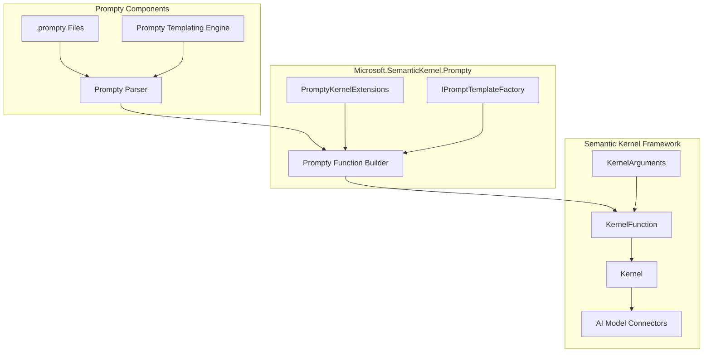

<!-- source: DeepWiki mcp.deepwiki.com · repo microsoft/prompty · page 8.2 Semantic Kernel Integration · fetched 2026-10-26 -->

# Semantic Kernel Integration

<details>
<summary>Relevant source files</summary>

The following files were used as context for generating this wiki page:

- [.vscode/settings.json](.vscode/settings.json)
- [web/docs/tutorials/using-semantic-kernel/page.mdx](web/docs/tutorials/using-semantic-kernel/page.mdx)

</details>


This document details how the Prompty system integrates with Microsoft Semantic Kernel, allowing Prompty templates to be used within the Semantic Kernel framework. The integration enables developers to leverage Prompty's standardized prompt format when building AI applications with Semantic Kernel in C#.

For information about integrating with other frameworks, see [Framework Integrations](#8) and [LangChain Integration](#8.1).

## Overview

Microsoft Semantic Kernel is an open-source development kit that lets you build AI agents and integrate the latest AI models into your applications. The Prompty integration with Semantic Kernel allows you to define prompts using the `.prompty` file format and execute them through Semantic Kernel's function-calling mechanisms.



Sources: [web/docs/tutorials/using-semantic-kernel/page.mdx:19-32](web/docs/tutorials/using-semantic-kernel/page.mdx:19-32)

## Installation and Prerequisites

To use Prompty with Semantic Kernel, you need to:

1. Install the NuGet package:
   ```
   dotnet add package Microsoft.SemanticKernel.Prompty
   ```

2. Set up Semantic Kernel with your preferred LLM provider (Azure OpenAI, OpenAI, etc.)

3. Import the necessary namespaces:
   ```csharp
   using Microsoft.SemanticKernel;
   using Microsoft.SemanticKernel.Prompty;
   ```

Sources: [web/docs/tutorials/using-semantic-kernel/page.mdx:34-44](web/docs/tutorials/using-semantic-kernel/page.mdx:34-44)

## Core Components

### PromptyKernelExtensions

The primary integration point is the `PromptyKernelExtensions` class, which extends the Semantic Kernel with methods for creating functions from Prompty templates.

The key methods are:

| Method | Description | Parameters |
|--------|-------------|------------|
| `CreateFunctionFromPrompty` | Creates a kernel function from a Prompty template string | `string promptyTemplate`, optional `IPromptTemplateFactory?` |
| `CreateFunctionFromPromptyFile` | Creates a kernel function from a Prompty file | `string promptyFilePath`, `IFileProvider fileProvider`, optional `IPromptTemplateFactory?` |

Sources: [web/docs/tutorials/using-semantic-kernel/page.mdx:19-32](web/docs/tutorials/using-semantic-kernel/page.mdx:19-32)

## Integration Methods

### Creating Functions from Inline Templates

The simplest integration method is to create a function from an inline Prompty template string:



Example usage:

1. Initialize the Kernel with your preferred LLM provider
2. Define a Prompty template as a string
3. Create a function using `CreateFunctionFromPrompty`
4. Invoke the function using `kernel.InvokeAsync`

Sources: [web/docs/tutorials/using-semantic-kernel/page.mdx:48-98](web/docs/tutorials/using-semantic-kernel/page.mdx:48-98)

### Creating Functions from Template Files

For more complex templates or better organization, you can create functions from external Prompty files:



Example usage:

1. Initialize the Kernel
2. Create a file provider (e.g., `PhysicalFileProvider`)
3. Create a function from a Prompty file using `CreateFunctionFromPromptyFile`
4. Invoke the function

Sources: [web/docs/tutorials/using-semantic-kernel/page.mdx:101-158](web/docs/tutorials/using-semantic-kernel/page.mdx:101-158)

## Advanced Usage

### Using Variables and KernelArguments

Prompty templates can incorporate dynamic data using variables. When using Semantic Kernel integration, you can pass data to these variables using `KernelArguments`:



Example usage:

1. Define a Prompty template with variable placeholders (e.g., `{{customer.first_name}}`)
2. Create objects or data structures for these variables
3. Add these objects to a `KernelArguments` instance
4. Pass the arguments when invoking the function

This allows for dynamic, context-aware prompts that can incorporate user data, chat history, or other application state.

Sources: [web/docs/tutorials/using-semantic-kernel/page.mdx:162-243](web/docs/tutorials/using-semantic-kernel/page.mdx:162-243)

## Integration Architecture

The following diagram shows how Prompty components integrate with Semantic Kernel's architecture:



Sources: [web/docs/tutorials/using-semantic-kernel/page.mdx:19-32](web/docs/tutorials/using-semantic-kernel/page.mdx:19-32)

## Best Practices

When integrating Prompty with Semantic Kernel, consider these best practices:

1. **Organize Templates**: Store Prompty templates in a dedicated directory with clear organization.

2. **Use Variables Consistently**: Define a consistent pattern for variable names to make templates maintainable.

3. **Leverage Template Inheritance**: Use Prompty's base template capabilities to create a hierarchy of reusable prompts.

4. **Custom File Providers**: For more complex applications, implement custom file providers to load templates from various sources (embedded resources, cloud storage, etc.).

5. **Error Handling**: Implement proper error handling for template loading and parsing failures.

6. **Template Validation**: Validate templates before execution to ensure they meet your application's requirements.

## Limitations and Considerations

- The Microsoft.SemanticKernel.Prompty package is in alpha stage and may undergo changes.
- Currently, the integration is primarily available for C# applications.
- Complex Prompty features should be tested thoroughly when used with Semantic Kernel.

## Conclusion

The Semantic Kernel integration enables the use of Prompty's standardized prompt format within Semantic Kernel applications. By using this integration, developers can:

1. Create maintainable, reusable prompts using the Prompty format
2. Easily incorporate these prompts into Semantic Kernel applications
3. Leverage Semantic Kernel's function-calling mechanisms while using Prompty templates
4. Pass dynamic data to prompts through KernelArguments

This integration bridges the gap between Prompty's prompt engineering capabilities and Semantic Kernel's robust orchestration framework.

Sources: [web/docs/tutorials/using-semantic-kernel/page.mdx:244-251](web/docs/tutorials/using-semantic-kernel/page.mdx:244-251)

---

