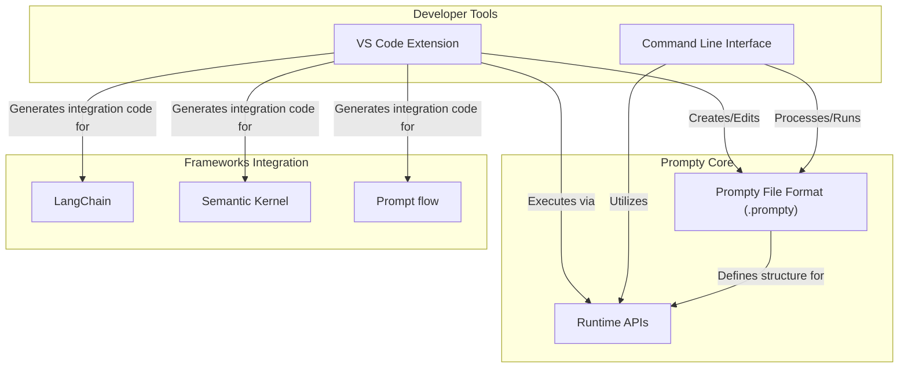
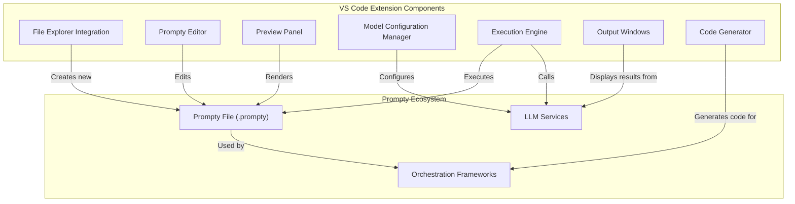

<!-- source: DeepWiki mcp.deepwiki.com · repo microsoft/prompty · page 9 Tools and Extensions · fetched 2026-10-26 -->

# Tools and Extensions

Relevant source files

The following files were used as context for generating this wiki page:

- [LICENSE](LICENSE)
- [README.md](README.md)

This page documents the various tools and extensions available for the Prompty ecosystem that enhance the developer experience when working with Prompty files. These tools streamline prompt engineering workflows and increase productivity. For detailed information about specific tools, see the subsections [VS Code Extension](#9.1) and [Command Line Interface](#9.2).

## Overview

Prompty's tools and extensions are designed to complement the core runtime functionality by providing intuitive interfaces for creating, testing, and deploying prompts. These tools bridge the gap between the prompty file format and practical development workflows.

Sources: [README.md:5-11](), [README.md:58-66]()

## VS Code Extension

The Prompty VS Code extension offers an intuitive prompt playground within VS Code, enabling developers to create, edit, and test prompts without leaving their development environment. It is available in the [Visual Studio Code Marketplace](https://marketplace.visualstudio.com/items?itemName=ms-toolsai.prompty).

### Features

#### Quick Create

The extension enables developers to quickly create new `.prompty` files by right-clicking in the VS Code explorer and selecting "New Prompty". This creates a basic template with the required structure.

#### Preview

The preview feature works similarly to Markdown preview, providing dynamic template rendering while typing. This allows you to see exactly how the rendered prompt will appear before sending it to the model.

#### Model Configuration

The extension supports defining and switching between different model configurations:

- Define configurations directly in VS Code
- Switch between configurations with a quick menu
- Store configurations at user level (for personal use) or workspace level (for team sharing)
- Support for both Azure Active Directory authentication and OpenAI API key authentication

#### Quick Run

Prompty can be executed directly from the editor by pressing F5 or clicking the Run button. Results are displayed in two output windows:

- **Prompty Output**: Shows a concise view of the LLM response
- **Prompty Output (Verbose)**: Displays detailed requests sent and received for debugging

#### Orchestration Framework Integration

The extension can generate integration code snippets for popular orchestration frameworks:

- Prompt flow
- LangChain
- Semantic Kernel

Simply right-click on a `.prompty` file and select the desired integration option.

Sources: [README.md:11-66]()

### Installation and Setup

To install the Prompty VS Code extension:

1. Open VS Code
2. Navigate to the Extensions marketplace
3. Search for "Prompty"
4. Click "Install"

For model configuration, you can either:

- Leave the `api_key` empty to trigger Azure Active Directory authentication
- Provide an OpenAI API key directly in settings
- Use `${env:xxx}` syntax to read API keys from environment variables (can be stored in `.env` files)

Sources: [README.md:33-46]()

## Command Line Interface

The Prompty Command Line Interface (CLI) provides a terminal-based approach to working with `.prompty` files. It complements the VS Code extension by allowing batch processing, automation, and integration with command-line workflows.

The CLI offers functionality for:

- Executing prompty files
- Validating prompty syntax
- Converting between formats
- Integration with shell scripting

For detailed documentation on the CLI functionality and commands, see [Command Line Interface](#9.2).

## Integration with Development Workflows

Both the VS Code extension and CLI are designed to integrate seamlessly with common development workflows:

| Tool | Primary Use Cases | Target Users | Key Features |
|------|------------------|--------------|--------------|
| VS Code Extension | Interactive prompt development | Prompt engineers, developers | Live preview, model switching, quick execution |
| CLI | Automation, CI/CD pipelines | DevOps engineers, automation specialists | Scriptability, batch processing, validation |

Together, these tools provide a comprehensive environment for working with Prompty files across various stages of development, from initial creation to production deployment.

Sources: [README.md:3-11](), [README.md:19-66]()

---

