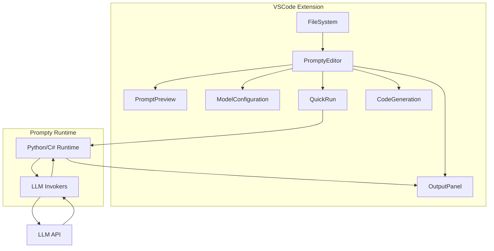
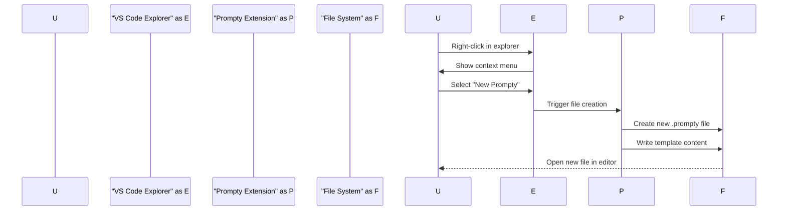
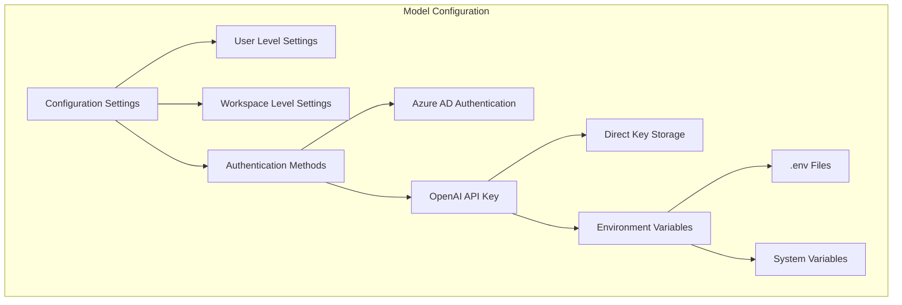
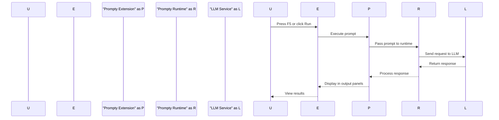
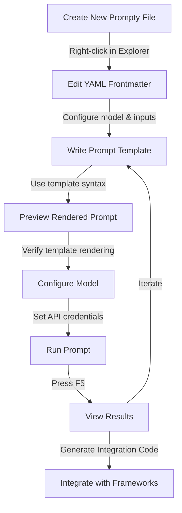

<!-- source: DeepWiki mcp.deepwiki.com · repo microsoft/prompty · page 9.1 VS Code Extension · fetched 2026-10-26 -->

# VS Code Extension

<details>
<summary>Relevant source files</summary>

The following files were used as context for generating this wiki page:

- [LICENSE](LICENSE)
- [README.md](README.md)

</details>


The Prompty VS Code extension provides an intuitive prompt engineering environment directly within Visual Studio Code. This extension allows developers to create, edit, preview, and run Prompty files (.prompty) with an integrated playground, enhancing the prompt development workflow.

This page documents the installation, features, and usage of the VS Code extension. For information about the underlying Prompty file format, see [Prompty File Format](#2).

## Installation

The Prompty extension is available in the Visual Studio Code Marketplace. It can be installed using one of these methods:

1. Search for "Prompty" in the Extensions view (Ctrl+Shift+X)
2. Visit the [Visual Studio Code Marketplace](https://marketplace.visualstudio.com/items?itemName=ms-toolsai.prompty) directly
3. Install from VS Code's Quick Open menu (Ctrl+P) with the command: `ext install ms-toolsai.prompty`

## Extension Architecture

The Prompty VS Code extension serves as a bridge between the VS Code interface and the Prompty runtime system, providing editing capabilities, preview functionality, and execution of prompts.



Sources: [README.md:19-57]()

## Features

### Quick Creation

The extension allows you to quickly create a new Prompty file by right-clicking in the VS Code explorer panel and selecting "New Prompty." This generates a basic template with the standard structure needed for a Prompty file.



Sources: [README.md:20-24]()

### Preview Mode

Similar to Markdown preview in VS Code, the Prompty extension offers a preview panel that renders your prompt template in real-time as you type. This feature allows you to see exactly how your prompt will be processed before it's sent to the model, including the dynamic rendering of any template variables.

Sources: [README.md:25-28]()

### Model Configuration

The extension provides flexible options for configuring model settings:

1. **Define multiple model configurations** directly in VS Code
2. **Switch between configurations** quickly via the command palette or UI
3. **Configure at different scopes**:
   - User level (global settings for all projects)
   - Workspace level (shared with team members via Git)

#### Authentication Options

- **Azure Active Directory (AAD)** authentication (recommended for enhanced security)
  - Leave the `api_key` field empty to trigger AAD auth
- **OpenAI API key** support
  - Store directly in VS Code settings
  - Reference from environment variables using `${env:VARIABLE_NAME}` syntax
  - Use `.env` files in the project or workspace root



Sources: [README.md:30-46]()

### Quick Run

The extension provides a streamlined way to execute your prompts directly from the editor:

1. Press **F5** or click the **Run** button at the top of the editor
2. View results in two output windows:
   - **Prompty Output**: Shows a concise view of the prompt response
   - **Prompty Output (Verbose)**: Displays detailed information about the requests sent and responses received



Sources: [README.md:48-56]()

### Orchestrator Integration

The extension facilitates integration with popular LLM orchestration frameworks by generating the necessary code snippets:

1. Right-click on a `.prompty` file in the explorer
2. Select the desired integration option
3. Copy the generated code snippet into your project

Supported frameworks include:
- Prompt flow
- Langchain
- Semantic Kernel

Sources: [README.md:58-66]()

## Usage Workflow

The typical workflow for working with Prompty in VS Code follows these steps:



Sources: [README.md:20-66]()

## Configuration Options

### Extension Settings

The extension can be configured through VS Code's settings interface. Common settings include:

| Setting | Description | Default |
|---------|-------------|---------|
| `prompty.defaultModel` | Default model to use when not specified in the file | - |
| `prompty.modelConfigurations` | Array of predefined model configurations | [] |
| `prompty.outputMode` | Level of detail in the output panel (concise/verbose) | concise |

### Model Configuration Format

Model configurations follow this structure:

```yaml
models:
  - name: my-azure-gpt-4
    type: azure
    deployment_id: gpt-4
    endpoint: https://your-resource.openai.azure.com/
    api_key: ${env:AZURE_OPENAI_KEY}  # or leave empty for AAD auth
  
  - name: my-openai-gpt-35
    type: openai
    model: gpt-3.5-turbo
    api_key: ${env:OPENAI_API_KEY}
```

Sources: [README.md:30-46]()

## Troubleshooting

### Common Issues

1. **Authentication Failures**
   - For AAD authentication, ensure you're logged into Azure in VS Code
   - For API keys, verify they are correctly stored or referenced

2. **Environment Variables Not Loading**
   - Ensure .env files are in the correct location
   - Restart VS Code after setting system environment variables

3. **Preview Not Updating**
   - Check for syntax errors in your template
   - Try reopening the file or restarting the preview

Sources: [README.md:41-46]()

---

