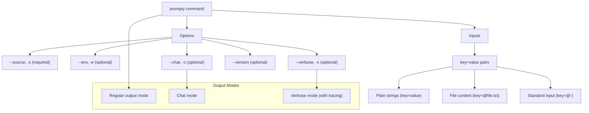
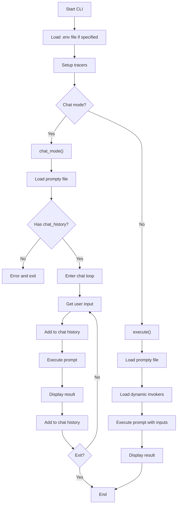
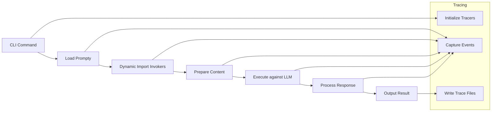

<!-- source: DeepWiki mcp.deepwiki.com · repo microsoft/prompty · page 9.2 Command Line Interface · fetched 2026-10-26 -->

# Command Line Interface

<details>
<summary>Relevant source files</summary>

The following files were used as context for generating this wiki page:

- [runtime/prompty/prompty/__init__.py](runtime/prompty/prompty/__init__.py)
- [runtime/prompty/prompty/cli.py](runtime/prompty/prompty/cli.py)
- [runtime/prompty/prompty/core.py](runtime/prompty/prompty/core.py)
- [runtime/prompty/prompty/invoker.py](runtime/prompty/prompty/invoker.py)
- [runtime/prompty/prompty/mustache.py](runtime/prompty/prompty/mustache.py)
- [runtime/prompty/prompty/openai/processor.py](runtime/prompty/prompty/openai/processor.py)
- [runtime/prompty/prompty/renderers.py](runtime/prompty/prompty/renderers.py)
- [runtime/prompty/prompty/tracer.py](runtime/prompty/prompty/tracer.py)
- [runtime/prompty/prompty/utils.py](runtime/prompty/prompty/utils.py)
- [runtime/prompty/tests/prompts/chat.prompty](runtime/prompty/tests/prompts/chat.prompty)
- [runtime/prompty/tests/test_core.py](runtime/prompty/tests/test_core.py)

</details>


The Prompty Command Line Interface (CLI) provides a way to run Prompty files directly from the terminal without writing code. This allows you to quickly test, debug, and use prompts in a terminal environment. This page documents the CLI's usage, arguments, and features.

For information on using Prompty in application code, see the Python API Reference in [Python API Reference](#3.1).

## Installation

The CLI is automatically installed when you install the Python runtime package:

```bash
pip install prompty
```

After installation, the `prompty` command will be available in your terminal.

Sources: [runtime/prompty/prompty/cli.py:141-165]()

## Basic Usage

The CLI has the following basic syntax:

```bash
prompty --source <file.prompty> [options] [inputs]
```

For example:

```bash
prompty --source prompts/conversation.prompty question="What is the capital of France?"
```

Sources: [runtime/prompty/prompty/cli.py:124-141]()

## Command Structure



Sources: [runtime/prompty/prompty/cli.py:125-141](), [runtime/prompty/prompty/cli.py:105-122]()

## Command Arguments

### Required Arguments

| Argument | Description |
|----------|-------------|
| `--source`, `-s` | Path to the prompty file to execute |

### Optional Arguments

| Argument | Description |
|----------|-------------|
| `--env`, `-e` | Path to a .env file for loading environment variables |
| `--verbose`, `-v` | Enable verbose output with tracing information |
| `--chat`, `-c` | Run in interactive chat mode |
| `--version` | Show the version number and exit |

### Input Arguments

Inputs are provided as key-value pairs:

```bash
prompty -s prompt.prompty key1=value1 key2=value2
```

The values can come from:
- Plain strings: `key="value"`
- Files: `key=@file.txt`
- Standard input: `key=@-`

Sources: [runtime/prompty/prompty/cli.py:105-122](), [runtime/prompty/prompty/cli.py:141-151]()

## Execution Flow



Sources: [runtime/prompty/prompty/cli.py:83-103](), [runtime/prompty/prompty/cli.py:46-80](), [runtime/prompty/prompty/cli.py:141-165]()

## Execution Modes

### Regular Execution Mode

In regular mode, the CLI:
1. Loads the specified prompty file
2. Dynamically imports the required executor/processor
3. Executes the prompt with provided inputs
4. Formats and displays the result

```bash
prompty -s summary.prompty text="This is a text to summarize"
```

Sources: [runtime/prompty/prompty/cli.py:83-103]()

### Chat Mode

Chat mode provides an interactive conversation interface:

1. The prompty file must have a `chat_history` input defined
2. The CLI maintains a conversation history
3. User inputs are processed and responses are streamed back

```bash
prompty -s chat.prompty --chat
```

Example conversation:
```
User: Hello, who are you?
Assistant: I'm an AI assistant. How can I help you today?

User: What can you do?
Assistant: I can answer questions, provide information, and help with various tasks.
```

Sources: [runtime/prompty/prompty/cli.py:46-80]()

## Tracing and Debugging

The CLI integrates with Prompty's tracing system, which helps debug and monitor prompt execution.

### Verbose Mode

When you run with the `--verbose` or `-v` flag, the CLI will:
1. Add a console tracer that prints detailed execution steps
2. Write trace files to the `.runs` directory in the current working directory

```bash
prompty -s prompt.prompty -v
```

This will output detailed information about:
- Prompt loading
- Template rendering
- Model invocation
- Response processing

### Trace Files

Trace files are stored in the `.runs` directory with the format:
```
<prompt_name>.<timestamp>.tracy
```

These files contain structured JSON with execution details and can be used for debugging or auditing.

Sources: [runtime/prompty/prompty/cli.py:152-161](), [runtime/prompty/prompty/tracer.py:253-266](), [runtime/prompty/prompty/tracer.py:351-365]()

## CLI Architecture

```mermaid
classDiagram
    class "CLI Command" {
        run()
        execute()
        chat_mode()
        _attributes_to_dict()
        normalize_path()
        dynamic_import()
    }
    
    class "Tracer System" {
        Tracer
        PromptyTracer
        console_tracer
        trace
    }
    
    class "Core Runtime" {
        load()
        execute()
        prepare()
        run()
    }
    
    class "Invoker System" {
        InvokerFactory
        Invoker
        dynamic_import()
    }
    
    "CLI Command" --> "Tracer System" : uses
    "CLI Command" --> "Core Runtime" : calls
    "Core Runtime" --> "Invoker System" : uses
    "Tracer System" --> "Invoker System" : traces
```

Sources: [runtime/prompty/prompty/cli.py:1-166](), [runtime/prompty/prompty/tracer.py:28-376](), [runtime/prompty/prompty/__init__.py:29-593]()

## Internal Processing Flow

The CLI processes commands through several stages:



Sources: [runtime/prompty/prompty/cli.py:83-103](), [runtime/prompty/prompty/__init__.py:209-265](), [runtime/prompty/prompty/__init__.py:489-539]()

## Dynamic Invoker Loading

The CLI dynamically loads the appropriate invokers based on the model configuration:

```mermaid
flowchart LR
    A["CLI"] --> B["dynamic_import()"]
    B --> C{"Model type?"}
    
    C -->|"azure" or "azure_openai"| D["Import prompty.azure"]
    C -->|"openai"| E["Import prompty.openai"]
    C -->|"serverless"| F["Import prompty.serverless"]
    C -->|custom| G["Import custom module"]
    
    D & E & F & G --> H["Register with InvokerFactory"]
    
    H --> I["Executor"]
    H --> J["Processor"]
```

Sources: [runtime/prompty/prompty/cli.py:30-42](), [runtime/prompty/prompty/invoker.py:90-146]()

## Examples

### Basic Execution

```bash
prompty -s summarize.prompty text="This is a long text that needs to be summarized."
```

### Chat Mode

```bash
prompty -s assistant.prompty --chat
```

### Using Environment Variables

```bash
prompty -s generate.prompty --env .env
```

### Multiple Inputs

```bash
prompty -s analyze.prompty text="Sample text" format="markdown" max_length=1000
```

### Input from File

```bash
prompty -s process.prompty content=@document.txt
```

### Input from Standard Input

```bash
cat document.txt | prompty -s process.prompty content=@-
```

### Verbose Debugging

```bash
prompty -s complex.prompty --verbose
```

Sources: [runtime/prompty/prompty/cli.py:124-134](), [runtime/prompty/prompty/cli.py:83-103](), [runtime/prompty/prompty/cli.py:46-80]()

## Limitations and Best Practices

- The CLI is best for interactive testing and simple prompt execution
- For complex applications, consider using the Python API directly
- Environment variables for API keys should be properly set
- Chat mode requires the prompty file to define a `chat_history` input
- Trace files can grow large if verbose mode is used extensively

Sources: [runtime/prompty/prompty/cli.py:46-80](), [runtime/prompty/prompty/tracer.py:253-266]()

---

