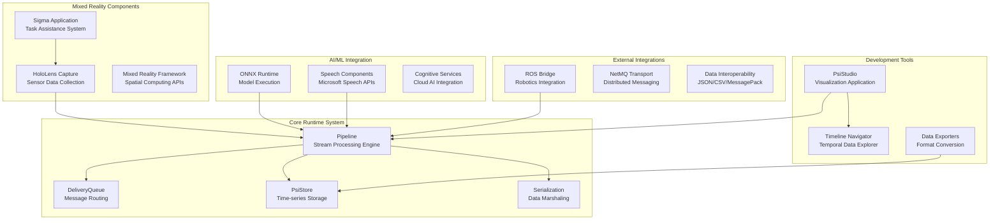
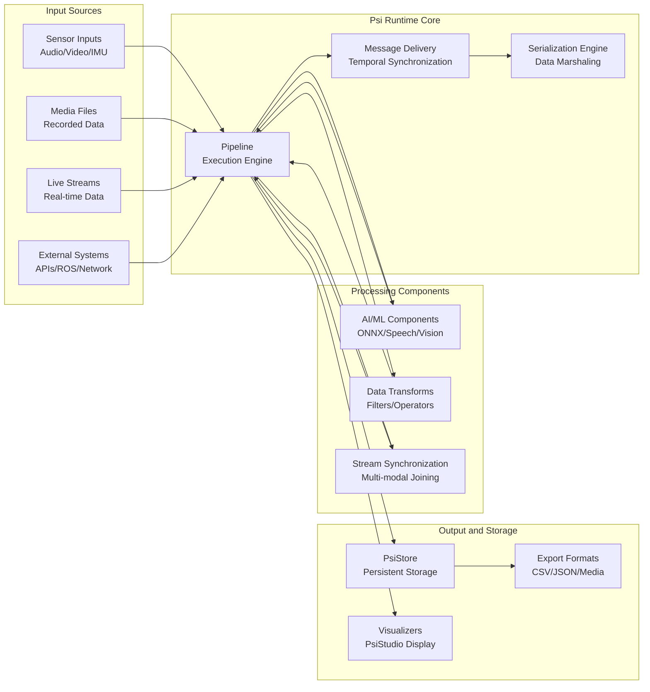

<!-- source: DeepWiki mcp.deepwiki.com · repo microsoft/psi · page 1 Overview · fetched 2026-10-26 -->

# Overview

Relevant source files

The following files were used as context for generating this wiki page:

- [.gitignore](.gitignore)
- [CONTRIBUTING.md](CONTRIBUTING.md)
- [README.md](README.md)

This document provides a high-level introduction to the Platform for Situated Intelligence (Psi) framework, covering its purpose, architecture, and key capabilities. It serves as the entry point for understanding how the various components of the Psi ecosystem work together to enable multimodal, integrative AI systems.

For detailed information about specific subsystems, see the [Core Framework](#2) for runtime components, [Mixed Reality and HoloLens](#3) for spatial computing capabilities, [Visualization and Analysis](#4) for PsiStudio tools, [External Integrations](#5) for third-party system connectivity, and [Development and Testing](#7) for build and contribution workflows.

## What is Platform for Situated Intelligence

Platform for Situated Intelligence (Psi) is an open-source framework for developing multimodal, integrative AI systems that process streaming sensor data under real-time constraints. The framework enables applications such as social robots, embodied conversational agents, mixed-reality systems, and ambient intelligence solutions.

The framework is built on .NET Standard, providing cross-platform support for Windows and Linux environments. It follows a stream-centric processing model where all data flows through time-synchronized message streams, enabling precise temporal coordination across multiple input modalities.

**Sources:** [README.md:6-12]()

## Key Features and Capabilities

| Feature | Description | Key Components |
|---------|-------------|----------------|
| **Stream Processing** | Time-synchronized message delivery and processing | `Pipeline`, `DeliveryQueue`, message streams |
| **Data Persistence** | Efficient storage and replay of temporal data | `PsiStore`, serialization system |
| **Mixed Reality** | HoloLens integration and spatial computing | HoloLens capture, Sigma application |
| **Visualization** | Interactive data analysis and timeline navigation | PsiStudio, timeline navigator |
| **AI/ML Integration** | Support for ONNX models and cognitive services | ONNX runtime, speech recognition |
| **External Connectivity** | Integration with ROS, cloud services, and data formats | ROS bridge, NetMQ transport |

**Sources:** [README.md:8-12](), [README.md:37-52]()

## Platform Architecture

### Overall System Architecture

The Psi platform consists of several interconnected subsystems that work together to provide a comprehensive development environment for multimodal AI applications.

**Sources:** [README.md:8-12](), [README.md:22-26]()

### Core Data Flow Architecture

This diagram shows how data flows through the core Psi runtime system, from input sources through processing components to storage and visualization.

**Sources:** [README.md:6-12](), [README.md:37-52]()

## Core System Components

### Runtime Infrastructure

The core runtime provides the fundamental infrastructure for stream processing and data management:

- **Pipeline Engine**: Manages component lifecycle, message routing, and temporal synchronization across all data streams
- **Message Delivery System**: Ensures time-ordered delivery of messages with support for real-time and replay scenarios  
- **Serialization Framework**: Handles cross-platform data marshaling and type safety for stream persistence
- **PsiStore**: Provides efficient storage and indexing for time-series data with support for random access and streaming replay

### Development and Analysis Tools

- **PsiStudio**: Interactive visualization application for exploring temporal data, debugging pipelines, and analyzing multimodal streams
- **Timeline Navigator**: Temporal exploration interface allowing navigation through recorded data sessions
- **Data Exporters**: Tools for converting PsiStore data to various formats including CSV, JSON, and media files

### Mixed Reality Capabilities

- **HoloLens Capture System**: Comprehensive data collection from HoloLens 2 sensors including cameras, IMU, audio, and spatial mapping
- **Sigma Application**: Mixed reality task assistance system demonstrating real-time interactive agent capabilities
- **Mixed Reality Framework**: Core utilities for spatial computing, coordinate transformations, and mixed reality application development

**Sources:** [README.md:22-26](), [README.md:47-50]()

## Getting Started

### Prerequisites and Installation

Psi requires .NET development environment and supports both Windows and Linux platforms. Applications can be built using either:

- **NuGet Packages**: Reference pre-built `Microsoft.Psi.*` packages for rapid development
- **Source Build**: Clone and build the repository for full access to source code and latest features

### Sample Applications

The framework includes several sample applications demonstrating key concepts:

| Sample | Complexity | Requirements | Purpose |
|--------|------------|--------------|---------|
| **HelloWorld** | Basic | None | Simple pipeline creation and stream processing |
| **SimpleVoiceActivityDetector** | Basic | Microphone | Audio capture and voice activity detection |
| **WebcamWithAudio** | Intermediate | Webcam + Microphone | Multi-modal synchronization demonstration |
| **WhatIsThat** | Advanced | Azure Kinect + Cognitive Services | Object detection with pointing recognition |
| **HoloLensSample** | Advanced | HoloLens 2 | Mixed reality application development |

### Development Workflow

1. **Create Pipeline**: Instantiate `Pipeline` class to manage component execution
2. **Add Components**: Connect input sources, processing components, and output sinks
3. **Configure Streams**: Set up message routing and temporal synchronization requirements
4. **Run or Store**: Execute pipeline in real-time or persist data to `PsiStore` for analysis
5. **Visualize**: Use PsiStudio to explore data and debug pipeline behavior

**Sources:** [README.md:35-52](), [README.md:43-50]()

## Community and Resources

The Psi framework is actively used by research institutions including Microsoft Research, Cornell Tech, MIT, Carnegie Mellon University, and others. The project welcomes community contributions through GitHub issues, discussions, and pull requests.

For technical support, use the GitHub [Discussions](https://github.com/microsoft/psi/discussions) forum. For bug reports and feature requests, file [GitHub issues](https://github.com/microsoft/psi/issues) with appropriate labels.

**Sources:** [README.md:54-82](), [README.md:60-62]()

---

