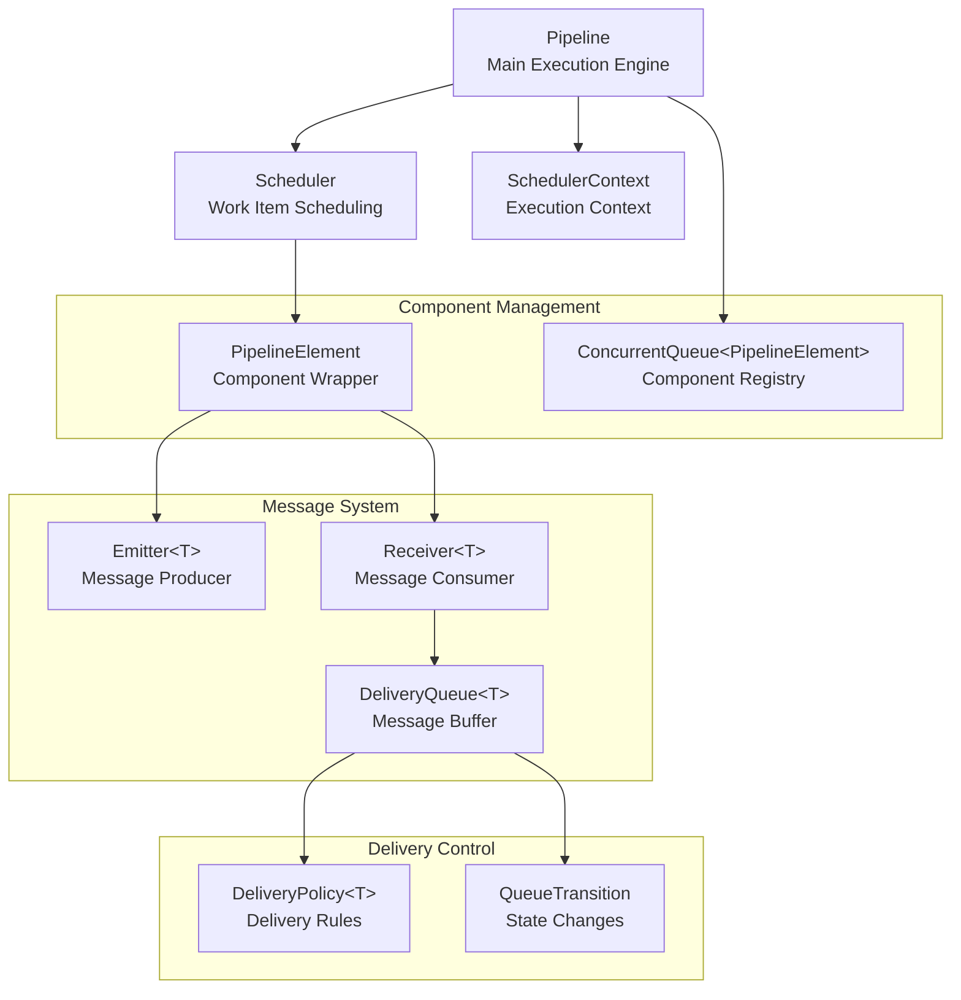
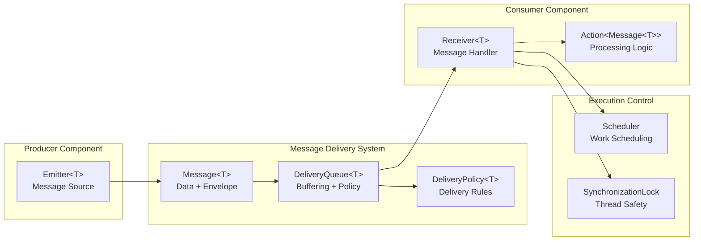
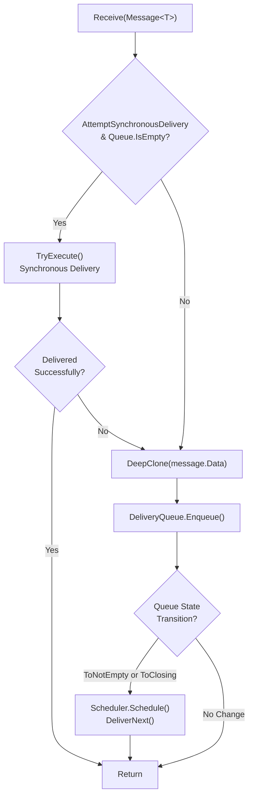
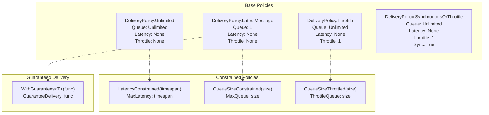
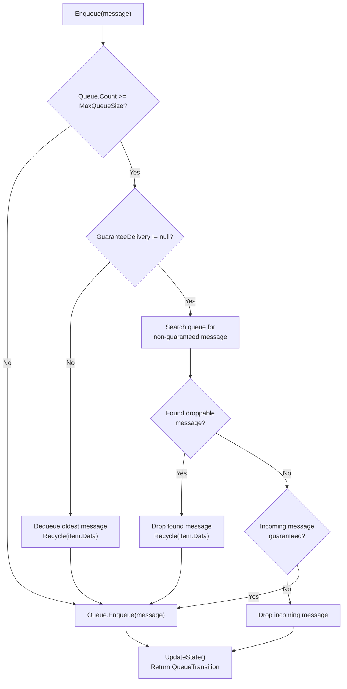
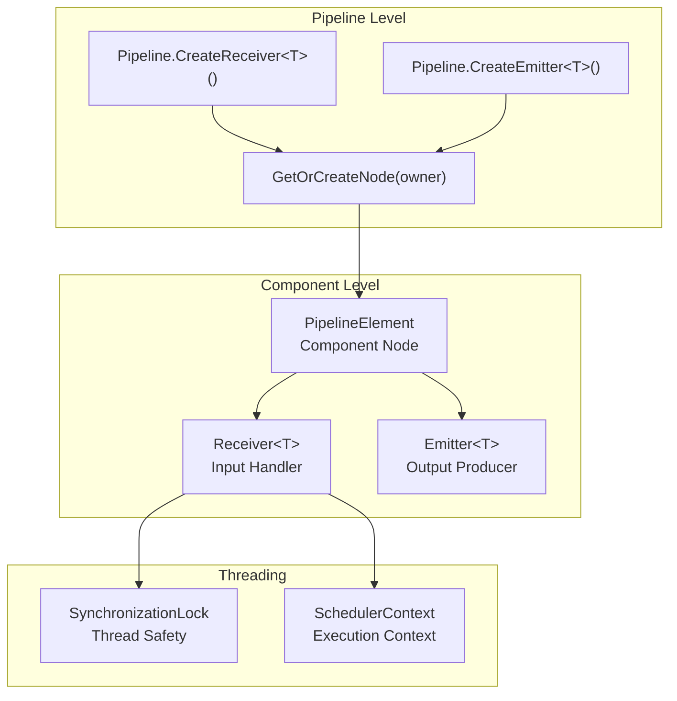

<!-- source: DeepWiki mcp.deepwiki.com · repo microsoft/psi · page 2 Core Framework · fetched 2026-10-26 -->

# Core Framework

Relevant source files

The following files were used as context for generating this wiki page:

- [Sources/Audio/Microsoft.Psi.Audio.Windows/AudioCapture.cs](Sources/Audio/Microsoft.Psi.Audio.Windows/AudioCapture.cs)
- [Sources/Runtime/Microsoft.Psi/Common/DeliveryPolicy.cs](Sources/Runtime/Microsoft.Psi/Common/DeliveryPolicy.cs)
- [Sources/Runtime/Microsoft.Psi/Common/DeliveryPolicy{T}.cs](Sources/Runtime/Microsoft.Psi/Common/DeliveryPolicy{T}.cs)
- [Sources/Runtime/Microsoft.Psi/Executive/Pipeline.cs](Sources/Runtime/Microsoft.Psi/Executive/Pipeline.cs)
- [Sources/Runtime/Microsoft.Psi/Streams/DeliveryQueue.cs](Sources/Runtime/Microsoft.Psi/Streams/DeliveryQueue.cs)
- [Sources/Runtime/Microsoft.Psi/Streams/Receiver{T}.cs](Sources/Runtime/Microsoft.Psi/Streams/Receiver{T}.cs)
- [Sources/Runtime/Test.Psi/DeliveryPolicyTest.cs](Sources/Runtime/Test.Psi/DeliveryPolicyTest.cs)

This document covers the fundamental runtime components that form the backbone of the Microsoft Psi framework. The core framework provides the essential infrastructure for message-based stream processing, including pipeline execution, message delivery, component communication, and queue management.

For information about data storage and retrieval, see [Data Persistence and Storage](#2.2). For details about serialization mechanisms, see [Serialization System](#2.3). For stream processing operators and transformations, see [Stream Processing Operators](#2.4).

## Pipeline Architecture

The `Pipeline` class serves as the central orchestrator for all component execution and message delivery in the Psi framework. It manages component lifecycles, schedules message processing, and coordinates inter-component communication through a sophisticated messaging system.

**Pipeline Component Architecture**

Sources: [Sources/Runtime/Microsoft.Psi/Executive/Pipeline.cs:21-153](), [Sources/Runtime/Microsoft.Psi/Streams/Receiver{T}.cs:27-84]()

The pipeline maintains several key responsibilities:

| Component | Purpose | Key Methods |
|-----------|---------|-------------|
| `Pipeline` | Central coordinator | `Create()`, `Run()`, `RunAsync()` |
| `Scheduler` | Work item execution | `Schedule()`, `TryExecute()` |
| `PipelineElement` | Component wrapper | `Initialize()`, `AddInput()`, `AddOutput()` |
| `ConcurrentQueue<PipelineElement>` | Component registry | Thread-safe component storage |

## Message Processing and Delivery

The message processing system implements a sophisticated delivery mechanism that handles message routing, queuing, and execution scheduling. Messages flow through the system via `Emitter` and `Receiver` pairs, with delivery behavior controlled by configurable policies.

**Message Flow Architecture**

Sources: [Sources/Runtime/Microsoft.Psi/Streams/Receiver{T}.cs:239-323](), [Sources/Runtime/Microsoft.Psi/Streams/DeliveryQueue.cs:87-130]()

### Message Delivery Process

The `Receiver<T>` class implements a two-path delivery mechanism:

1. **Synchronous Path**: Direct execution when conditions allow
2. **Asynchronous Path**: Queued execution through the scheduler

The delivery process in the `Receive` method [Sources/Runtime/Microsoft.Psi/Streams/Receiver{T}.cs:268-322]() follows this pattern:

Sources: [Sources/Runtime/Microsoft.Psi/Streams/Receiver{T}.cs:268-322]()

## Delivery Policies and Queue Management

The `DeliveryPolicy` system provides configurable message delivery behaviors that control how messages are queued, when they are dropped, and how backpressure is handled. The `DeliveryQueue<T>` implements these policies through sophisticated queuing logic.

**Delivery Policy Types**

Sources: [Sources/Runtime/Microsoft.Psi/Common/DeliveryPolicy.cs:21-61](), [Sources/Runtime/Microsoft.Psi/Common/DeliveryPolicy{T}.cs:111-119]()

### Queue State Management

The `DeliveryQueue<T>` manages complex state transitions through the `QueueTransition` struct, which tracks changes in queue state and triggers appropriate throttling behavior:

| Transition | Description | Action |
|------------|-------------|---------|
| `ToEmpty` | Queue became empty | Stop scheduling delivery |
| `ToNotEmpty` | Queue received first message | Start scheduling delivery |
| `ToStartThrottling` | Queue reached throttle threshold | Freeze upstream producer |
| `ToStopThrottling` | Queue dropped below throttle threshold | Unfreeze upstream producer |
| `ToClosing` | Received closing message | Schedule final delivery |

Sources: [Sources/Runtime/Microsoft.Psi/Streams/DeliveryQueue.cs:14-40](), [Sources/Runtime/Microsoft.Psi/Streams/DeliveryQueue.cs:282-304]()

### Message Dropping Logic

The queue implements sophisticated message dropping logic in the `Enqueue` method [Sources/Runtime/Microsoft.Psi/Streams/DeliveryQueue.cs:140-270]() that respects delivery guarantees:

Sources: [Sources/Runtime/Microsoft.Psi/Streams/DeliveryQueue.cs:153-270]()

## Component Communication Infrastructure

The framework provides a robust component communication system through the `CreateReceiver` and `CreateEmitter` methods on the `Pipeline` class. This system ensures type safety, proper lifecycle management, and efficient message routing.

**Component Wiring Architecture**

Sources: [Sources/Runtime/Microsoft.Psi/Executive/Pipeline.cs:353-387](), [Sources/Runtime/Microsoft.Psi/Executive/Pipeline.cs:442-445]()

The pipeline ensures that all receivers associated with the same component owner are never executed concurrently, providing a critical thread-safety guarantee for component implementations.

Sources: [Sources/Runtime/Microsoft.Psi/Executive/Pipeline.cs:21-153](), [Sources/Runtime/Microsoft.Psi/Streams/DeliveryQueue.cs:47-306](), [Sources/Runtime/Microsoft.Psi/Streams/Receiver{T}.cs:27-454](), [Sources/Runtime/Microsoft.Psi/Common/DeliveryPolicy.cs:11-236](), [Sources/Runtime/Microsoft.Psi/Common/DeliveryPolicy{T}.cs:12-121]()

---

