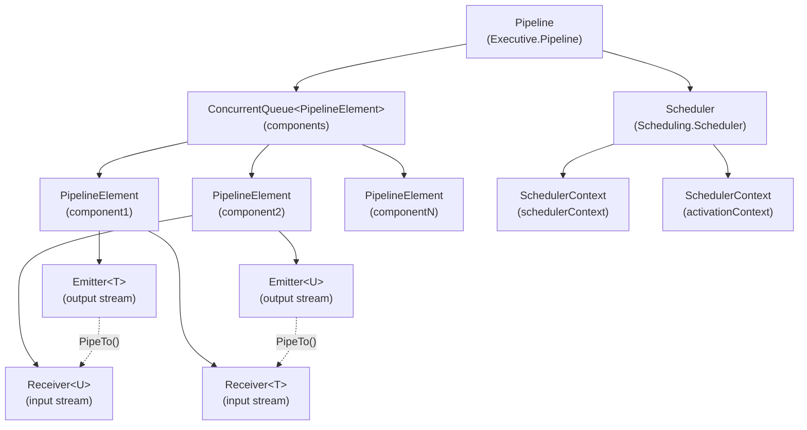
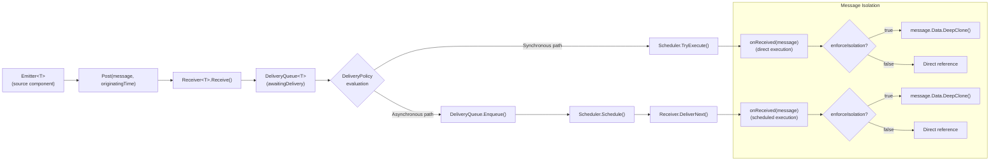
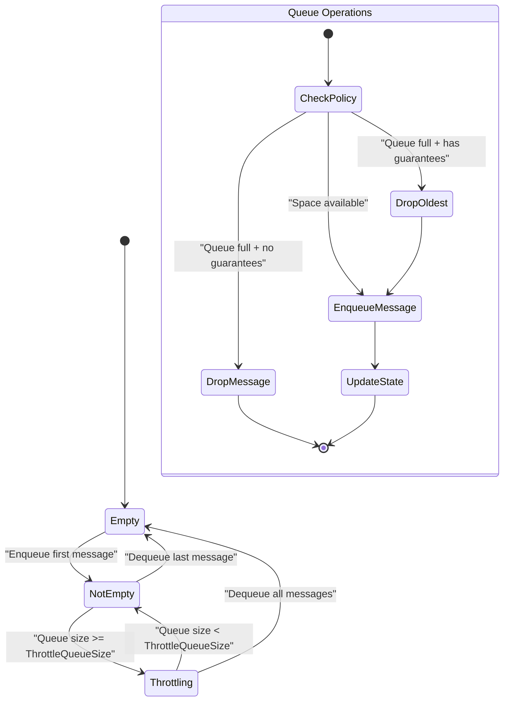
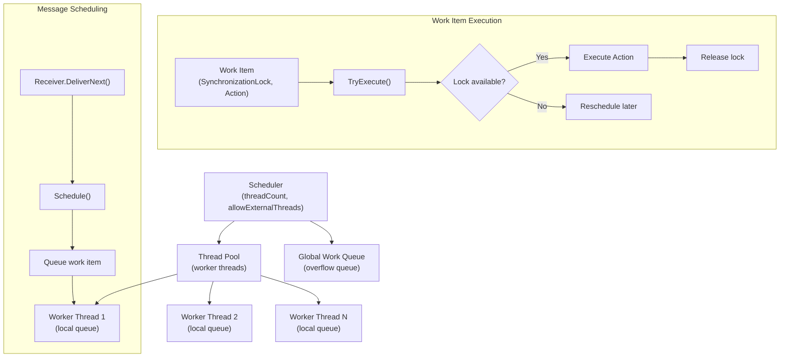
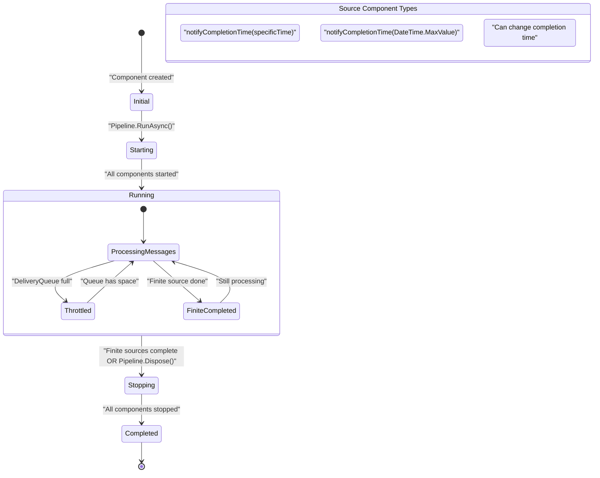
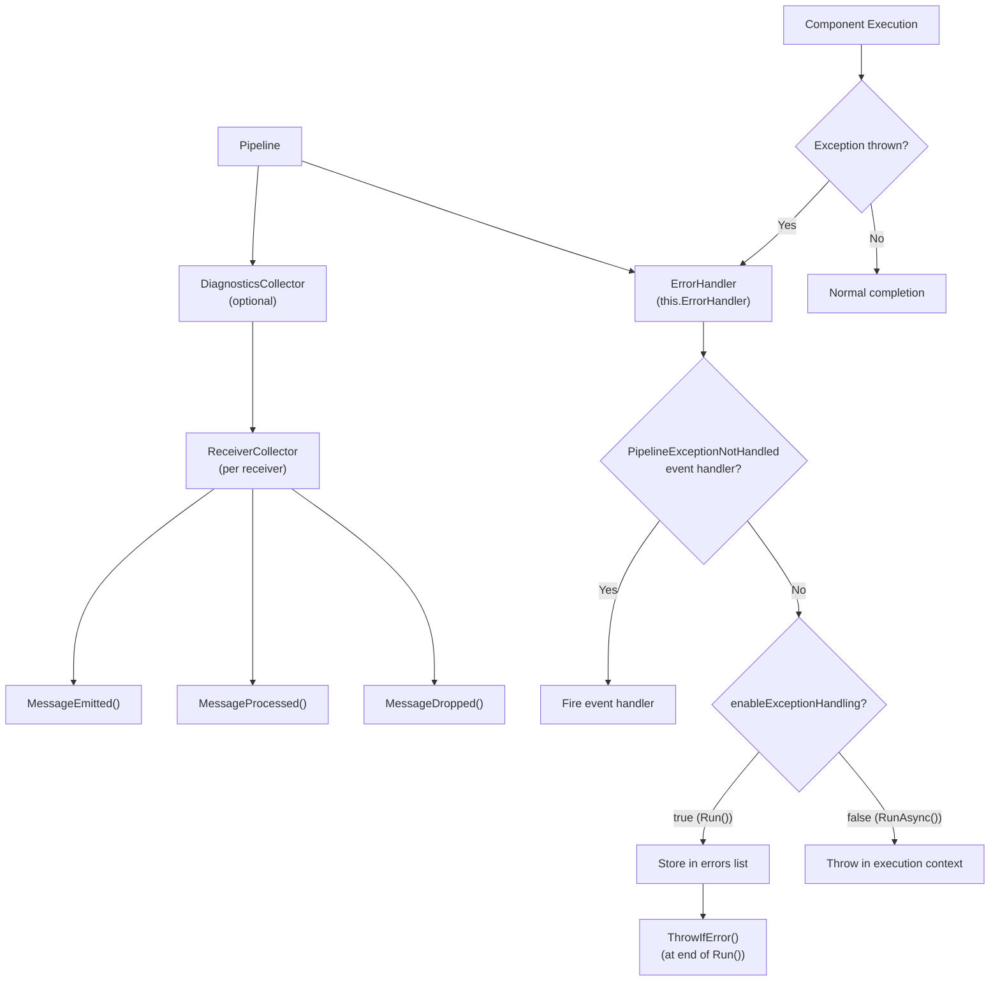

<!-- source: DeepWiki mcp.deepwiki.com · repo microsoft/psi · page 2.1 Pipeline and Message Processing · fetched 2026-10-26 -->

# Pipeline and Message Processing

Relevant source files

The following files were used as context for generating this wiki page:

- [Sources/Audio/Microsoft.Psi.Audio.Windows/AudioCapture.cs](Sources/Audio/Microsoft.Psi.Audio.Windows/AudioCapture.cs)
- [Sources/Imaging/Test.Psi.Imaging.Windows/AverageColorTests.cs](Sources/Imaging/Test.Psi.Imaging.Windows/AverageColorTests.cs)
- [Sources/Kinect/Test.Psi.Kinect.Windows.x64/MeshTests.cs](Sources/Kinect/Test.Psi.Kinect.Windows.x64/MeshTests.cs)
- [Sources/Media/Microsoft.Psi.Media.Windows.x64/MediaSource.cs](Sources/Media/Microsoft.Psi.Media.Windows.x64/MediaSource.cs)
- [Sources/RealSense/Microsoft.Psi.RealSense.Windows.x64/RealSenseSensor.cs](Sources/RealSense/Microsoft.Psi.RealSense.Windows.x64/RealSenseSensor.cs)
- [Sources/Runtime/Microsoft.Psi/Common/DeliveryPolicy.cs](Sources/Runtime/Microsoft.Psi/Common/DeliveryPolicy.cs)
- [Sources/Runtime/Microsoft.Psi/Common/DeliveryPolicy{T}.cs](Sources/Runtime/Microsoft.Psi/Common/DeliveryPolicy{T}.cs)
- [Sources/Runtime/Microsoft.Psi/Executive/Pipeline.cs](Sources/Runtime/Microsoft.Psi/Executive/Pipeline.cs)
- [Sources/Runtime/Microsoft.Psi/Streams/DeliveryQueue.cs](Sources/Runtime/Microsoft.Psi/Streams/DeliveryQueue.cs)
- [Sources/Runtime/Microsoft.Psi/Streams/Receiver{T}.cs](Sources/Runtime/Microsoft.Psi/Streams/Receiver{T}.cs)
- [Sources/Runtime/Test.Psi/CommonTester.cs](Sources/Runtime/Test.Psi/CommonTester.cs)
- [Sources/Runtime/Test.Psi/DeliveryPolicyTest.cs](Sources/Runtime/Test.Psi/DeliveryPolicyTest.cs)
- [Sources/Runtime/Test.Psi/IntervalTests.cs](Sources/Runtime/Test.Psi/IntervalTests.cs)
- [Sources/Runtime/Test.Psi/JoinTests.cs](Sources/Runtime/Test.Psi/JoinTests.cs)
- [Sources/Runtime/Test.Psi/PipelineTest.cs](Sources/Runtime/Test.Psi/PipelineTest.cs)
- [Sources/Visualization/Microsoft.Psi.Visualization.Windows/PluginMap.cs](Sources/Visualization/Microsoft.Psi.Visualization.Windows/PluginMap.cs)

This document covers the core runtime architecture of Microsoft Psi's pipeline system, focusing on how components communicate through message passing, delivery queues, and scheduling mechanisms. It explains the fundamental classes and patterns that enable real-time stream processing in Psi applications.

For information about data persistence and storage, see [Data Persistence and Storage](#2.2). For details about serialization mechanisms, see [Serialization System](#2.3).

## Core Pipeline Architecture

The `Pipeline` class serves as the central execution engine that manages a graph of interconnected components. Each pipeline contains components that communicate through typed message streams using emitters and receivers.

### Pipeline Component Graph

The pipeline maintains component references in a `ConcurrentQueue<PipelineElement>` and uses two distinct scheduler contexts: one for message delivery and another exclusively for component activation.

Sources: [Sources/Runtime/Microsoft.Psi/Executive/Pipeline.cs:21-263](), [Sources/Runtime/Test.Psi/PipelineTest.cs:25-40]()

## Message Delivery System

Message delivery in Psi follows a sophisticated queuing and scheduling system that ensures proper ordering and timing while supporting various delivery policies.

### Message Flow Architecture

The system attempts synchronous delivery first when possible (based on `DeliveryPolicy.AttemptSynchronousDelivery`), falling back to asynchronous queued delivery when necessary.

Sources: [Sources/Runtime/Microsoft.Psi/Streams/Receiver{T}.cs:239-323](), [Sources/Runtime/Microsoft.Psi/Streams/DeliveryQueue.cs:132-270]()

## Delivery Policies and Queue Management

Delivery policies control message queuing behavior, latency constraints, and dropping strategies. The `DeliveryQueue<T>` implements these policies while maintaining message ordering.

### DeliveryPolicy Types

| Policy | Description | Queue Behavior | Use Case |
|--------|-------------|----------------|----------|
| `Unlimited` | No queue size limit | Grows indefinitely | Lossless processing |
| `LatestMessage` | Queue size of 1 | Drops old messages | Real-time scenarios |
| `Throttle` | Throttles source when queue full | Blocks upstream | Back-pressure control |
| `SynchronousOrThrottle` | Attempts sync delivery first | Sync then throttle | Low-latency processing |

### Queue State Management

The `QueueTransition` struct tracks state changes (`ToEmpty`, `ToNotEmpty`, `ToStartThrottling`, `ToStopThrottling`, `ToClosing`) to trigger appropriate scheduling and throttling actions.

Sources: [Sources/Runtime/Microsoft.Psi/Streams/DeliveryQueue.cs:14-305](), [Sources/Runtime/Microsoft.Psi/Common/DeliveryPolicy.cs:11-236](), [Sources/Runtime/Test.Psi/DeliveryPolicyTest.cs:15-349]()

## Scheduling and Threading

The `Scheduler` class manages thread pools and work item execution. Components are associated with `SynchronizationLock` contexts that ensure exclusive execution of receivers belonging to the same component.

### Scheduler Architecture

Each component has a `SynchronizationLock` that prevents concurrent execution of its receivers, ensuring thread safety without explicit locking in component code.

Sources: [Sources/Runtime/Microsoft.Psi/Executive/Pipeline.cs:45-99](), [Sources/Runtime/Test.Psi/PipelineTest.cs:311-324]()

## Component Lifecycle Management

Pipeline components follow a defined lifecycle with explicit start/stop phases and completion tracking for both finite and infinite source components.

### Component States and Transitions

The pipeline tracks `completableComponents` and uses the `NoRemainingCompletableComponents` event to coordinate shutdown. Finite sources signal completion by calling `notifyCompletionTime` with their final originating time.

Sources: [Sources/Runtime/Microsoft.Psi/Executive/Pipeline.cs:173-286](), [Sources/Runtime/Test.Psi/PipelineTest.cs:376-461]()

## Error Handling and Diagnostics

The pipeline provides comprehensive error handling and diagnostic capabilities through the `DiagnosticsCollector` system and exception management.

### Error Flow and Diagnostics

The pipeline distinguishes between synchronous execution (where exceptions are collected and re-thrown) and asynchronous execution (where exceptions propagate immediately unless handled).

Sources: [Sources/Runtime/Microsoft.Psi/Executive/Pipeline.cs:474-487](), [Sources/Runtime/Microsoft.Psi/Streams/Receiver{T}.cs:241-296]()

---

