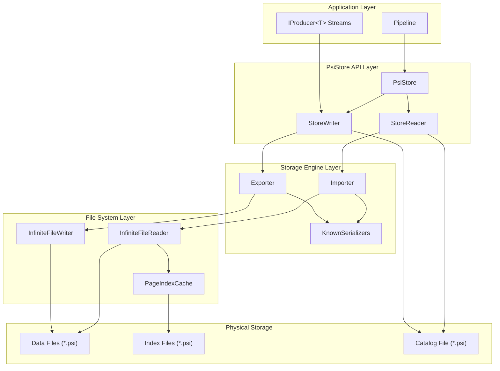
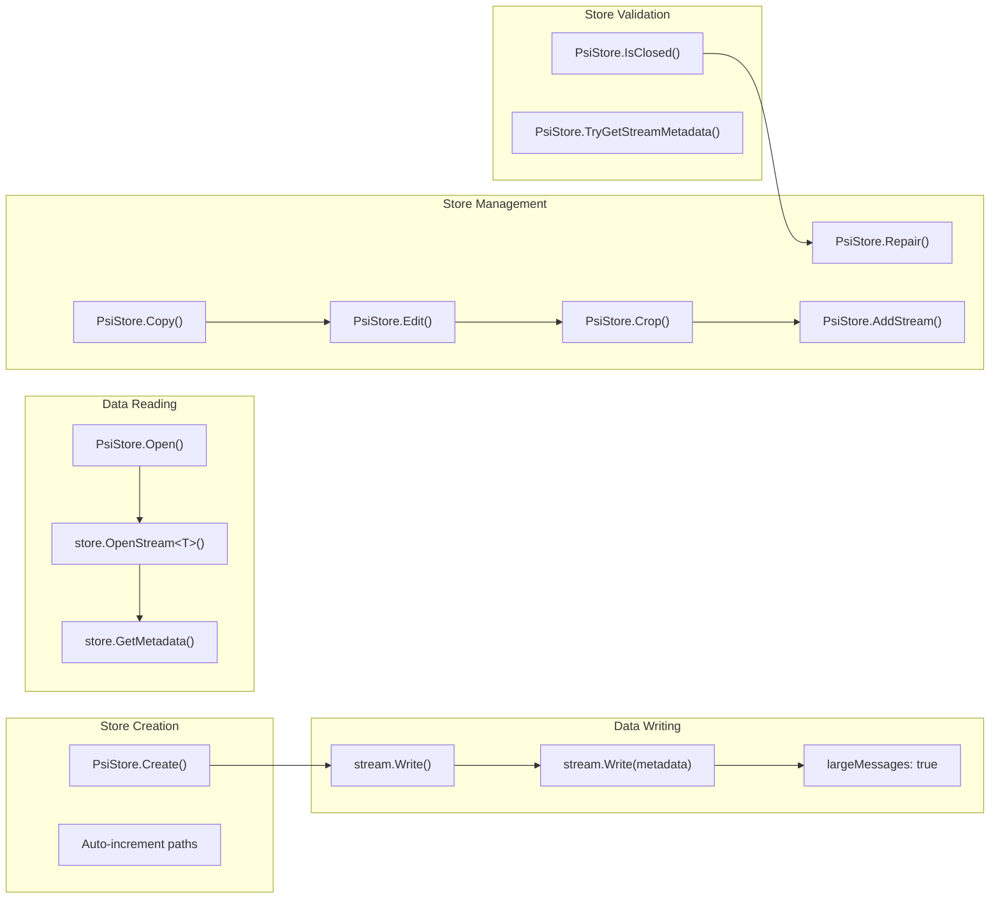
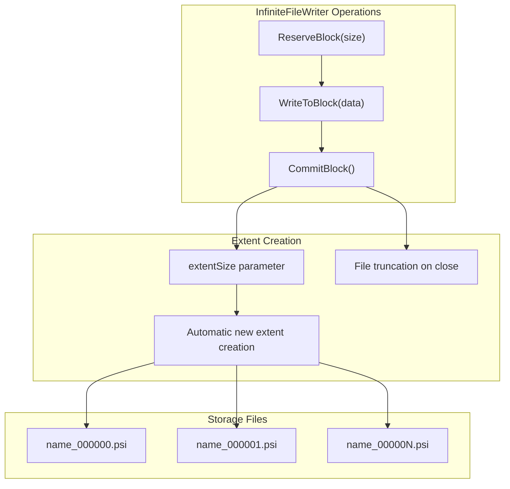
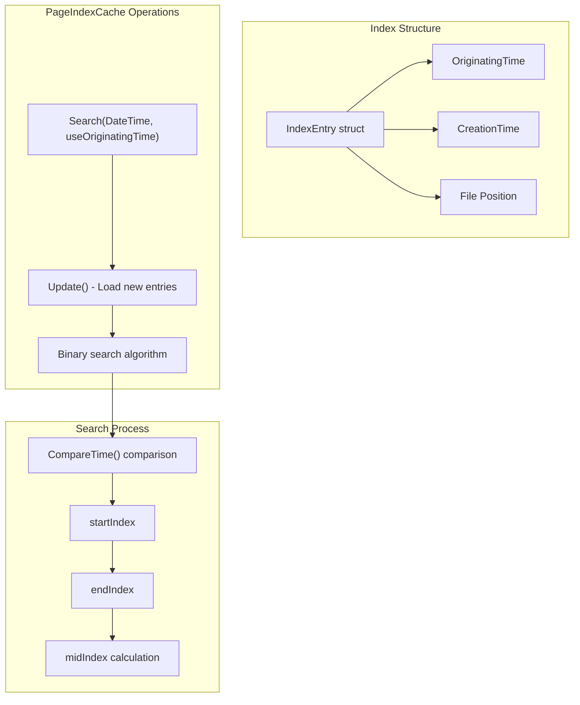
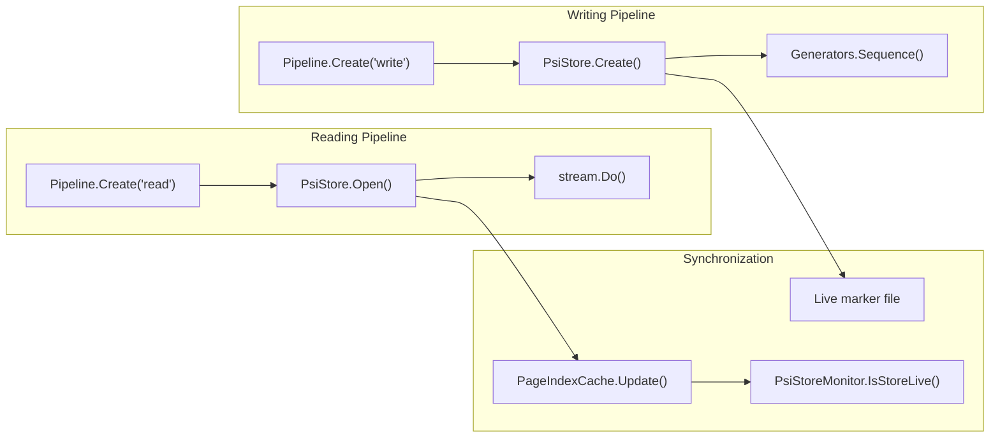
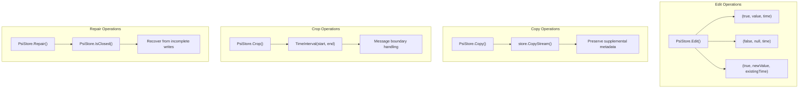

<!-- source: DeepWiki mcp.deepwiki.com · repo microsoft/psi · page 2.2 Data Persistence and Storage · fetched 2026-10-26 -->

# Data Persistence and Storage

Relevant source files

The following files were used as context for generating this wiki page:

- [.github/workflows/msbuild.yml](.github/workflows/msbuild.yml)
- [Sources/Runtime/Microsoft.Psi/Persistence/PageIndexCache.cs](Sources/Runtime/Microsoft.Psi/Persistence/PageIndexCache.cs)
- [Sources/Runtime/Test.Psi/PersistenceTest.cs](Sources/Runtime/Test.Psi/PersistenceTest.cs)

This document covers the PsiStore system, which provides efficient time-series data storage and retrieval capabilities for the Microsoft Psi framework. The PsiStore system handles persisting multimodal streaming data to disk with temporal indexing, enabling efficient replay and analysis of recorded sessions.

For information about the pipeline processing that generates the data being stored, see [Pipeline and Message Processing](#2.1). For details about data serialization formats, see [Serialization System](#2.3).

## Core Architecture

The PsiStore system is built around a multi-layered architecture that provides efficient storage and retrieval of time-ordered streaming data:

**Sources:** [Sources/Runtime/Test.Psi/PersistenceTest.cs:1-50](), [Sources/Runtime/Microsoft.Psi/Persistence/PageIndexCache.cs:1-25]()

## PsiStore Operations

The `PsiStore` class provides the primary interface for data persistence operations. The following diagram shows the key operations and their relationships:

**Sources:** [Sources/Runtime/Test.Psi/PersistenceTest.cs:128-165](), [Sources/Runtime/Test.Psi/PersistenceTest.cs:236-272](), [Sources/Runtime/Test.Psi/PersistenceTest.cs:375-449]()

## File Structure and Storage Format

PsiStore uses a segmented file approach with the `InfiniteFileWriter` and `InfiniteFileReader` classes managing the low-level storage:

| Component | File Pattern | Purpose |
|-----------|--------------|---------|
| Data Extents | `{name}_{000000}.psi` | Segmented data storage with configurable extent size |
| Index Files | `{name}.index.psi` | Temporal index entries for efficient seeking |
| Catalog File | `{name}.catalog.psi` | Stream metadata and store configuration |
| Live Marker | `{name}.Live` | Indicates active writing session |

### Extent Management

The infinite file system automatically manages storage extents:

**Sources:** [Sources/Runtime/Test.Psi/PersistenceTest.cs:38-93](), [Sources/Runtime/Test.Psi/PersistenceTest.cs:97-122]()

## Indexing and Search

The `PageIndexCache` class provides efficient temporal seeking through hierarchical indexing:

**Sources:** [Sources/Runtime/Microsoft.Psi/Persistence/PageIndexCache.cs:33-78](), [Sources/Runtime/Microsoft.Psi/Persistence/PageIndexCache.cs:80-118]()

## Advanced Features

### Real-time Reading During Writing

PsiStore supports concurrent reading while data is being written, enabling live analysis scenarios:

**Sources:** [Sources/Runtime/Test.Psi/PersistenceTest.cs:577-617](), [Sources/Runtime/Microsoft.Psi/Persistence/PageIndexCache.cs:102-106]()

### Large Message Handling

For messages exceeding normal size limits, PsiStore provides specialized large message support:

| Feature | Configuration | Usage |
|---------|---------------|--------|
| Large Messages | `largeMessages: true` | `stream.Write("name", store, largeMessages: true)` |
| Unaligned Blocks | Automatic | Handles non-4KB aligned data efficiently |
| Memory Management | Background disposal | `MemoryMappedView` cleanup on separate thread |

**Sources:** [Sources/Runtime/Test.Psi/PersistenceTest.cs:621-649](), [Sources/Runtime/Test.Psi/PersistenceTest.cs:653-686]()

## Store Management Operations

### Store Editing and Transformation

PsiStore provides several operations for post-processing stored data:

**Sources:** [Sources/Runtime/Test.Psi/PersistenceTest.cs:274-371](), [Sources/Runtime/Test.Psi/PersistenceTest.cs:993-1043](), [Sources/Runtime/Test.Psi/PersistenceTest.cs:1047-1105](), [Sources/Runtime/Test.Psi/PersistenceTest.cs:1109-1226]()

### Metadata Management

Stream metadata provides essential information for data interpretation:

| Metadata Type | Purpose | Access Method |
|---------------|---------|---------------|
| Stream Metadata | Type info, message counts, time ranges | `store.GetMetadata(streamName)` |
| Supplemental Metadata | Custom application data | `store.GetSupplementalMetadata<T>()` |
| Type Registration | Custom serialization handling | `store.Serializers.Register<T>()` |

**Sources:** [Sources/Runtime/Test.Psi/PersistenceTest.cs:839-858](), [Sources/Runtime/Test.Psi/PersistenceTest.cs:862-890](), [Sources/Runtime/Test.Psi/PersistenceTest.cs:920-944]()

---

