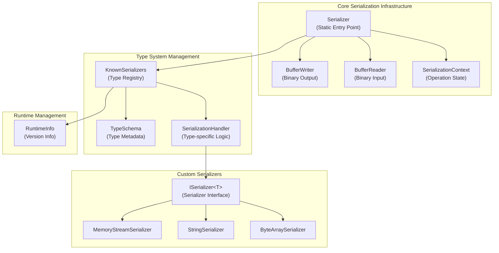
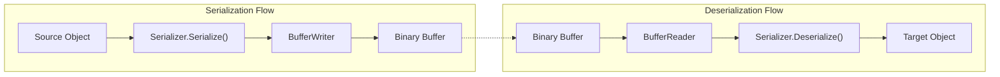
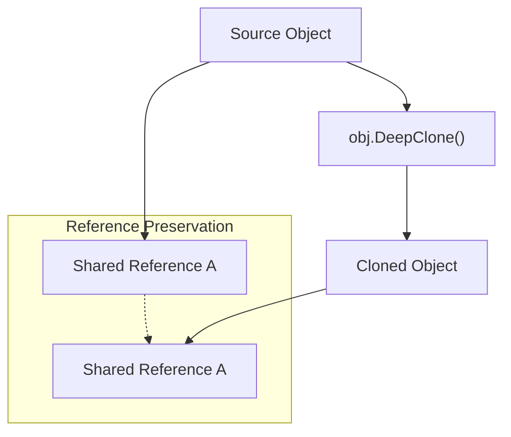
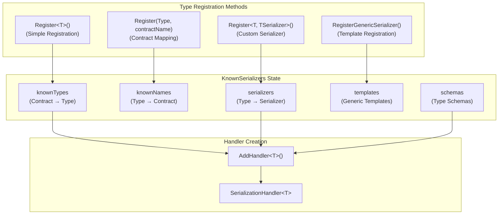
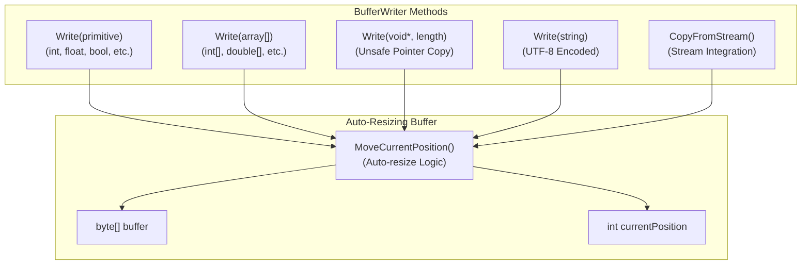
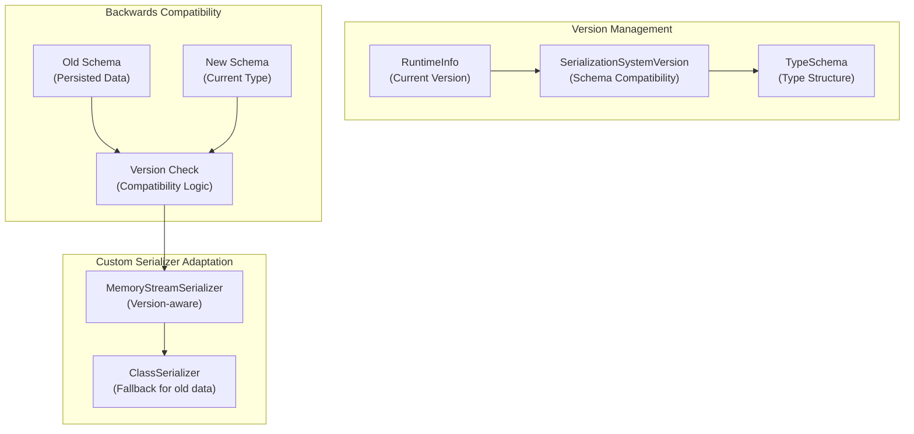

<!-- source: DeepWiki mcp.deepwiki.com · repo microsoft/psi · page 2.3 Serialization System · fetched 2026-10-26 -->

# Serialization System

Relevant source files

The following files were used as context for generating this wiki page:

- [Sources/Imaging/Microsoft.Psi.Imaging/EncodedImage.cs](Sources/Imaging/Microsoft.Psi.Imaging/EncodedImage.cs)
- [Sources/Runtime/Microsoft.Psi/Common/BufferReader.cs](Sources/Runtime/Microsoft.Psi/Common/BufferReader.cs)
- [Sources/Runtime/Microsoft.Psi/Common/BufferWriter.cs](Sources/Runtime/Microsoft.Psi/Common/BufferWriter.cs)
- [Sources/Runtime/Microsoft.Psi/Common/RuntimeInfo.cs](Sources/Runtime/Microsoft.Psi/Common/RuntimeInfo.cs)
- [Sources/Runtime/Microsoft.Psi/Serialization/KnownSerializers.cs](Sources/Runtime/Microsoft.Psi/Serialization/KnownSerializers.cs)
- [Sources/Runtime/Microsoft.Psi/Serialization/MemoryStreamSerializer.cs](Sources/Runtime/Microsoft.Psi/Serialization/MemoryStreamSerializer.cs)
- [Sources/Runtime/Test.Psi/MemoryStreamTester.cs](Sources/Runtime/Test.Psi/MemoryStreamTester.cs)
- [Sources/Runtime/Test.Psi/SerializationTester.cs](Sources/Runtime/Test.Psi/SerializationTester.cs)

The Psi Serialization System provides cross-platform data marshaling capabilities for efficient serialization, deserialization, and deep cloning of objects within the Psi framework. This system enables data persistence to stores, message passing between pipeline components, and cross-platform compatibility. The serialization system supports both built-in .NET types and custom user-defined types through automatic code generation and custom serializer registration.

For information about data persistence to disk, see [Data Persistence and Storage](#2.2). For stream processing operations that utilize serialization, see [Stream Processing Operators](#2.4).

## Core Architecture

The serialization system is built around a set of core components that work together to provide efficient binary serialization with support for polymorphic types, reference preservation, and schema evolution.

Sources: [Sources/Runtime/Microsoft.Psi/Serialization/KnownSerializers.cs:1-200](), [Sources/Runtime/Microsoft.Psi/Common/BufferWriter.cs:1-50](), [Sources/Runtime/Microsoft.Psi/Common/BufferReader.cs:1-50](), [Sources/Runtime/Microsoft.Psi/Common/RuntimeInfo.cs:1-56]()

## Primary Operations

The serialization system provides three primary operations for working with objects: serialization/deserialization, deep cloning, and resource clearing.

### Serialization and Deserialization

Serialization converts objects to binary format using `BufferWriter`, while deserialization reconstructs objects from binary data using `BufferReader`.

Sources: [Sources/Runtime/Test.Psi/SerializationTester.cs:47-56](), [Sources/Runtime/Microsoft.Psi/Common/BufferWriter.cs:84-94](), [Sources/Runtime/Microsoft.Psi/Common/BufferReader.cs:122-132]()

### Deep Cloning

Deep cloning creates independent copies of objects, preserving reference relationships while ensuring no shared state between source and target.

Sources: [Sources/Runtime/Test.Psi/SerializationTester.cs:122-133](), [Sources/Runtime/Test.Psi/SerializationTester.cs:234-240]()

### Resource Clearing

The clear operation releases resources held by objects, particularly important for `Shared<T>` objects that manage unmanaged resources.

Sources: [Sources/Runtime/Test.Psi/SerializationTester.cs:731-782]()

## Type Registration and Schema Management

The `KnownSerializers` class manages the mapping between .NET types and their corresponding serializers, supporting both automatic code generation and explicit registration of custom serializers.

Sources: [Sources/Runtime/Microsoft.Psi/Serialization/KnownSerializers.cs:206-298](), [Sources/Runtime/Microsoft.Psi/Serialization/KnownSerializers.cs:467-543]()

## Built-in Serializers

The system includes several optimized serializers for common .NET types, each implementing the `ISerializer<T>` interface.

| Type | Serializer Class | Special Features |
|------|-----------------|------------------|
| `string` | `StringSerializer` | UTF-8 encoding, null handling |
| `byte[]` | `ByteArraySerializer` | Direct binary copy |
| `BufferReader` | `BufferSerializer` | Shared buffer optimization |
| `string[]` | `StringArraySerializer` | Array-specific optimization |
| `MemoryStream` | `MemoryStreamSerializer` | Version compatibility, capacity management |
| `IEnumerable<T>` | `EnumerableSerializer<T>` | Generic collection support |
| `Dictionary<K,V>` | `DictionarySerializer<K,V>` | Key-value pair optimization |

Sources: [Sources/Runtime/Microsoft.Psi/Serialization/KnownSerializers.cs:176-184](), [Sources/Runtime/Microsoft.Psi/Serialization/MemoryStreamSerializer.cs:13-96]()

## Binary Format and BufferWriter/BufferReader

The serialization system uses a custom binary format optimized for performance, implemented through `BufferWriter` and `BufferReader` classes that provide type-safe binary I/O operations.

### BufferWriter Capabilities

Sources: [Sources/Runtime/Microsoft.Psi/Common/BufferWriter.cs:84-94](), [Sources/Runtime/Microsoft.Psi/Common/BufferWriter.cs:304-434](), [Sources/Runtime/Microsoft.Psi/Common/BufferWriter.cs:527-547]()

### BufferReader Capabilities

The `BufferReader` provides corresponding read operations with the same type safety and performance characteristics.

Sources: [Sources/Runtime/Microsoft.Psi/Common/BufferReader.cs:122-132](), [Sources/Runtime/Microsoft.Psi/Common/BufferReader.cs:274-513]()

## Schema Evolution and Versioning

The serialization system supports schema evolution through version management and backwards compatibility mechanisms.

Sources: [Sources/Runtime/Microsoft.Psi/Common/RuntimeInfo.cs:15-35](), [Sources/Runtime/Microsoft.Psi/Serialization/MemoryStreamSerializer.cs:21-35]()

## Testing and Validation

The serialization system includes comprehensive testing infrastructure that validates correctness across different scenarios.

### Test Coverage Areas

| Test Category | Purpose | Example Tests |
|---------------|---------|---------------|
| Simple Types | Basic primitive serialization | `int`, `string`, `double`, `DateTime` |
| Complex Types | Class and struct serialization | Custom classes with nested fields |
| Collections | Array and enumerable handling | `int[]`, `List<T>`, `Dictionary<K,V>` |
| Polymorphic Types | Runtime type resolution | Interface implementations |
| Reference Preservation | Shared object maintenance | Multiple references to same object |
| Performance | Serialization speed benchmarks | Clone operations per second |

Sources: [Sources/Runtime/Test.Psi/SerializationTester.cs:25-56](), [Sources/Runtime/Test.Psi/SerializationTester.cs:574-641](), [Sources/Runtime/Test.Psi/SerializationTester.cs:688-727]()

## Integration Points

The serialization system integrates with several other Psi framework components:

- **Pipeline Message Processing**: Automatic serialization for message delivery between components
- **PsiStore**: Persistent storage of serialized stream data  
- **Cross-platform Communication**: Binary format exchange between different runtime environments
- **Shared Resources**: Proper lifecycle management for `Shared<T>` objects

Sources: [Sources/Runtime/Test.Psi/SerializationTester.cs:62-85](), [Sources/Runtime/Test.Psi/SerializationTester.cs:733-782]()

---

