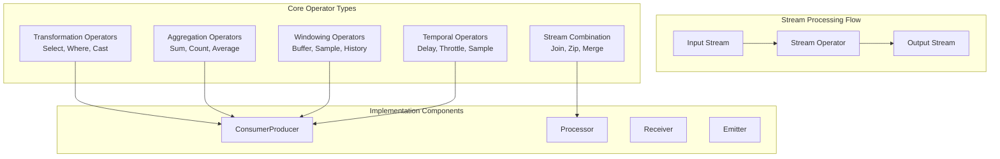
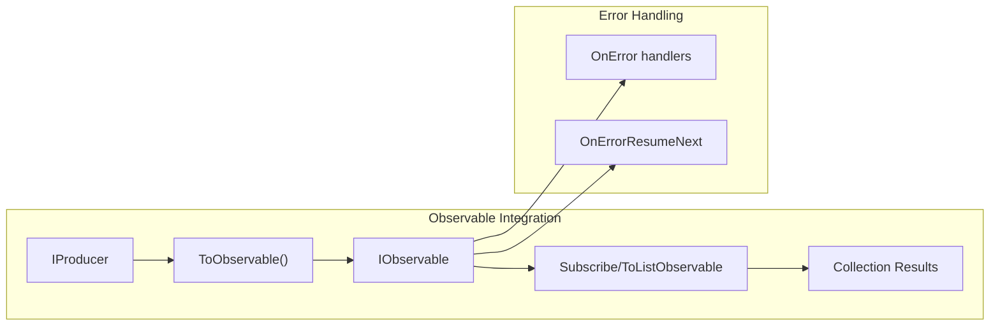
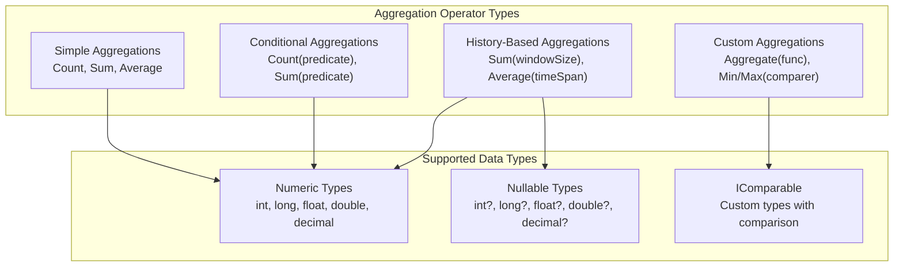
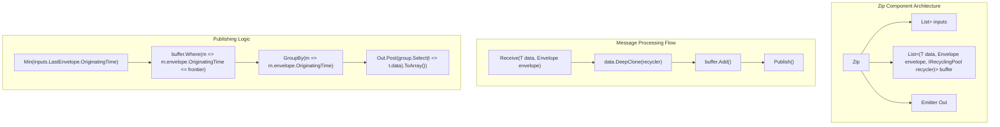
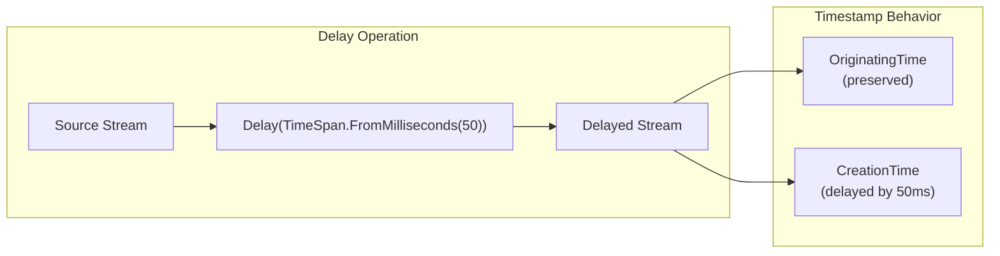

<!-- source: DeepWiki mcp.deepwiki.com · repo microsoft/psi · page 2.4 Stream Processing Operators · fetched 2026-10-26 -->

# Stream Processing Operators

<details>
<summary>Relevant source files</summary>

The following files were used as context for generating this wiki page:

- [Sources/Runtime/Microsoft.Psi/Components/RelativeTimeWindow.cs](Sources/Runtime/Microsoft.Psi/Components/RelativeTimeWindow.cs)
- [Sources/Runtime/Microsoft.Psi/Components/Zip.cs](Sources/Runtime/Microsoft.Psi/Components/Zip.cs)
- [Sources/Runtime/Microsoft.Psi/Operators/Enumerable.cs](Sources/Runtime/Microsoft.Psi/Operators/Enumerable.cs)
- [Sources/Runtime/Test.Psi/OperatorTests.cs](Sources/Runtime/Test.Psi/OperatorTests.cs)

</details>


Stream processing operators in Microsoft Psi provide composable transformation and analysis capabilities for real-time data streams. This document covers the available operators for filtering, transforming, aggregating, and combining streams within the Psi pipeline execution model.

For information about the underlying pipeline architecture and message processing, see [Pipeline and Message Processing](#2.1). For data serialization mechanisms used by operators, see [Serialization System](#2.3).

## Operator Architecture Overview

Stream operators in Psi are implemented as components that consume input streams and produce output streams, operating within the pipeline's message delivery framework.



Sources: [Sources/Runtime/Microsoft.Psi/Components/RelativeTimeWindow.cs:15-16](), [Sources/Runtime/Microsoft.Psi/Components/Zip.cs:16]()

## Basic Transformation Operators

### Selection and Filtering

The framework provides standard functional operators for stream transformation:

| Operator | Purpose | Implementation |
|----------|---------|----------------|
| `Select` | Transform each message | Maps `T` to `U` using provided function |
| `Where` | Filter messages | Includes only messages matching predicate |
| `Cast` | Type conversion | Safely converts between compatible types |

### Observable Integration

Psi streams can be converted to and from Reactive Extensions `IObservable<T>` for integration with external systems.



Sources: [Sources/Runtime/Test.Psi/OperatorTests.cs:125-193](), [Sources/Runtime/Microsoft.Psi/Operators/Enumerable.cs:19-31]()

## Aggregation Operators

### Statistical Aggregations

Psi provides real-time aggregation operators that compute running statistics over stream data:

| Operator | Data Types | Functionality |
|----------|------------|---------------|
| `Count()` | All types | Running count of messages |
| `LongCount()` | All types | Running count as `long` |
| `Sum()` | Numeric types | Running sum calculation |
| `Average()` | Numeric types | Running average calculation |
| `Min()` | Comparable types | Running minimum value |
| `Max()` | Comparable types | Running maximum value |



Sources: [Sources/Runtime/Test.Psi/OperatorTests.cs:197-258](), [Sources/Runtime/Test.Psi/OperatorTests.cs:262-320](), [Sources/Runtime/Test.Psi/OperatorTests.cs:679-691]()

### Conditional Aggregations

Aggregation operators support predicate-based filtering:

```csharp
// Example usage patterns from tests
range.Count(x => x % 2 == 0)        // Count even numbers
range.Sum(x => x > threshold)       // Sum values above threshold
range.Average(i => i % 2 == 0)      // Average of even numbers
```

Sources: [Sources/Runtime/Test.Psi/OperatorTests.cs:203](), [Sources/Runtime/Test.Psi/OperatorTests.cs:298]()

## Windowing Operators

### History-Based Windows

Psi provides windowing operators that maintain historical data for analysis:

| Window Type | Parameters | Behavior |
|-------------|------------|----------|
| Count-based | `size: int` | Maintains last N messages |
| Time-based | `timeSpan: TimeSpan` | Maintains messages within time window |
| Relative time | `RelativeTimeInterval` | Window relative to anchor message |

```mermaid
graph TB
    subgraph "Windowing Implementation"
        RelativeTimeWindow["RelativeTimeWindow<TInput,TOutput>"]
        Buffer["Queue<Message<TInput>> buffer"]
        Selector["Func<IEnumerable<Message<TInput>>, TOutput>"]
        
        RelativeTimeWindow --> Buffer
        RelativeTimeWindow --> Selector
    end
    
    subgraph "Window Processing"
        AnchorMessage["Anchor Message"]
        TimeInterval["Time Interval Calculation"]
        MessageSelection["Message Selection"]
        OutputGeneration["Output Generation"]
        
        AnchorMessage --> TimeInterval
        TimeInterval --> MessageSelection
        MessageSelection --> OutputGeneration
    end
    
    subgraph "Buffer Management"
        EnqueueMessage["Enqueue New Message"]
        ProcessRemoval["Process Removal"]
        DequeueOld["Dequeue Old Messages"]
        
        EnqueueMessage --> ProcessRemoval
        ProcessRemoval --> DequeueOld
    end
```



Sources: [Sources/Runtime/Microsoft.Psi/Components/RelativeTimeWindow.cs:15-35](), [Sources/Runtime/Microsoft.Psi/Components/RelativeTimeWindow.cs:41-46]()

### Relative Time Windows

The `RelativeTimeWindow<TInput, TOutput>` component implements sophisticated time-based windowing:

```csharp
// Key implementation details
private readonly RelativeTimeInterval relativeTimeInterval;
private readonly Func<IEnumerable<Message<TInput>>, TOutput> selector;
private readonly Queue<Message<TInput>> buffer = new Queue<Message<TInput>>();
```

The component maintains an anchor message and processes windows relative to that anchor's originating time.

Sources: [Sources/Runtime/Microsoft.Psi/Components/RelativeTimeWindow.cs:18-20](), [Sources/Runtime/Microsoft.Psi/Components/RelativeTimeWindow.cs:48-51]()

## Stream Combination Operators

### Zip Operator

The `Zip<T>` component combines multiple streams while preserving temporal ordering:



Sources: [Sources/Runtime/Microsoft.Psi/Components/Zip.cs:16-33](), [Sources/Runtime/Microsoft.Psi/Components/Zip.cs:67-72](), [Sources/Runtime/Microsoft.Psi/Components/Zip.cs:74-96]()

### Pairing and Repeat Operations

The framework supports stream pairing with configurable initial values and repetition behavior:

```csharp
// Test examples showing pairing patterns
var output = clock.Pair(input, -1).Item2()  // With initial value
var output = clock.Pair(input).Item2()      // Without initial value
```

Sources: [Sources/Runtime/Test.Psi/OperatorTests.cs:57-94]()

## Temporal Operators

### Delay Operator

The delay operator shifts messages in time while preserving originating timestamps:



Sources: [Sources/Runtime/Test.Psi/OperatorTests.cs:23-53]()

### Event Source Integration

The `EventSource<THandler, TOut>` component bridges external events into Psi streams:

```csharp
var eventSource = new EventSource<EventHandler<int>, double>(
    pipeline,
    handler => this.EventSourceTestEvent += handler,    // Subscribe
    handler => this.EventSourceTestEvent -= handler,    // Unsubscribe  
    post => new EventHandler<int>((sender, e) => post(e / 10.0)));  // Transform
```

Sources: [Sources/Runtime/Test.Psi/OperatorTests.cs:104-108]()

## Stream Enumeration

### IEnumerable Integration

```mermaid
graph TB
    subgraph "Stream Enumeration Architecture"
        StreamEnumerable["StreamEnumerable<T>"]
        StreamEnumerator["StreamEnumerator"]
        ConcurrentQueue["ConcurrentQueue<T>"]
        ManualResetEvents["ManualResetEvent<br/>Enqueued, Closed"]
        
        StreamEnumerable --> StreamEnumerator
        StreamEnumerator --> ConcurrentQueue
        StreamEnumerator --> ManualResetEvents
    end
    
    subgraph "Processing Flow"
        Processor["Processor<T,T>"]
        DeepClone["d.DeepClone()"]
        QueueEnqueue["Queue.Enqueue()"]
        SetEvent["Enqueued.Set()"]
        
        Processor --> DeepClone
        DeepClone --> QueueEnqueue
        QueueEnqueue --> SetEvent
    end
    
    subgraph "Enumeration Control"
        MoveNext["MoveNext()"]
        TryDequeue["Queue.TryDequeue()"]
        WaitHandle["WaitHandle.WaitAny()"]
        PredicateCheck["predicate(current)"]
        
        MoveNext --> TryDequeue
        TryDequeue --> WaitHandle
        WaitHandle --> PredicateCheck
    end
```

The `ToEnumerable<T>` operator converts Psi streams to standard .NET enumerables:



Sources: [Sources/Runtime/Microsoft.Psi/Operators/Enumerable.cs:37-63](), [Sources/Runtime/Microsoft.Psi/Operators/Enumerable.cs:83-136]()

## Advanced Operators

### Custom Aggregation

The `Aggregate` operator enables custom reduction operations:

```csharp
// Factorial calculation example from tests
var factorials = Generators.Range(pipeline, 1, 7, TimeSpan.FromTicks(1))
    .Aggregate((x, y) => x * y);
```

Sources: [Sources/Runtime/Test.Psi/OperatorTests.cs:666-667]()

### Min/Max with Custom Comparers

Min and Max operators support custom comparison logic:

```csharp
var reverseComparer = new CompareIntsReversed();
var min = seq.Min(reverseComparer);
var max = seq.Max(reverseComparer);
```

Sources: [Sources/Runtime/Test.Psi/OperatorTests.cs:697-702]()

---

